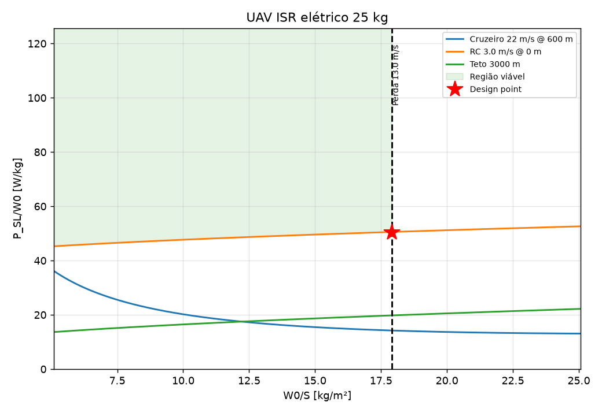

# acdt — Aircraft (and beyond) Conceptual-to-Detailed Design Toolkit

**PT** · Framework open-source (Apache-2.0, ver `LICENSE`) para projeto de engenharia, do requisito ao projeto
detalhado. A aeronave (asa fixa, incluindo UAS) é o primeiro domínio. A arquitetura separa um
**núcleo agnóstico de domínio** (requisitos, pipeline, estado de projeto, sistemas elétricos e
cablagem, normas, MDO, wrappers CFD/FEM) dos **plugins de domínio**. Só usamos métodos clássicos e
rastreáveis (Raymer, Roskam, Gudmundsson, DATCOM, Anderson, Torenbeek, Nicolai, Megson), citados no
código. Quando há ferramentas open-source credíveis, usamo-las através de *wrappers* (AeroSandbox,
NeuralFoil, AVL, OpenMDAO, SU2, CalculiX, WireViz…).

**O que o acdt faz hoje, área a área** (métodos, fidelidade, comandos, limites, roadmap e sugestões):
[CAPABILITIES.md](CAPABILITIES.md) — também servido como recurso MCP `acdt://capabilities`.

## Estado

| fase | conteúdo | estado |
|---|---|---|
| 1 — Conceptual | requisitos abertos, W0 (Raymer/Breguet/elétrico) com **peso vazio estimado por componentes e iterado** (Raymer Cap. 15; estatística só como valor inicial e cross-check), diagrama de restrições com design point automático, geometria, sustentação DATCOM, arrasto por build-up, polar, custo, relatório | ✅ |
| 1E — Sistemas | hélice, motor/ESC, bateria, servos, autopiloto, power budget, cablagem (bitola, WireViz/DOT/CSV), massa/CG, checklist de normas | ✅ |
| 2 — Baixa fidelidade | AVL (VLM) + XFOIL/NeuralFoil dentro do ciclo (CD0, e, clmax); V-n CS-23 / STANAG 4671 com n_lim realimentado nos pesos; Schrenk/AVL → V, M, T → viga-caixão (Megson/Bruhn) como cross-check da asa de Raymer; ponto neutro, margem estática, envelope de CG, volumes de cauda, derivadas de controlo (manual vs AVL); missão por segmentos, payload–range, subida/teto, pistas (Raymer Cap. 17, Anderson) | ✅ (ver `docs/tutorial-fase2.md`) |
| 3 — MDA/MDO | OpenMDAO (MDF, NLBGS/Newton, SLSQP) com gestão de modelos por região de confiança sobre o pipeline completo (`acdt optimize`, objetivo do registo de requisitos); OpenAeroStruct estático (VLM + caixão); divergência, inversão, flutter binário, AEER-45; Kuhn, crippling de Needham e caixão por encurvadura; scissor plot, modos dinâmicos e MIL-F-8785C | ✅ (ver `docs/tutorial-fase3.md`) |
| 4 — Alta fidelidade (verificação) | `acdt hifi`: geometria OpenVSP (STEP/STL, render 3-D); SU2 RANS-SA 2-D com GCI (Celik); CalculiX casca do caixão (tensão, encurvadura, modos); flutter modos + DLM p-k e deck Nastran SOL 145; Roskam Classe II; nervuras, ligação da raiz, superfícies de comando; netlist KiCad; restrições HQ/aeroelásticas no MDO (opção); fatores de calibração L3 → L1/L2 rastreados e opcionais | ✅ (ver `docs/tutorial-fase4.md`); CFD 3-D grande preparado para máquina mais potente; OpenFOAM e C_h DATCOM: stubs |
| 5 — Estrutura interna da asa | `acdt wingbox`: secção real (Megson) no eixo elástico; FEM de cascas próprio (QM6+MITC4) verificado contra soluções analíticas e CalculiX; otimização longarinas / t/c / curvatura / torção / nervuras com NeuralFoil + linha sustentadora com torção elástica, restrições aeroelásticas, C_Lmax e combustível; render 3-D da estrutura | ✅ (ver `docs/tutorial-fase5.md`); SIMP das nervuras pendente |
| 6 — RCS e estrutura à encurvadura | `acdt rcs`: Óptica Física (PEC, Gordon, 2 ressaltos) validada contra casos canónicos e otimização aero/RCS com frente de Pareto; biblioteca de materiais isotrópicos (compósito como isotrópico equivalente); secções I/C/Z/T/L/hat/tubos; `acdt wingbox6`: caixão com reforçadores ou sanduíche dimensionado à encurvadura, banzos pela secção, nervuras dimensionadas, nº de reforçadores e tipo de longarina como variáveis, viga calibrada pelo FEM de cascas no ciclo; C172 de asa alta | ✅ (ver `docs/tutorial-fase6.md`); SIMP das nervuras só como demo; RCS de onda completa pendente |
| 7 — Fabrico e custo | `acdt manufacture`: decomposição em peças; processo e material por peça (viabilidade, FOPV/ACCEM, buy-to-fly, rebites, ferramental, aprendizagem); custo bottom-up vs Eastlake e DAPCA IV; **escada de fidelidade do custo L0 (CERs, assinaladas fora da base para configurações não convencionais) → L1 (bottom-up paramétrico) → L2 (bottom-up detalhado: peças, BOM, cotações)** com confiança, bandas AACE 18R-97 e calibração do nível superior para o inferior; Pareto W0–custo; validação C172S | ✅ (ver `docs/tutorial-fase7-fabrico-custo.md`); Roskam VIII e exemplo L2 real pendentes |
| 8 — Superfícies de comando e simulador 6-DOF | `acdt controls` / `acdt simulate`: ailerons (MIL-F-8785C, CS 23.157), profundor (rotação, compensação), leme (vento cruzado, OEI), flaps, momentos de charneira (AVL); 6-DOF próprio com tabelas AVL, piloto automático Beard & McLain, Dryden e rajadas, missão YAML, k_energia vs quase-estacionário; verificação cruzada com o JSBSim (processo separado); validação C172S (POH) | ✅ (ver `docs/tutorial-fase8-simulador.md`); C_h DATCOM, inércias e hélice por calibrar |
| 9 — Hélice, inércias e flaps de camber | `acdt flap-options`: BEMT de passo fixo, inércias Roskam V, flaps de camber/flaperon como opção comparada com flap simples | ✅ (ver `docs/tutorial-fase9-camber-flaps.md`) |
| 10 — Certificação e segurança | `acdt certify` / `acdt safety`: base (CS-23 nível/classe, CS-25, STANAG 4671/4703, SORA 2.5), matriz de conformidade (paráfrase + fonte oficial, MoC, evidência, estado; CSV/XLSX/MD), FHA/FTA/FMEA (ARP4761 baixa fidelidade, taxas com fonte, MTBF requerido), estudo de redundância com ΔW0 | ✅ (ver `docs/tutorial-fase10-certificacao-seguranca.md`); contenção SORA e taxas C2 em aberto |
| peso e centragem / trem | dentro de `acdt size`: diagrama de carregamento, limites dianteiro e traseiro, posição do trem, tombo, capotagem e curso de aterragem; as verificações `wb:` e `gear:` não mudam a viabilidade da Fase 1 | ✅ (ver `docs/tutorial-wb-trem.md`); sem spin-up, carga lateral nem travões |
| AI — camada AI-native | servidor MCP (`acdt mcp`): 43 ferramentas (incl. estudo conceptual de missão e frota), recursos (métodos citados, materiais, componentes, normas, docs, runs) e prompts; registo de runs com proveniência; dados externos validados (fonte, data, unidades, plausibilidade); guarda de computação; trabalhos assíncronos | ✅ (ver secção "Usar com um agente de IA") |

## Início rápido

> Windows + Cursor/Grok Build: ver [docs/DEV-SETUP-WINDOWS.md](docs/DEV-SETUP-WINDOWS.md); estado e próximos passos em [docs/HANDOFF.md](docs/HANDOFF.md).

```bash
pip install -e ".[dev]"                 # extras opcionais: aero, mdo, structures, hifi
# Fase 2 (opcional): avl e xfoil no PATH (ver docs/ARCHITECTURE.md §8); senão NeuralFoil + Schrenk
pytest -q
acdt requirements                       # tipos de requisito disponíveis
acdt size examples/uav_endurance_payload.yaml -o out/uav
acdt optimize examples/uav_endurance_payload.yaml -o out/uav_mdo   # Fase 3, extra [mdo]
acdt hifi examples/uav_endurance_payload.yaml -o out/uav_hifi     # Fase 4, extra [hifi] + SU2/CalculiX/Gmsh/OpenVSP
acdt wingbox6 examples/cessna172_check.yaml -o out/c172_wb6       # Fase 6, extra [wingbox]
acdt rcs study examples/uav_endurance_payload.yaml -o out/uav_rcs # Fase 6, Pareto aero/RCS
acdt manufacture examples/manufacturing/cessna172_manufacturing.yaml --pareto   # Fase 7, fabrico e custo
acdt simulate examples/cessna172_check.yaml examples/simulation/c172_check.yaml --jsbsim   # Fase 8, simulador 6-DOF
acdt simulate examples/simulation/n0_patrol.yaml --fidelity pointmass   # P3, massa pontual N0
acdt flap-options examples/uav_loiter_dash_camber.yaml          # Fase 9, flaps de camber como opção
acdt certify examples/cessna172_check.yaml -o out/c172          # Fase 10, base, matriz de conformidade, FHA/FTA/FMEA, SORA
acdt safety uas --scheme stanag4671 --mtow 153 --trade          # Fase 10, avaliação rápida sem dimensionamento
```

Exemplos em `examples/`:

* UAV elétrico de ~25 kg (endurance + payload);
* UAV a gasolina de ~150 kg (endurance + payload + pista);
* GA de 2 lugares (alcance + velocidade);
* treinador (manobra + custo);
* caso sobre-restringido (inviável);
* verificação com o Cessna 172S (W0 e peso vazio dentro de ±15 %).

Resultados em `examples/output/`.



## Usar com um agente de IA (MCP)

O acdt é *AI-native*: o utilizador descreve o que quer e o agente (Cursor, Claude, Grok Build, …) usa as
ferramentas do acdt pelo servidor MCP para chegar ao projeto. Regras para o agente: [AGENTS.md](AGENTS.md) e
[docs/ai-agent-guide.md](docs/ai-agent-guide.md) (servidos também como recurso `acdt://agents-guide`).

```bash
pip install -e ".[ai,mdo,hifi,wingbox]"   # o extra [ai] instala o SDK MCP oficial
acdt mcp                                  # stdio (o que os clientes lançam)
acdt mcp --http --port 8765               # HTTP streamable em http://127.0.0.1:8765/mcp
python examples/ai_session/session.py     # sessão de demonstração (pedido → dimensionado + MDO + dossier)
```

* **Ferramentas (30):** `requirements_schema`, `validate_requirements`, `size` (L0/L1), `systems`, `optimize`,
  `wingbox` (fase 5/6), `rcs`, `hifi_estimate`, `hifi` (guarda de computação), `job_status`, `list_jobs`,
  `validate_material`, `validate_component`, `list_examples`, `get_run`, `list_runs`, `compare_runs`,
  `get_calibration`, `apply_calibration`, `generate_report`, `get_reference`, `manufacturing_plan`,
  `cost_estimate`, `process_options`, `compare_materials`, `size_control_surfaces`, `simulate_mission`, `flap_options`, `certify`, `safety_assessment`.
* **Recursos:** `acdt://capabilities` (o que a ferramenta faz, [CAPABILITIES.md](CAPABILITIES.md)),
  `acdt://methods` (métodos e referências), `acdt://materials`, `acdt://components`,
  `acdt://standards`, `acdt://agents-guide`, `acdt://docs/{name}`, `acdt://runs/{run_id}`.
* **Prompts:** `design_from_requirements`, `research_component`, `hifi_verification`.
* Cada chamada cria um run com proveniência em `runs/` (`ACDT_RUNS_DIR`): entradas, pressupostos com origem,
  dados externos com fonte e data, calibração, versões e commit git. Corridas longas devolvem `job_id`.
* Passos pesados de alta fidelidade (`cfd2d`, `gci`, `wing_euler`) só correm com autorização explícita do
  utilizador (`user_approved`); `ACDT_MCP_HEAVY=never` recusa-os sempre.

**Windows** — `.cursor\mcp.json` (Cursor), `.mcp.json` (Claude Code) ou `claude_desktop_config.json`
(Claude Desktop); o Grok Build também lê `.cursor/mcp.json` e `.mcp.json`:

```json
{
  "mcpServers": {
    "acdt": {
      "command": "C:\\caminho\\aircraft-design-tools\\.venv\\Scripts\\python.exe",
      "args": ["-m", "acdt.cli", "mcp"],
      "cwd": "C:\\caminho\\aircraft-design-tools",
      "env": {
        "ACDT_RUNS_DIR": "C:\\caminho\\aircraft-design-tools\\runs",
        "ACDT_MCP_HEAVY": "approval"
      }
    }
  }
}
```

Para o AVL/XFOIL (L1) e SU2/CalculiX/Gmsh (alta fidelidade) acrescente as pastas dos executáveis a `PATH`
(ou `ACDT_HIFI_BIN`) no bloco `env`.

**Linux / macOS:**

```json
{
  "mcpServers": {
    "acdt": {
      "command": "/caminho/aircraft-design-tools/.venv/bin/python",
      "args": ["-m", "acdt.cli", "mcp"],
      "cwd": "/caminho/aircraft-design-tools",
      "env": { "ACDT_RUNS_DIR": "/caminho/aircraft-design-tools/runs" }
    }
  }
}
```

**Grok Build** (nativo, `~/.grok/config.toml` ou `.grok/config.toml` no repositório; ou
`grok mcp add acdt -- python -m acdt.cli mcp`, depois `grok mcp doctor acdt`):

```toml
[mcp_servers.acdt]
command = "/caminho/aircraft-design-tools/.venv/bin/python"
args = ["-m", "acdt.cli", "mcp"]
env = { ACDT_RUNS_DIR = "/caminho/aircraft-design-tools/runs" }
```

**HTTP** (servidor partilhado numa máquina, p. ex. a mais potente): `acdt mcp --http --host 127.0.0.1 --port 8765`
e no cliente `{"mcpServers": {"acdt": {"url": "http://127.0.0.1:8765/mcp"}}}`. O servidor HTTP não tem
autenticação: mantê-lo em `127.0.0.1` ou atrás de um túnel/VPN.

Documentação:

* [Guia para agentes de IA](docs/ai-agent-guide.md) · [AGENTS.md](AGENTS.md)
* [Arquitetura](docs/ARCHITECTURE.md)
* [Tutorial da Fase 1](docs/tutorial-fase1.md)
* [Tutorial da Fase 2](docs/tutorial-fase2.md)
* [Tutorial da Fase 3](docs/tutorial-fase3.md)
* [Tutorial da Fase 4](docs/tutorial-fase4.md)
* [Tutorial da Fase 5](docs/tutorial-fase5.md)
* [Tutorial da Fase 6](docs/tutorial-fase6.md)
* [Tutorial da Fase 7 — fabrico e custo](docs/tutorial-fase7-fabrico-custo.md)
* [Tutorial da Fase 8 — superfícies de comando e simulador 6-DOF](docs/tutorial-fase8-simulador.md)
* [Tutorial da Fase 9 — hélice de passo fixo, inércias e flaps de camber como opção](docs/tutorial-fase9-camber-flaps.md)
* [Tutorial — peso e centragem operacional e trem](docs/tutorial-wb-trem.md)
* [Software de terceiros e licenças](THIRD_PARTY.md)

> Ferramenta de apoio ao projeto conceptual. Os resultados **não** substituem a análise de
> engenharia nem a certificação.

---

## English summary

**acdt** is a proprietary engineering design framework (see `LICENSE`). Aircraft is its first domain.

* A **domain-agnostic core** (`acdt.core`) provides:
  * units, ISA, and an open **requirements registry** (any subset, each with units and a
    min/max/target/objective sense, with consistency validation);
  * a pipeline orchestrator and design state;
  * component selection, electrical power budget and wire harness (gauge by ampacity and voltage
    drop; WireViz/DOT/CSV export);
  * mass/CG, standards checklists, and MDO and CFD/FEM tool hooks.
* **Domain plugins** (`acdt.domains.aircraft`) register their own requirement types, classical
  methods and stages.
* Phase 1 (conceptual sizing) and Phase 1E (systems) are implemented and tested:
  * Raymer weight sizing with Breguet and electric (Hepperle) missions; the empty weight is
    **estimated by components** (Raymer Ch. 15 GA equations + Phase-1E system masses, sized
    harness, listed items) and iterated with geometry until convergence, starting from a cited
    statistical We/W0 (Raymer Table 3.1, Nicolai & Carichner Table 5.1, or the designer's own
    statistics) and cross-checked against it in the report;
  * Gudmundsson/Raymer constraint diagram with automatic design point;
  * DATCOM lift and Raymer component drag build-up;
  * cost (Eastlake).
* Phase 2 (low fidelity) is implemented and tested:
  * AVL 3.40 (VLM) and XFOIL 6.99 / NeuralFoil section polars run inside the sizing loop
    (`assumptions.aero.fidelity: lowfi`) and replace the handbook wing drag and Oswald factor;
  * V-n diagram per CS-23 / STANAG 4671 (manoeuvre + Pratt gust); n_limit feeds the weight
    equations; Schrenk or AVL span loads give shear, bending and torsion, and a two-spar wing box
    (Megson/Bruhn) is sized as a cross-check of Raymer's wing weight;
  * neutral point (handbook and AVL), static margin over the CG envelope from the weight
    breakdown, tail volumes, control derivatives and trim;
  * segment mission (take-off, climb, cruise, loiter, descent, landing), range/endurance,
    payload-range, climb/ceilings, field lengths (Raymer Ch. 17, Anderson), checked against the
    requirements (`verified`).
* A Cessna 172S check (W0 and empty weight within ±15 %) is part of the tests.
* Higher-fidelity phases follow a gated fidelity ladder:
  * handbook methods first;
  * then AVL/XFOIL, parametric structures, stability and performance (Phase 2, done);
  * Phase 3 (done): OpenMDAO MDO (MDF, trust-region model management with the full pipeline as
    high-fidelity model, `acdt optimize`), static aero-structural coupling (OpenAeroStruct),
    classical aeroelastic checks (divergence, reversal, binary flutter, AEER-45), Kuhn/crippling/
    buckling-sized wing box, scissor plot, dynamic modes and MIL-F-8785C handling qualities;
  * Phase 4 (done, `acdt hifi`): OpenVSP geometry, SU2 2-D RANS with grid-convergence study,
    CalculiX shell FEM of the wing box, FE modes + doublet-lattice p-k flutter and a Nastran
    SOL 145 deck, Roskam Class II cross-check, ribs/root joint/control surfaces, KiCad netlist,
    and traced, opt-in L3 → L1/L2 calibration factors. High fidelity verifies; it does not size.
    Large 3-D CFD cases are set up and listed for a bigger machine.
  * Phase 5 (done, `acdt wingbox`): real thin-walled section, in-house shell FEM, wing-box/airfoil/twist
    optimisation with aeroelastic constraints.
  * Phase 6 (done): Physical Optics RCS with canonical validation and aero/RCS Pareto optimisation
    (`acdt rcs`); isotropic material library (composites as CLT-equivalent isotropic); parametric
    thin-walled sections; buckling-sized stiffened/sandwich wing box with section-based spar caps,
    sized ribs and the beam calibrated against the shell FEM inside the loop (`acdt wingbox6`).
* **Phase 7 (done, `acdt manufacture`): manufacturing and cost.**
  * Per-part process models: feasibility, FOPV/ACCEM hours, buy-to-fly, rivets, tooling and learning curves.
  * Discrete material × process selection, and bottom-up cost compared with modified Eastlake and DAPCA IV.
  * A **cost fidelity ladder**:
    * L0: top-down CERs, flagged low-confidence outside their database (unconventional, unmanned, new
      propulsion);
    * L1: parametric bottom-up from the preliminary design;
    * L2: detailed bottom-up from the part list, BOM and quotes.

    Every level reports AACE 18R-97 uncertainty bands, and each higher level calibrates the one below
    (`cost_calibration.json`).
  * A W0–cost Pareto with material mass feedback.
  * A Cessna 172S validation against its list price.
* **Phase 8 (done, `acdt controls`, `acdt simulate`): control surfaces and 6-DOF mission simulator.** The same YAML also runs as a quasi-steady point-mass mission (`--fidelity pointmass`, N0/N1); see `docs/tutorial-p3-massa-pontual.md`.
  Control-surface sizing with AVL (roll time-to-bank, rotation, trim, crosswind, OEI, flaps, hinge moments);
  in-house 6-DOF on AVL tables with a Beard & McLain autopilot, Dryden turbulence and gusts, YAML missions and
  k_energy against the quasi-steady model; JSBSim cross-check as a separate process; C172S POH validation.
* **Operational weight and balance and landing gear, inside `acdt size`.** Loading diagram (Raymer 2018
  Sec. 15.1, Roskam Part II 1985 Ch. 10), conceptual forward and aft limits, gear position versus CG, tip-back,
  overturn and energy stroke (Raymer Ch. 11, Currey 1988, 14 CFR 23.473 as of 25 July 2017). Checks `wb:` and
  `gear:` do not change Phase-1 feasibility. Spin-up, side load and brakes are not included. See
  `docs/tutorial-wb-trem.md`.
* **Phase 9 (done, `acdt flap-options`): fixed-pitch propeller, inertias and camber flaps as a design option.**
  BEMT fixed-pitch propeller (rpm-limited) in sizing and the simulator (C172S climb 715 fpm vs POH 730, −2.0 %);
  Roskam Part V inertias; camber/cruise flaps and flaperons (XFOIL/NeuralFoil δ-polars −10…+15°, envelope,
  schedule) fed into the constraint diagram, mission and MDO; none / plain / camber / flaperon compared with
  fair same-area plain-flap references, flap-system mass, actuators and cost; selected only if justified.
* **AI-native (MCP):** `pip install -e ".[ai]"`, then `acdt mcp` (stdio) or `acdt mcp --http` (streamable HTTP,
  `http://127.0.0.1:8765/mcp`). 28 tools (requirements → size L0/L1 → systems → flap options → optimize → wingbox → rcs → controls/6-DOF simulation → manufacturing/cost → hifi with
  a compute guard → calibration → report, plus run registry, comparison and external-data validation), resources
  (methods catalogue with citations, materials, components, standards, docs, runs) and prompts
  (`design_from_requirements`, `research_component`, `hifi_verification`). Every call writes a provenance record
  under `runs/`. Heavy high-fidelity steps run only with explicit user approval. Agent rules: `AGENTS.md`,
  `docs/ai-agent-guide.md`; demo: `examples/ai_session/`. Client configuration (Cursor, Claude, Grok Build;
  Windows and Linux): see the Portuguese section "Usar com um agente de IA (MCP)" above — the JSON/TOML snippets are
  language-neutral.
* Copyleft tools are called through files or CLI and are never bundled (Gmsh included: acdt writes
  `.geo` files and runs the `gmsh` executable as a separate process; see `THIRD_PARTY.md`).
* See `docs/ARCHITECTURE.md` (Portuguese) and `THIRD_PARTY.md`.

```bash
pip install -e ".[dev]" && pytest -q
acdt size examples/uav_endurance_payload.yaml -o out/uav
```

Licence: Apache License 2.0 — Copyright (c) 2026 João Frazão (see `LICENSE` and `NOTICE`). Third-party components remain under their own licences (see `THIRD_PARTY.md`); GPL/LGPL tools are only run as separate executables, never imported.
