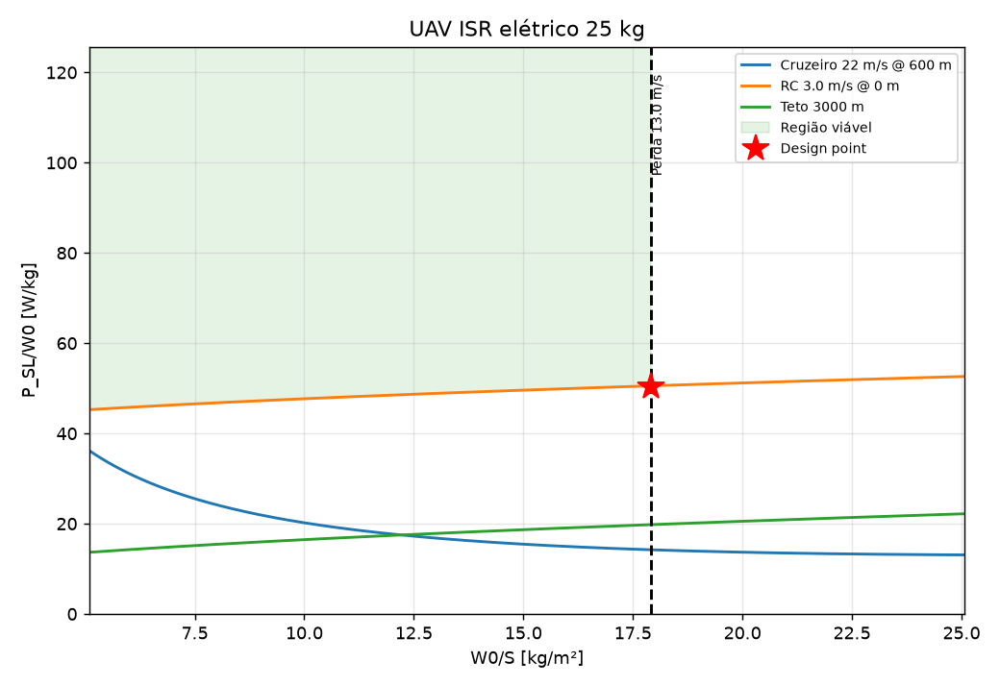

# Tutorial — Fase 1: do requisito ao design point

Este tutorial dimensiona o UAV elétrico de exemplo (`examples/uav_endurance_payload.yaml`) e
explica cada passo e o método clássico por trás dele.

## 0. Instalação

```bash
git clone https://github.com/joaovpfrazao/acdt.git
cd acdt
python -m venv .venv && . .venv/bin/activate
pip install -e ".[dev]"            # opcional: ".[dev,aero,mdo]" para AeroSandbox/NeuralFoil/OpenMDAO
pytest -q                          # todos os testes devem passar
```

## 1. Escrever os requisitos

Um ficheiro de missão YAML tem três blocos:

* `requirements:` é **qualquer subconjunto** dos tipos registados. Para ver a lista, corra
  `acdt requirements`.
* `assumptions:` são os pressupostos do projetista (AR, perfil, frações estatísticas,
  eficiências…). Tudo o que não tem fonte num manual vai aqui, à vista.
* `systems:` (opcional) ativa a seleção de sistemas (Fase 1E).

Cada requisito tem um sentido e uma unidade:

```yaml
requirements:
  payload_mass: {target: 4.0, unit: kg}
  endurance:    {min: 2.5, unit: h}
  stall_speed:  {max: 13, unit: m/s}
  wing_span:    {max: 4.2, unit: m}
  mtow:         {max: 25, unit: kg}
  unit_cost:    {objective: minimize}     # opcional: muda o critério do design point
```

As unidades convertem-se para SI (`kt`, `ft`, `fpm`, `lb`, `nmi`, `h`…). Requisitos
contraditórios (p. ex. `mtow: [{target: 30}, {max: 25}]`) são rejeitados antes de qualquer
cálculo.

## 2. Correr

```bash
acdt size examples/uav_endurance_payload.yaml -o examples/output/uav_endurance_payload
```

Em `examples/output/uav_endurance_payload/` ficam:

* `report.md`, `result.json`;
* `constraint_diagram.png`, `drag_polar.png`;
* com `systems:`, também `harness.wireviz.yml`, `harness.dot`, `netlist.csv` e
  `compliance_checklist.md`.

Exit code: 0 se for viável, 1 se for inviável (o relatório diz que requisito falhou), 2 se os
requisitos forem inconsistentes.

## 3. O que acontece por dentro

1. **Validação** (`core/requirements.py` + `domains/aircraft/requirement_types.py`): unidades,
   sentidos, contradições e limites da categoria regulamentar.
2. **Peso à descolagem** (Raymer Eq. 3.4): W0 = (W_crew + W_payload)/(1 − W_f/W0 − W_e/W0).
   * W_e/W0 começa num **valor estatístico** (`initial_class`: Raymer Tab. 3.1, Nicolai &
     Carichner Tab. 5.1, ou `fixed_fraction`/regressão do utilizador) e depois é
     **substituído pela estimativa por componentes** do passo 7.
   * W_f/W0 vem da missão: Breguet para hélice ou jato (Raymer Eqs. 3.5–3.8), ou a energia
     elétrica E = m g V t /(η L/D) (Hepperle 2012), com reserva e profundidade de descarga.
3. **Diagrama de restrições**:
   * perda (Raymer Eq. 5.6);
   * descolagem (Raymer Sec. 5.3) e aterragem (Raymer Eq. 5.11);
   * cruzeiro, volta, subida e teto (Gudmundsson 2014 Sec. 3.2), com o fator de peso β
     (Mattingly).
   * Para hélices, T/W converte-se em P/W com a eficiência da hélice.
   * **Design point:** por omissão, a maior carga alar admissível pelos limites de W/S (Raymer
     Sec. 5.1), com o P/W mínimo da envolvente nesse ponto. Com um objetivo de custo ou de MTOW,
     é o W/S de menor peso vazio estimado por componentes (`min_weight`).
4. **Geometria** (Raymer Cap. 6–7): S = W0/(W/S), b = √(AR·S), cordas, MAC (Eq. 7.5), Ȳ (Eq. 7.6),
   empenagens por coeficientes de volume (Tab. 6.4) e áreas molhadas (Eq. 7.12).
5. **Sustentação** (DATCOM via Raymer): CLα pela Eq. 12.6, CLmax limpo pela Eq. 12.15 e flaps
   pela Eq. 12.21.
6. **Arrasto** (Raymer Cap. 12):
   * build-up por componentes Cf·FF·Q·Swet/Sref, com transição laminar, rugosidade e arrasto
     diverso;
   * Oswald pela Eq. 12.48;
   * polar CD = CD0 + K·CL² e (L/D)max.
7. **Pesos por componente** (`weights_detailed.py`, Raymer Eqs. 15.46–15.59): asa, empenagens,
   fuselagem, trem, motor instalado, combustível, comandos, aviónica, elétrico, interiores; para
   UAVs, massas reais da Fase 1E (motor/ESC, servos, autopiloto, cablagem), itens listados e
   margem de crescimento. O relatório mostra a tabela por item e o cross-check estatístico.
8. **MDA de ponto fixo**: o novo We, L/D e CD0 realimentam o passo 2 (W0 = (W_crew + W_payload +
   We)/(1 − W_f/W0)) até W0, CD0 e We convergirem.
9. **Sistemas (1E)**:
   * hélice, motor, ESC, bateria S×P, servos e autopiloto;
   * por omissão a hélice é estatística (Raymer Sec. 10.3, C_P e J do utilizador). Com
     `systems.propeller.method: bemt` corre-se o BEMT de passo fixo (McCormick 1995 Cap. 6, Ning 2014)
     já usado na Fase 9: é preciso diâmetro ou Mach de ponta, rpm, passo ou auto, corda ou auto, e
     uma polar (aerofólio nomeado ou tabela com fonte). Em falta → unassessed, a estatística não é
     apresentada como BEMT.
   * `systems.motor.deck` (opt-in): modelo DC de 1ª ordem de Drela 2007 (Kv, R, I0 + source). Sem fonte
     ou fora de domínio (I>I_max, V>V_max) o η não é aplicado (nunca 0,85 silencioso).
   * power budget, cablagem e massa/CG;
   * o peso real da bateria e dos sistemas realimenta W0.

Comandos avulso (sem dimensionar a aeronave):

```bash
acdt bemt propeller --input examples/systems/bemt_propeller_illustrative.json -o out/bemt_prop.json
acdt motor-deck --input examples/systems/motor_deck_illustrative.json -o out/deck.json
```

Exemplo ilustrativo (PRESSUPOSTO, não é um mapa de fornecedor): hélice D=0,50 m, passo 0,30 m,
J=0,440, η=0,723, 5995 rpm / 749 W em cruzeiro a 22 m/s (abaixo dos 1000 W nominais: passo fixo +
lei de binário elétrico). Deck EXAMPLE: Kv=500 rpm/V, R=0,15 Ω, I0=0,6 A, 22 V e 8000 rpm → I=40,0 A,
P_veio≈630 W, η≈0,716.

## 4. Ler o resultado (UAV de exemplo)

| grandeza | valor |
|---|---|
| W0 | 23,4 kg (cumpre o MTOW ≤ 25 kg) |
| We (por componentes) | 11,7 kg → We/W0 = 0,50 (valor inicial Raymer Tab. 3.1 `uav_small`; ver avisos abaixo) |
| estrutura / propulsão / equipamento / itens / margem | 6,44 / 1,13 / 1,36 / 1,70 / 1,06 kg |
| W/S | 17,91 kg/m² |
| P/W | 50,6 W/kg (P ≈ 1,18 kW) |
| asa | S = 1,308 m², b = 4,28 m (**falha** b ≤ 4,2 m; o `acdt optimize` resolve) |
| restrições ativas | subida de 3 m/s e perda a 13 m/s |
| aerodinâmica | CD0 = 0,0232, (L/D)max = 20,7 |
| bateria | 8S3P Li-ion pouch, ≈1776 Wh, 7,78 kg |

Valores da corrida em `examples/output/uav_endurance_payload/report.md` (18 nov 2026).

O valor inicial estatístico (Raymer `uav_small`) não fecha com a bateria em Wf (We/W0 + Wf/W0 > 0,98); o
relatório diz isso e reinicia a iteração por componentes em We/W0 = 0,30, sem efeito no resultado final.
Depois avisa que We/W0 = 0,50 está abaixo da banda estatística (0,77–0,89 para estas classes): as equações de
Raymer são de aviação geral e, extrapoladas a ~20 kg, omitem itens (suportes, ferragens, reforços locais). Os
itens do exemplo são valores rotulados; com dados próprios, use `components.items` e `components.calibration`
para ajustar.



## 5. Experimentar

* Suba a endurance para 3,5 h (`examples/uav_overconstrained.yaml`). O projeto fica **INVIÁVEL**:
  W0 ≈ 33,5 kg e b ≈ 5,1 m violam o MTOW e a envergadura máximos.
* Os outros exemplos combinam requisitos diferentes:
  * `ga_range_speed.yaml`: alcance, velocidade e pista;
  * `trainer_maneuver_cost.yaml`: n = 3, taxa de volta e custo minimizado;
  * `cessna172_check.yaml`: verificação contra o Cessna 172S (W0 e We dentro de ±15 %);
  * `uav_gasoline_150kg.yaml`: UAV a gasolina, valor inicial Raymer Tab. 3.1 (UAV tático).
* Se instalou `[aero]`, compare o seu projeto com o VLM do AeroSandbox:

```python
from acdt.domains.aircraft.mission import MissionSpec
from acdt.domains.aircraft.sizing import run
from acdt.domains.aircraft.aero.interfaces import aerosandbox_crosscheck
r = run(MissionSpec.from_yaml("examples/uav_endurance_payload.yaml"))
print(aerosandbox_crosscheck(r.config, r.cruise_speed, r.cruise_altitude, 2.0, "vlm"))
```

## 6. Limitações a ter presentes

* O peso vazio vem das equações de aviação geral de Raymer (Cap. 15). Abaixo de ~450 kg
  são extrapolação: calibre com dados próprios (`components.calibration`) e liste os itens
  reais (`components.items`). O método antigo continua disponível com
  `weights: {method: statistical, fixed_fraction: ...}`.
* As equações de UAV de Gundlach não estão implementadas (fonte não verificada).
* O FF da Raymer Eq. 12.30 tem o fator M^0,18, que anula FF a Mach → 0. Mantivemos a equação
  como está no livro. Para casos de muito baixo Mach, confirme com o AeroBuildup.
* Os componentes `*_class` são valores de exemplo. A ampacidade dos fios é um exemplo a
  substituir pelo SAE AS50881.
* BEMT e o deck de motor no ciclo de sistemas são opt-in; por omissão permanece a estatística.
  Inputs EXAMPLE nos exemplos não são dados de fornecedor. Unassessed ≠ pass.
