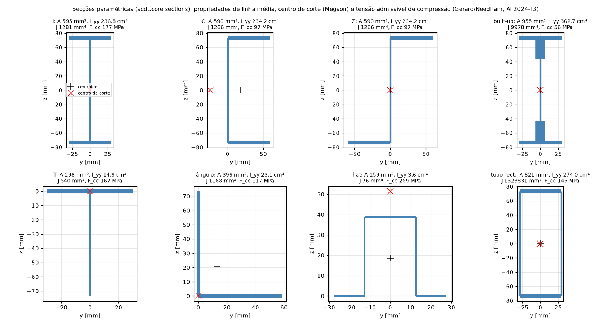
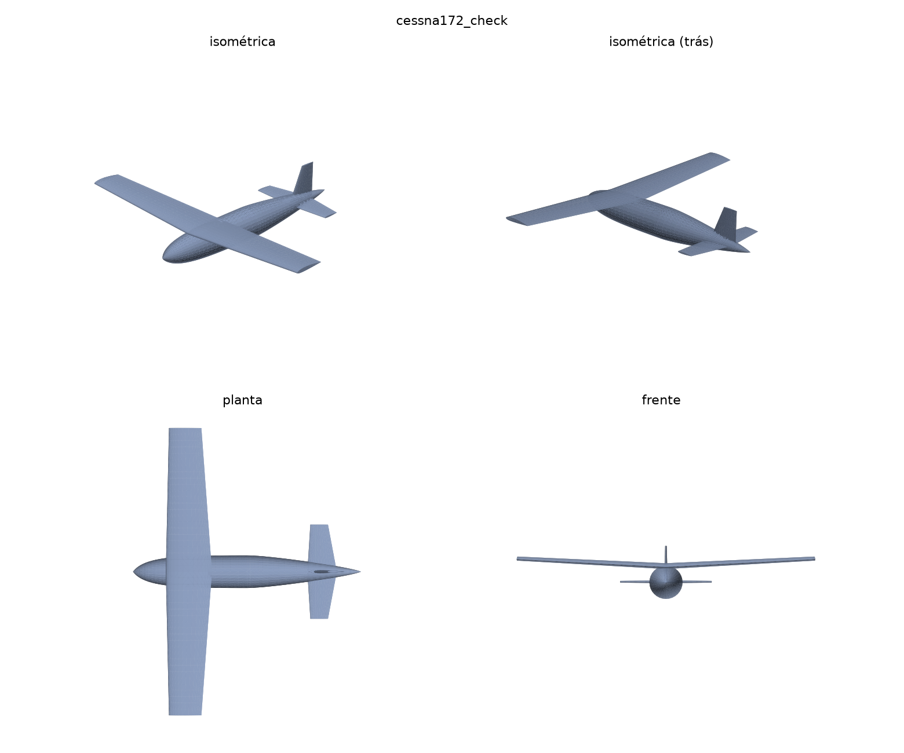

# Tutorial — Fase 6: RCS, materiais, secções, encurvadura no ciclo e calibração viga ↔ cascas

Continua o [tutorial da Fase 5](tutorial-fase5.md). A Fase 6 acrescenta, ainda em **baixa fidelidade no ciclo**:

1. **RCS** (secção reta radar) por Óptica Física e uma otimização **aero/RCS** (frente de Pareto);
2. uma **biblioteca de materiais isotrópicos** (metais e compósito equivalente isotrópico);
3. **secções de parede fina paramétricas** (I, C, Z, T, L, hat, tubos, longarina composta);
4. `acdt wingbox6`: caixão dimensionado **à encurvadura** (reforçadores Z ou sanduíche), banzos a partir da
   secção, nervuras dimensionadas (esmagamento, corte, encurvadura, furos) e **calibração da viga contra o FEM de
   cascas** da Fase 5;
5. a asa alta do C172 no OpenVSP.

Regras (as mesmas): só métodos clássicos citados no código; nenhum número afinado; tudo o que é hipótese está
marcado `ASSUMPTION` no código e no JSON. Alta fidelidade só no fim (verificação), e serve para calibrar a baixa.

## 0. Pré-requisitos

```bash
pip install -e ".[dev,aero,mdo,hifi,wingbox]"
pip install -e ".[fastfem]"        # opcional (pypardiso): só acelera o FEM de cascas
```

AVL e XFOIL têm de estar no `PATH` (`acdt doctor` confirma); sem eles o pipeline usa NeuralFoil + Schrenk e os
números da §4.5 não se reproduzem.

## 1. RCS — Óptica Física (`acdt rcs`)

`core/em/po.py` calcula a RCS de superfícies trianguladas condutoras perfeitas (PEC) por Óptica Física
(Knott, Shaeffer & Tuley 1993, Cap. 5; Balanis 2012, §11.3), com o integral de faceta em forma fechada de Gordon
(IEEE TAP 1975) — a mesma física do POFACETS (NPS). Opcional: oclusão entre partes e um segundo ressalto por
*shooting-and-bouncing rays* (Ling, Chou & Lee 1989) para diedros/cantos.

```bash
acdt rcs validate                                            # casos canónicos (tabela no ecrã)
acdt rcs study examples/uav_endurance_payload.yaml -o examples/output/uav_endurance_payload_rcs --samples 120
acdt rcs stl examples/output/cessna172_check_hifi/geometry/cessna172_check.stl -o examples/output/cessna172_check_rcs
```

### Montagem com chine (opt-in)

Quando o JSON tem `assembly` (e não um `result.json` paramétrico), `acdt rcs study` e
`acdt shape study --assembly` leem a montagem: corpos (incluindo `pod.chine_deg` / `Body.chine`),
superfícies, discos e itens `box|sphere|cylinder`. O inventário marca o que entrou na malha PO, o que ficou
de fora por PRESSUPOSTO (hélice) e o que ficou **unassessed** (nunca silêncio). Não há solver de onda completa.

```bash
acdt rcs study examples/integration/chine_fuselage_rcs.json -o examples/output/chine_rcs --samples 8
acdt shape study --assembly examples/integration/chine_fuselage_rcs.json -o examples/output/chine_shape --samples 8
acdt integration examples/integration/chine_fuselage_rcs.json -o examples/output/chine_int --rcs
```


Validação contra soluções analíticas (10 GHz):

| caso | referência | Δ [dB] |
|---|---|---|
| placa, incidência normal | 4πA²/λ² | 0 |
| esfera (PO, ótico) | πa² | +0.0006 |
| cilindro, incidência normal | 2πaL²/λ | +0.025 |
| diedro 90°, 0°, VV / HH | 8πa²b²/λ² | +0.079 / −0.080 |
| diedro 90°, 15°, VV / HH | idem, projeção | +0.022 / −0.058 |

**Otimização aero/RCS** (`domains/aircraft/rcs/study.py`): aeronave facetada paramétrica (enflechamento, alinhamento
de arestas, ângulo do *chine*, inclinação das caudas em V) com aerodinâmica de baixa fidelidade (CD0 por build-up,
e de Oswald, variação de peso estrutural com o enflechamento); DOE por hipercubo latino (OpenMDAO), frente de Pareto
combinada (DOE + restrição ε por COBYLA + baseline) e o "joelho" pela distância à utopia. RCS frontal média
(±30° de azimute, elevação −5/0/+5°, VV, 10 GHz). Resultados do UAV:

| desenho | rácio de desempenho | L/D | RCS frontal média [dBsm] |
|---|---|---|---|
| baseline | 1.000 | 18.97 | −28.19 |
| joelho | 0.948 | 19.48 | −41.00 |
| RCS mínima | 0.793 | 17.35 | −42.26 |

C172 (STL do OpenVSP, asa alta): RCS frontal média −15.15 dBsm, mediana −28.64, máxima −4.00 dBsm.

**Limitações** (impressas em cada relatório): sem difração de arestas (PTD/MEC), sem ondas rastejantes/progressivas,
cavidades/entradas de ar só até 2 ressaltos, sem materiais absorventes (RAM), só PEC; a precisão cai longe das
direções especulares e em incidência rasante. Alta fidelidade (onda completa: MoM/MLFMM, ou FDTD como o openEMS,
GPL-3) fica para a fase de verificação, numa máquina mais potente.

## 2. Materiais (`core/materials.py`)

Decisão de projeto (desta fase): **todos os membros isotrópicos**. O compósito entra como **isotrópico equivalente**:
E, G, ν são as constantes de engenharia no plano de um laminado pela Teoria Clássica dos Laminados (Jones 1999,
Cap. 4), e as tensões admissíveis vêm de *cut-offs* de deformação de projeto (`ASSUMPTION`: ε_c = 3500 με,
ε_t = 4000 με, γ = 7000 με, × k_env = 0.8; CMH-17-3G Vol. 3 Cap. 12, Niu 1992 Cap. 4). O caminho
ortotrópico/laminado (`core/fem/laminate.py`) fica para a alta fidelidade.

| chave | origem | E [GPa] | ρ [kg/m³] | F_cy [MPa] |
|---|---|---|---|---|
| `al2024_t3` | MIL-HDBK-5J Tab. 3.2.3.0(b) | 72.4 | 2780 | 269 |
| `al7075_t6` | MIL-HDBK-5J Tab. 3.7.6.0(b) | 71.0 | 2796 | 469 |
| `steel_4130` | MIL-HDBK-5J Tab. 2.3.1.0(c1) | 199.9 | 7833 | 517 |
| `ti6al4v` | MIL-HDBK-5J Tab. 5.4.1.0(b) | 110.3 | 4429 | 896 |
| `cfrp_qi` | AS4/3501-6 [0/±45/90]s, CLT (Daniel & Ishai Tab. A.4) | 58.2 | 1600 | 163 (cut-off) |
| `cfrp_cap` | AS4/3501-6 70/20/10 (`ASSUMPTION`) | 111.5 | 1600 | 312 (cut-off) |
| `gfrp_qi` | E-vidro/epóxi [0/±45/90]s | 20.6 | 1970 | 58 (cut-off) |
| `pvc_foam_h80` | Divinycell H80 (ficha técnica) | 0.095 | 80 | 1.4 |
| `balsa` | USDA Wood Handbook Tab. 5-3b | 3.4 | 160 | 14.9 |

Os valores são típicos/base S — verificar contra a edição atual do MMPDS / CMH-17 antes de qualquer certificação.

## 3. Secções de parede fina (`core/sections.py`)

Fábricas `i_section`, `channel`, `z_section`, `t_section`, `angle`, `hat`, `rect_tube`, `circular_tube`,
`builtup_spar` → `Profile` com área, I, J (Saint-Venant de parede fina), centro de corte (Megson), empenamento,
encurvadura local de cada placa (k = 4.0 bordos apoiados, 0.43 bordo livre) e *crippling* de Gerard/Needham.
`spar_cap_allowable(kind, …)` dá a tensão admissível de compressão do banzo de uma longarina de cada tipo.



## 4. `acdt wingbox6` — caixão à encurvadura, nervuras e calibração

```bash
acdt wingbox6 examples/cessna172_check.yaml -o examples/output/cessna172_check_wingbox6        # metal, alcance
acdt wingbox6 examples/uav_endurance_payload.yaml -o examples/output/uav_endurance_payload_wingbox6   # compósito, autonomia
```

Opções: `--objective weight|range|endurance|mtow`, `--material metal|composite` (por omissão o da missão),
`--maxiter 30`, `--phase5 <json>` (comparação), `--no-fem`, `--hold-section` (fixa t/c, curvatura e
torção geométrica na geometria de partida; o mesmo que `assumptions.structures.wingbox.hold_section`).
O JSON da Fase 6 inclui `buckling_reserve`: factor de carga até à envolvente de encurvadura das peles
(interacção de Allen/Zenkert no sanduíche, ou a condição de pele metálica à carga limite) e o factor de
reserva de cada nervura (encurvadura de corte ∝ t³, esmagamento ∝ t³, corte ∝ t). RF > 1 nas estações à
bitola mínima.

### 4.1 Revestimento metálico reforçado (`wingbox/sizing6.py: metal_cover`)
* Reforçadores Z (aba 0.4 h_s, h_s ≤ 0.3 h); *crippling* de Gerard (dois cantos); coluna Euler–Johnson entre
  nervuras com c = 1 (Bruhn C7, Niu).
* Por omissão `skin_buckling="limit"`: a pele **não encurva até à carga limite** (σ_cr·A ≥ P/1.5, com interação
  de corte); à carga última a pele trabalha com a largura efetiva de von Kármán b_e = 1.9 t √(E/σ_st)
  (Bruhn C7.11). Opção `"ultimate"`: pele totalmente efetiva sem encurvadura até à última (mais conservador).
* Pesquisa: bissecção vetorizada na espessura da pele, grelha em h_s/t_st e k_t = t_st/t_s ∈ {1, 1.5, 2, 3}.
* O número de reforçadores `n_str` é variável discreta: rastreio na baseline e vizinhança ±2/±4 no ótimo.
* Banzos: fração φ_cap da área do painel (variável contínua), à mesma deformação; tensão admissível do banzo
  pela secção (`cap_allowable`, extrusão `ASSUMPTION`: b = 10 t_f, aba vertical b/2; T para I, cantoneira para
  C/Z, duas cantoneiras para a longarina composta).
* Painel inferior = máx(tração, compressão em n_neg·P).

### 4.2 Sanduíche compósito (`sandwich_cover`)
* Carga crítica com corte do núcleo (Allen 1969): N_cr = N_E/(1 + N_E/S), k = min_m (mb/a + a/mb)².
* Enrugamento das faces 0.5 (E_f E_c G_c)^{1/3}; ε admissível = mín(cut-off, banzo, enrugamento).
* Interação com o corte usando a deformação real ε = P/(2 t_f w E + 2 A_cap E_cap).

### 4.3 Nervuras (`size_ribs`)
* Esmagamento por curvatura p = 2σ² t̄ L/(E h) (Niu §5.4), coluna larga, corte ΔV/2h, encurvadura por corte.
* Furos de alívio D/h ∈ {0, 0.25, 0.5} (fator líquido 0.5, área retirada πD/(8h)); partes de nariz e cauda em
  espessura mínima com 50 % de furos. O passo das nervuras é variável contínua (0.4–2.5× o da Fase 5).

### 4.3b Demo SIMP da nervura e massa opt-in (`wingbox/rib_simp.py`, `rib_simp_mass.py`)
Otimização topológica 2-D (SIMP, Bendsøe 1989; Bendsøe & Sigmund 2003; filtro de densidade de Bruns & Tortorelli 2001; critério
de otimalidade como em Sigmund 2001 / Andreassen et al. 2011 — escrito a partir dos artigos) da alma da nervura da
raiz do ótimo: retângulo entre longarinas, encastrado nas almas, carregado pela pressão de esmagamento e pelo ΔV da
baía; fração de volume 0.4 (`ASSUMPTION`). Dá uma **sugestão de layout** (onde pôr furos/treliça); a nervura
continua a ser dimensionada por `size_ribs`. Corre em ~3 s → `<nome>_rib_simp.png`.

A massa SIMP **não entra no orçamento por omissão** (o estudo e o SLSQP não mudam). Opt-in, depois do ótimo:
`assumptions.structures.rib_simp_mass: {vol, penal, nelx?, iters?, stations: all}` ou
`acdt wingbox6 --rib-simp-mass ficheiro.json`, ou o comando autónomo `acdt rib-simp --input …`
(MCP `rib_simp_mass`). A alma entre longarinas passa a `m_web = mean(ρ)·w·h·t·ρ_mat`, com `t` de
`size_ribs` (Niu §5.4) e `ρ` da ficha com fonte; o resto nariz/cauda fica o PRESSUPOSTO de 50 % de
`size_ribs` e é rotulado como fora do domínio SIMP. `vol` e `penal` são entradas obrigatórias.
SIMP só na raiz, ou geometria/cargas/fontes em falta → o termo fica unassessed, as massas dimensionadas
são retidas, e não há extrapolação silenciosa nem unassessed=pass.

Exemplo ilustrativo (`examples/wingbox/rib_simp_mass_illustrative.json`, EXAMPLE/PRESSUPOSTO, malha grosseira
nelx=32, iters=30, Al 2024-T3 MMPDS ρ=2780 kg/m³, vol=0.4, p=3, duas nervuras, **não** é um resultado FEM ou de fornecedor):
alma sólida 0.1668 + 0.0854 kg; com SIMP ~0.0667 + 0.0342 kg; resto nariz/cauda 0.0334 + 0.0171 kg (inalterado);
orçamento de nervuras (duas semi-asas) 0.605 kg → 0.303 kg (Δ −0.303 kg). Sem `vol`/`rho_source`, ou com
`stations: root`, o estado é unassessed e a massa size_ribs mantém-se.

### 4.4 Calibração viga ↔ cascas (`wingbox/shell6.py`)
O FEM de cascas da Fase 5 (QM6 + MITC4) é montado **sobre o contorno real** (com o nariz em D, banzos e
reforçadores como vigas excêntricas, nervuras do caixão e do nariz, encastrado na raiz) e corrido em dois casos
(força na longarina dianteira F e traseira R). Por baía:

* EI = ∫M / Δφ (ajuste plano da rotação de flexão), GJ = ∫D / (Δθ_F − Δθ_R), centro de corte s = Δθ_F/(Δθ_F − Δθ_R);
* k_σ = força no painel do FEM / (M/h) — corrige a tensão de dimensionamento (cobre o efeito da curvatura do perfil
  e do nariz em D a levar flexão);
* GA transversal (γ = w′ + φ) — só para a flecha na verificação;
* baías com < 5 % do momento da baía da raiz herdam o valor da baía interior (erro numérico, não física).

Fatores k_EI, k_GJ, Δx_sc e k_σ multiplicam/corrigem a secção de Megson **dentro do ciclo**. Ciclo: calibrar na
baseline → SLSQP → recalibrar no ótimo → SLSQP a partir do ótimo → vizinhança discreta → verificação FEM no
caso de projeto (sustentação a c/4, momento de picada q c² c_m0, inércia no centro de corte). A torção da viga
inclui a pseudo-torção cinemática do eixo enflechado (−w′·dx_sc/dy; Bisplinghoff, Ashley & Halfman 1955).
Cada calibração demora ~1–1.5 s (2000–4000 nós).

### 4.5 Resultados
Corridas em 2026-10-28 nesta máquina, com AVL e XFOIL no `PATH` (`acdt doctor`); C172 `--maxiter 20`: 8 min 02 s
no total (estudo 462 s), UAV `--maxiter 30` (por omissão): 1 min 37 s (estudo 51 s). **Importante:** sem AVL/XFOIL no
`PATH` o pipeline cai para NeuralFoil + Schrenk e as baselines mudam (UAV L/D 17.33 em vez de 18.97; C172 8.58 em
vez de 8.78) — não é regressão, é o fallback. Com AVL/XFOIL as baselines coincidem com o JSON guardado da Fase 5.

| | C172 (metal, alcance) | UAV (compósito, autonomia) |
|---|---|---|
| caixão Fase 3 | 99.50 kg | 3.62 kg |
| Fase 5 (JSON guardado): baseline → ótimo | 97.75 → 76.18 kg; L/D 8.78 → 8.55; alcance 1185 → 1307.9 km | 3.62 → 3.53 kg; L/D 18.97 → 19.30; autonomia ×1.0216 |
| Fase 6 baseline (sem calibração → calibrada) | 107.68 → 102.00 kg (n_str 14) | 3.68 → 3.63 kg (sanduíche) |
| **Fase 6 ótimo** | **75.31 kg; L/D 8.51; alcance 1338.9 km** | **3.51 kg; L/D 19.29; autonomia ×1.0224** |
| variáveis no ótimo | x_f/x_r 0.250/0.500, t/c 0.155/0.092, curvatura 0.028, torção −2.02°, nervuras 0.32 m (15/semi-asa), φ_cap 0.056, 14 reforçadores Z (h 21.9 mm) | x_f/x_r 0.278/0.528, t/c 0.097/0.092, curvatura 0.047, torção −0.79°, nervuras 0.225 m (10), núcleo 3.2 mm |

Rastreio de n_str na baseline do C172 (sem calibração): 6/10/14/18 → 120.27/109.83/107.68/109.24 kg.
Vizinhança discreta no ótimo do C172: n_str 10/12/14/16/18 → 75.61/75.36/75.31/75.63/76.13 kg; I/C/Z/composta →
iguais (ver limitações). No C172 os dois SLSQP pararam no limite de iterações (20 e 10): o ótimo é viável mas não
está convergido a rigor. O baseline da Fase 6 é mais pesado do que o da Fase 5 porque a Fase 6 dimensiona à
encurvadura (reforçadores, nervuras, sem encurvadura do revestimento até à carga limite).

Fatores de calibração (FEM de cascas / secção de Megson), raiz → ponta:

| | k_EI | k_GJ | Δx_sc/c | k_σ |
|---|---|---|---|---|
| C172 baseline | 1.27 → 1.16 | 1.02–1.10 | +0.017 → +0.006 | 0.91–0.93 |
| C172 ótimo | 1.25 → 1.04 | 1.03–1.08 | +0.055 → −0.006 | 0.86 → 0.83 |
| UAV baseline | 1.03 → 1.01 | 1.02–1.07 | +0.097 → −0.007 | 0.82 → 0.88 |
| UAV ótimo | 1.01 → 0.98 (mín. 0.97) | 1.03–1.10 | +0.082 → −0.018 | 0.79 → 0.75 (mín. 0.74) |

k_EI > 1 no C172: os reforçadores e a curvatura das coberturas dão mais rigidez do que a idealização; k_σ < 1:
o nariz em D e as coberturas curvas levam parte da flexão (a altura h é medida nas longarinas).

Verificação FEM no caso de projeto (carga última):

| | ponta w FEM / viga [m] | torção ponta FEM / viga (só torção) [°] | força na cobertura (baía raiz) FEM / viga [kN] | V₀, T₀ |
|---|---|---|---|---|
| C172 baseline | 0.192 / 0.187 (−2.7 %) | −0.095 / −0.177 (−0.200) | 255.1 / 245.8 | ±0.1 %, ±1.2 % |
| C172 ótimo | 0.242 / 0.240 (−0.9 %) | −1.210 / −1.242 (−1.245) | 185.3 / 186.1 | ±0.1 %, ±0.04 % |
| UAV baseline | 0.131 / 0.135 (+2.6 %) | 0.160 / 0.113 (0.087) | 12.1 / 11.7 | ±0.1 %, ±0.1 % |
| UAV ótimo | 0.250 / 0.249 (−0.2 %) | 0.231 / 0.144 (0.101) | 13.4 / 13.5 | ±0.1 %, ±0.2 % |

A torção residual do UAV (≤ 0.09°, valores absolutos muito pequenos) vem do acoplamento flexão–torção que a viga
não tem (centro de corte variável por baía, nariz em D); é registado e não é corrigido com fatores arbitrários.

Figuras: `examples/output/<missão>_wingbox6/` → `_calibration.png`, `_fem_check.png`, `_layout6.png`,
`_structure3d_fase6.png`, `_rib_simp.png`.

## 5. Asa alta do C172 no OpenVSP

`geometry.wing_position: high` (e `wing_z_fraction`) põe a raiz da asa no topo da fuselagem; a geometria do
`cessna172_check` foi regenerada:



## 6. Limitações e o que precisa de máquina mais potente

* RCS: só PO + 2 ressaltos, PEC; sem difração de arestas, ondas rastejantes, RAM, cavidades/entradas. Onda completa
  (MoM/MLFMM/FDTD) precisa de máquina mais potente.
* Estrutura: tudo isotrópico (compósito equivalente); sem pós-encurvadura além da largura efetiva; sem fadiga,
  tolerância ao dano explícita, juntas, cortes/portas de acesso; grandes deformações/não-linearidade geométrica e
  encurvadura não linear dos painéis ficam para a alta fidelidade (CalculiX/Nastran não lineares).
* O FEM de cascas no ciclo é linear e grosseiro (ds ≈ c₀/8) — serve para calibrar, não para tensões locais.
* O SIMP das nervuras é 2-D linear (um caso de carga, volume fixo, Q4). A massa da alma só volta ao orçamento
  quando pedida (opt-in); o resto nariz/cauda não é SIMP. Não é FEM não linear nem campanha de topologia
  (TACS/ADflow/OpenVSP ficam no PC do João).
* Com b/t = 10 a extrusão do banzo atinge F_cy para todos os tipos de longarina, pelo que o tipo (I/C/Z/composta)
  não diferencia a massa (diferencia com b/t = 25, verificado nos testes).
* CFD 3-D e flutter de alta fidelidade da configuração final: máquina mais potente.
