# Relatório de dimensionamento — UAV gasolina ≥150 kg (STANAG 4671)

_acdt 0.1.0 · Fase 1 (conceptual) + 1E (sistemas) + Fase 2 (baixa fidelidade)_

UAV de asa fixa com motor a gasolina de 2 tempos e hélice propulsora, trem triciclo fixo, descolagem/aterragem em pista. Payload EO/IR + SAR ligeiro. Valores ilustrativos.


**Resultado:** ✅ VIÁVEL

**Verificação por segmentos (Fase 2):** ⚠️ pelo menos um requisito não cumprido na missão por segmentos (ver §13)

## 1. Requisitos desta corrida

| requisito | sentido | valor | qualificadores | estágios | avaliado |
|---|---|---|---|---|---|
| propulsion_type | target | piston_prop | - | context | sim |
| regulatory_category | target | easa_specific | - | check, systems | sim |
| payload_mass | target | 38 kg | - | sizing | sim |
| endurance | min | 10 h | - | sizing | sim |
| cruise_speed | target | 45 m/s | - | constraint, sizing | sim |
| cruise_altitude | target | 3000 m | - | context | sim |
| stall_speed | max | 26 m/s | - | constraint | sim |
| climb_rate | min | 3.0 m/s | - | constraint | sim |
| service_ceiling | min | 5000 m | - | constraint | sim |
| takeoff_ground_roll | max | 300 m | - | constraint | sim |

Requisitos não definidos (livres / por omissão): crew_mass, range, max_speed, load_factor, turn_rate, landing_distance, mtow, wing_span, power_available, thrust_available, unit_cost, noise, mtow_objective

### Validação

- **info**: Nz das equações de massa = 1.5 × n_lim do diagrama V-n (4.40, manobra; stanag_4671)
- **warning**: n_lim = 4.40 está acima da linha de perda mesmo a VD (n = 2.69 com CLmax quase-estático): valor CONSERVATIVO mantido (a perda dinâmica numa rajada pode excedê-lo); VC baixo face a VS1 — rever VC/CLmax antes de dimensionar
- **info**: Massa do caixão da asa (Megson/Bruhn) = 5.40 kg vs Raymer Eq. 15.46 15.73 kg (razão 0.34); usado: Raymer
- **info**: Massa da fuselagem L1 / Raymer Eq. 15.49 = 0.75 (5.5 kg vs 7.3 kg).
- **info**: W0 = 153 kg está abaixo da base de dados das equações GA de Raymer (~1000–8000 lb): extrapolação — calibrar com dados próprios (calibration).

## 2. Peso à descolagem (Raymer Cap. 3; Hepperle 2012 para elétrico)

| grandeza | valor |
|---|---|
| W0 [kg] | 153.2 |
| We [kg] | 93.25 |
| Combustível/bateria [kg] | 21.96 |
| Payload + tripulação [kg] | 38 |
| We/W0 | 0.6086 |
| Wf/W0 | 0.1433 |
| Energia bateria nominal [Wh] | - |

Pernas da missão: loiter 36000 (SI) @ V=45.0 m/s, L/D=14.5, h=3000 m

## 2a. Estimativa de pesos por componentes (Raymer 6th ed. Cap. 15 + sistemas)

Valor inicial do peso vazio: Raymer 6th ed. Table 3.1 (We/W0 = A W0^C, W0 in lb) 'uav_tactical_recce_ucav'.

Fator de carga último Nz = 6.60 (1.5 × limite). Iteração: estatística → geometria → componentes → novo We → re-dimensionar, até convergir (histórico na secção 8).

| grupo | item | kg | % W0 | método |
|---|---|---|---|---|
| structure | asa | 15.73 | 10.26 | Raymer Eq. 15.46; composite x0.875 (Raymer Table 15.4) |
| structure | empenagem horizontal | 0.4145 | 0.2705 | Raymer Eq. 15.47; composite x0.855 (Raymer Table 15.4) |
| structure | empenagem vertical | 0.5199 | 0.3393 | Raymer Eq. 15.48; composite x0.855 (Raymer Table 15.4) |
| structure | fuselagem | 6.775 | 4.422 | Raymer Eq. 15.49 (unpressurized); composite x0.925 (Raymer Table 15.4) |
| structure | trem principal | 11.87 | 7.748 | Raymer Eq. 15.50; composite x0.975 (Raymer Table 15.4) |
| structure | trem de nariz | 3.35 | 2.187 | Raymer Eq. 15.51; composite x0.975 (Raymer Table 15.4) |
| propulsion | motor instalado (+hélice, berço, capota) | 30.72 | 20.05 | Raymer Eq. 15.52, Wen = P/0.9 kW/kg (ASSUMPTION — give engine_dry_mass_kg) |
| propulsion | sistema de combustível | 5.138 | 3.353 | Raymer Eq. 15.53 |
| equipment | comandos (hastes/charneiras) | 0.7929 | 0.5175 | Raymer Eq. 15.54 |
| equipment | aviónica (piloto automático, datalink, ...) | 6 | 3.916 | user (uninstalled mass; installation items listed separately) |
| equipment | gerador/alternador + regulador | 2 | 1.305 | user-listed item |
| equipment | servos (6) + cablagem de sinal | 2.5 | 1.632 | user-listed item |
| user_items | suporte do payload + amortecimento | 1.5 | 0.979 | user-listed item |
| equipment | bateria de backup (avionics) | 1.5 | 0.979 | user-listed item |
| allowance | margem de crescimento/integração | 4.44 | 2.898 | 5% of the build-up (ASSUMPTION, labelled) |


Resumo por grupo e composição de W0:

| grupo | kg | % W0 |
|---|---|---|
| structure | 38.66 | 25.23 |
| propulsion | 35.85 | 23.4 |
| equipment | 12.79 | 8.35 |
| user_items | 1.5 | 0.979 |
| allowance | 4.44 | 2.898 |
| **peso vazio We** | 93.24 | 60.86 |
| combustível / bateria | 21.96 | 14.33 |
| payload | 38 | 24.8 |
| tripulação | 0 | 0 |
| **W0** | 153.2 | 100 |


Notas do build-up:

- W0 = 153 kg está abaixo da base de dados das equações GA de Raymer (~1000–8000 lb): extrapolação — calibrar com dados próprios (calibration).

Cross-check estatístico (We/W0 das classes publicadas no W0 obtido; 'fora' = W0 fora do intervalo da base de dados):

| classe | We/W0 | We [kg] | na gama | fonte |
|---|---|---|---|---|
| uav_small | 0.684 | 104.8 | - | Raymer 6th ed. Table 3.1 (We/W0 = A W0^C, W0 in lb) 'uav_small' |
| uav_tactical_recce_ucav | 0.6579 | 100.8 | - | Raymer 6th ed. Table 3.1 (We/W0 = A W0^C, W0 in lb) 'uav_tactical_recce_ucav' |
| nicolai_uav_prop_endurance_lt12h | 0.7424 | 113.8 | - | Nicolai & Carichner (AIAA 2010) Table 5.1 (We = A W0^B, lb) 'nicolai_uav_prop_endurance_lt12h' |
| nicolai_uav_prop_endurance_gt12h | 0.5653 | 86.62 | - | Nicolai & Carichner (AIAA 2010) Table 5.1 (We = A W0^B, lb) 'nicolai_uav_prop_endurance_gt12h' |


## 3. Design point (diagrama de restrições)

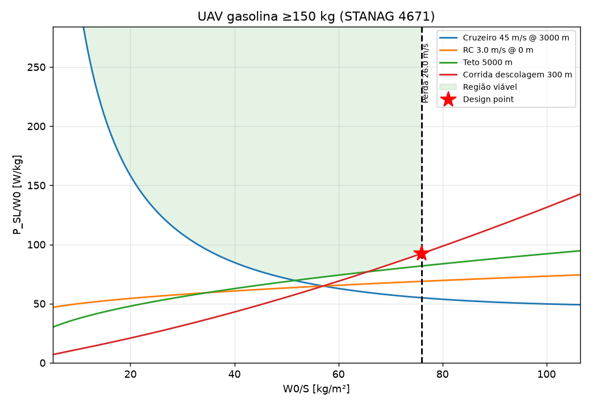

- **W0/S = 745.5 N/m² (76.02 kg/m²)**
- **P/W_SL = 92.4 W/kg** → P_SL = 14.2 kW
- Restrições ativas: Corrida descolagem 300 m, Perda 26.0 m/s
- Área alar S = 2.015 m²

## 4. Geometria de primeira iteração

| parâmetro | valor |
|---|---|
| S_m2 | 2.015 |
| AR | 16 |
| span_m | 5.679 |
| taper | 0.6 |
| c_root_m | 0.4436 |
| c_tip_m | 0.2662 |
| MAC_m | 0.3623 |
| y_MAC_m | 1.301 |
| sweep_c4_deg | 0 |
| sweep_LE_deg | 0.8952 |
| t/c | 0.135 |

Fuselagem: L = 3.20 m, D = 0.400 m. Empenagem horizontal S = 0.207 m², vertical S = 0.195 m², braço = 1.76 m (coef. de volume, Raymer Eq. 6.28–6.29).

Caixão da asa (parametrizado na geometria, análise na Fase 2): longarinas a 20%/65% c, largura na raiz 0.200 m.

## 5. Aerodinâmica (Raymer Cap. 12 / DATCOM)

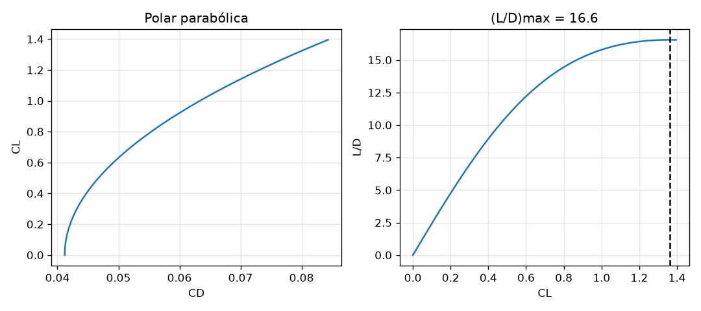

- CLα = 5.240 /rad (0.0914 /deg)
- CLmax limpo / descolagem / aterragem = 1.40 / 1.44 / 1.80
- CD0 = 0.04119, K = 0.0222 (e = 0.898), (L/D)max = 16.55 a CL = 1.36

Decomposição do CD0 (component build-up):

| component | Swet_m2 | Cf | FF | Q | CD0 |
|---|---|---|---|---|---|
| wing | 3.768 | 0.003629 | 1.221 | 1 | 0.008284 |
| htail | 0.4209 | 0.004019 | 1.134 | 1.04 | 0.0009896 |
| vtail | 0.3958 | 0.003603 | 1.118 | 1.04 | 0.0008231 |
| fuselage | 3.371 | 0.002861 | 1.137 | 1 | 0.005442 |

D/q adicional (trem, antenas, ...): 0.0460 m²; L&P: 5%

## 6. Verificações

- ➖ `regulatory_category` — easa_specific: no numeric limit
- ✅ `static_margin` — SM no CG traseiro 10.0 % (alvo 10 %; dianteiro 11.0 %) — posicionamento da asa por bisseção
- ✅ `trim` — CLmax limpo (CG dianteiro): δe -12.3°; cruzeiro (CG dianteiro): δe -9.0°
- ❌ `hq:scissor` — S_h/S atual 0.103 vs mínimo 0.131 (estabilidade 0.103 no CG traseiro, controlo 0.131 a CLmax no CG dianteiro; dimensionante: controlo)
- ✅ `hq:short_period` — período curto ζ = 0.445 → Nível 1 (N1: 0.30–2.00; MIL-F-8785C Table IV, Classe I, Cat. B) — UAV: indicativo
- ✅ `hq:CAP` — CAP = ω²/(n/α) [1/(g s²)] = 2.98 → Nível 1 (N1: 0.085–3.6; MIL-F-8785C Figs. 1–3, Classe I, Cat. B) — UAV: indicativo
- ✅ `hq:phugoid` — fugóide ζ = 0.0414 → Nível 1 (N1: ≥ 0.04; MIL-F-8785C 3.2.1.2, Classe I, Cat. B) — UAV: indicativo
- ❌ `hq:dutch_roll` — rolamento holandês ζ / ζω / ω = 0.074 / 0.142 / 1.91 → Nível 2 (N1: 0.08 / 0.15 / 0.4; MIL-F-8785C Table VI, Classe I, Cat. B) — UAV: indicativo
- ✅ `hq:roll` — rolamento τ_R [s] = 0.202 → Nível 1 (N1: ≤ 1.4; MIL-F-8785C Table VII, Classe I, Cat. B) — UAV: indicativo
- ➖ `hq:spiral` — espiral unassessed: declare assumptions.geometry.dihedral_deg (current TrapezoidalWing default Γ=3° is PRESSUPOSTO only; Clβ/spiral need an explicit dihedral — Etkin & Reid 1996 Ch. 6 / MIL-F-8785C Table VIII)
- ❌ `wb:envelope` — 4 carregamento(s) fora dos limites conceptuais; extremos 0.707 m (combustível, 115 kg) e 0.711 m (vazio, 93 kg). Os limites são de projeto (margem estática e trim), não um envelope aprovado.
- ❌ `gear:position` — não há entre-eixos na banda 8.0–15.0 % com as duas rodas dentro da fuselagem (0–3.200 m, nariz ≥ 0.000 m; Raymer Cap. 11)
- ❌ `gear:tipback` — sem posição de trem
- ✅ `gear:stroke` — curso 0.171 m para n_g = 3.00 (fator já usado no peso, com pisos de 14 CFR 23.473(g))
- ✅ `aeroel:divergence` — divergência torsional V = 260.0 m/s EAS vs 58.1 (= 1.2 V_D); margem +347 %
- ✅ `aeroel:reversal` — inversão de aileron: não ocorre (V → ∞) vs 58.1 m/s EAS
- ✅ `aeroel:flutter` — flutter binário V = 116.0 m/s EAS vs 58.1 (= 1.2 V_D); margem +99 %
- ✅ `aeroel:aeer45` — AEER-45 / 23.629(d): F = 0.00167 vs F_max = 0.017 (balanceamento do aileron não avaliado)
- ✅ `perf:endurance` — tempo em espera (segmentos): 10.59 h vs requerido ≥ 10 (missão por segmentos — verificação, não altera a viabilidade do dimensionamento)
- ✅ `perf:service_ceiling` — teto de serviço (Anderson): 5658 m vs requerido ≥ 5000 (missão por segmentos — verificação, não altera a viabilidade do dimensionamento)
- ✅ `perf:climb_rate` — ROC máx. ao nível do mar: 4.799 m/s vs requerido ≥ 3 (missão por segmentos — verificação, não altera a viabilidade do dimensionamento)
- ✅ `perf:takeoff_ground_roll` — corrida de descolagem (Raymer 17.8): 296.8 m vs requerido ≤ 300 (missão por segmentos — verificação, não altera a viabilidade do dimensionamento)

## 8. Histórico do ciclo MDA (peso ↔ design point ↔ geometria ↔ arrasto)

| iter | W0 | We/W0 usado | We | Wf | n_lim (V-n) | asa Raymer [kg] | asa caixão [kg] | We_comp | We_comp/W0 | CD0 | W/S | P/W | L/D_max | aero |
|---|---|---|---|---|---|---|---|---|---|---|---|---|---|---|
| 1 | 167.2 | 0.6487 | 108.5 | 20.73 | 4.4 | 17.88 | 6.147 | 98.46 | 0.5889 | 0.03712 | 726.7 | 9.144 | 14.4 | manual |
| 2 | 160.2 | 0.6146 | 98.46 | 23.75 | 4.4 | 16.96 | 5.839 | 96.91 | 0.6049 | 0.03827 | 726.7 | 9.412 | 14.18 | manual |
| 3 | 158.7 | 0.6106 | 96.91 | 23.82 | 4.4 | 16.76 | 5.774 | 96.35 | 0.607 | 0.03853 | 726.7 | 9.433 | 14.13 | manual |
| 4 | 158.1 | 0.6093 | 96.35 | 23.79 | 4.4 | 16.69 | 5.749 | 96.11 | 0.6077 | 0.03863 | 726.7 | 9.437 | 14.11 | manual |
| 5 | 157.9 | 0.6087 | 96.11 | 23.78 | 4.4 | 16.65 | 5.738 | 96.01 | 0.608 | 0.03868 | 726.7 | 9.439 | 14.1 | manual |
| 6 | 157.8 | 0.6085 | 96.01 | 23.78 | 4.4 | 16.64 | 5.733 | 95.96 | 0.6082 | 0.0387 | 726.7 | 9.44 | 14.1 | manual |
| 7 | 157.7 | 0.6084 | 95.96 | 23.77 | 4.4 | 16.63 | 5.731 | 95.94 | 0.6082 | 0.0387 | 726.7 | 9.44 | 14.1 | manual |
| 8 | 157.7 | 0.6083 | 95.94 | 23.77 | 4.4 | 16.63 | 5.73 | 95.93 | 0.6083 | 0.03871 | 726.7 | 9.44 | 14.1 | manual |
| 9 | 157.7 | 0.6083 | 95.93 | 23.77 | 4.4 | 16.63 | 5.73 | 95.93 | 0.6083 | 0.03871 | 726.7 | 9.44 | 14.1 | manual |
| 10 | 157.7 | 0.6083 | 95.93 | 23.77 | 4.4 | 16.63 | 5.73 | 95.93 | 0.6083 | 0.03871 | 726.7 | 9.44 | 14.1 | manual |
| 11 | 157.7 | 0.6083 | 95.93 | 23.77 | 4.4 | 16.63 | 5.73 | 95.93 | 0.6083 | 0.03871 | 726.7 | 9.44 | 14.1 | manual |
| 12 | 157.7 | 0.6083 | 95.93 | 23.77 | 4.4 | 16.63 | 5.73 | 95.93 | 0.6083 | 0.03871 | 726.7 | 9.44 | 14.1 | manual |
| 13 | 157.7 | 0.6083 | 95.93 | 23.77 | 4.4 | 16.63 | 5.711 | 95.93 | 0.6083 | 0.03951 | 726.7 | 9.44 | 16.94 | lowfi |
| 14 | 156 | 0.6148 | 95.93 | 22.1 | 4.4 | 16.06 | 5.512 | 94.35 | 0.6047 | 0.04071 | 747.1 | 9.391 | 16.66 | lowfi |
| 15 | 154.3 | 0.6113 | 94.35 | 21.99 | 4.4 | 15.86 | 5.448 | 93.69 | 0.6071 | 0.04098 | 745.9 | 9.413 | 16.6 | lowfi |
| 16 | 153.7 | 0.6097 | 93.69 | 21.97 | 4.4 | 15.78 | 5.421 | 93.43 | 0.608 | 0.04111 | 745.7 | 9.418 | 16.57 | lowfi |
| 17 | 153.4 | 0.6091 | 93.43 | 21.97 | 4.4 | 15.75 | 5.41 | 93.32 | 0.6084 | 0.04115 | 745.6 | 9.421 | 16.56 | lowfi |
| 18 | 153.3 | 0.6088 | 93.32 | 21.96 | 4.4 | 15.73 | 5.405 | 93.27 | 0.6085 | 0.04118 | 745.5 | 9.421 | 16.55 | lowfi |
| 19 | 153.2 | 0.6087 | 93.27 | 21.96 | 4.4 | 15.73 | 5.404 | 93.25 | 0.6086 | 0.04119 | 745.5 | 9.422 | 16.55 | lowfi |
| 20 | 153.2 | 0.6086 | 93.25 | 21.96 | 4.4 | 15.73 | 5.403 | 93.24 | 0.6086 | 0.04119 | 745.5 | 9.422 | 16.55 | lowfi |

## 10. Aerodinâmica de baixa fidelidade (Fase 2: XFOIL + AVL)

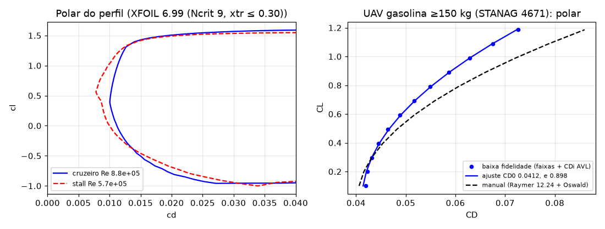

- Perfil: XFOIL 6.99 (Ncrit 9, xtr ≤ 0.30); Re de cruzeiro 8.75e+05, cm0 = -0.0971
- clmax do perfil (Re de perda 5.74e+05) = 1.551 → CLmax limpo 1.396 (Raymer Eq. 12.15)
- Carga em envergadura: AVL 3.40 (VLM), 2 ângulos; e_inv = 0.952, fator de fuselagem (Kroo) 0.9901
- CDp da asa (integração em faixas, CL = 0.5) = 0.00919 vs termo do manual 0.00828
- **Polar usada no ciclo: CD0 = 0.04119, K = 0.02215 (e = 0.898)**

- perfil NACA 4415: Re cruzeiro 8.75e+05 (xtr = 0.30), clmax a Re_stall 5.74e+05 (transição livre, Ncrit 9)

### Comparação AVL / baixa fidelidade vs métodos de manual

| grandeza | manual | AVL / baixa fid. | método manual | nota |
|---|---|---|---|---|
| CLα asa [/rad] | 5.24 | 5.672 | DATCOM / Raymer Eq. 12.6 | AVL: avião completo (asa + cauda), sem fuselagem |
| CDi a CL = 0.810 | 0.02131 | 0.01346 | Oswald Raymer e = 0.612 | AVL e (Trefftz) = 0.970; Oswald inclui arrasto viscoso dependente de CL |
| x̄_NP [MAC] | 0.4534 | 0.5246 | Raymer Eq. 16.9 + Torenbeek (fuselagem) | sem fuselagem: 0.494 (AVL não modela a fuselagem) |
| CLδe [/rad] | 0.2309 | 0.2605 | Nelson Ch. 2/5 (τ: Raymer Fig. 16.7 / DATCOM) |  |
| Cmδe [/rad] | -1.122 | -1.208 | Nelson Ch. 2/5 (τ: Raymer Fig. 16.7 / DATCOM) | AVL: Cmδe no CG traseiro; Cnδr com convenção de sinal AVL |
| |Clδa| [/rad] | 0.383 | 0.2968 | Nelson Ch. 2/5 (τ: Raymer Fig. 16.7 / DATCOM) |  |
| Cnδr [/rad] | -0.06125 | 0.05546 | Nelson Ch. 2/5 (τ: Raymer Fig. 16.7 / DATCOM) | AVL: Cmδe no CG traseiro; Cnδr com convenção de sinal AVL |
| CD0 (polar ajustada) | 0.04028 | 0.04119 | Raymer Eq. 12.24 | perfil XFOIL 6.99 (Ncrit 9, xtr ≤ 0.30); ajuste rms 2.2e-04 |
| e efetivo | 0.6122 | 0.898 | Raymer Eq. 12.49 | baixa fid.: AVL e_inv × Kroo (fuselagem) + cd(cl) do perfil |
| cl_max do perfil | 1.5 | 1.551 | pressuposto do utilizador | XFOIL/NeuralFoil a Re = 5.74e+05 |

## 11. Estruturas: V-n, cargas na asa e caixão (Fase 2)

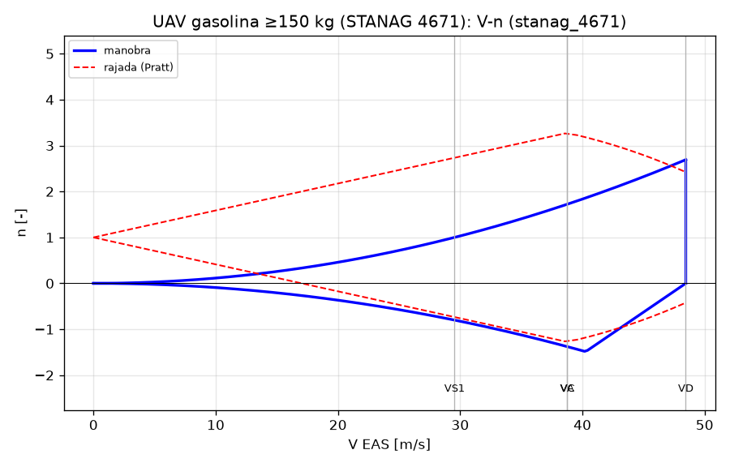

| grandeza | valor |
|---|---|
| regulation | stanag_4671 |
| category | utility |
| VS1_EAS_m_s | 29.53 |
| VA_EAS_m_s | 38.77 |
| VC_EAS_m_s | 38.77 |
| VD_EAS_m_s | 48.46 |
| n_manoeuvre_pos | 4.4 |
| n_manoeuvre_neg | -1.76 |
| n_gust_VC | 3.276 / -1.276 |
| n_gust_VD | 2.422 / -0.422 |
| mu_g | 81.34 |
| Kg | 0.8262 |
| n_limit_pos | 4.4 |
| n_limit_neg | -1.76 |
| governing | manobra |
| n_ultimate | 6.6 |

Cláusulas aplicadas: USAR.333 (envelope); USAR.335(a)(1) VC from operating requirements; USAR.335(b)(1) VD ≥ 1.25 VC; USAR.335(c) VA ≥ VS√n; USAR.337; USAR.341 / USAR.333(c); USAR.303 FS = 1.5

- ⚠️ n_lim = 4.40 está acima da linha de perda mesmo a VD (n = 2.69 com CLmax quase-estático): valor CONSERVATIVO mantido (a perda dinâmica numa rajada pode excedê-lo); VC baixo face a VS1 — rever VC/CLmax antes de dimensionar

Condição crítica de dimensionamento: n = 4.40 (manobra), q a VD = 48.5 m/s EAS.

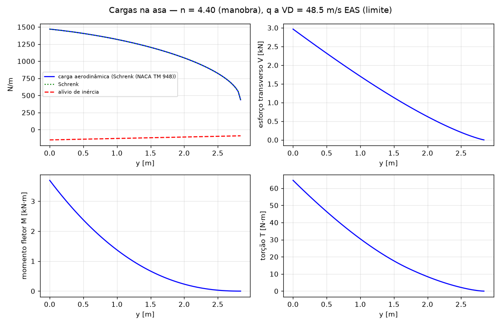

Raiz (limite): V = 2965.4 N, M = 3698.6 N·m, T = 64.6 N·m.

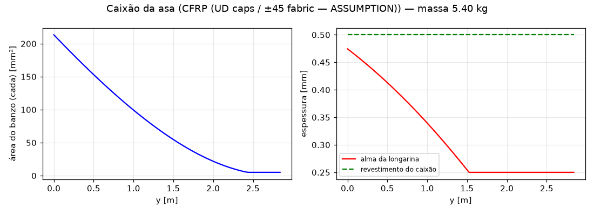

| parcela | massa [kg] |
|---|---|
| caps | 1.353 |
| box_skins | 1.406 |
| core | 0.3832 |
| webs | 0.2195 |
| web_uprights | 0 |
| LE_TE_skins | 0.8903 |
| ribs | 0.07044 |
| ideal | 4.322 |
| nonoptimum | 1.081 |
| total | 5.403 |

Cross-check da massa da asa:

| método | massa da asa [kg] |
|---|---|
| Raymer Eq. 15.46 (estatístico) | 15.73 |
| caixão Megson/Bruhn, carga Schrenk (CFRP (UD caps / ±45 fabric — ASSUMPTION)) | 5.403 |
| caixão Megson/Bruhn, carga AVL | 5.377 |

- Revestimentos em sanduíche: núcleo PVC/PMI foam (ASSUMPTION) ρ = 75 kg/m³, E_c = 70 MPa, G_c = 30 MPa (PRESSUPOSTO); núcleo na raiz 3.3 mm, máx. 3.3 mm; interação R_c + R_s² ≤ 1 (Bruhn C5)
- Enrugamento das faces σ_wr = 0.5 (E_f E_c G_c)^(1/3) = 251 MPa (Hoff & Mautner) → OK
- Almas: núcleo sanduíche onde τ > τ_cr (máx. 2.0 mm)
- allowables are ASSUMPTIONS (knock-down for environment/damage)
- 30 nervuras (passo 0.22 m)
- fator não-ótimo 1.25 (PRESSUPOSTO)
- superfícies de comando, flaps e carenagens NÃO incluídos (secundários)
- Eixo elástico = centro de corte da secção real (Megson, multicélula, com bordo de ataque D): x_sc/c raiz 0.350 (meio do caixão 0.425); EI/GJ da secção idealizada no contorno do perfil

### Viga L1: fuselagem, empenagens e torção elástica

Fuselagem 5.5 kg, Raymer Eq. 15.49 7.3 kg (razão 0.75). Estabilizador 0.2 kg, deriva 0.2 kg. CG estrutural 1.013365710030863 m (não move as estações Roskam do peso e centragem).
Deflexão da cauda no caso limite 0.4 mm; torção da deriva 0.016°.
Correção elástica de cruzeiro: aplicada = não; K_flex/K_rígido = 0.9986; torção de ponta -0.087°; CLα flexível 5.327 /rad. O CLα de manual do resultado mantém-se.
- Fuselagem: casca circular não reforçada, γ de NASA SP-8007 (1968) na encurvadura clássica 0,605 E t/R (Timoshenko & Gere, ν = 0,3). Longarinas só com área mínima (o momento já está no revestimento).
- Piso 0.45 L × 0.75 D, duas anteparas π R² à espessura mínima (Torenbeek 1982 App. D lista estes itens; a espessura é a mínima do material — PRESSUPOSTO). Fator não-ótimo 1.25 só em revestimento + longarinas + cavernas.
- Envelope de manobra: sustentação atingível do estabilizador a VA (Raymer 12.15), equilíbrio + 23.423(b), inércia do motor e aterragem (23.473). 23.427 (rajada) e 23.441 (leme) não estão modelados. Torção assimétrica do estabilizador omitida.
- Estação da asa neste fecho: x = 0.67 m (centro aerodinâmico: ápice colocado pela estabilidade + quarto da corda média).
- γ de SP-8007 é uma correlação de cilindros de alumínio. Em CFRP entra como PRESSUPOSTO conservativo, não como ensaio do laminado.
- Empenagens: caixão de duas longarinas (Megson), carga em envergadura uniforme — PRESSUPOSTO, M_raiz = L b/8 por semienvergadura, mais pesado em flexão do que uma elipse. c_lmax de secção 1 (estabilizador) e 0.8 (deriva), não o da asa; CLmax pela Eq. 12.15 de Raymer.
- k_EI e k_GJ multiplicam EI e GJ da asa (razão viga/BoxFEM). A fuselagem não os usa.
- Massa da fuselagem L1 / Raymer Eq. 15.49 = 0.75. A regressão de Raymer inclui portas, janelas e suportes que esta casca não tem.

## 12. Estabilidade e controlo (Fase 2: Raymer Cap. 16, Etkin & Reid, Nelson)

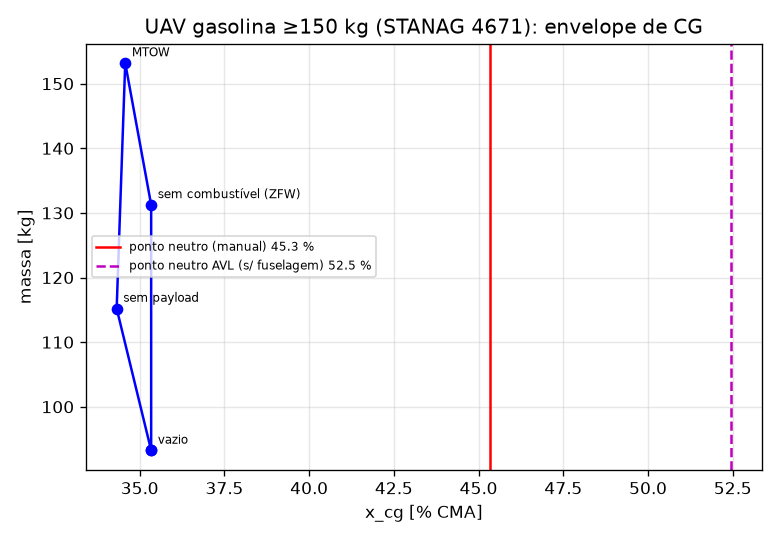

- asa posicionada para SM = 10% no CG mais recuado (ápice a 17.6% L); ápice da asa a x = 0.562 m
- Ponto neutro x̄_NP = 0.453 MAC (manual), 0.525 (AVL); dε/dα = 0.208
- **Margem estática: 11.0 % (CG dianteiro) … 10.0 % (CG traseiro)**
- AVL, cruzeiro compensado no CG traseiro: α = 4.43°, δe = -4.72°, Cnβ = 0.0634, Clβ = -0.0792, Cmq = -18.17
- Coef. de volume: V_h = 0.500, V_v = 0.0300 (Raymer Table 6.4: - / -)

| caso | massa [kg] | x_cg [m] | x̄_cg [MAC] | SM |
|---|---|---|---|---|
| vazio | 93.24 | 0.7107 | 0.3534 | 0.1 |
| sem payload | 115.2 | 0.7071 | 0.3432 | 0.1102 |
| MTOW | 153.2 | 0.708 | 0.3457 | 0.1077 |
| sem combustível (ZFW) | 131.2 | 0.7107 | 0.3534 | 0.1 |

Compensação (trim) no CG dianteiro:

| condição | CL | δe [°] | ok (|δe| ≤ máx.) |
|---|---|---|---|
| CLmax limpo (CG dianteiro) | 1.396 | -12.26 | True |
| cruzeiro (CG dianteiro) | 0.8099 | -8.964 | True |

- Clδa comparado em módulo (convenções de sinal do aileron diferem entre AVL e Nelson).
- Estações de estrutura: PRESSUPOSTOS (Roskam Part V Table 8.1, valores típicos). Tripulação, carga e bateria, se a missão não as der, ficam no CG da massa fixa (Raymer 2018 Sec. 15.1: a estação que não desloca o balanço). Um UAV sem massa de tripulação não leva tripulação. O combustível de asa fica a 30 % da CMA. Substituir em assumptions.stability.stations.

## 12a. Peso e centragem operacional e trem de aterragem

Peso e centragem (Raymer 2018 Sec. 15.1; Roskam Parte II Cap. 10). Os limites, quando não são dados no ficheiro, são os conceptuais: margem estática alvo atrás e, à frente, o mais à ré entre o trim no CLmax limpo e o flare com flaps.

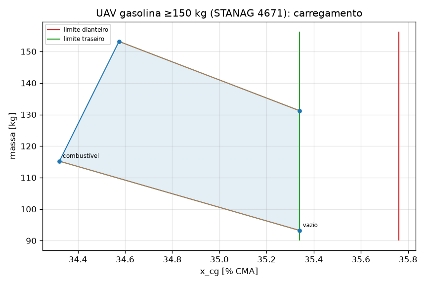

4 carregamento(s) fora dos limites conceptuais; extremos 0.707 m (combustível, 115 kg) e 0.711 m (vazio, 93 kg). Os limites são de projeto (margem estática e trim), não um envelope aprovado.

| carregamento | massa [kg] | x_cg [m] | x̄ [% CMA] |
|---|---|---|---|
| vazio | 93.24 | 0.7107 | 35.34 |
| combustível | 115.2 | 0.7071 | 34.32 |
| payload | 131.2 | 0.7107 | 35.34 |
| payload + combustível | 153.2 | 0.708 | 34.57 |

Limites a W0: dianteiro 0.7122671419958604 m, traseiro 0.7107398272585703 m.

- Limite dianteiro conceptual: dimensiona «flare com flaps» a 0.712 m. Casos: limpo a 0.642 m (CL 1.40, Cm0 -0.0863), flare com flaps a 0.712 m (CL 1.80, Cm0 -0.3261). Nelson 1998 Cap. 2, |δe| = 25°. Cm0 da asa = -0.0863 (Raymer Eq. 16.13, cm0 do perfil) Cm0,f = -0.0698 entra no flare (Multhopp, Nelson 1998 Cap. 2; k2−k1 da tabela de Lamb em Tuckerman, NACA Report 139; α0 = -3.97°. Largura constante igual a D e i_f = 0, PRESSUPOSTO — fuselagem de revolução, Torenbeek App. F, sem segmentar nariz e cauda) ΔCm do flap = -0.1700 entra no flare (Glauert 1926, b_C·δ·S_f/S; δ = 30° (PRESSUPOSTO, omissão de flightsim/controls.py — substituir em assumptions.aero.flap.landing_deg); c_f/c = 0.25 (PRESSUPOSTO, omissão de flightsim/controls.py — substituir em assumptions.aero.flap.cf_c); S_f/S = 0.500; corda da parte com flap igual à CMA, PRESSUPOSTO). Efeito de solo no flare: CLα da cauda × 1.019 (φ = 0.943 = 1 − exp[−2.48 (2h/b)^0.768], Torenbeek 1982, citado por Phillips e Hunsaker, Journal of Aircraft, Vol. 50, No. 4, 2013, Eq. (4); h/b = 0.604, h = 0.550 m, trem + 0.5 D, weights.components.main_gear_length_m; PRESSUPOSTO: o centro aerodinâmico da cauda está à altura do eixo da fuselagem). 1/CLα = 1/a0 + φ/(π AR), a0 = 0.95·2π, e = 1 (PRESSUPOSTO). O quociente multiplica o CLα livre e não substitui o declive de Helmbold. O CLmax não aumenta e o dε/dα do ponto neutro não é reduzido: essa redução é a penalização de rotação, não um alívio do flare. Na tesoura, φ repete-se em cada S_h/S porque a envergadura muda com a área. O flare fica em efeito de solo só neste declive. O fator de Hoerner e Borst não é usado como CLα.
- Limite traseiro conceptual: ponto neutro menos a margem estática alvo (Raymer Cap. 16).
- Estações de CG: as da estabilidade. Estrutura: Roskam Parte V, Tabela 8.1 (PRESSUPOSTO). Tripulação, carga e bateria, se a missão não as der, ficam no CG da massa fixa (Raymer 2018 Sec. 15.1); combustível de asa a 30 % da CMA. Substituir em assumptions.stability.stations, weight_balance.loading ou extra_items. O combustível arde na estação do tanque; não há combustível inutilizável separado.
- A tripulação, quando existe, vai em todos os carregamentos.

**Trem (tricycle).** tricycle: sem posição na fuselagem; h_cg 0.55 m. Nenhum entre-eixos da banda 8.0–15.0 % mantém o nariz em x ≥ 0.00 m e o principal até 3.20 m (Raymer Cap. 11).

W_aterragem 146 kg (95 % de W0; 14 CFR 23.473(b) permite 95 % sem verificar a cláusula de combustível); W/S 14.79 lb/ft²; V = 8.63 ft/s (2.63 m/s, 23.473(d)); n_inércia 3.67; n_reação 3.00; curso 0.171 m para n_g = 3.00 (fator já usado no peso, com pisos de 14 CFR 23.473(g)); η = 0.80 (oleo); κ = 0.667 (teto regulamentar 2/3). Sem sustentação da asa o curso sobe para 0.252 m. Spin-up, mola de retorno, carga lateral e travões não entram neste passo.

| verificação | ok | resultado |
|---|---|---|
| gear:position | não | não há entre-eixos na banda 8.0–15.0 % com as duas rodas dentro da fuselagem (0–3.200 m, nariz ≥ 0.000 m; Raymer Cap. 11) |
| gear:tipback | não | sem posição de trem |
| gear:stroke | sim | curso 0.171 m para n_g = 3.00 (fator já usado no peso, com pisos de 14 CFR 23.473(g)) |


- h_cg PRESSUPOSTO = comprimento do trem principal + raio da fuselagem (CG no eixo da fuselagem; o mesmo pressuposto de flightsim/controls.py). Substituir por landing_gear.h_cg_m.
- O curso é o do amortecedor para o n_g das equações de peso (Raymer Tabela 11.5 no valor por omissão). O pneu (η = 0.47) só conta se landing_gear.tire_stroke_m for dado.
- Balanço de energia: Currey 1988 §5.3, N = [V²/(2g) + (1−κ)(S+S_t)] / (η_s S + η_t S_t).

## 13. Desempenho por segmentos (Fase 2: Raymer Cap. 17, Anderson)

Orçamento utilizável: Wf / 1.06 (reserva + não utilizável 6 %, Raymer Eq. 3.11).

Missão requerida (segmentos):

| segmento | t [min] | dist [km] | consumo [kg] | h [m] | V [m/s] | nota |
|---|---|---|---|---|---|---|
| aquecimento + descolagem | 0 | 0 | 4.596 | 0→0 | 0 | Raymer Table 3.2 (0.970) |
| subida (V_y) | 13.6 | 30.72 | 0.652 | 0→3000 | 37.83 | potência de subida, integrado (V médio) |
| espera (loiter) | 600 | 1620 | 13.93 | 3000→3000 | 45 |  |
| descida (L/D máx, ralenti) + aterragem | 27.52 | 49.66 | 0.7398 | 3000→0 | 30.07 | Raymer 0.995 (combustível) |

Missão até esgotar o orçamento: **alcance 1795.3 km, endurance 11.27 h**.

| segmento | t [min] | dist [km] | consumo [kg] | h [m] | V [m/s] | nota |
|---|---|---|---|---|---|---|
| aquecimento + descolagem | 0 | 0 | 4.596 | 0→0 | 0 | Raymer Table 3.2 (0.970) |
| subida (V_y) | 13.6 | 30.72 | 0.652 | 0→3000 | 37.83 | potência de subida, integrado (V médio) |
| espera (loiter) | 635.2 | 1715 | 14.73 | 3000→3000 | 45 | estendido até esgotar o orçamento |
| descida (L/D máx, ralenti) + aterragem | 27.61 | 49.66 | 0.7398 | 3000→0 | 29.98 | Raymer 0.995 (combustível) |

Requisitos vs desempenho por segmentos:

| requisito | grandeza | obtido | requerido | unidade | ok |
|---|---|---|---|---|---|
| endurance | tempo em espera (segmentos) | 10.59 | 10 | h | ✅ |
| service_ceiling | teto de serviço (Anderson) | 5658 | 5000 | m | ✅ |
| climb_rate | ROC máx. ao nível do mar | 4.799 | 3 | m/s | ✅ |
| takeoff_ground_roll | corrida de descolagem (Raymer 17.8) | 296.8 | 300 | m | ✅ |

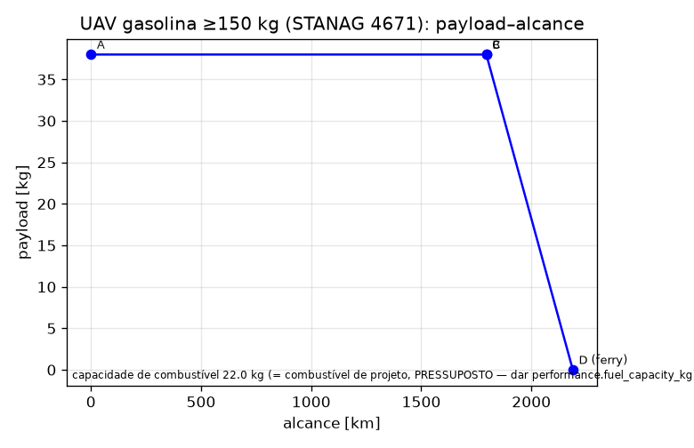

| ponto | payload_kg | combustível_kg | massa_kg | range_km |
|---|---|---|---|---|
| A | 38 | 0 | 131.3 | 0 |
| B | 38 | 21.96 | 153.2 | 1795 |
| C | 38 | 21.96 | 153.2 | 1795 |
| D (ferry) | 0 | 21.96 | 115.2 | 2188 |

Nota: capacidade de combustível 22.0 kg (= combustível de projeto, PRESSUPOSTO — dar performance.fuel_capacity_kg).

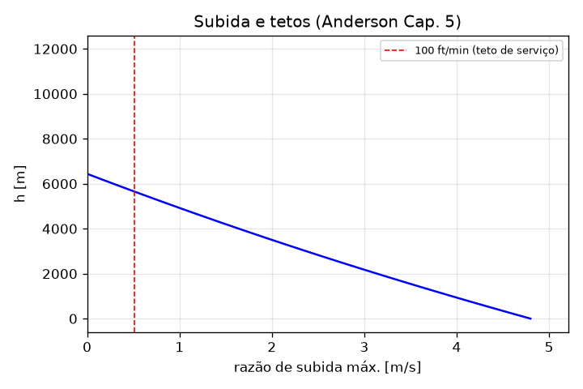

- ROC máx. ao nível do mar 4.80 m/s; teto de serviço 5658 m; teto absoluto 6441 m
- Descolagem (Raymer 17.8): corrida 297 m, total sobre 15 m 502 m (V_TO 32.0 m/s)
- Aterragem (Raymer 17.9): corrida 222 m, total sobre 15 m 526 m (μ_travagem 0.4; aproximação γ = 3° — `performance.approach_angle_deg`, por omissão o máximo de 5.2 % / 3° de CS/14 CFR 23.75(a)(1))

- Os resultados de segmentos usam a mesma polar e reservas do dimensionamento; diferenças face aos requisitos vêm da subida/descida integradas vs. frações históricas (Raymer Table 3.2).

## 14. Caixão da asa dimensionado à estabilidade (Fase 3: Bruhn C5/C7/C11, Farrar, Kuhn)

| caixão | massa [kg] | / Raymer 15.46 |
|---|---|---|
| resistência (Fase 2, limite inferior) | 4.045 | 0.2572 |
| encurvadura (Fase 3, CFRP (UD caps / ±45 fabric — ASSUMPTION)) | 5.403 | 0.3436 |
| Raymer Eq. 15.46 (asa completa, estatístico) | 15.73 | 1 |

Parcelas (caixão de encurvadura):

| parcela | massa [kg] |
|---|---|
| caps | 1.353 |
| box_skins | 1.406 |
| core | 0.3832 |
| webs | 0.2195 |
| web_uprights | 0 |
| LE_TE_skins | 0.8903 |
| ribs | 0.07044 |
| ideal | 4.322 |
| nonoptimum | 1.081 |
| total | 5.403 |

- Almas Kuhn: fator de tração diagonal k máx. 0.000 (k = 0: alma resistente ao corte, sem tração diagonal)
- Revestimentos em sanduíche: núcleo PVC/PMI foam (ASSUMPTION) ρ = 75 kg/m³, E_c = 70 MPa, G_c = 30 MPa (PRESSUPOSTO); núcleo na raiz 3.3 mm, máx. 3.3 mm; interação R_c + R_s² ≤ 1 (Bruhn C5)
- Enrugamento das faces σ_wr = 0.5 (E_f E_c G_c)^(1/3) = 251 MPa (Hoff & Mautner) → OK
- Almas: núcleo sanduíche onde τ > τ_cr (máx. 2.0 mm)
- allowables are ASSUMPTIONS (knock-down for environment/damage)
- 30 nervuras (passo 0.22 m)
- fator não-ótimo 1.25 (PRESSUPOSTO)
- superfícies de comando, flaps e carenagens NÃO incluídos (secundários)
- Eixo elástico = centro de corte da secção real (Megson, multicélula, com bordo de ataque D): x_sc/c raiz 0.350 (meio do caixão 0.425); EI/GJ da secção idealizada no contorno do perfil

## 15. Aeroelasticidade clássica (Fase 3)

V_D = 48.5 m/s EAS.

| fenómeno | V [m/s EAS] | requerido 1.2 V_D | margem | ok | método |
|---|---|---|---|---|---|
| divergência torsional | 260 | 58.15 | +347 % | ✅ | W&C 8.3 / Bisplinghoff 8-2 (faixas + FE) |
| inversão do aileron | n/a | 58.15 | sem ocorrência | ✅ | W&C 8.4, Glauert (flap 2D) |
| flutter binário (flexão–torção) | 116 | 58.15 | +99 % | ✅ | W&C 11 (modos assumidos, quase-estacionário) |

- Frequências desacopladas: flexão 7.37 Hz, torção 45.9 Hz; flutter a 36.7 Hz
- AEER-45 (fator de flexibilidade torsional da asa): F = 1.672e-03 vs F_max = 200/V_D² = 1.702e-02 → OK

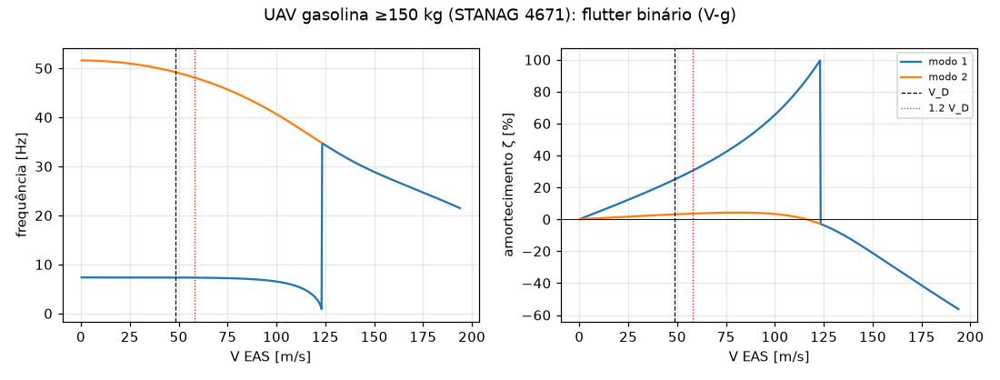

### Acoplamento aero-estrutural estático (OpenAeroStruct, VLM + caixão)

| ponto | modelo | α [°] | CL | CDi | CLα [/rad] | flecha ponta [m] | torção ponta [°] |
|---|---|---|---|---|---|---|---|
| cruise | rígido | 8.518 | 0.8099 | 0.01288 | 5.41 | 6.031e-06 | 2.858e-05 |
| cruise | flexível | 8.368 | 0.8099 | 0.01292 | 5.516 | 0.06084 | 0.288 |
| manobra (n_lim, V_D EAS, nível do mar) | rígido | 24.6 | 2.281 | 0.1014 | 5.01 | 2.482e-05 | 0.0001169 |
| manobra (n_lim, V_D EAS, nível do mar) | flexível | 23.75 | 2.281 | 0.1024 | 5.262 | 0.2523 | 1.187 |

- Efeito da forma deformada no arrasto induzido de cruzeiro: K_flex/K = 1.0034
- Missão por segmentos: rígido 1795.3 km / 11.273 h → flexível 1793.9 km / 11.264 h (comparação com o resultado desacoplado da Fase 2)
- ponto de manobra: CL = 2.28 > CLmax limpo 1.40 (n_lim de rajada acima da linha de perda) — caso de carga válido para a deformação (VLM linear), α não físico
- OpenAeroStruct VLM (sem viscoso/onda: só arrasto induzido) + FEM de caixão 'wingbox' acoplados por NLBGS; rígido = E, G × 10⁴
- secção do caixão: NACA-4 entre longarinas; espessuras de alma/revestimento do caixão acdt (5 pontos de controlo); revestimento único equivalente que reproduz EI(y) do caixão acdt e G ajustado para GJ (PRESSUPOSTO)
- sem alívio de peso estrutural nem de combustível na asa (conservativo para a deformação)
- índice de falha OAS (von Mises/KS, σ_adm = σ_cap/1.5) na manobra: +0.377 (< 0 = OK) — critério de resistência do OAS sobre o revestimento equivalente — INDICATIVO (o dimensionamento é o do caixão acdt)
- massa da asa 15.73 kg distribuída ∝ corda; CG da secção a 0.50 c; eixo elástico a 0.342 c (centro de corte da secção, média), e = 0.092 c atrás do c.a.; a_w = 6.283/rad (2D, teoria das faixas — sem correção 3D/compressibilidade)
- encastramento na parede da fuselagem y0 = 0.200 m; EI/GJ do caixão buckling
- requisito: livre de flutter/divergência/inversão até 1.2 V_D = 58.1 m/s EAS (14 CFR 23.629(c) legado; CS/14 CFR 23.2245 'suficientemente além'; STANAG 4671 USAR.629 — verificar)
- flutter: modelo binário de modos assumidos (W&C Cap. 11), aerodinâmica quase-estacionária — ESTIMATIVA; a análise racional exige modos FEM + DLM (Fase 4)
- UAV (STANAG 4671): AEER-45 é um critério FAA para aviação geral — informativo

## 16. Diagrama de tesoura, modos dinâmicos e qualidades de voo (Fase 3)

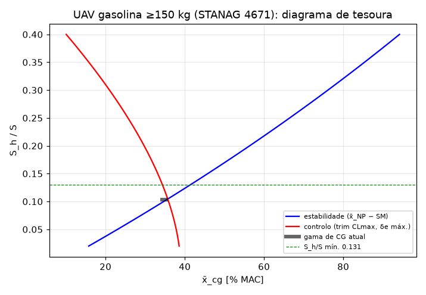

- S_h/S atual 0.103; requerido 0.131 (estabilidade 0.103, controlo 0.131; dimensionante: controlo) → ❌ (Torenbeek Cap. 9)
- linha de controlo: o x̄ mais à ré entre o CLmax limpo 1.40 (Cm0 asa -0.0863) e o flare com flaps (CLmax aterragem 1.80, Cm0 -0.3261), δe = −25°, τ_e = 0.661. Cm0 da asa = -0.0863 (Raymer Eq. 16.13, cm0 do perfil) Cm0,f = -0.0698 entra no flare (Multhopp, Nelson 1998 Cap. 2; k2−k1 da tabela de Lamb em Tuckerman, NACA Report 139; α0 = -3.97°. Largura constante igual a D e i_f = 0, PRESSUPOSTO — fuselagem de revolução, Torenbeek App. F, sem segmentar nariz e cauda) ΔCm do flap = -0.1700 entra no flare (Glauert 1926, b_C·δ·S_f/S; δ = 30° (PRESSUPOSTO, omissão de flightsim/controls.py — substituir em assumptions.aero.flap.landing_deg); c_f/c = 0.25 (PRESSUPOSTO, omissão de flightsim/controls.py — substituir em assumptions.aero.flap.cf_c); S_f/S = 0.500; corda da parte com flap igual à CMA, PRESSUPOSTO). Efeito de solo no flare: CLα da cauda × 1.019 (φ = 0.943 = 1 − exp[−2.48 (2h/b)^0.768], Torenbeek 1982, citado por Phillips e Hunsaker, Journal of Aircraft, Vol. 50, No. 4, 2013, Eq. (4); h/b = 0.604, h = 0.550 m, trem + 0.5 D, weights.components.main_gear_length_m; PRESSUPOSTO: o centro aerodinâmico da cauda está à altura do eixo da fuselagem). 1/CLα = 1/a0 + φ/(π AR), a0 = 0.95·2π, e = 1 (PRESSUPOSTO). O quociente multiplica o CLα livre e não substitui o declive de Helmbold. O CLmax não aumenta e o dε/dα do ponto neutro não é reduzido: essa redução é a penalização de rotação, não um alívio do flare. Na tesoura, φ repete-se em cada S_h/S porque a envergadura muda com a área. O flare fica em efeito de solo só neste declive. O fator de Hoerner e Borst não é usado como CLα.
- massa da cauda não realimentada (posição da asa e braço fixos)
- gama de CG: a mesma do trim (extremos dos casos de carregamento)

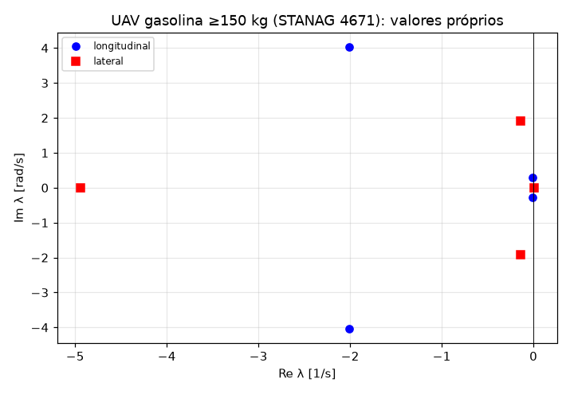

| modo | ωn [rad/s] | ζ | período [s] | τ / T [s] |
|---|---|---|---|---|
| período curto | 4.508 | 0.4455 | 1.557 | - |
| fugóide | 0.283 | 0.04143 | 22.22 | - |
| rolamento holandês | 1.914 | 0.07427 | 3.291 | - |
| rolamento (constante de tempo) | - | - | - | 0.2022 |
| espiral instável | - | - | - | 89.49 |

- n/α = 6.81 g/rad, CAP = 2.98 1/(g s²)
- Inércias (Roskam V, soma por componentes): Ixx 88.7, Iyy 23.3, Izz 112 kg·m²
- derivadas de taxa e laterais: AVL (sem fuselagem) + Cnβ da fuselagem (Raymer 16.47) -0.0383
- Cmα = −CLα·SM no CG de MTOW (ponto neutro de manual com fuselagem)
- inércias por soma de componentes (Roskam Parte V) — PRESSUPOSTOS de estações

Qualidades de voo — MIL-F-8785C, Classe I, categoria B (nível exigido 1):

| modo | valor | nível | limite N1 | ref |
|---|---|---|---|---|
| período curto ζ | 0.4455 | 1 | 0.30–2.00 | MIL-F-8785C Table IV |
| CAP = ω²/(n/α) [1/(g s²)] | 2.984 | 1 | 0.085–3.6 | MIL-F-8785C Figs. 1–3 |
| fugóide ζ | 0.04143 | 1 | ≥ 0.04 | MIL-F-8785C 3.2.1.2 |
| rolamento holandês ζ / ζω / ω | 0.074 / 0.142 / 1.91 | 2 | 0.08 / 0.15 / 0.4 | MIL-F-8785C Table VI |
| rolamento τ_R [s] | 0.2022 | 1 | ≤ 1.4 | MIL-F-8785C Table VII |
| espiral T2 [s] (∞ = estável) | 89.49 | 1 | ≥ 20 | MIL-F-8785C Table VIII |


## Pressupostos usados

```yaml
weights:
  method: components
  initial_class: uav_tactical_recce_ucav
  fixed_fraction: null
  A: null
  C: null
  tech_factor: 1.0
  Kvs: 1.0
  fixed_mass_kg: 0.0
  components:
    material: composite
    structural_category: utility
    landing_gear: tricycle
    main_gear_length_m: 0.35
    nose_gear_length_m: 0.3
    engine_kW_per_kg: 0.9
    avionics_uninstalled_kg: 6
    n_tanks: 1
    items:
    - name: gerador/alternador + regulador
      mass_kg: 2.0
      group: equipment
    - name: servos (6) + cablagem de sinal
      mass_kg: 2.5
      group: equipment
    - name: suporte do payload + amortecimento
      mass_kg: 1.5
    - name: bateria de backup (avionics)
      mass_kg: 1.5
      group: equipment
    growth_allowance: 0.05
aero:
  AR: 16
  taper: 0.6
  sweep_c4_deg: 0.0
  tc_root: 0.15
  tc_tip: 0.12
  xc_max_t: 0.3
  airfoil: NACA 4415
  clmax_airfoil: 1.5
  flap:
    kind: plain
    flapped_area_ratio: 0.5
  oswald: null
  cfe: 0.0055
  swet_sref: 4.0
  laminar:
    wing: 0.3
    htail: 0.3
    vtail: 0.3
    fuselage: 0.1
  roughness: smooth_molded_composite
  Q: {}
  lp_fraction: 0.05
  extra_drag_areas_m2:
    fixed_gear: 0.03
    gimbal_eo_ir: 0.012
    antennas_misc: 0.004
  CL_ground: 0.5
  dCD0_takeoff: 0.01
  mu_roll: 0.04
  fidelity: lowfi
  airfoil_solver: xfoil
propulsion:
  eta_cruise: 0.78
  eta_climb: 0.75
  eta_takeoff: 0.55
  bsfc_lb_hp_h: null
  tsfc_1_h: 0.5
  battery_Wh_kg: 200.0
  eta_total: 0.7
  dod: 0.8
  energy_reserve: 0.2
  systems_power_W: 0.0
  n_engines: 1
  propeller: null
geometry:
  fuselage_length_m: 3.2
  fuselage_diameter_m: 0.4
  fuselage_fineness: 7.0
  fuselage_class: null
  tail_class: null
  c_ht: 0.5
  c_vt: 0.03
  tail_arm_fraction: 0.55
  ar_h: 4.0
  ar_v: 1.5
  dihedral_deg: null
  configuration: conventional
  tail_dihedral_deg: null
  boom_span_fraction: 0.35
  pod_length_fraction: 0.55
  boom_width_m: null
  taper_v: 0.5
constraints:
  cruise_weight_fraction: 1.0
  landing_weight_fraction: 1.0
  approach_distance_ft: 600.0
  margin: 0.0
  ws_initial_psf: 17.0
  ws_min: 50.0
  ws_max: 3000.0
  default_cruise_altitude_m: 0.0
  ws_fixed: null
  value_fixed: null
mda:
  max_iter: 30
  tol: 1.0e-05
  tol_lowfi: 0.0002
structures:
  regulation: auto
  load_factor_from_vn: true
  material: auto
  nonoptimum_factor: 1.25
  VH_eas_m_s: null
  elastic_axis: section
  le_cell: true
  flex: false
  mass_in_loop: false
  wingbox:
    hold_section: false
stability:
  target_static_margin: 0.1
  wing_apex_x_fraction: null
  stations: {}
  inertia_method: components
  roskam_reference: null
  radii_of_gyration: null
  elevator_max_deg: 25.0
  use_avl: true
  dynamics: true
  hq_category: B
  hq_required_level: 1
performance:
  fuel_capacity_kg: null
  max_payload_kg: null
  mu_brake: 0.4
  approach_angle_deg: 3.0
aeroelasticity:
  enabled: true
  a_w: 6.283185307179586
  x_cg_chord: null
  margin_factor: 1.2
  static_aerostructural: true
mdo:
  objective: null
  solver: nlbgs
  trust_region_iterations: 8
  trust_region_radius: 0.3
  design_vars:
  - ws
  - AR
  AR_bounds:
  - 5.0
  - 16.0
  ws_bounds_factor:
  - 0.6
  - 1.4
  pw_bounds_factor:
  - 0.6
  - 1.6
  maxiter: 60
  tol: 1.0e-06
  hq_aeroel_constraints: false
  hq_aeroel_keys: null
cost: {}
calibration:
  file: null
  apply: []
  factors: {}
weight_balance:
  crew_optional: false
  extra_items: []
  x_forward_m: null
  x_aft_m: null
  forward_limit: null
  aft_limit: null
  lemac_arm_in: null
  mac_in: null
landing_gear:
  h_cg_m: null
  tipback_deg: 15.0
  overturn_max_deg: 63.0
  nose_fraction_min: 0.08
  nose_fraction_max: 0.15
  wing_lift_fraction: 0.6666666666666666
  absorber: oleo
  eta: null
  stroke_m: null
  tire_stroke_m: 0.0
  max_stroke_m: null
  rotation_min_deg: 10.0
  x_nose_m: null
  x_main_m: null
  x_tail_m: null
  track_m: null
  x_nose_min_m: 0.0
  x_main_max_m: null
launch_recovery: null
```

## Referências

- Raymer, D. P., *Aircraft Design: A Conceptual Approach*, 6th ed., AIAA, 2018 (equation numbers as in the 6th ed.).
- Roskam, J., *Airplane Design*, Parts I–VIII, DARcorporation.
- Gudmundsson, S., *General Aviation Aircraft Design: Applied Methods and Procedures*, Elsevier, 2014.
- Anderson, J. D., *Aircraft Performance and Design*, McGraw-Hill, 1999.
- Torenbeek, E., *Synthesis of Subsonic Airplane Design*, Delft Univ. Press, 1982.
- USAF Stability and Control DATCOM, 1978.
- Hepperle, M., "Electric Flight – Potential and Limitations", NATO STO-MP-AVT-209, 2012.
- Niu, M. C. Y., *Airframe Structural Design*, Conmilit, 1988.
- Drela, M., "First-Order DC Electric Motor Model", MIT, 2007.
- ISO 2533:1975 Standard Atmosphere.
- Nicolai, L. M., Carichner, G. E., *Fundamentals of Aircraft and Airship Design*, Vol. I, AIAA, 2010 (Table 5.1, We = A·W0^B incl. UAV classes).
- EASA CS-23 (Amdt. 4 and earlier) / 14 CFR 23.337 (pre-Amdt. 23-64): limit manoeuvring load factors.
- IEC 60028:1925, International standard of resistance for copper (ρCu = 8890 kg/m³).
- FAA Type Certificate Data Sheet 1E10 (Lycoming O-360/IO-360 series) — engine dry mass in the C172 check.
- Drela, M., "XFOIL: An Analysis and Design System for Low Reynolds Number Airfoils", 1989; XFOIL 6.99 (GPL).
- Drela, M., Youngren, H., AVL 3.40 (Athena Vortex Lattice), MIT, 2022 (GPL).
- Sharpe, P., NeuralFoil, MIT, 2024 (fallback section polars).
- Schrenk, O., "A Simple Approximation Method for Obtaining the Spanwise Lift Distribution", NACA TM 948, 1940.
- Megson, T. H. G., *Aircraft Structures for Engineering Students*, 5th ed., 2013 (Ch. 16, 19–23).
- Bruhn, E. F., *Analysis and Design of Flight Vehicle Structures*, 1973 (Ch. A3, C5, C11).
- Etkin, B., Reid, L. D., *Dynamics of Flight: Stability and Control*, 3rd ed., Wiley, 1996.
- Nelson, R. C., *Flight Stability and Automatic Control*, 2nd ed., McGraw-Hill, 1998.
- Kroo, I., *Aircraft Design: Synthesis and Analysis*, Stanford (lift-dependent drag, fuselage span-efficiency factor).
- EASA CS-23 Amdt. 4 / 14 CFR 23.333–23.341 (flight envelope, design speeds, gust loads); 14 CFR/CS 23.65 (climb speed).
- NATO STANAG 4671 Ed. 1 (USAR), 2009: USAR.303, .333, .335, .337, .341.
- Abbott, I. H., von Doenhoff, A. E., *Theory of Wing Sections*, Dover, 1959.
