# Relatório de dimensionamento — Cessna 172S (verificação)

_acdt 0.1.0 · Fase 1 (conceptual) + 1E (sistemas) + Fase 2 (baixa fidelidade)_

Requisitos ao estilo do POH do C172S para validar o método.

**Resultado:** ✅ VIÁVEL

**Verificação por segmentos (Fase 2):** ⚠️ pelo menos um requisito não cumprido na missão por segmentos (ver §13)

## 1. Requisitos desta corrida

| requisito | sentido | valor | qualificadores | estágios | avaliado |
|---|---|---|---|---|---|
| propulsion_type | target | piston_prop | - | context | sim |
| regulatory_category | target | cs_23 | - | check, systems | sim |
| crew_mass | target | 77 kg | - | sizing | sim |
| payload_mass | target | 185 kg | - | sizing | sim |
| range | min | 1185 km | - | sizing | sim |
| cruise_speed | target | 122 kt | - | constraint, sizing | sim |
| cruise_altitude | target | 8000 ft | - | context | sim |
| stall_speed | max | 48 kt | - | constraint | sim |
| takeoff_ground_roll | max | 293 m | - | constraint | sim |
| landing_distance | max | 407 m | - | constraint | sim |
| climb_rate | min | 730 ft/min | - | constraint | sim |
| service_ceiling | min | 13500 ft | - | constraint | sim |

Requisitos não definidos (livres / por omissão): endurance, max_speed, load_factor, turn_rate, mtow, wing_span, power_available, thrust_available, unit_cost, noise, mtow_objective

### Validação

- **info**: Nz das equações de massa = 1.5 × n_lim do diagrama V-n (3.95, rajada; cs_23)
- **info**: Massa do caixão da asa (Megson/Bruhn) = 99.88 kg vs Raymer Eq. 15.46 132.10 kg (razão 0.76); usado: Raymer
- **warning**: Desempenho por segmentos não cumpre: distância de aterragem (Raymer 17.9, total 50 ft): 504 m vs requerido ≤ 407 (missão por segmentos — verificação, não altera a viabilidade do dimensionamento)

## 2. Peso à descolagem (Raymer Cap. 3; Hepperle 2012 para elétrico)

| grandeza | valor |
|---|---|
| W0 [kg] | 1161 |
| We [kg] | 720.5 |
| Combustível/bateria [kg] | 178.6 |
| Payload + tripulação [kg] | 262 |
| We/W0 | 0.6206 |
| Wf/W0 | 0.1538 |
| Energia bateria nominal [Wh] | - |

Pernas da missão: cruise 1185000 (SI) @ V=62.8 m/s, L/D=9.2, h=2438 m

## 2a. Estimativa de pesos por componentes (Raymer 6th ed. Cap. 15 + sistemas)

Valor inicial do peso vazio: Raymer 6th ed. Table 3.1 (We/W0 = A W0^C, W0 in lb) 'ga_single_engine'.

Fator de carga último Nz = 5.93 (1.5 × limite). Iteração: estatística → geometria → componentes → novo We → re-dimensionar, até convergir (histórico na secção 8).

| grupo | item | kg | % W0 | método |
|---|---|---|---|---|
| structure | asa | 132.1 | 11.38 | Raymer Eq. 15.46 |
| structure | empenagem horizontal | 12.58 | 1.084 | Raymer Eq. 15.47 |
| structure | empenagem vertical | 6.53 | 0.5624 | Raymer Eq. 15.48 |
| structure | fuselagem | 98.9 | 8.518 | Raymer Eq. 15.49 (unpressurized) |
| structure | trem principal | 74.3 | 6.399 | Raymer Eq. 15.50 |
| structure | trem de nariz | 18.04 | 1.554 | Raymer Eq. 15.51 |
| propulsion | motor instalado (+hélice, berço, capota) | 202.4 | 17.44 | Raymer Eq. 15.52, Wen from engine datasheet (user) |
| propulsion | sistema de combustível | 27.82 | 2.396 | Raymer Eq. 15.53 |
| equipment | comandos de voo (cabos/hastes) | 18.98 | 1.634 | Raymer Eq. 15.54 |
| equipment | hidráulica | 0.9935 | 0.08557 | Raymer Eq. 15.55 (Kh=0.013, M=0.1) |
| equipment | aviónica instalada | 25.12 | 2.163 | Raymer Eq. 15.57, Wuav 15 kg (user) |
| equipment | sistema elétrico | 64.6 | 5.564 | Raymer Eq. 15.56 |
| equipment | interiores (bancos, cintos...) | 38.09 | 3.281 | Raymer Eq. 15.59 |


Resumo por grupo e composição de W0:

| grupo | kg | % W0 |
|---|---|---|
| structure | 342.5 | 29.49 |
| propulsion | 230.3 | 19.83 |
| equipment | 147.8 | 12.73 |
| **peso vazio We** | 720.5 | 62.05 |
| combustível / bateria | 178.6 | 15.38 |
| payload | 185 | 15.93 |
| tripulação | 77 | 6.632 |
| **W0** | 1161 | 100 |


Cross-check estatístico (We/W0 das classes publicadas no W0 obtido; 'fora' = W0 fora do intervalo da base de dados):

| classe | We/W0 | We [kg] | na gama | fonte |
|---|---|---|---|---|
| ga_single_engine | 0.5747 | 667.3 | - | Raymer 6th ed. Table 3.1 (We/W0 = A W0^C, W0 in lb) 'ga_single_engine' |
| homebuilt_composite | 0.5675 | 658.9 | - | Raymer 6th ed. Table 3.1 (We/W0 = A W0^C, W0 in lb) 'homebuilt_composite' |
| nicolai_light_ga | 0.601 | 697.8 | - | Nicolai & Carichner (AIAA 2010) Table 5.1 (We = A W0^B, lb) 'nicolai_light_ga' |


## 3. Design point (diagrama de restrições)

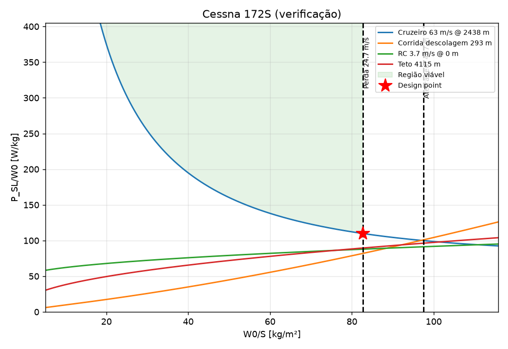

- **W0/S = 811.3 N/m² (82.73 kg/m²)**
- **P/W_SL = 109.8 W/kg** → P_SL = 127 kW
- Restrições ativas: Cruzeiro 63 m/s @ 2438 m, Perda 24.7 m/s
- Área alar S = 14.034 m²

## 4. Geometria de primeira iteração

| parâmetro | valor |
|---|---|
| S_m2 | 14.03 |
| AR | 7.32 |
| span_m | 10.14 |
| taper | 0.7 |
| c_root_m | 1.629 |
| c_tip_m | 1.14 |
| MAC_m | 1.399 |
| y_MAC_m | 2.385 |
| sweep_c4_deg | 0 |
| sweep_LE_deg | 1.381 |
| t/c | 0.12 |

Fuselagem: L = 8.10 m, D = 1.157 m. Empenagem horizontal S = 2.829 m², vertical S = 1.171 m², braço = 4.86 m (coef. de volume, Raymer Eq. 6.28–6.29).

Caixão da asa (parametrizado na geometria, análise na Fase 2): longarinas a 20%/65% c, largura na raiz 0.733 m.

## 5. Aerodinâmica (Raymer Cap. 12 / DATCOM)

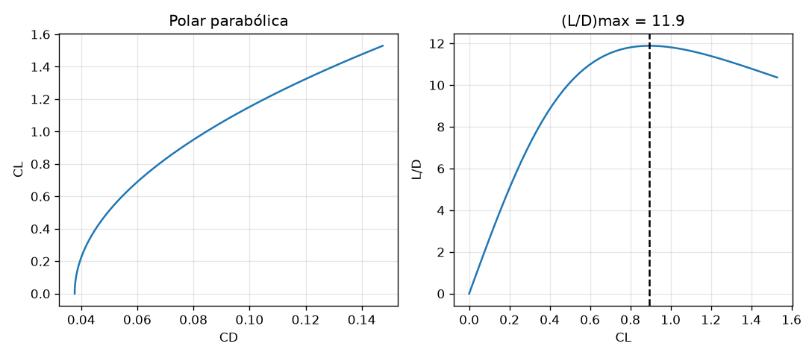

- CLα = 4.587 /rad (0.0801 /deg)
- CLmax limpo / descolagem / aterragem = 1.53 / 1.74 / 2.17
- CD0 = 0.03767, K = 0.0470 (e = 0.926), (L/D)max = 11.89 a CL = 0.90

Decomposição do CD0 (component build-up):

| component | Swet_m2 | Cf | FF | Q | CD0 |
|---|---|---|---|---|---|
| wing | 24.84 | 0.003084 | 1.253 | 1 | 0.006838 |
| htail | 5.739 | 0.003362 | 1.202 | 1.04 | 0.001719 |
| vtail | 2.376 | 0.003323 | 1.186 | 1.04 | 0.0006939 |
| fuselage | 24 | 0.002544 | 1.192 | 1 | 0.005187 |

D/q adicional (trem, antenas, ...): 0.3000 m²; L&P: 5%

## 6. Verificações

- ✅ `regulatory_category` — cs_23: W0 1161.1 kg <= 8618 kg
- ✅ `static_margin` — SM no CG traseiro 10.0 % (alvo 10 %; dianteiro 11.9 %) — posicionamento da asa por bisseção
- ✅ `trim` — CLmax limpo (CG dianteiro): δe -8.1°; cruzeiro (CG dianteiro): δe -3.3°
- ✅ `hq:scissor` — S_h/S atual 0.202 vs mínimo 0.202 (estabilidade 0.202 no CG traseiro, controlo 0.020 a CLmax no CG dianteiro; dimensionante: estabilidade)
- ✅ `hq:short_period` — período curto ζ = 0.852 → Nível 1 (N1: 0.30–2.00; MIL-F-8785C Table IV, Classe I, Cat. B)
- ✅ `hq:CAP` — CAP = ω²/(n/α) [1/(g s²)] = 1.81 → Nível 1 (N1: 0.085–3.6; MIL-F-8785C Figs. 1–3, Classe I, Cat. B)
- ✅ `hq:phugoid` — fugóide ζ = 0.0909 → Nível 1 (N1: ≥ 0.04; MIL-F-8785C 3.2.1.2, Classe I, Cat. B)
- ✅ `hq:dutch_roll` — rolamento holandês ζ / ζω / ω = 0.153 / 0.232 / 1.51 → Nível 1 (N1: 0.08 / 0.15 / 0.4; MIL-F-8785C Table VI, Classe I, Cat. B)
- ✅ `hq:roll` — rolamento τ_R [s] = 0.224 → Nível 1 (N1: ≤ 1.4; MIL-F-8785C Table VII, Classe I, Cat. B)
- ✅ `hq:spiral` — espiral T2 [s] (∞ = estável) = inf → Nível 1 (N1: ≥ 20; MIL-F-8785C Table VIII, Classe I, Cat. B)
- ✅ `aeroel:divergence` — divergência torsional V = 192.3 m/s EAS vs 117.4 (= 1.2 V_D); margem +64 %
- ✅ `aeroel:reversal` — inversão de aileron V = 189.4 m/s EAS vs 117.4 (= 1.2 V_D); margem +61 %
- ❌ `aeroel:flutter` — flutter binário V = 113.0 m/s EAS vs 117.4 (= 1.2 V_D); margem -4 %
- ✅ `aeroel:aeer45` — AEER-45 / 23.629(d): F = 0.00162 vs F_max = 0.00418 (balanceamento do aileron não avaliado)
- ✅ `perf:range` — distância de cruzeiro (segmentos): 1228 km vs requerido ≥ 1185 (missão por segmentos — verificação, não altera a viabilidade do dimensionamento)
- ✅ `perf:service_ceiling` — teto de serviço (Anderson): 5249 m vs requerido ≥ 4115 (missão por segmentos — verificação, não altera a viabilidade do dimensionamento)
- ✅ `perf:climb_rate` — ROC máx. ao nível do mar: 5.383 m/s vs requerido ≥ 3.708 (missão por segmentos — verificação, não altera a viabilidade do dimensionamento)
- ✅ `perf:takeoff_ground_roll` — corrida de descolagem (Raymer 17.8): 199.5 m vs requerido ≤ 293 (missão por segmentos — verificação, não altera a viabilidade do dimensionamento)
- ❌ `perf:landing_distance` — distância de aterragem (Raymer 17.9, total 50 ft): 504 m vs requerido ≤ 407 (missão por segmentos — verificação, não altera a viabilidade do dimensionamento)

## 8. Histórico do ciclo MDA (peso ↔ design point ↔ geometria ↔ arrasto)

| iter | W0 | We/W0 usado | We | Wf | n_lim (V-n) | asa Raymer [kg] | asa caixão [kg] | We_comp | We_comp/W0 | CD0 | W/S | P/W | L/D_max | aero |
|---|---|---|---|---|---|---|---|---|---|---|---|---|---|---|
| 1 | 936 | 0.5974 | 559.2 | 114.8 | 3.8 | 102.1 | 76.89 | 627.6 | 0.6705 | 0.04235 | 778.1 | 8.48 | 10.61 | manual |
| 2 | 1070 | 0.5867 | 627.6 | 180.2 | 3.8 | 120.8 | 91.59 | 688.9 | 0.644 | 0.03858 | 778.1 | 12.91 | 11.12 | manual |
| 3 | 1132 | 0.6083 | 688.9 | 181.6 | 3.8 | 129.7 | 98.73 | 712 | 0.6287 | 0.03712 | 778.1 | 11.96 | 11.34 | manual |
| 4 | 1156 | 0.6161 | 712 | 181.6 | 3.8 | 133 | 101.4 | 720.4 | 0.6234 | 0.03661 | 778.1 | 11.59 | 11.42 | manual |
| 5 | 1164 | 0.6188 | 720.4 | 181.7 | 3.8 | 134.2 | 102.4 | 723.5 | 0.6215 | 0.03643 | 778.1 | 11.47 | 11.44 | manual |
| 6 | 1167 | 0.6198 | 723.5 | 181.7 | 3.8 | 134.7 | 102.7 | 724.7 | 0.6208 | 0.03637 | 778.1 | 11.42 | 11.45 | manual |
| 7 | 1168 | 0.6202 | 724.7 | 181.8 | 3.8 | 134.8 | 102.9 | 725.1 | 0.6206 | 0.03634 | 778.1 | 11.4 | 11.46 | manual |
| 8 | 1169 | 0.6203 | 725.1 | 181.8 | 3.8 | 134.9 | 102.9 | 725.2 | 0.6205 | 0.03634 | 778.1 | 11.4 | 11.46 | manual |
| 9 | 1169 | 0.6204 | 725.2 | 181.8 | 3.8 | 134.9 | 102.9 | 725.3 | 0.6204 | 0.03633 | 778.1 | 11.4 | 11.46 | manual |
| 10 | 1169 | 0.6204 | 725.3 | 181.8 | 3.8 | 134.9 | 102.9 | 725.3 | 0.6204 | 0.03633 | 778.1 | 11.39 | 11.46 | manual |
| 11 | 1169 | 0.6204 | 725.3 | 181.8 | 3.8 | 134.9 | 102.9 | 725.3 | 0.6204 | 0.03633 | 778.1 | 11.39 | 11.46 | manual |
| 12 | 1169 | 0.6204 | 725.3 | 181.8 | 3.8 | 134.9 | 103 | 725.3 | 0.6204 | 0.03633 | 778.1 | 11.39 | 11.46 | manual |
| 13 | 1169 | 0.6204 | 725.3 | 181.8 | 3.982 | 134.9 | 105.4 | 725.3 | 0.6204 | 0.03642 | 778.1 | 11.39 | 12.11 | lowfi |
| 14 | 1167 | 0.6218 | 725.3 | 179.2 | 3.951 | 133.2 | 100.3 | 723.2 | 0.62 | 0.03758 | 812.6 | 10.88 | 11.9 | lowfi |
| 15 | 1164 | 0.6214 | 723.2 | 178.7 | 3.952 | 132.5 | 100.2 | 721.5 | 0.6199 | 0.03761 | 811.4 | 11.18 | 11.9 | lowfi |
| 16 | 1162 | 0.6209 | 721.5 | 178.6 | 3.951 | 132.2 | 99.98 | 720.9 | 0.6203 | 0.03765 | 811.4 | 11.18 | 11.89 | lowfi |
| 17 | 1161 | 0.6207 | 720.9 | 178.6 | 3.952 | 132.1 | 99.9 | 720.6 | 0.6205 | 0.03766 | 811.4 | 11.19 | 11.89 | lowfi |
| 18 | 1161 | 0.6206 | 720.6 | 178.6 | 3.951 | 132.1 | 99.88 | 720.5 | 0.6205 | 0.03766 | 811.3 | 11.2 | 11.89 | lowfi |
| 19 | 1161 | 0.6206 | 720.5 | 178.6 | 3.952 | 132.1 | 99.88 | 720.5 | 0.6205 | 0.03767 | 811.3 | 11.2 | 11.89 | lowfi |

## 10. Aerodinâmica de baixa fidelidade (Fase 2: XFOIL + AVL)

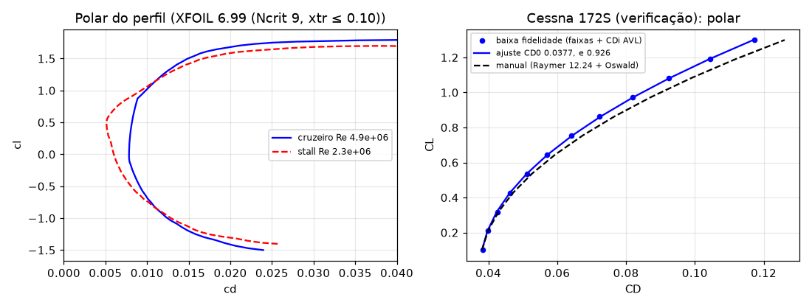

- Perfil: XFOIL 6.99 (Ncrit 9, xtr ≤ 0.10); Re de cruzeiro 4.94e+06, cm0 = -0.0509
- clmax do perfil (Re de perda 2.32e+06) = 1.699 → CLmax limpo 1.529 (Raymer Eq. 12.15)
- Carga em envergadura: AVL 3.40 (VLM), 2 ângulos; e_inv = 0.994, fator de fuselagem (Kroo) 0.9739
- CDp da asa (integração em faixas, CL = 0.5) = 0.00741 vs termo do manual 0.00684
- **Polar usada no ciclo: CD0 = 0.03767, K = 0.04697 (e = 0.926)**

- perfil NACA 2412: Re cruzeiro 4.94e+06 (xtr = 0.10), clmax a Re_stall 2.32e+06 (transição livre, Ncrit 9)

### Comparação AVL / baixa fidelidade vs métodos de manual

| grandeza | manual | AVL / baixa fid. | método manual | nota |
|---|---|---|---|---|
| CLα asa [/rad] | 4.587 | 5.108 | DATCOM / Raymer Eq. 12.6 | AVL: avião completo (asa + cauda), sem fuselagem |
| CDi a CL = 0.428 | 0.009591 | 0.008017 | Oswald Raymer e = 0.830 | AVL e (Trefftz) = 0.993; Oswald inclui arrasto viscoso dependente de CL |
| x̄_NP [MAC] | 0.5063 | 0.5743 | Raymer Eq. 16.9 + Torenbeek (fuselagem) | sem fuselagem: 0.536 (AVL não modela a fuselagem) |
| CLδe [/rad] | 0.4522 | 0.5115 | Nelson Ch. 2/5 (τ: Raymer Fig. 16.7 / DATCOM) |  |
| Cmδe [/rad] | -1.57 | -1.677 | Nelson Ch. 2/5 (τ: Raymer Fig. 16.7 / DATCOM) | AVL: Cmδe no CG traseiro; Cnδr com convenção de sinal AVL |
| |Clδa| [/rad] | 0.3553 | 0.2325 | Nelson Ch. 2/5 (τ: Raymer Fig. 16.7 / DATCOM) |  |
| Cnδr [/rad] | -0.08167 | 0.07294 | Nelson Ch. 2/5 (τ: Raymer Fig. 16.7 / DATCOM) | AVL: Cmδe no CG traseiro; Cnδr com convenção de sinal AVL |
| CD0 (polar ajustada) | 0.0376 | 0.03767 | Raymer Eq. 12.24 | perfil XFOIL 6.99 (Ncrit 9, xtr ≤ 0.10); ajuste rms 2.4e-04 |
| e efetivo | 0.8299 | 0.9258 | Raymer Eq. 12.49 | baixa fid.: AVL e_inv × Kroo (fuselagem) + cd(cl) do perfil |
| cl_max do perfil | 1.6 | 1.699 | pressuposto do utilizador | XFOIL/NeuralFoil a Re = 2.32e+06 |

## 11. Estruturas: V-n, cargas na asa e caixão (Fase 2)

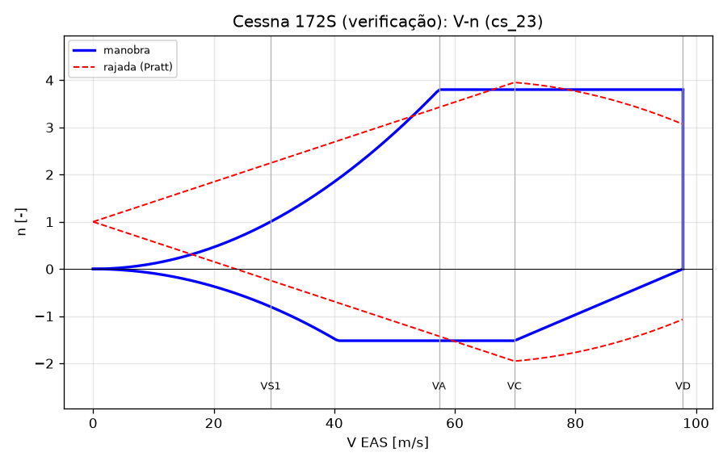

| grandeza | valor |
|---|---|
| regulation | cs_23 |
| category | normal |
| VS1_EAS_m_s | 29.43 |
| VA_EAS_m_s | 57.38 |
| VC_EAS_m_s | 69.88 |
| VD_EAS_m_s | 97.84 |
| n_manoeuvre_pos | 3.8 |
| n_manoeuvre_neg | -1.52 |
| n_gust_VC | 3.952 / -1.952 |
| n_gust_VD | 3.067 / -1.067 |
| mu_g | 24.14 |
| Kg | 0.7216 |
| n_limit_pos | 3.952 |
| n_limit_neg | -1.952 |
| governing | rajada |
| n_ultimate | 5.929 |

Cláusulas aplicadas: 23.333 (envelope); 23.335(a) VC ≥ 33.0√(W/S) kt = 136 kt EAS; 23.335(b) VD ≥ max(1.25 VC, 1.40 VC,min); 23.335(c) VA ≥ VS√n; 23.337 limit manoeuvring load factors; 23.341 gust load factors (Pratt–Walker)


Condição crítica de dimensionamento: n = 3.95 (rajada), q a VD = 97.8 m/s EAS.

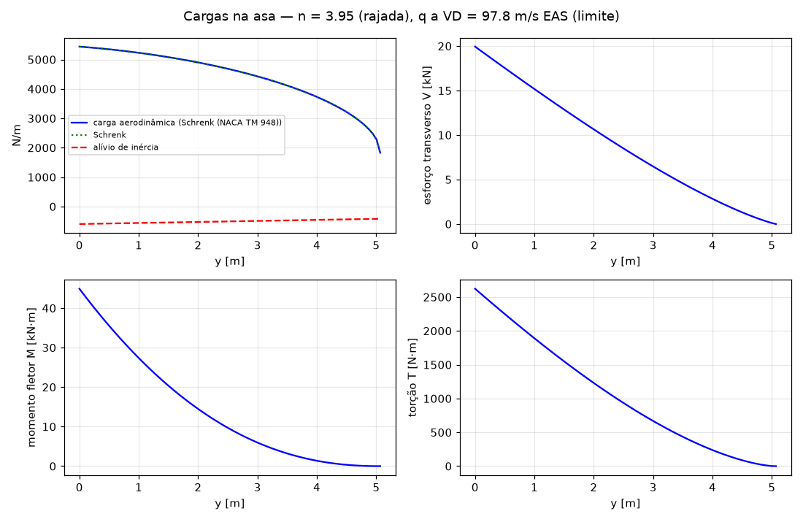

Raiz (limite): V = 19936.0 N, M = 44897.6 N·m, T = 2622.8 N·m.

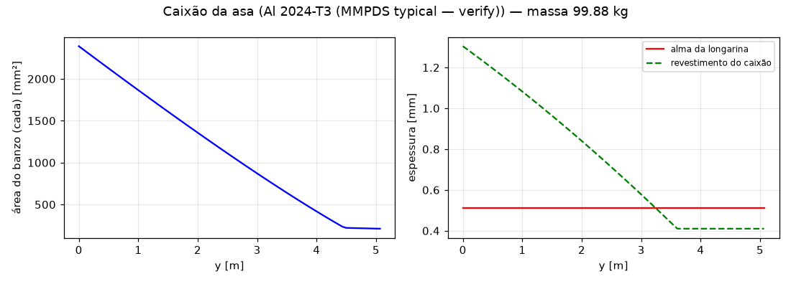

| parcela | massa [kg] |
|---|---|
| caps | 0 |
| covers_skin_stringers | 54.87 |
| core | 0 |
| webs | 3.731 |
| web_uprights | 1.262 |
| LE_TE_skins | 18.24 |
| ribs | 1.807 |
| ideal | 79.9 |
| nonoptimum | 19.98 |
| total | 99.88 |

Cross-check da massa da asa:

| método | massa da asa [kg] |
|---|---|
| Raymer Eq. 15.46 (estatístico) | 132.1 |
| caixão Megson/Bruhn, carga Schrenk (Al 2024-T3 (MMPDS typical — verify)) | 99.88 |
| caixão Megson/Bruhn, carga AVL | 97.36 |

- Revestimentos reforçados (Z): σ ótimo de Farrar F = 0.81 com corte por crippling de Needham 234 MPa (b'/t = 12 — PRESSUPOSTO); passo de reforçadores na raiz 49 mm (≈ 15 reforçadores/painel); σ raiz 184 MPa
- Almas: tensão diagonal de Kuhn, k raiz = 0.64, montantes a d = h (PRESSUPOSTO), C1 = C2 ≈ 0 (α ≈ 45°, banzos rígidos — PRESSUPOSTO); admissível de τ_max = Fsu (curva Bruhn Fig. C11.19 não digitalizada — LIMITAÇÃO)
- Banzo inferior: tração Ftu e compressão no caso negativo n_neg/n_pos = 0.49
- MMPDS typical 2024-T3 sheet: Fcy 269 MPa, Ftu 434 MPa, Fsu 262 MPa, G 27.6 GPa — verify
- 16 nervuras (passo 0.84 m)
- fator não-ótimo 1.25 (PRESSUPOSTO)
- superfícies de comando, flaps e carenagens NÃO incluídos (secundários)

## 12. Estabilidade e controlo (Fase 2: Raymer Cap. 16, Etkin & Reid, Nelson)

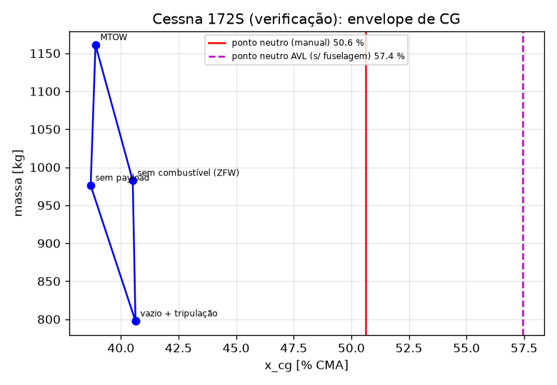

- asa posicionada para SM = 10% no CG mais recuado (ápice a 14.8% L); ápice da asa a x = 1.201 m
- Ponto neutro x̄_NP = 0.506 MAC (manual), 0.574 (AVL); dε/dα = 0.399
- **Margem estática: 11.9 % (CG dianteiro) … 10.0 % (CG traseiro)**
- AVL, cruzeiro compensado no CG traseiro: α = 3.10°, δe = -1.25°, Cnβ = 0.0888, Clβ = -0.0736, Cmq = -17.43
- Coef. de volume: V_h = 0.700, V_v = 0.0400 (Raymer Table 6.4: 0.7 / 0.04)

| caso | massa [kg] | x_cg [m] | x̄_cg [MAC] | SM |
|---|---|---|---|---|
| vazio + tripulação | 797.5 | 1.827 | 0.4063 | 0.1 |
| sem payload | 976.1 | 1.799 | 0.3869 | 0.1194 |
| MTOW | 1161 | 1.802 | 0.389 | 0.1174 |
| sem combustível (ZFW) | 982.5 | 1.825 | 0.4051 | 0.1012 |

Compensação (trim) no CG dianteiro:

| condição | CL | δe [°] | ok (|δe| ≤ máx.) |
|---|---|---|---|
| CLmax limpo (CG dianteiro) | 1.529 | -8.121 | True |
| cruzeiro (CG dianteiro) | 0.4278 | -3.323 | True |

- Clδa comparado em módulo (convenções de sinal do aileron diferem entre AVL e Nelson).
- Estações de CG dos componentes: PRESSUPOSTOS (Roskam Part V Table 8.1, valores típicos) — substituir pelas posições do layout real em assumptions.stability.stations.

## 13. Desempenho por segmentos (Fase 2: Raymer Cap. 17, Anderson)

Orçamento utilizável: Wf / 1.06 (reserva + não utilizável 6 %, Raymer Eq. 3.11).

Missão requerida (segmentos):

| segmento | t [min] | dist [km] | consumo [kg] | h [m] | V [m/s] | nota |
|---|---|---|---|---|---|---|
| aquecimento + descolagem | 0 | 0 | 34.83 | 0→0 | 0 | Raymer Table 3.2 (0.970) |
| subida (V_y) | 9.343 | 20.63 | 4.185 | 0→2438 | 37.07 | potência de subida, integrado (V médio) |
| cruzeiro | 314.8 | 1186 | 119.6 | 2438→2438 | 62.76 |  |
| descida (L/D máx, ralenti) + aterragem | 12.74 | 28.99 | 5.61 | 2438→0 | 37.92 | Raymer 0.995 (combustível) |

Missão até esgotar o orçamento: **alcance 1277.2 km, endurance 5.80 h**.

| segmento | t [min] | dist [km] | consumo [kg] | h [m] | V [m/s] | nota |
|---|---|---|---|---|---|---|
| aquecimento + descolagem | 0 | 0 | 34.83 | 0→0 | 0 | Raymer Table 3.2 (0.970) |
| subida (V_y) | 9.343 | 20.63 | 4.185 | 0→2438 | 37.07 | potência de subida, integrado (V médio) |
| cruzeiro | 326 | 1228 | 123.8 | 2438→2438 | 62.76 | estendido até esgotar o orçamento |
| descida (L/D máx, ralenti) + aterragem | 12.77 | 28.99 | 5.61 | 2438→0 | 37.84 | Raymer 0.995 (combustível) |

Requisitos vs desempenho por segmentos:

| requisito | grandeza | obtido | requerido | unidade | ok |
|---|---|---|---|---|---|
| range | distância de cruzeiro (segmentos) | 1228 | 1185 | km | ✅ |
| service_ceiling | teto de serviço (Anderson) | 5249 | 4115 | m | ✅ |
| climb_rate | ROC máx. ao nível do mar | 5.383 | 3.708 | m/s | ✅ |
| takeoff_ground_roll | corrida de descolagem (Raymer 17.8) | 199.5 | 293 | m | ✅ |
| landing_distance | distância de aterragem (Raymer 17.9, total 50 ft) | 504 | 407 | m | ❌ |

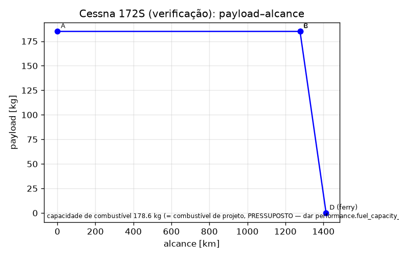

| ponto | payload_kg | combustível_kg | massa_kg | range_km |
|---|---|---|---|---|
| A | 185 | 0 | 982.5 | 0 |
| B | 185 | 178.6 | 1161 | 1277 |
| C | 185 | 178.6 | 1161 | 1277 |
| D (ferry) | 0 | 178.6 | 976.1 | 1414 |

Nota: capacidade de combustível 178.6 kg (= combustível de projeto, PRESSUPOSTO — dar performance.fuel_capacity_kg).

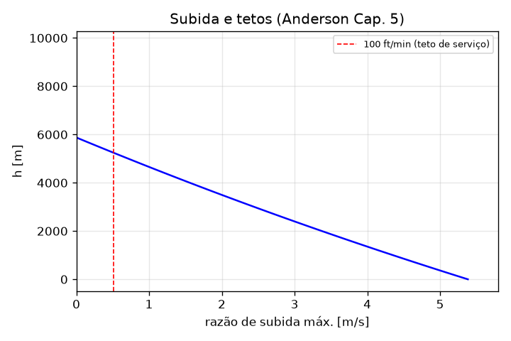

- ROC máx. ao nível do mar 5.38 m/s; teto de serviço 5249 m; teto absoluto 5876 m
- Descolagem (Raymer 17.8): corrida 200 m, total sobre 15 m 382 m (V_TO 30.4 m/s)
- Aterragem (Raymer 17.9): corrida 201 m, total sobre 15 m 504 m (μ_travagem 0.4; aproximação γ = 3° — `performance.approach_angle_deg`, por omissão o máximo de 5.2 % / 3° de CS/14 CFR 23.75(a)(1))

- Os resultados de segmentos usam a mesma polar e reservas do dimensionamento; diferenças face aos requisitos vêm da subida/descida integradas vs. frações históricas (Raymer Table 3.2).

## 14. Caixão da asa dimensionado à estabilidade (Fase 3: Bruhn C5/C7/C11, Farrar, Kuhn)

| caixão | massa [kg] | / Raymer 15.46 |
|---|---|---|
| resistência (Fase 2, limite inferior) | 86.18 | 0.6524 |
| encurvadura (Fase 3, Al 2024-T3 (MMPDS typical — verify)) | 99.88 | 0.7561 |
| Raymer Eq. 15.46 (asa completa, estatístico) | 132.1 | 1 |

Parcelas (caixão de encurvadura):

| parcela | massa [kg] |
|---|---|
| caps | 0 |
| covers_skin_stringers | 54.87 |
| core | 0 |
| webs | 3.731 |
| web_uprights | 1.262 |
| LE_TE_skins | 18.24 |
| ribs | 1.807 |
| ideal | 79.9 |
| nonoptimum | 19.98 |
| total | 99.88 |

- Almas Kuhn: fator de tração diagonal k máx. 0.639 (k = 0: alma resistente ao corte, sem tração diagonal)
- Passo dos reforçadores: 28–140 mm (encurvadura local do revestimento, k = 4)
- Revestimentos reforçados (Z): σ ótimo de Farrar F = 0.81 com corte por crippling de Needham 234 MPa (b'/t = 12 — PRESSUPOSTO); passo de reforçadores na raiz 49 mm (≈ 15 reforçadores/painel); σ raiz 184 MPa
- Almas: tensão diagonal de Kuhn, k raiz = 0.64, montantes a d = h (PRESSUPOSTO), C1 = C2 ≈ 0 (α ≈ 45°, banzos rígidos — PRESSUPOSTO); admissível de τ_max = Fsu (curva Bruhn Fig. C11.19 não digitalizada — LIMITAÇÃO)
- Banzo inferior: tração Ftu e compressão no caso negativo n_neg/n_pos = 0.49
- MMPDS typical 2024-T3 sheet: Fcy 269 MPa, Ftu 434 MPa, Fsu 262 MPa, G 27.6 GPa — verify
- 16 nervuras (passo 0.84 m)
- fator não-ótimo 1.25 (PRESSUPOSTO)
- superfícies de comando, flaps e carenagens NÃO incluídos (secundários)

## 15. Aeroelasticidade clássica (Fase 3)

V_D = 97.8 m/s EAS.

| fenómeno | V [m/s EAS] | requerido 1.2 V_D | margem | ok | método |
|---|---|---|---|---|---|
| divergência torsional | 192.3 | 117.4 | +64 % | ✅ | W&C 8.3 / Bisplinghoff 8-2 (faixas + FE) |
| inversão do aileron | 189.4 | 117.4 | +61 % | ✅ | W&C 8.4, Glauert (flap 2D) |
| flutter binário (flexão–torção) | 113 | 117.4 | -4 % | ❌ | W&C 11 (modos assumidos, quase-estacionário) |

- Frequências desacopladas: flexão 7.25 Hz, torção 23.5 Hz; flutter a 18.4 Hz
- AEER-45 (fator de flexibilidade torsional da asa): F = 1.620e-03 vs F_max = 200/V_D² = 4.176e-03 → OK

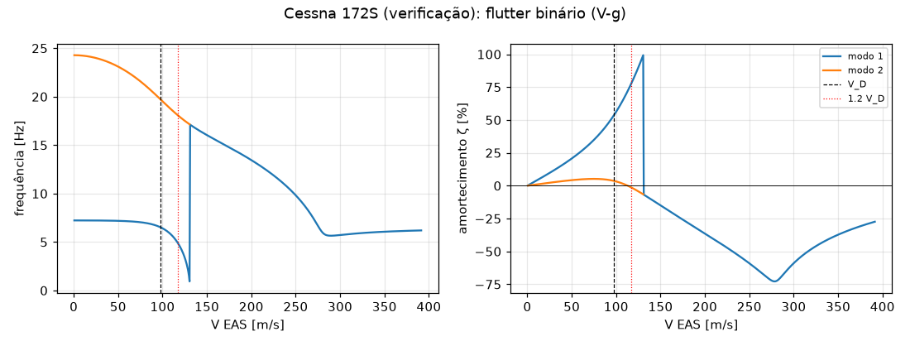

### Acoplamento aero-estrutural estático (OpenAeroStruct, VLM + caixão)

| ponto | modelo | α [°] | CL | CDi | CLα [/rad] | flecha ponta [m] | torção ponta [°] |
|---|---|---|---|---|---|---|---|
| cruise | rígido | 5.279 | 0.4278 | 0.007744 | 4.629 | 5.559e-06 | 3.104e-05 |
| cruise | flexível | 5.109 | 0.4278 | 0.00777 | 4.787 | 0.05621 | 0.3135 |
| manobra (n_lim, V_D EAS, nível do mar) | rígido | 6.756 | 0.547 | 0.01266 | 4.615 | 2.193e-05 | 0.0001224 |
| manobra (n_lim, V_D EAS, nível do mar) | flexível | 6.069 | 0.547 | 0.01283 | 5.153 | 0.227 | 1.261 |

- Efeito da forma deformada no arrasto induzido de cruzeiro: K_flex/K = 1.0034
- Missão por segmentos: rígido 1277.2 km / 5.802 h → flexível 1276.6 km / 5.799 h (comparação com o resultado desacoplado da Fase 2)
- OpenAeroStruct VLM (sem viscoso/onda: só arrasto induzido) + FEM de caixão 'wingbox' acoplados por NLBGS; rígido = E, G × 10⁴
- secção do caixão: NACA-4 entre longarinas; espessuras de alma/revestimento do caixão acdt (5 pontos de controlo); revestimento único equivalente que reproduz EI(y) do caixão acdt e G ajustado para GJ (PRESSUPOSTO)
- sem alívio de peso estrutural nem de combustível na asa (conservativo para a deformação)
- índice de falha OAS (von Mises/KS, σ_adm = σ_cap/1.5) na manobra: +0.498 (< 0 = OK) — critério de resistência do OAS sobre o revestimento equivalente — INDICATIVO (o dimensionamento é o do caixão acdt)
- massa da asa 132.10 kg distribuída ∝ corda; CG da secção a 0.50 c; eixo elástico a 0.425 c (meio do caixão), e = 0.175 c atrás do c.a.; a_w = 6.283/rad (2D, teoria das faixas — sem correção 3D/compressibilidade)
- encastramento na parede da fuselagem y0 = 0.578 m; EI/GJ do caixão buckling
- requisito: livre de flutter/divergência/inversão até 1.2 V_D = 117.4 m/s EAS (14 CFR 23.629(c) legado; CS/14 CFR 23.2245 'suficientemente além'; STANAG 4671 USAR.629 — verificar)
- flutter: modelo binário de modos assumidos (W&C Cap. 11), aerodinâmica quase-estacionária — ESTIMATIVA; a análise racional exige modos FEM + DLM (Fase 4)

## 16. Diagrama de tesoura, modos dinâmicos e qualidades de voo (Fase 3)

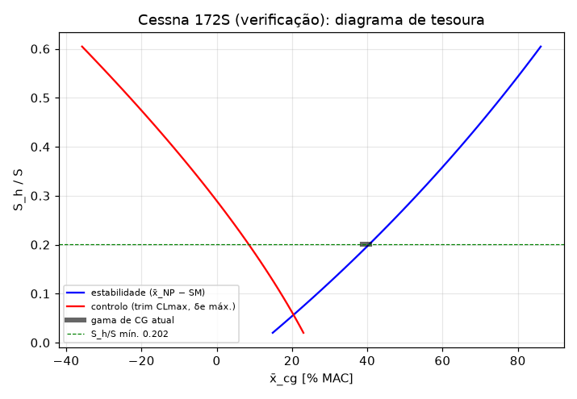

- S_h/S atual 0.202; requerido 0.202 (estabilidade 0.202, controlo 0.02; dimensionante: estabilidade) → ✅ (Torenbeek Cap. 9)
- linha de controlo: trim a CLmax limpo 1.53 com δe = −25°, τ_e = 0.661, Cm0 = -0.0400 (Raymer 16.13); momento dos flaps e efeito de solo NÃO incluídos
- massa da cauda não realimentada (posição da asa e braço fixos)

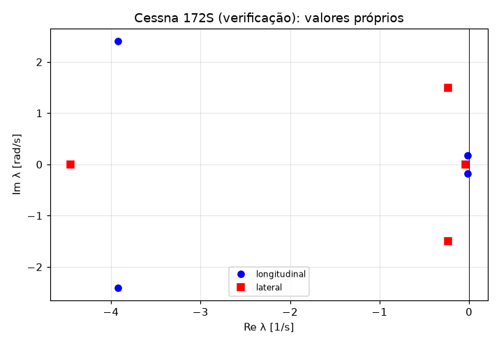

| modo | ωn [rad/s] | ζ | período [s] | τ / T [s] |
|---|---|---|---|---|
| período curto | 4.603 | 0.8522 | 2.609 | - |
| fugóide | 0.1741 | 0.09095 | 36.24 | - |
| rolamento holandês | 1.514 | 0.153 | 4.199 | - |
| rolamento (constante de tempo) | - | - | - | 0.2245 |
| espiral estável | - | - | - | 16.36 |

- n/α = 11.7 g/rad, CAP = 1.81 1/(g s²)
- Inércias (Roskam V, soma por componentes): Ixx 2.44e+03, Iyy 1.66e+03, Izz 4.09e+03 kg·m²
- derivadas de taxa e laterais: AVL (sem fuselagem) + Cnβ da fuselagem (Raymer 16.47) -0.0634
- Cmα = −CLα·SM no CG de MTOW (ponto neutro de manual com fuselagem)
- inércias por soma de componentes (Roskam Parte V) — PRESSUPOSTOS de estações

Qualidades de voo — MIL-F-8785C, Classe I, categoria B (nível exigido 1):

| modo | valor | nível | limite N1 | ref |
|---|---|---|---|---|
| período curto ζ | 0.8522 | 1 | 0.30–2.00 | MIL-F-8785C Table IV |
| CAP = ω²/(n/α) [1/(g s²)] | 1.814 | 1 | 0.085–3.6 | MIL-F-8785C Figs. 1–3 |
| fugóide ζ | 0.09095 | 1 | ≥ 0.04 | MIL-F-8785C 3.2.1.2 |
| rolamento holandês ζ / ζω / ω | 0.153 / 0.232 / 1.51 | 1 | 0.08 / 0.15 / 0.4 | MIL-F-8785C Table VI |
| rolamento τ_R [s] | 0.2245 | 1 | ≤ 1.4 | MIL-F-8785C Table VII |
| espiral T2 [s] (∞ = estável) | n/a | 1 | ≥ 20 | MIL-F-8785C Table VIII |


## Pressupostos usados

```yaml
weights:
  method: components
  initial_class: null
  fixed_fraction: null
  A: null
  C: null
  tech_factor: 1.0
  Kvs: 1.0
  fixed_mass_kg: 0.0
  components:
    material: metal
    landing_gear: tricycle
    main_gear_length_m: 0.65
    nose_gear_length_m: 0.55
    engine_dry_mass_kg: 121.6
    avionics_uninstalled_kg: 15
    n_tanks: 2
aero:
  AR: 7.32
  taper: 0.7
  sweep_c4_deg: 0.0
  tc_root: 0.12
  tc_tip: 0.12
  xc_max_t: 0.3
  airfoil: NACA 2412
  clmax_airfoil: 1.6
  flap:
    kind: slotted
    flapped_area_ratio: 0.55
  oswald: null
  cfe: 0.0055
  swet_sref: 4.0
  laminar:
    wing: 0.1
    htail: 0.1
    vtail: 0.1
    fuselage: 0.0
  roughness: smooth_paint
  Q:
    wing: 1.0
  lp_fraction: 0.05
  extra_drag_areas_m2:
    fixed_landing_gear: 0.2
    cooling_and_engine: 0.1
  CL_ground: 0.5
  dCD0_takeoff: 0.01
  mu_roll: 0.04
  fidelity: lowfi
  airfoil_solver: xfoil
propulsion:
  eta_cruise: 0.8
  eta_climb: 0.75
  eta_takeoff: 0.55
  bsfc_lb_hp_h: null
  tsfc_1_h: 0.5
  battery_Wh_kg: 200.0
  eta_total: 0.7
  dod: 0.8
  energy_reserve: 0.2
  systems_power_W: 0.0
  n_engines: 1
geometry:
  fuselage_length_m: null
  fuselage_diameter_m: null
  fuselage_fineness: 7.0
  fuselage_class: null
  tail_class: null
  c_ht: null
  c_vt: null
  tail_arm_fraction: 0.6
  ar_h: 4.0
  ar_v: 1.5
constraints:
  cruise_weight_fraction: 1.0
  landing_weight_fraction: 1.0
  approach_distance_ft: 600.0
  margin: 0.0
  ws_initial_psf: 17.0
  ws_min: 50.0
  ws_max: 3000.0
  default_cruise_altitude_m: 0.0
  ws_fixed: null
  value_fixed: null
mda:
  max_iter: 30
  tol: 1.0e-05
  tol_lowfi: 0.0002
structures:
  regulation: auto
  load_factor_from_vn: true
  material: auto
  nonoptimum_factor: 1.25
  VH_eas_m_s: null
stability:
  target_static_margin: 0.1
  wing_apex_x_fraction: null
  stations: {}
  elevator_max_deg: 25.0
  use_avl: true
  dynamics: true
  hq_category: B
  hq_required_level: 1
performance:
  fuel_capacity_kg: null
  max_payload_kg: null
  mu_brake: 0.4
  approach_angle_deg: 3.0
aeroelasticity:
  enabled: true
  a_w: 6.283185307179586
  x_cg_chord: null
  margin_factor: 1.2
  static_aerostructural: true
mdo:
  objective: null
  solver: nlbgs
  trust_region_iterations: 8
  trust_region_radius: 0.3
  design_vars:
  - ws
  - AR
  AR_bounds:
  - 5.0
  - 16.0
  ws_bounds_factor:
  - 0.6
  - 1.4
  pw_bounds_factor:
  - 0.6
  - 1.6
  maxiter: 60
  tol: 1.0e-06
cost: {}
```

## Referências

- Raymer, D. P., *Aircraft Design: A Conceptual Approach*, 6th ed., AIAA, 2018 (equation numbers as in the 6th ed.).
- Roskam, J., *Airplane Design*, Parts I–VIII, DARcorporation.
- Gudmundsson, S., *General Aviation Aircraft Design: Applied Methods and Procedures*, Elsevier, 2014.
- Anderson, J. D., *Aircraft Performance and Design*, McGraw-Hill, 1999.
- Torenbeek, E., *Synthesis of Subsonic Airplane Design*, Delft Univ. Press, 1982.
- USAF Stability and Control DATCOM, 1978.
- Hepperle, M., "Electric Flight – Potential and Limitations", NATO STO-MP-AVT-209, 2012.
- Niu, M. C. Y., *Airframe Structural Design*, Conmilit, 1988.
- Drela, M., "First-Order DC Electric Motor Model", MIT, 2007.
- ISO 2533:1975 Standard Atmosphere.
- Nicolai, L. M., Carichner, G. E., *Fundamentals of Aircraft and Airship Design*, Vol. I, AIAA, 2010 (Table 5.1, We = A·W0^B incl. UAV classes).
- EASA CS-23 (Amdt. 4 and earlier) / 14 CFR 23.337 (pre-Amdt. 23-64): limit manoeuvring load factors.
- IEC 60028:1925, International standard of resistance for copper (ρCu = 8890 kg/m³).
- FAA Type Certificate Data Sheet 1E10 (Lycoming O-360/IO-360 series) — engine dry mass in the C172 check.
- Drela, M., "XFOIL: An Analysis and Design System for Low Reynolds Number Airfoils", 1989; XFOIL 6.99 (GPL).
- Drela, M., Youngren, H., AVL 3.40 (Athena Vortex Lattice), MIT, 2022 (GPL).
- Sharpe, P., NeuralFoil, MIT, 2024 (fallback section polars).
- Schrenk, O., "A Simple Approximation Method for Obtaining the Spanwise Lift Distribution", NACA TM 948, 1940.
- Megson, T. H. G., *Aircraft Structures for Engineering Students*, 5th ed., 2013 (Ch. 16, 19–23).
- Bruhn, E. F., *Analysis and Design of Flight Vehicle Structures*, 1973 (Ch. A3, C5, C11).
- Etkin, B., Reid, L. D., *Dynamics of Flight: Stability and Control*, 3rd ed., Wiley, 1996.
- Nelson, R. C., *Flight Stability and Automatic Control*, 2nd ed., McGraw-Hill, 1998.
- Kroo, I., *Aircraft Design: Synthesis and Analysis*, Stanford (lift-dependent drag, fuselage span-efficiency factor).
- EASA CS-23 Amdt. 4 / 14 CFR 23.333–23.341 (flight envelope, design speeds, gust loads); 14 CFR/CS 23.65 (climb speed).
- NATO STANAG 4671 Ed. 1 (USAR), 2009: USAR.303, .333, .335, .337, .341.
- Abbott, I. H., von Doenhoff, A. E., *Theory of Wing Sections*, Dover, 1959.
