# Relatório de dimensionamento — Cessna 172S (verificação)

_acdt 0.1.0 · Fase 1 (conceptual) + 1E (sistemas) + Fase 2 (baixa fidelidade)_

Requisitos ao estilo do POH do C172S para validar o método.

**Resultado:** ✅ VIÁVEL

**Verificação por segmentos (Fase 2):** ⚠️ pelo menos um requisito não cumprido na missão por segmentos (ver §13)

## 1. Requisitos desta corrida

| requisito | sentido | valor | qualificadores | estágios | avaliado |
|---|---|---|---|---|---|
| propulsion_type | target | piston_prop | - | context | sim |
| regulatory_category | target | cs_23 | - | check, systems | sim |
| crew_mass | target | 77 kg | - | sizing | sim |
| payload_mass | target | 185 kg | - | sizing | sim |
| range | min | 1185 km | - | sizing | sim |
| cruise_speed | target | 122 kt | - | constraint, sizing | sim |
| cruise_altitude | target | 8000 ft | - | context | sim |
| stall_speed | max | 48 kt | - | constraint | sim |
| takeoff_ground_roll | max | 293 m | - | constraint | sim |
| landing_distance | max | 407 m | - | constraint | sim |
| climb_rate | min | 730 ft/min | - | constraint | sim |
| service_ceiling | min | 13500 ft | - | constraint | sim |

Requisitos não definidos (livres / por omissão): endurance, max_speed, load_factor, turn_rate, mtow, wing_span, power_available, thrust_available, unit_cost, noise, mtow_objective

### Validação

- **info**: Nz das equações de massa = 1.5 × n_lim do diagrama V-n (3.80, manobra; cs_23)
- **info**: Massa do caixão da asa (Megson/Bruhn) = 85.10 kg vs Raymer Eq. 15.46 102.01 kg (razão 0.83); usado: Raymer
- **warning**: Desempenho por segmentos não cumpre: distância de aterragem (Raymer 17.9, total 50 ft): 503.2 m vs requerido ≤ 407 (missão por segmentos — verificação, não altera a viabilidade do dimensionamento)

## 2. Peso à descolagem (Raymer Cap. 3; Hepperle 2012 para elétrico)

| grandeza | valor |
|---|---|
| W0 [kg] | 1161 |
| We [kg] | 693.4 |
| Combustível/bateria [kg] | 205.7 |
| Payload + tripulação [kg] | 262 |
| We/W0 | 0.5972 |
| Wf/W0 | 0.1772 |
| Energia bateria nominal [Wh] | - |

Pernas da missão: cruise 1373202 (SI) @ V=62.8 m/s, L/D=8.6, h=2438 m

## 2a. Estimativa de pesos por componentes (Raymer 6th ed. Cap. 15 + sistemas)

Valor inicial do peso vazio: Raymer 6th ed. Table 3.1 (We/W0 = A W0^C, W0 in lb) 'ga_single_engine'.

Fator de carga último Nz = 5.70 (1.5 × limite). Iteração: estatística → geometria → componentes → novo We → re-dimensionar, até convergir (histórico na secção 8).

| grupo | item | kg | % W0 | método |
|---|---|---|---|---|
| structure | asa | 102 | 8.786 | Raymer Eq. 15.46 |
| structure | empenagem horizontal | 14.4 | 1.24 | Raymer Eq. 15.47 |
| structure | empenagem vertical | 5.345 | 0.4603 | Raymer Eq. 15.48 |
| structure | fuselagem | 98.22 | 8.459 | Raymer Eq. 15.49 (unpressurized) |
| structure | trem principal | 74.3 | 6.399 | Raymer Eq. 15.50 |
| structure | trem de nariz | 18.04 | 1.554 | Raymer Eq. 15.51 |
| propulsion | motor instalado (+hélice, berço, capota) | 202.4 | 17.44 | Raymer Eq. 15.52, Wen from engine datasheet (user) |
| propulsion | sistema de combustível | 30.83 | 2.656 | Raymer Eq. 15.53 |
| equipment | comandos de voo (cabos/hastes) | 17.09 | 1.472 | Raymer Eq. 15.54 |
| equipment | hidráulica | 0.9935 | 0.08557 | Raymer Eq. 15.55 (Kh=0.013, M=0.1) |
| equipment | aviónica instalada | 25.12 | 2.163 | Raymer Eq. 15.57, Wuav 15 kg (user) |
| equipment | sistema elétrico | 66.45 | 5.723 | Raymer Eq. 15.56 |
| equipment | interiores (bancos, cintos...) | 38.09 | 3.281 | Raymer Eq. 15.59 |


Resumo por grupo e composição de W0:

| grupo | kg | % W0 |
|---|---|---|
| structure | 312.3 | 26.9 |
| propulsion | 233.3 | 20.09 |
| equipment | 147.7 | 12.72 |
| **peso vazio We** | 693.3 | 59.71 |
| combustível / bateria | 205.7 | 17.72 |
| payload | 185 | 15.93 |
| tripulação | 77 | 6.632 |
| **W0** | 1161 | 100 |


Cross-check estatístico (We/W0 das classes publicadas no W0 obtido; 'fora' = W0 fora do intervalo da base de dados):

| classe | We/W0 | We [kg] | na gama | fonte |
|---|---|---|---|---|
| ga_single_engine | 0.5747 | 667.3 | - | Raymer 6th ed. Table 3.1 (We/W0 = A W0^C, W0 in lb) 'ga_single_engine' |
| homebuilt_composite | 0.5675 | 658.9 | - | Raymer 6th ed. Table 3.1 (We/W0 = A W0^C, W0 in lb) 'homebuilt_composite' |
| nicolai_light_ga | 0.601 | 697.8 | - | Nicolai & Carichner (AIAA 2010) Table 5.1 (We = A W0^B, lb) 'nicolai_light_ga' |


## 3. Design point (diagrama de restrições)

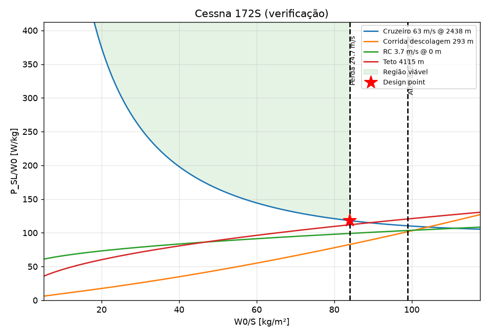

- **W0/S = 823.4 N/m² (83.96 kg/m²)**
- **P/W_SL = 118.1 W/kg** → P_SL = 137 kW
- Restrições ativas: Cruzeiro 63 m/s @ 2438 m, Perda 24.7 m/s
- Área alar S = 13.829 m²

## 4. Geometria de primeira iteração

| parâmetro | valor |
|---|---|
| S_m2 | 13.83 |
| AR | 5 |
| span_m | 8.315 |
| taper | 0.7 |
| c_root_m | 1.957 |
| c_tip_m | 1.37 |
| MAC_m | 1.68 |
| y_MAC_m | 1.957 |
| sweep_c4_deg | 0 |
| sweep_LE_deg | 2.021 |
| t/c | 0.12 |

Fuselagem: L = 8.10 m, D = 1.157 m. Empenagem horizontal S = 3.348 m², vertical S = 0.947 m², braço = 4.86 m (coef. de volume, Raymer Eq. 6.28–6.29).

Caixão da asa (parametrizado na geometria, análise na Fase 2): longarinas a 20%/65% c, largura na raiz 0.880 m.

## 5. Aerodinâmica (Raymer Cap. 12 / DATCOM)

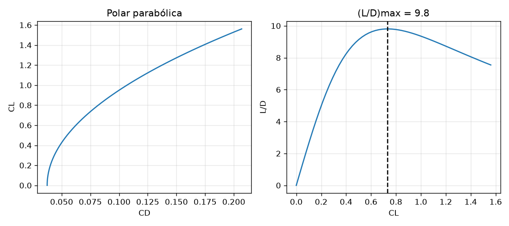

- CLα = 4.083 /rad (0.0713 /deg)
- CLmax limpo / descolagem / aterragem = 1.56 / 1.76 / 2.20
- CD0 = 0.03739, K = 0.0695 (e = 0.915), (L/D)max = 9.81 a CL = 0.73

Decomposição do CD0 (component build-up):

| component | Swet_m2 | Cf | FF | Q | CD0 |
|---|---|---|---|---|---|
| wing | 23.68 | 0.002988 | 1.253 | 1 | 0.006409 |
| htail | 6.793 | 0.003312 | 1.202 | 1.04 | 0.002034 |
| vtail | 1.921 | 0.003387 | 1.186 | 1.04 | 0.0005803 |
| fuselage | 24 | 0.002544 | 1.192 | 1 | 0.005263 |

D/q adicional (trem, antenas, ...): 0.3000 m²; L&P: 5%

## 6. Verificações

- ✅ `regulatory_category` — cs_23: W0 1161.1 kg <= 8618 kg
- ✅ `static_margin` — SM no CG traseiro 10.0 % (alvo 10 %; dianteiro 12.1 %) — posicionamento da asa por bisseção
- ✅ `trim` — CLmax limpo (CG dianteiro): δe -8.2°; cruzeiro (CG dianteiro): δe -3.2°
- ✅ `hq:scissor` — S_h/S atual 0.242 vs mínimo 0.242 (estabilidade 0.242 no CG traseiro, controlo 0.020 a CLmax no CG dianteiro; dimensionante: estabilidade)
- ✅ `hq:short_period` — período curto ζ = 0.99 → Nível 1 (N1: 0.30–2.00; MIL-F-8785C Table IV, Classe I, Cat. B)
- ✅ `hq:CAP` — CAP = ω²/(n/α) [1/(g s²)] = 2.11 → Nível 1 (N1: 0.085–3.6; MIL-F-8785C Figs. 1–3, Classe I, Cat. B)
- ✅ `hq:phugoid` — fugóide ζ = 0.0963 → Nível 1 (N1: ≥ 0.04; MIL-F-8785C 3.2.1.2, Classe I, Cat. B)
- ❌ `hq:dutch_roll` — rolamento holandês ζ / ζω / ω = 0.100 / 0.127 / 1.27 → Nível 2 (N1: 0.08 / 0.15 / 0.4; MIL-F-8785C Table VI, Classe I, Cat. B)
- ✅ `hq:roll` — rolamento τ_R [s] = 0.272 → Nível 1 (N1: ≤ 1.4; MIL-F-8785C Table VII, Classe I, Cat. B)
- ✅ `hq:spiral` — espiral T2 [s] (∞ = estável) = inf → Nível 1 (N1: ≥ 20; MIL-F-8785C Table VIII, Classe I, Cat. B)
- ✅ `aeroel:divergence` — divergência torsional V = 243.9 m/s EAS vs 118.3 (= 1.2 V_D); margem +106 %
- ✅ `aeroel:reversal` — inversão de aileron V = 240.3 m/s EAS vs 118.3 (= 1.2 V_D); margem +103 %
- ✅ `aeroel:flutter` — flutter binário V = 140.7 m/s EAS vs 118.3 (= 1.2 V_D); margem +19 %
- ✅ `aeroel:aeer45` — AEER-45 / 23.629(d): F = 0.000959 vs F_max = 0.00411 (balanceamento do aileron não avaliado)
- ✅ `perf:range` — distância de cruzeiro (segmentos): 1397 km vs requerido ≥ 1373 (missão por segmentos — verificação, não altera a viabilidade do dimensionamento)
- ✅ `perf:service_ceiling` — teto de serviço (Anderson): 4419 m vs requerido ≥ 4115 (missão por segmentos — verificação, não altera a viabilidade do dimensionamento)
- ✅ `perf:climb_rate` — ROC máx. ao nível do mar: 5.163 m/s vs requerido ≥ 3.708 (missão por segmentos — verificação, não altera a viabilidade do dimensionamento)
- ✅ `perf:takeoff_ground_roll` — corrida de descolagem (Raymer 17.8): 183.8 m vs requerido ≤ 293 (missão por segmentos — verificação, não altera a viabilidade do dimensionamento)
- ❌ `perf:landing_distance` — distância de aterragem (Raymer 17.9, total 50 ft): 503.2 m vs requerido ≤ 407 (missão por segmentos — verificação, não altera a viabilidade do dimensionamento)

## 8. Histórico do ciclo MDA (peso ↔ design point ↔ geometria ↔ arrasto)

| iter | W0 | We/W0 usado | We | Wf | n_lim (V-n) | asa Raymer [kg] | asa caixão [kg] | We_comp | We_comp/W0 | CD0 | W/S | P/W | L/D_max | aero |
|---|---|---|---|---|---|---|---|---|---|---|---|---|---|---|
| 1 | 983.9 | 0.5921 | 582.5 | 139.3 | 3.8 | 82.85 | 68.47 | 622.8 | 0.633 | 0.0424 | 823.4 | 10.15 | 9.133 | manual |
| 2 | 1091 | 0.5707 | 622.8 | 206.5 | 3.8 | 94.41 | 78.39 | 670.6 | 0.6145 | 0.03942 | 823.4 | 13.29 | 9.472 | manual |
| 3 | 1141 | 0.5879 | 670.6 | 208 | 3.8 | 99.77 | 83.06 | 687 | 0.6023 | 0.03824 | 823.4 | 12.58 | 9.617 | manual |
| 4 | 1157 | 0.5939 | 687 | 207.8 | 3.8 | 101.5 | 84.62 | 692.3 | 0.5984 | 0.03787 | 823.4 | 12.3 | 9.664 | manual |
| 5 | 1162 | 0.5957 | 692.3 | 207.8 | 3.8 | 102.1 | 85.12 | 694 | 0.5972 | 0.03776 | 823.4 | 12.21 | 9.679 | manual |
| 6 | 1164 | 0.5963 | 694 | 207.8 | 3.8 | 102.3 | 85.29 | 694.6 | 0.5968 | 0.03772 | 823.4 | 12.18 | 9.684 | manual |
| 7 | 1164 | 0.5965 | 694.6 | 207.8 | 3.8 | 102.4 | 85.34 | 694.8 | 0.5967 | 0.03771 | 823.4 | 12.17 | 9.685 | manual |
| 8 | 1165 | 0.5966 | 694.8 | 207.8 | 3.8 | 102.4 | 85.36 | 694.8 | 0.5967 | 0.0377 | 823.4 | 12.17 | 9.686 | manual |
| 9 | 1165 | 0.5966 | 694.8 | 207.8 | 3.8 | 102.4 | 85.36 | 694.8 | 0.5966 | 0.0377 | 823.4 | 12.17 | 9.686 | manual |
| 10 | 1165 | 0.5966 | 694.8 | 207.8 | 3.8 | 102.4 | 85.37 | 694.8 | 0.5966 | 0.0377 | 823.4 | 12.17 | 9.686 | manual |
| 11 | 1165 | 0.5966 | 694.8 | 207.8 | 3.8 | 102.4 | 85.37 | 694.8 | 0.5966 | 0.0377 | 823.4 | 12.17 | 9.686 | manual |
| 12 | 1165 | 0.5966 | 694.8 | 207.8 | 3.8 | 102.4 | 85.43 | 694.9 | 0.5966 | 0.03736 | 823.4 | 12.17 | 9.819 | lowfi |
| 13 | 1163 | 0.5976 | 694.9 | 205.9 | 3.8 | 102.2 | 85.25 | 693.9 | 0.5968 | 0.03735 | 823.4 | 12.03 | 9.811 | lowfi |
| 14 | 1162 | 0.5974 | 693.9 | 205.7 | 3.8 | 102.1 | 85.15 | 693.5 | 0.597 | 0.03738 | 823.4 | 12.03 | 9.807 | lowfi |
| 15 | 1161 | 0.5972 | 693.5 | 205.7 | 3.8 | 102 | 85.11 | 693.4 | 0.5971 | 0.03739 | 823.4 | 12.04 | 9.806 | lowfi |
| 16 | 1161 | 0.5972 | 693.4 | 205.7 | 3.8 | 102 | 85.1 | 693.3 | 0.5971 | 0.03739 | 823.4 | 12.04 | 9.806 | lowfi |

## 10. Aerodinâmica de baixa fidelidade (Fase 2: XFOIL + AVL)

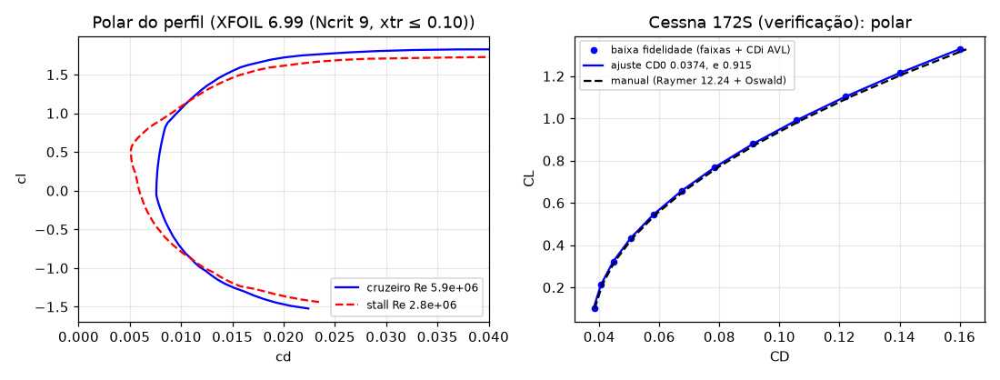

- Perfil: XFOIL 6.99 (Ncrit 9, xtr ≤ 0.10); Re de cruzeiro 5.93e+06, cm0 = -0.0510
- clmax do perfil (Re de perda 2.77e+06) = 1.735 → CLmax limpo 1.561 (Raymer Eq. 12.15)
- Carga em envergadura: AVL 3.40 (VLM), 2 ângulos; e_inv = 0.977, fator de fuselagem (Kroo) 0.9613
- CDp da asa (integração em faixas, CL = 0.5) = 0.00647 vs termo do manual 0.00641
- **Polar usada no ciclo: CD0 = 0.03739, K = 0.06954 (e = 0.915)**

- perfil NACA 2412: Re cruzeiro 5.93e+06 (xtr = 0.10), clmax a Re_stall 2.77e+06 (transição livre, Ncrit 9)

### Comparação AVL / baixa fidelidade vs métodos de manual

| grandeza | manual | AVL / baixa fid. | método manual | nota |
|---|---|---|---|---|
| CLα asa [/rad] | 4.083 | 4.569 | DATCOM / Raymer Eq. 12.6 | AVL: avião completo (asa + cauda), sem fuselagem |
| CDi a CL = 0.434 | 0.01332 | 0.01214 | Oswald Raymer e = 0.901 | AVL e (Trefftz) = 0.989; Oswald inclui arrasto viscoso dependente de CL |
| x̄_NP [MAC] | 0.4784 | 0.5581 | Raymer Eq. 16.9 + Torenbeek (fuselagem) | sem fuselagem: 0.505 (AVL não modela a fuselagem) |
| CLδe [/rad] | 0.5431 | 0.6108 | Nelson Ch. 2/5 (τ: Raymer Fig. 16.7 / DATCOM) |  |
| Cmδe [/rad] | -1.57 | -1.679 | Nelson Ch. 2/5 (τ: Raymer Fig. 16.7 / DATCOM) | AVL: Cmδe no CG traseiro; Cnδr com convenção de sinal AVL |
| |Clδa| [/rad] | 0.3162 | 0.1923 | Nelson Ch. 2/5 (τ: Raymer Fig. 16.7 / DATCOM) |  |
| Cnδr [/rad] | -0.08167 | 0.07225 | Nelson Ch. 2/5 (τ: Raymer Fig. 16.7 / DATCOM) | AVL: Cmδe no CG traseiro; Cnδr com convenção de sinal AVL |
| CD0 (polar ajustada) | 0.03778 | 0.03739 | Raymer Eq. 12.24 | perfil XFOIL 6.99 (Ncrit 9, xtr ≤ 0.10); ajuste rms 1.9e-04 |
| e efetivo | 0.9007 | 0.9155 | Raymer Eq. 12.49 | baixa fid.: AVL e_inv × Kroo (fuselagem) + cd(cl) do perfil |
| cl_max do perfil | 1.6 | 1.735 | pressuposto do utilizador | XFOIL/NeuralFoil a Re = 2.77e+06 |

## 11. Estruturas: V-n, cargas na asa e caixão (Fase 2)

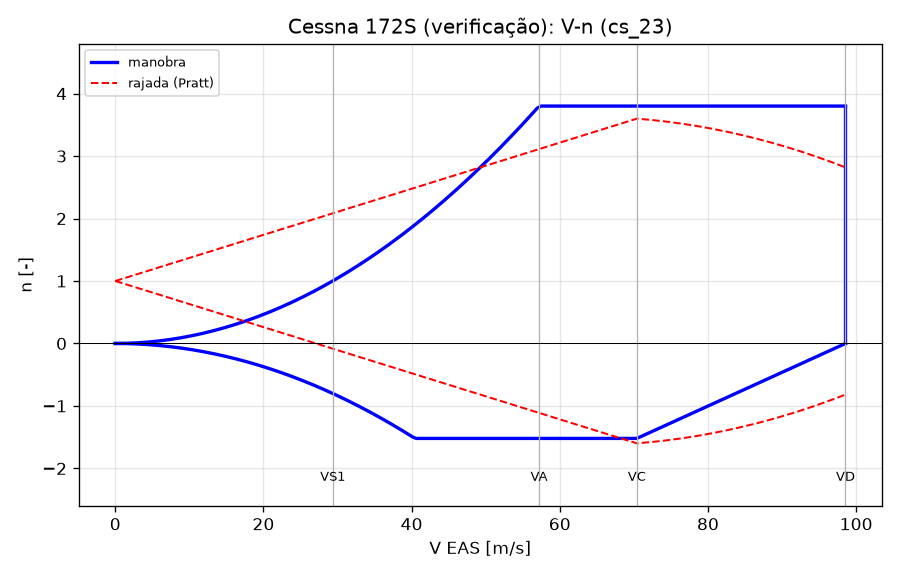

| grandeza | valor |
|---|---|
| regulation | cs_23 |
| category | normal |
| VS1_EAS_m_s | 29.34 |
| VA_EAS_m_s | 57.2 |
| VC_EAS_m_s | 70.4 |
| VD_EAS_m_s | 98.56 |
| n_manoeuvre_pos | 3.8 |
| n_manoeuvre_neg | -1.52 |
| n_gust_VC | 3.598 / -1.598 |
| n_gust_VD | 2.819 / -0.819 |
| mu_g | 22.75 |
| Kg | 0.7137 |
| n_limit_pos | 3.8 |
| n_limit_neg | -1.598 |
| governing | manobra |
| n_ultimate | 5.7 |

Cláusulas aplicadas: 23.333 (envelope); 23.335(a) VC ≥ 33.0√(W/S) kt = 137 kt EAS; 23.335(b) VD ≥ max(1.25 VC, 1.40 VC,min); 23.335(c) VA ≥ VS√n; 23.337 limit manoeuvring load factors; 23.341 gust load factors (Pratt–Walker)


Condição crítica de dimensionamento: n = 3.80 (manobra), q a VD = 98.6 m/s EAS.

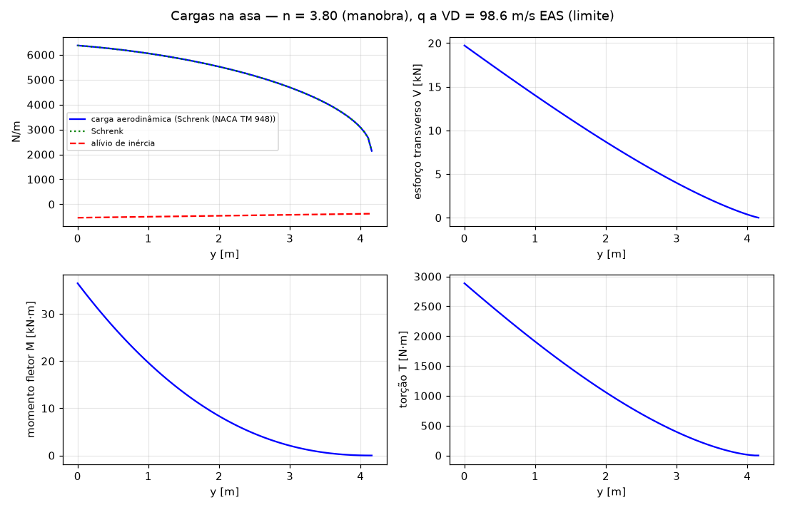

Raiz (limite): V = 19727.8 N, M = 36511.1 N·m, T = 2886.1 N·m.

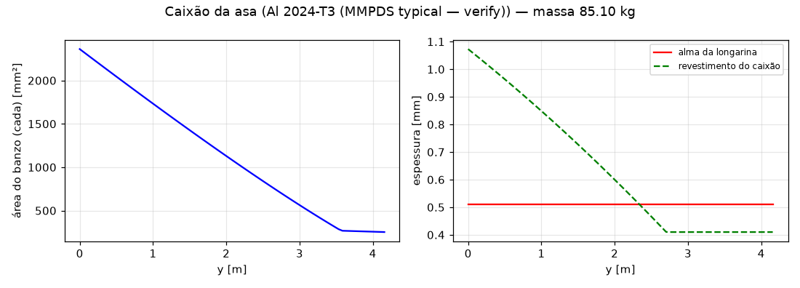

| parcela | massa [kg] |
|---|---|
| caps | 0 |
| covers_skin_stringers | 43.52 |
| core | 0 |
| webs | 3.677 |
| web_uprights | 0.9591 |
| LE_TE_skins | 17.97 |
| ribs | 1.955 |
| ideal | 68.08 |
| nonoptimum | 17.02 |
| total | 85.1 |

Cross-check da massa da asa:

| método | massa da asa [kg] |
|---|---|
| Raymer Eq. 15.46 (estatístico) | 102 |
| caixão Megson/Bruhn, carga Schrenk (Al 2024-T3 (MMPDS typical — verify)) | 85.1 |
| caixão Megson/Bruhn, carga AVL | 82.62 |

- Revestimentos reforçados (Z): σ ótimo de Farrar F = 0.81 com corte por crippling de Needham 234 MPa (b'/t = 12 — PRESSUPOSTO); passo de reforçadores na raiz 49 mm (≈ 18 reforçadores/painel); σ raiz 126 MPa
- Almas: tensão diagonal de Kuhn, k raiz = 0.66, montantes a d = h (PRESSUPOSTO), C1 = C2 ≈ 0 (α ≈ 45°, banzos rígidos — PRESSUPOSTO); admissível de τ_max = Fsu (curva Bruhn Fig. C11.19 não digitalizada — LIMITAÇÃO)
- Banzo inferior: tração Ftu e compressão no caso negativo n_neg/n_pos = 0.42
- MMPDS typical 2024-T3 sheet: Fcy 269 MPa, Ftu 434 MPa, Fsu 262 MPa, G 27.6 GPa — verify
- 12 nervuras (passo 1.01 m)
- fator não-ótimo 1.25 (PRESSUPOSTO)
- superfícies de comando, flaps e carenagens NÃO incluídos (secundários)

## 12. Estabilidade e controlo (Fase 2: Raymer Cap. 16, Etkin & Reid, Nelson)

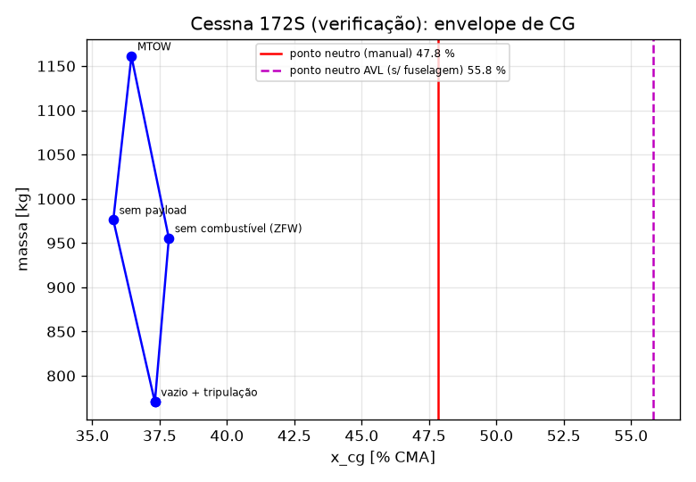

- asa posicionada para SM = 10% no CG mais recuado (ápice a 14.1% L); ápice da asa a x = 1.144 m
- Ponto neutro x̄_NP = 0.478 MAC (manual), 0.558 (AVL); dε/dα = 0.520
- **Margem estática: 12.1 % (CG dianteiro) … 10.0 % (CG traseiro)**
- AVL, cruzeiro compensado no CG traseiro: α = 3.88°, δe = -1.49°, Cnβ = 0.0905, Clβ = -0.0774, Cmq = -14.40
- Coef. de volume: V_h = 0.700, V_v = 0.0400 (Raymer Table 6.4: 0.7 / 0.04)

| caso | massa [kg] | x_cg [m] | x̄_cg [MAC] | SM |
|---|---|---|---|---|
| vazio + tripulação | 770.3 | 1.841 | 0.3732 | 0.1052 |
| sem payload | 976 | 1.815 | 0.3578 | 0.1206 |
| MTOW | 1161 | 1.826 | 0.3645 | 0.1139 |
| sem combustível (ZFW) | 955.3 | 1.849 | 0.3784 | 0.1 |

Compensação (trim) no CG dianteiro:

| condição | CL | δe [°] | ok (|δe| ≤ máx.) |
|---|---|---|---|
| CLmax limpo (CG dianteiro) | 1.561 | -8.199 | True |
| cruzeiro (CG dianteiro) | 0.4342 | -3.24 | True |

- Clδa comparado em módulo (convenções de sinal do aileron diferem entre AVL e Nelson).
- Estações de CG dos componentes: PRESSUPOSTOS (Roskam Part V Table 8.1, valores típicos) — substituir pelas posições do layout real em assumptions.stability.stations.

## 13. Desempenho por segmentos (Fase 2: Raymer Cap. 17, Anderson)

Orçamento utilizável: Wf / 1.06 (reserva + não utilizável 6 %, Raymer Eq. 3.11).

Missão requerida (segmentos):

| segmento | t [min] | dist [km] | consumo [kg] | h [m] | V [m/s] | nota |
|---|---|---|---|---|---|---|
| aquecimento + descolagem | 0 | 0 | 34.83 | 0→0 | 0 | Raymer Table 3.2 (0.970) |
| subida (V_y) | 10.16 | 22.42 | 4.884 | 0→2438 | 36.99 | potência de subida, integrado (V médio) |
| cruzeiro | 364.7 | 1373 | 146.3 | 2438→2438 | 62.76 |  |
| descida (L/D máx, ralenti) + aterragem | 9.571 | 23.91 | 5.607 | 2438→0 | 41.64 | Raymer 0.995 (combustível) |

Missão até esgotar o orçamento: **alcance 1443.4 km, endurance 6.51 h**.

| segmento | t [min] | dist [km] | consumo [kg] | h [m] | V [m/s] | nota |
|---|---|---|---|---|---|---|
| aquecimento + descolagem | 0 | 0 | 34.83 | 0→0 | 0 | Raymer Table 3.2 (0.970) |
| subida (V_y) | 10.16 | 22.42 | 4.884 | 0→2438 | 36.99 | potência de subida, integrado (V médio) |
| cruzeiro | 371 | 1397 | 148.7 | 2438→2438 | 62.76 | estendido até esgotar o orçamento |
| descida (L/D máx, ralenti) + aterragem | 9.583 | 23.91 | 5.607 | 2438→0 | 41.58 | Raymer 0.995 (combustível) |

Requisitos vs desempenho por segmentos:

| requisito | grandeza | obtido | requerido | unidade | ok |
|---|---|---|---|---|---|
| range | distância de cruzeiro (segmentos) | 1397 | 1373 | km | ✅ |
| service_ceiling | teto de serviço (Anderson) | 4419 | 4115 | m | ✅ |
| climb_rate | ROC máx. ao nível do mar | 5.163 | 3.708 | m/s | ✅ |
| takeoff_ground_roll | corrida de descolagem (Raymer 17.8) | 183.8 | 293 | m | ✅ |
| landing_distance | distância de aterragem (Raymer 17.9, total 50 ft) | 503.2 | 407 | m | ❌ |

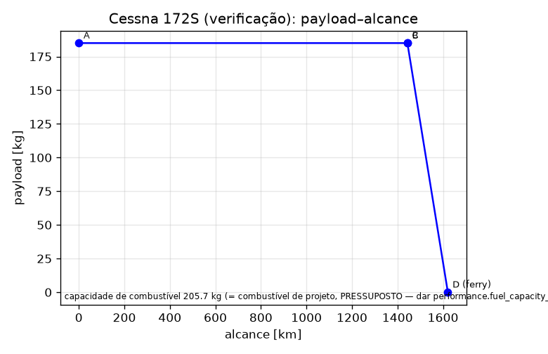

| ponto | payload_kg | combustível_kg | massa_kg | range_km |
|---|---|---|---|---|
| A | 185 | 0 | 955.4 | 0 |
| B | 185 | 205.7 | 1161 | 1443 |
| C | 185 | 205.7 | 1161 | 1443 |
| D (ferry) | 0 | 205.7 | 976.1 | 1621 |

Nota: capacidade de combustível 205.7 kg (= combustível de projeto, PRESSUPOSTO — dar performance.fuel_capacity_kg).

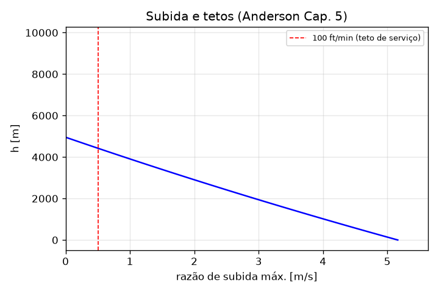

- ROC máx. ao nível do mar 5.16 m/s; teto de serviço 4419 m; teto absoluto 4956 m
- Descolagem (Raymer 17.8): corrida 184 m, total sobre 15 m 394 m (V_TO 30.4 m/s)
- Aterragem (Raymer 17.9): corrida 200 m, total sobre 15 m 503 m (μ_travagem 0.4; aproximação γ = 3° — `performance.approach_angle_deg`, por omissão o máximo de 5.2 % / 3° de CS/14 CFR 23.75(a)(1))

- Os resultados de segmentos usam a mesma polar e reservas do dimensionamento; diferenças face aos requisitos vêm da subida/descida integradas vs. frações históricas (Raymer Table 3.2).

## 14. Caixão da asa dimensionado à estabilidade (Fase 3: Bruhn C5/C7/C11, Farrar, Kuhn)

| caixão | massa [kg] | / Raymer 15.46 |
|---|---|---|
| resistência (Fase 2, limite inferior) | 68.69 | 0.6733 |
| encurvadura (Fase 3, Al 2024-T3 (MMPDS typical — verify)) | 85.1 | 0.8343 |
| Raymer Eq. 15.46 (asa completa, estatístico) | 102 | 1 |

Parcelas (caixão de encurvadura):

| parcela | massa [kg] |
|---|---|
| caps | 0 |
| covers_skin_stringers | 43.52 |
| core | 0 |
| webs | 3.677 |
| web_uprights | 0.9591 |
| LE_TE_skins | 17.97 |
| ribs | 1.955 |
| ideal | 68.08 |
| nonoptimum | 17.02 |
| total | 85.1 |

- Almas Kuhn: fator de tração diagonal k máx. 0.659 (k = 0: alma resistente ao corte, sem tração diagonal)
- Passo dos reforçadores: 30–168 mm (encurvadura local do revestimento, k = 4)
- Revestimentos reforçados (Z): σ ótimo de Farrar F = 0.81 com corte por crippling de Needham 234 MPa (b'/t = 12 — PRESSUPOSTO); passo de reforçadores na raiz 49 mm (≈ 18 reforçadores/painel); σ raiz 126 MPa
- Almas: tensão diagonal de Kuhn, k raiz = 0.66, montantes a d = h (PRESSUPOSTO), C1 = C2 ≈ 0 (α ≈ 45°, banzos rígidos — PRESSUPOSTO); admissível de τ_max = Fsu (curva Bruhn Fig. C11.19 não digitalizada — LIMITAÇÃO)
- Banzo inferior: tração Ftu e compressão no caso negativo n_neg/n_pos = 0.42
- MMPDS typical 2024-T3 sheet: Fcy 269 MPa, Ftu 434 MPa, Fsu 262 MPa, G 27.6 GPa — verify
- 12 nervuras (passo 1.01 m)
- fator não-ótimo 1.25 (PRESSUPOSTO)
- superfícies de comando, flaps e carenagens NÃO incluídos (secundários)

## 15. Aeroelasticidade clássica (Fase 3)

V_D = 98.6 m/s EAS.

| fenómeno | V [m/s EAS] | requerido 1.2 V_D | margem | ok | método |
|---|---|---|---|---|---|
| divergência torsional | 243.9 | 118.3 | +106 % | ✅ | W&C 8.3 / Bisplinghoff 8-2 (faixas + FE) |
| inversão do aileron | 240.3 | 118.3 | +103 % | ✅ | W&C 8.4, Glauert (flap 2D) |
| flutter binário (flexão–torção) | 140.7 | 118.3 | +19 % | ✅ | W&C 11 (modos assumidos, quase-estacionário) |

- Frequências desacopladas: flexão 13.3 Hz, torção 30.3 Hz; flutter a 24.3 Hz
- AEER-45 (fator de flexibilidade torsional da asa): F = 9.587e-04 vs F_max = 200/V_D² = 4.115e-03 → OK

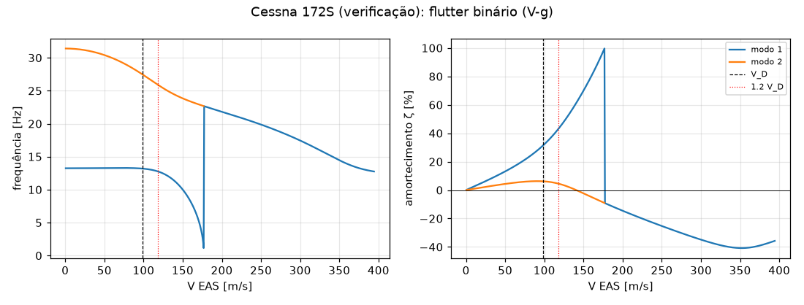

### Acoplamento aero-estrutural estático (OpenAeroStruct, VLM + caixão)

| ponto | modelo | α [°] | CL | CDi | CLα [/rad] | flecha ponta [m] | torção ponta [°] |
|---|---|---|---|---|---|---|---|
| cruise | rígido | 6.067 | 0.4342 | 0.01161 | 4.08 | 2.189e-06 | 2.11e-05 |
| cruise | flexível | 5.953 | 0.4342 | 0.01163 | 4.161 | 0.02201 | 0.2122 |
| manobra (n_lim, V_D EAS, nível do mar) | rígido | 7.357 | 0.5259 | 0.01704 | 4.066 | 8.304e-06 | 8.004e-05 |
| manobra (n_lim, V_D EAS, nível do mar) | flexível | 6.915 | 0.5259 | 0.01711 | 4.335 | 0.08458 | 0.8136 |

- Efeito da forma deformada no arrasto induzido de cruzeiro: K_flex/K = 1.0011
- Missão por segmentos: rígido 1443.4 km / 6.512 h → flexível 1442.8 km / 6.510 h (comparação com o resultado desacoplado da Fase 2)
- OpenAeroStruct VLM (sem viscoso/onda: só arrasto induzido) + FEM de caixão 'wingbox' acoplados por NLBGS; rígido = E, G × 10⁴
- secção do caixão: NACA-4 entre longarinas; espessuras de alma/revestimento do caixão acdt (5 pontos de controlo); revestimento único equivalente que reproduz EI(y) do caixão acdt e G ajustado para GJ (PRESSUPOSTO)
- sem alívio de peso estrutural nem de combustível na asa (conservativo para a deformação)
- índice de falha OAS (von Mises/KS, σ_adm = σ_cap/1.5) na manobra: +0.201 (< 0 = OK) — critério de resistência do OAS sobre o revestimento equivalente — INDICATIVO (o dimensionamento é o do caixão acdt)
- massa da asa 102.01 kg distribuída ∝ corda; CG da secção a 0.50 c; eixo elástico a 0.425 c (meio do caixão), e = 0.175 c atrás do c.a.; a_w = 6.283/rad (2D, teoria das faixas — sem correção 3D/compressibilidade)
- encastramento na parede da fuselagem y0 = 0.578 m; EI/GJ do caixão buckling
- requisito: livre de flutter/divergência/inversão até 1.2 V_D = 118.3 m/s EAS (14 CFR 23.629(c) legado; CS/14 CFR 23.2245 'suficientemente além'; STANAG 4671 USAR.629 — verificar)
- flutter: modelo binário de modos assumidos (W&C Cap. 11), aerodinâmica quase-estacionária — ESTIMATIVA; a análise racional exige modos FEM + DLM (Fase 4)

## 16. Diagrama de tesoura, modos dinâmicos e qualidades de voo (Fase 3)

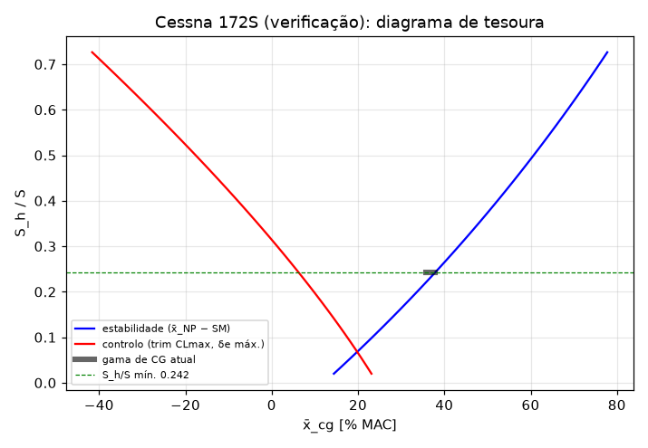

- S_h/S atual 0.242; requerido 0.242 (estabilidade 0.242, controlo 0.02; dimensionante: estabilidade) → ✅ (Torenbeek Cap. 9)
- linha de controlo: trim a CLmax limpo 1.56 com δe = −25°, τ_e = 0.661, Cm0 = -0.0364 (Raymer 16.13); momento dos flaps e efeito de solo NÃO incluídos
- massa da cauda não realimentada (posição da asa e braço fixos)

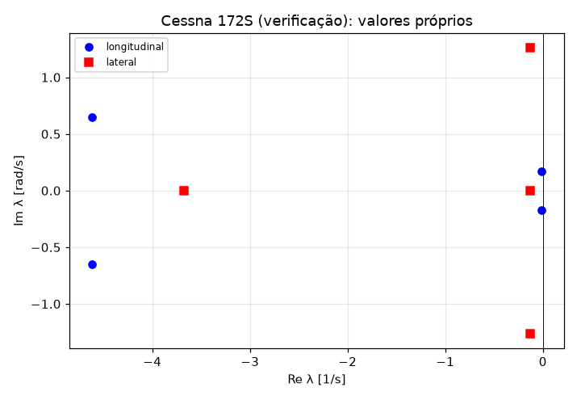

| modo | ωn [rad/s] | ζ | período [s] | τ / T [s] |
|---|---|---|---|---|
| período curto | 4.66 | 0.9902 | 9.659 | - |
| fugóide | 0.1738 | 0.09629 | 36.33 | - |
| rolamento holandês | 1.27 | 0.1 | 4.974 | - |
| rolamento (constante de tempo) | - | - | - | 0.2721 |
| espiral estável | - | - | - | 5.507 |

- n/α = 10.3 g/rad, CAP = 2.11 1/(g s²)
- Inércias (Roskam V, soma por componentes): Ixx 1.63e+03, Iyy 1.67e+03, Izz 3.3e+03 kg·m²
- derivadas de taxa e laterais: AVL (sem fuselagem) + Cnβ da fuselagem (Raymer 16.47) -0.0785
- Cmα = −CLα·SM no CG de MTOW (ponto neutro de manual com fuselagem)
- inércias por soma de componentes (Roskam Parte V) — PRESSUPOSTOS de estações

Qualidades de voo — MIL-F-8785C, Classe I, categoria B (nível exigido 1):

| modo | valor | nível | limite N1 | ref |
|---|---|---|---|---|
| período curto ζ | 0.9902 | 1 | 0.30–2.00 | MIL-F-8785C Table IV |
| CAP = ω²/(n/α) [1/(g s²)] | 2.106 | 1 | 0.085–3.6 | MIL-F-8785C Figs. 1–3 |
| fugóide ζ | 0.09629 | 1 | ≥ 0.04 | MIL-F-8785C 3.2.1.2 |
| rolamento holandês ζ / ζω / ω | 0.100 / 0.127 / 1.27 | 2 | 0.08 / 0.15 / 0.4 | MIL-F-8785C Table VI |
| rolamento τ_R [s] | 0.2721 | 1 | ≤ 1.4 | MIL-F-8785C Table VII |
| espiral T2 [s] (∞ = estável) | n/a | 1 | ≥ 20 | MIL-F-8785C Table VIII |


## Pressupostos usados

```yaml
weights:
  method: components
  initial_class: null
  fixed_fraction: null
  A: null
  C: null
  tech_factor: 1.0
  Kvs: 1.0
  fixed_mass_kg: 0.0
  components:
    material: metal
    landing_gear: tricycle
    main_gear_length_m: 0.65
    nose_gear_length_m: 0.55
    engine_dry_mass_kg: 121.6
    avionics_uninstalled_kg: 15
    n_tanks: 2
aero:
  AR: 5.0
  taper: 0.7
  sweep_c4_deg: 0.0
  tc_root: 0.12
  tc_tip: 0.12
  xc_max_t: 0.3
  airfoil: NACA 2412
  clmax_airfoil: 1.6
  flap:
    kind: slotted
    flapped_area_ratio: 0.55
  oswald: null
  cfe: 0.0055
  swet_sref: 4.0
  laminar:
    wing: 0.1
    htail: 0.1
    vtail: 0.1
    fuselage: 0.0
  roughness: smooth_paint
  Q:
    wing: 1.0
  lp_fraction: 0.05
  extra_drag_areas_m2:
    fixed_landing_gear: 0.2
    cooling_and_engine: 0.1
  CL_ground: 0.5
  dCD0_takeoff: 0.01
  mu_roll: 0.04
  fidelity: lowfi
  airfoil_solver: xfoil
propulsion:
  eta_cruise: 0.8
  eta_climb: 0.75
  eta_takeoff: 0.55
  bsfc_lb_hp_h: null
  tsfc_1_h: 0.5
  battery_Wh_kg: 200.0
  eta_total: 0.7
  dod: 0.8
  energy_reserve: 0.2
  systems_power_W: 0.0
  n_engines: 1
geometry:
  fuselage_length_m: null
  fuselage_diameter_m: null
  fuselage_fineness: 7.0
  fuselage_class: null
  tail_class: null
  c_ht: null
  c_vt: null
  tail_arm_fraction: 0.6
  ar_h: 4.0
  ar_v: 1.5
constraints:
  cruise_weight_fraction: 1.0
  landing_weight_fraction: 1.0
  approach_distance_ft: 600.0
  margin: 0.0
  ws_initial_psf: 17.0
  ws_min: 50.0
  ws_max: 3000.0
  default_cruise_altitude_m: 0.0
  ws_fixed: 823.3677141614038
  value_fixed: null
  criterion: fixed_ws
mda:
  max_iter: 30
  tol: 1.0e-05
  tol_lowfi: 0.0002
structures:
  regulation: auto
  load_factor_from_vn: true
  material: auto
  nonoptimum_factor: 1.25
  VH_eas_m_s: null
stability:
  target_static_margin: 0.1
  wing_apex_x_fraction: null
  stations: {}
  elevator_max_deg: 25.0
  use_avl: true
  dynamics: true
  hq_category: B
  hq_required_level: 1
performance:
  fuel_capacity_kg: null
  max_payload_kg: null
  mu_brake: 0.4
  approach_angle_deg: 3.0
aeroelasticity:
  enabled: true
  a_w: 6.283185307179586
  x_cg_chord: null
  margin_factor: 1.2
  static_aerostructural: true
mdo:
  objective: null
  solver: nlbgs
  trust_region_iterations: 8
  trust_region_radius: 0.3
  design_vars:
  - ws
  - AR
  AR_bounds:
  - 5.0
  - 16.0
  ws_bounds_factor:
  - 0.6
  - 1.4
  pw_bounds_factor:
  - 0.6
  - 1.6
  maxiter: 60
  tol: 1.0e-06
cost: {}
```

## Referências

- Raymer, D. P., *Aircraft Design: A Conceptual Approach*, 6th ed., AIAA, 2018 (equation numbers as in the 6th ed.).
- Roskam, J., *Airplane Design*, Parts I–VIII, DARcorporation.
- Gudmundsson, S., *General Aviation Aircraft Design: Applied Methods and Procedures*, Elsevier, 2014.
- Anderson, J. D., *Aircraft Performance and Design*, McGraw-Hill, 1999.
- Torenbeek, E., *Synthesis of Subsonic Airplane Design*, Delft Univ. Press, 1982.
- USAF Stability and Control DATCOM, 1978.
- Hepperle, M., "Electric Flight – Potential and Limitations", NATO STO-MP-AVT-209, 2012.
- Niu, M. C. Y., *Airframe Structural Design*, Conmilit, 1988.
- Drela, M., "First-Order DC Electric Motor Model", MIT, 2007.
- ISO 2533:1975 Standard Atmosphere.
- Nicolai, L. M., Carichner, G. E., *Fundamentals of Aircraft and Airship Design*, Vol. I, AIAA, 2010 (Table 5.1, We = A·W0^B incl. UAV classes).
- EASA CS-23 (Amdt. 4 and earlier) / 14 CFR 23.337 (pre-Amdt. 23-64): limit manoeuvring load factors.
- IEC 60028:1925, International standard of resistance for copper (ρCu = 8890 kg/m³).
- FAA Type Certificate Data Sheet 1E10 (Lycoming O-360/IO-360 series) — engine dry mass in the C172 check.
- Drela, M., "XFOIL: An Analysis and Design System for Low Reynolds Number Airfoils", 1989; XFOIL 6.99 (GPL).
- Drela, M., Youngren, H., AVL 3.40 (Athena Vortex Lattice), MIT, 2022 (GPL).
- Sharpe, P., NeuralFoil, MIT, 2024 (fallback section polars).
- Schrenk, O., "A Simple Approximation Method for Obtaining the Spanwise Lift Distribution", NACA TM 948, 1940.
- Megson, T. H. G., *Aircraft Structures for Engineering Students*, 5th ed., 2013 (Ch. 16, 19–23).
- Bruhn, E. F., *Analysis and Design of Flight Vehicle Structures*, 1973 (Ch. A3, C5, C11).
- Etkin, B., Reid, L. D., *Dynamics of Flight: Stability and Control*, 3rd ed., Wiley, 1996.
- Nelson, R. C., *Flight Stability and Automatic Control*, 2nd ed., McGraw-Hill, 1998.
- Kroo, I., *Aircraft Design: Synthesis and Analysis*, Stanford (lift-dependent drag, fuselage span-efficiency factor).
- EASA CS-23 Amdt. 4 / 14 CFR 23.333–23.341 (flight envelope, design speeds, gust loads); 14 CFR/CS 23.65 (climb speed).
- NATO STANAG 4671 Ed. 1 (USAR), 2009: USAR.303, .333, .335, .337, .341.
- Abbott, I. H., von Doenhoff, A. E., *Theory of Wing Sections*, Dover, 1959.
