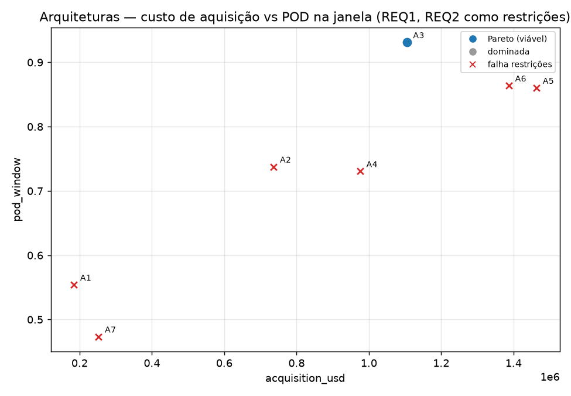
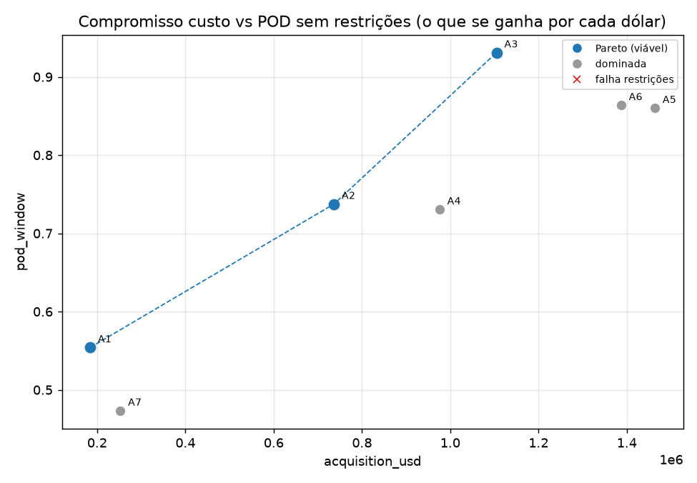

# Estudo conceptual: Vigilância de pesca ilegal na ZEE continental (zona centro)

*Registo `vigilancia_de_pesca_ilegal_na_zee_continental_zo` (acdt.concept_study/1), criado 2026-10-29T14:05:21+00:00. O raciocínio é do agente de IA; os números vêm das ferramentas determinísticas do acdt (secção Chamadas). Valores marcados PRESSUPOSTO não vêm de método nem de fonte.*

## Problema (palavras do utilizador)

> Quero vigiar esta área de mar porque há barcos estrangeiros a fazer pesca ilegal.

## Interpretação

* Necessidade: detetar, seguir e identificar (para prova e intervenção) embarcações de pesca estrangeiras a pescar ilegalmente numa área de mar português. A decisão a tomar é QUE ARQUITETURA de sistema aéreo não tripulado (quantas aeronaves, de que tamanho, com que sensores, a partir de onde) dá cobertura credível ao menor custo. A intervenção (abordagem) é de outra entidade (Marinha/autoridade de pescas); o sistema aéreo entrega deteção + identificação + track.
* Cadeia de missão: radar marítimo (área larga, dia/noite, independente do AIS — quem pesca ilegalmente pode desligar o AIS) → correlação com AIS/VMS → EO/IR para identificação (nome/número de casco, artes de pesca) → registo e entrega do track. Logo, os requisitos-chave são probabilidade de deteção na área numa janela de tempo, presença permanente e capacidade de identificação.

## Pressupostos

* **ASS1** PRESSUPOSTO — Área de vigilância: retângulo 38.9–40.1 N × 10.9–9.7 W (ao largo de Peniche/Nazaré, dentro da ZEE continental) *Justificação:* o utilizador não indicou a área; escolhida uma área representativa (~1/20 da ZEE continental de 287 521 km²) para tornar o estudo concreto
* **ASS2** PRESSUPOSTO — Base: BA5 Monte Real (39.828 N, 8.887 W), pista existente *Justificação:* aeródromo militar público mais próximo da área; alternativa civil a avaliar
* **ASS3** PRESSUPOSTO — Alvo: embarcação de pesca 15–40 m; a pescar 2–6 kn (arrasto de fundo 3–5 kn), em trânsito 8–12 kn *Fonte:* FAO / IMCS (velocidades de arrasto e trânsito)
* **ASS4** PRESSUPOSTO — Janela de deteção = tempo de travessia da área por uma embarcação a 10 kn *Justificação:* pior caso razoável: embarca que entra, pesca pouco e sai; uma embarcação a pescar fica muitas horas (janela maior, requisito mais fácil) — sensibilidade a 12 h
* **ASS5** PRESSUPOSTO — Disponibilidade operacional da aeronave A = 0.85 (sensibilidade 0.70) *Justificação:* sem dado público fiável para esta classe; valor de planeamento a confirmar com MTBF/MTTR reais — o número de aeronaves é sensível a isto
* **ASS6** PRESSUPOSTO — Turnaround no solo 4 h (L/M), reserva 1 h, sobreposição na passagem de estação 0.25 h *Justificação:* abastecimento, inspeção pós-voo e briefing; reserva para desvio/meteo
* **ASS7** PRESSUPOSTO — Largura de varrimento do radar: NSP-7 = 20.4 km (datasheet, alvo 'fishing boat'); NSP-2 = 10 km (sensibilidade 5–20 km) *Justificação:* NSP-2 anuncia 44 km de deteção MMTI marítima sem indicar a classe de alvo; 10 km é deliberadamente conservador
* **ASS8** PRESSUPOSTO — Lei de deteção de Koopman (pesquisa aleatória) para o requisito *Justificação:* conservador face ao varrimento paralelo (alvo em movimento, navegação imperfeita, estado do mar); o varrimento paralelo dá o limite otimista
* **ASS9** PRESSUPOSTO — Produção de N = 50 unidades para o CER de custo (L0); ano 2026 *Justificação:* ordem de grandeza de um programa pequeno; o custo unitário é sensível a N e o CER tem baixa confiança para UAV
* **ASS10** PRESSUPOSTO — S: lançamento e recuperação no navio dentro da área (trânsito 0.25 h cada sentido), troca de bateria 1 h, reserva 0.25 h *Justificação:* opção criativa 'mothership'; custo e disponibilidade do navio não incluídos

## Fontes consultadas

* **SOU1** IMSAR NSP-7: 10.9 kg, 275 W, banda Ku; marítimo: faixa 20.4 km para barco de pesca — https://www.radartutorial.eu/19.kartei/08.airborne/pubs/nsp-7_datasheet_spreads.pdf (consultado 2026-10-29)
* **SOU2** IMSAR NSP-2: 1.5–2.1 kg, ≤ 56 W; MMTI marítimo deteção/track 44 km (classe não indicada) — https://www.imsar.com/radar-products/nsp-2 (consultado 2026-10-29)
* **SOU3** Trillium HD25 0.35–0.39 kg; HD45-LV-CZ 1.35 kg — https://www.trilliumeng.com (consultado 2026-10-29)
* **SOU4** ZEE de Portugal continental 287 521 km² — https://www.dgrm.pt (consultado 2026-10-29)
* **SOU5** Velocidades de arrasto 2–6 kn, trânsito 8–12 kn — FAO fishing techniques / IMCS network (consultado 2026-10-29)
* **SOU6** Gasolina 95 em Portugal: 2.067 €/L (média DGEG, 27 out 2026) — https://www.combustivel.com.pt (consultado 2026-10-29)

## Requisitos derivados

| id | requisito | métrica | limiar | justificação |
|---|---|---|---|---|
| REQ1 | Detetar uma embarcação de pesca na área dentro da janela de travessia | pod_window | >= 0.9 | janela = 5.56 h (travessia de 103 km a 10 kn, chamada transit_time); 0.9 = PRESSUPOSTO de eficácia credível |
| REQ2 | Presença permanente (24/7) dos sensores previstos na estação | p_enough_available | >= 0.95 | prob. de haver aeronaves disponíveis suficientes para manter o ciclo (binomial k-de-N); 0.95 = PRESSUPOSTO |
| REQ3 | Identificação EO/IR de uma embarcação de 15 m a distância de segurança | ifov_rad | <= 1e-4 (≈ 11.7 km a 50 %) | Johnson (identificação, 6.4 ciclos): IFOV 0.1 mrad → 11.7 km; o datasheet da HD45 tem de ser verificado contra este valor (não avaliado aqui) |
| REQ4 | Minimizar o custo de aquisição da frota (e, como indicador de operação, horas de voo e combustível por dia) | acquisition_usd | min | objetivo, não limite (orçamento desconhecido — pergunta Q4) |

## Alternativas

| id | descrição | avaliável | como / porque não |
|---|---|---|---|
| A1 | 1×L, sem continuidade (uma aeronave grande) | sim | size_fleet + persistent_coverage(fleet 1) |
| A2 | L, 1 estação 24/7 | sim | persistent_coverage + sweep_coverage + size_fleet |
| A3 | L, 2 estações 24/7 | sim | idem |
| A4 | M, 2 estações 24/7 (radar ligeiro) | sim | idem |
| A5 | M, 3 estações 24/7 | sim | idem |
| A6 | Misto: 1 estação L (área larga) + 1 estação M (identificação/seguimento por cueing) | sim | idem; POD combinada pela aditividade do esforço de Koopman |
| A7 | S elétrico 25 kg lançado de navio, 2 estações | sim | trânsito ~0; custo do navio NÃO incluído |
| X1 | Aeróstato cativo costeiro com radar | não | acdt não dimensiona aeróstatos; cobre só a faixa costeira (a área começa ~25 km da costa) |
| X2 | Satélite SAR + AIS (ex.: serviços EMSA/Copernicus) com aeronave só para identificação | não | revisita e latência de satélite não modeladas; muito promissor como cueing — pergunta Q3 |
| X3 | Avião tripulado de patrulha marítima existente | não | meio existente, custo/hora não público aqui |
| X4 | VTOL lançado de navio-patrulha | não | acdt ainda não dimensiona VTOL |
| X5 | HALE solar / estratosférico | não | fora do âmbito do dimensionamento atual |
| X6 | Veículos de superfície não tripulados (USV) com radar | não | não é aeronave; horizonte baixo |

## Comparação: Arquiteturas — custo de aquisição vs POD na janela (REQ1, REQ2 como restrições)

| alternativa | acquisition_usd | pod_window | flight_hours_per_day | n_aircraft | p_enough_available | fuel_kg_per_day | losses_per_year | Pareto | restrições |
|---|---|---|---|---|---|---|---|---|---|
| A1 | 1.841e+05 | 0.554 | 16.12 | 1 | 0 | 27.65 | None | não | pod_window = 0.554 < min 0.9; p_enough_available = 0 < min 0.95 |
| A2 | 7.365e+05 | 0.7375 | 27.18 | 4 | 0.988 | 46.63 | 17.93 | não | pod_window = 0.7375 < min 0.9 |
| A3 | 1.105e+06 | 0.9311 | 54.37 | 6 | 0.9527 | 93.26 | 35.86 | sim | ok |
| A4 | 9.756e+05 | 0.7305 | 59.13 | 6 | 0.9527 | 93.51 | 40.81 | não | pod_window = 0.7305 < min 0.9 |
| A5 | 1.463e+06 | 0.8601 | 88.69 | 9 | 0.9661 | 140.3 | 61.22 | não | pod_window = 0.8601 < min 0.9 |
| A7 | 2.524e+05 | 0.4732 | 68.84 | 6 | 0.9527 | 0 | 47.98 | não | pod_window = 0.4732 < min 0.9 |
| A6 | 1.387e+06 | 0.8637 | 56.75 | 8 | 0.9762 | 93.38 | 38.34 | não | pod_window = 0.8637 < min 0.9 |

Objetivos: acquisition_usd (minimizar), pod_window (maximizar), flight_hours_per_day (minimizar). Frente de Pareto: A3.

## Comparação: Compromisso custo vs POD sem restrições (o que se ganha por cada dólar)

| alternativa | acquisition_usd | pod_window | n_aircraft | p_enough_available | flight_hours_per_day | fuel_kg_per_day | losses_per_year | Pareto | restrições |
|---|---|---|---|---|---|---|---|---|---|
| A1 | 1.841e+05 | 0.554 | 1 | 0 | 16.12 | 27.65 | None | sim | ok |
| A2 | 7.365e+05 | 0.7375 | 4 | 0.988 | 27.18 | 46.63 | 17.93 | sim | ok |
| A3 | 1.105e+06 | 0.9311 | 6 | 0.9527 | 54.37 | 93.26 | 35.86 | sim | ok |
| A4 | 9.756e+05 | 0.7305 | 6 | 0.9527 | 59.13 | 93.51 | 40.81 | não | ok |
| A5 | 1.463e+06 | 0.8601 | 9 | 0.9661 | 88.69 | 140.3 | 61.22 | não | ok |
| A7 | 2.524e+05 | 0.4732 | 6 | 0.9527 | 68.84 | 0 | 47.98 | não | ok |
| A6 | 1.387e+06 | 0.8637 | 8 | 0.9762 | 56.75 | 93.38 | 38.34 | não | ok |

Objetivos: acquisition_usd (minimizar), pod_window (maximizar). Frente de Pareto: A1, A2, A3.

## Constatações

* **FIN1** Horizonte radar a 3000 m = 235 km e a 600 m = 110 km, muito acima dos alcances dos radares (20–44 km): a deteção é limitada pelo sensor, não pelo horizonte; voar mais baixo não penaliza a deteção mas reduz a área por hora apenas pela velocidade.
* **FIN2** Variante L: W0 127.9 kg, endurance 16.45 h, custo unitário 184 k$ (N=50), perda por surtida 0.0279; viável=False; verificações falhadas: trim, hq:scissor, hq:dutch_roll, wb:envelope, gear:position, gear:tipback, perf:endurance; base de certificação ['stanag4703'].
* **FIN3** Variante M: W0 92.4 kg, endurance 10.62 h, custo unitário 163 k$ (N=50), perda por surtida 0.0182; viável=True; verificações falhadas: hq:scissor, hq:dutch_roll, wb:envelope, gear:position, gear:tipback; base de certificação ['stanag4703'].
* **FIN4** Variante S: W0 23.6 kg, endurance 2.73 h, custo unitário 42 k$ (N=50), perda por surtida 0.0047; viável=False; verificações falhadas: wing_span, hq:scissor, hq:CAP, hq:spiral, wb:envelope, perf:endurance; base de certificação ['stanag4703'].
* **FIN5** Indicadores derivados no script (aritmética sobre resultados das ferramentas): pod_window de frotas mistas = 1 − Π(1 − POD_i) (aditividade do esforço de Koopman); losses_per_year = surtidas/dia · 365 · p_loss_per_sortie (ARP4761 low-fi, taxas genéricas do template 'uas'); A6 dimensionada com confiança √0.95 por tipo (independência).
* **FIN6** A taxa de perda por surtida vem do template ARP4761 low-fi 'uas' com taxas de falha genéricas: com dezenas de surtidas por semana, a atrição prevista (losses_per_year) pesa mais do que a aquisição. É o PRESSUPOSTO mais crítico para o custo de ciclo de vida e tem de ser substituído por dados de fiabilidade reais (MTBF dos componentes) antes de qualquer decisão.
* **FIN7** Sensibilidades: A4 POD com W_NSP-2=5 km → 0.481; A4 POD com W_NSP-2=20 km → 0.927; A3 frota L para 95 % com A=0.7 → 9; A2 POD com janela 12 h → 0.944; A2 POD varrimento paralelo (otimista) → 1

## Recomendação

A3: L, 2 estações 24/7 — 6 aeronaves, aquisição ≈ 1.10 M$ (CER L0, baixa confiança), POD na janela 0.93, P(frota suficiente) 0.953, 54 h de voo/dia.

**Porquê:**
alternativa mais barata no conjunto de Pareto que cumpre REQ1 (POD ≥ 0.9 na janela) e REQ2 (P ≥ 0.95); sem pesos — o compromisso custo/POD/horas de voo está no gráfico e na tabela. ATENÇÃO: a variante L ainda não fecha no dimensionamento L0 (verificações falhadas: trim, hq:scissor, hq:dutch_roll, wb:envelope, gear:position, gear:tipback, perf:endurance); a arquitetura é válida ao nível conceptual, a aeronave tem de ser corrigida (trim/estabilidade/W&B/trem; a verificação por segmentos dá endurance ligeiramente abaixo de 16 h). A atrição prevista (FIN6) domina o custo de ciclo de vida se as taxas genéricas se confirmarem.

**Sensibilidades:**
* A4 POD com W_NSP-2=5 km: 0.481
* A4 POD com W_NSP-2=20 km: 0.927
* A3 frota L para 95 % com A=0.7: 9
* A2 POD com janela 12 h: 0.944
* A2 POD varrimento paralelo (otimista): 1

**Fora do alcance das ferramentas:**
X1–X6 (aeróstato, satélite+aeronave, avião tripulado, VTOL, HALE, USV); custo de operação (manutenção, pessoal, seguros); meteorologia e espaço aéreo; desempenho do radar com estado do mar; o custo do navio em A7; a câmara (REQ3) contra o datasheet

**Próximos passos:**
responder às perguntas Q1–Q5; obter a largura de varrimento do NSP-2 para barco de pesca; corrigir as verificações falhadas da variante escolhida (trim/HQ/W&B/trem) em L1; avaliar X2 (satélite como cueing) porque pode reduzir muito o número de aeronaves

## Perguntas ao utilizador

* **QUE1** Qual é a área real (polígono) e há várias áreas/prioridades?
* **QUE2** É preciso presença 24/7 ou só em certos períodos/épocas (ex.: campanhas de pesca, noite)?
* **QUE3** Que meios já existem (navios-patrulha, aviões de patrulha marítima, dados de satélite EMSA/Copernicus) e com quem o sistema tem de partilhar dados?
* **QUE4** Orçamento de aquisição e de operação, e horizonte do programa?
* **QUE5** Bases possíveis (BA5, aeródromos civis, navios) e restrições de espaço aéreo?

## Chamadas às ferramentas (determinísticas)

| # | ferramenta | argumentos (resumo) |
|---|---|---|
| 1 | `geo_measure` | `{"points": {"BA5": [39.828, -8.887], "centro": [39.5, -10.3], "bordo_E": [39.5, -9.7], "bordo_W": [39.5, -10.9]}, "legs": [["BA5", "centro"], ["BA5", "bordo_E"]…` |
| 2 | `transit_time` | `{"distance_km": 102.96026755648526, "airspeed_m_s": 5.14444}` |
| 3 | `johnson_range` | `{"target_dim_m": 15.0, "task": "identification", "ifov_rad": 0.0001}` |
| 4 | `radar_horizon` | `{"h_sensor_m": 3000, "h_target_m": 5}` |
| 5 | `radar_horizon` | `{"h_sensor_m": 600, "h_target_m": 5}` |
| 6 | `size_fleet` | `{"variants": [{"id": "L", "spec_path": "examples/concept/illegal_fishing/variant_L.yaml", "quantity": 1, "cost": {"N": 50, "year": 2026}, "safety": {}}, {"id": …` |
| 7 | `persistent_coverage` | `{"endurance_h": 16.4464526312886, "turnaround_h": 4.0, "distance_km": 126.3277359695501, "airspeed_m_s": 45.0, "reserve_h": 1.0, "handoff_overlap_h": 0.25, "n_s…` |
| 8 | `persistent_coverage` | `{"endurance_h": 16.4464526312886, "turnaround_h": 4.0, "distance_km": 126.3277359695501, "airspeed_m_s": 45.0, "reserve_h": 1.0, "handoff_overlap_h": 0.25, "n_s…` |
| 9 | `persistent_coverage` | `{"endurance_h": 16.4464526312886, "turnaround_h": 4.0, "distance_km": 126.3277359695501, "airspeed_m_s": 45.0, "reserve_h": 1.0, "handoff_overlap_h": 0.25, "n_s…` |
| 10 | `persistent_coverage` | `{"endurance_h": 10.615531033785269, "turnaround_h": 4.0, "distance_km": 126.3277359695501, "airspeed_m_s": 45.0, "reserve_h": 1.0, "handoff_overlap_h": 0.25, "n…` |
| 11 | `persistent_coverage` | `{"endurance_h": 10.615531033785269, "turnaround_h": 4.0, "distance_km": 126.3277359695501, "airspeed_m_s": 45.0, "reserve_h": 1.0, "handoff_overlap_h": 0.25, "n…` |
| 12 | `persistent_coverage` | `{"endurance_h": 10.615531033785269, "turnaround_h": 4.0, "distance_km": 126.3277359695501, "airspeed_m_s": 45.0, "reserve_h": 1.0, "handoff_overlap_h": 0.25, "n…` |
| 13 | `persistent_coverage` | `{"endurance_h": 2.727570342607572, "turnaround_h": 1.0, "t_out_h": 0.25, "t_back_h": 0.25, "reserve_h": 0.25, "handoff_overlap_h": 0.25, "n_stations": 1, "avail…` |
| 14 | `persistent_coverage` | `{"endurance_h": 2.727570342607572, "turnaround_h": 1.0, "t_out_h": 0.25, "t_back_h": 0.25, "reserve_h": 0.25, "handoff_overlap_h": 0.25, "n_stations": 2, "avail…` |
| 15 | `persistent_coverage` | `{"endurance_h": 2.727570342607572, "turnaround_h": 1.0, "t_out_h": 0.25, "t_back_h": 0.25, "reserve_h": 0.25, "handoff_overlap_h": 0.25, "n_stations": 3, "avail…` |
| 16 | `persistent_coverage` | `{"endurance_h": 16.4464526312886, "turnaround_h": 4.0, "distance_km": 126.3277359695501, "airspeed_m_s": 45.0, "reserve_h": 1.0, "handoff_overlap_h": 0.25, "ava…` |
| 17 | `sweep_coverage` | `{"area_km2": 13738.260752262873, "sweep_width_km": 20.4, "speed_m_s": 45.0, "n_on_station": 0.6038263179344641, "time_h": 5.559414498224473, "pod_target": 0.9}` |
| 18 | `size_fleet` | `{"variants": [{"id": "Lx1", "spec_path": "examples/concept/illegal_fishing/variant_L.yaml", "quantity": 1, "cost": {"N": 50, "year": 2026}, "safety": {}}]}` |
| 19 | `persistent_coverage` | `{"endurance_h": 16.4464526312886, "turnaround_h": 4.0, "distance_km": 126.3277359695501, "airspeed_m_s": 45.0, "reserve_h": 1.0, "handoff_overlap_h": 0.25, "n_s…` |
| 20 | `sweep_coverage` | `{"area_km2": 13738.260752262873, "sweep_width_km": 20.4, "speed_m_s": 45.0, "n_on_station": 1, "time_h": 5.559414498224473, "pod_target": 0.9}` |
| 21 | `size_fleet` | `{"variants": [{"id": "Lx4", "spec_path": "examples/concept/illegal_fishing/variant_L.yaml", "quantity": 4, "cost": {"N": 50, "year": 2026}, "safety": {}}]}` |
| 22 | `persistent_coverage` | `{"endurance_h": 16.4464526312886, "turnaround_h": 4.0, "distance_km": 126.3277359695501, "airspeed_m_s": 45.0, "reserve_h": 1.0, "handoff_overlap_h": 0.25, "n_s…` |
| 23 | `sweep_coverage` | `{"area_km2": 13738.260752262873, "sweep_width_km": 20.4, "speed_m_s": 45.0, "n_on_station": 2, "time_h": 5.559414498224473, "pod_target": 0.9}` |
| 24 | `size_fleet` | `{"variants": [{"id": "Lx6", "spec_path": "examples/concept/illegal_fishing/variant_L.yaml", "quantity": 6, "cost": {"N": 50, "year": 2026}, "safety": {}}]}` |
| 25 | `persistent_coverage` | `{"endurance_h": 10.615531033785269, "turnaround_h": 4.0, "distance_km": 126.3277359695501, "airspeed_m_s": 45.0, "reserve_h": 1.0, "handoff_overlap_h": 0.25, "n…` |
| 26 | `sweep_coverage` | `{"area_km2": 13738.260752262873, "sweep_width_km": 10.0, "speed_m_s": 45.0, "n_on_station": 2, "time_h": 5.559414498224473, "pod_target": 0.9}` |
| 27 | `size_fleet` | `{"variants": [{"id": "Mx6", "spec_path": "examples/concept/illegal_fishing/variant_M.yaml", "quantity": 6, "cost": {"N": 50, "year": 2026}, "safety": {}}]}` |
| 28 | `persistent_coverage` | `{"endurance_h": 10.615531033785269, "turnaround_h": 4.0, "distance_km": 126.3277359695501, "airspeed_m_s": 45.0, "reserve_h": 1.0, "handoff_overlap_h": 0.25, "n…` |
| 29 | `sweep_coverage` | `{"area_km2": 13738.260752262873, "sweep_width_km": 10.0, "speed_m_s": 45.0, "n_on_station": 3, "time_h": 5.559414498224473, "pod_target": 0.9}` |
| 30 | `size_fleet` | `{"variants": [{"id": "Mx9", "spec_path": "examples/concept/illegal_fishing/variant_M.yaml", "quantity": 9, "cost": {"N": 50, "year": 2026}, "safety": {}}]}` |
| 31 | `persistent_coverage` | `{"endurance_h": 2.727570342607572, "turnaround_h": 1.0, "t_out_h": 0.25, "t_back_h": 0.25, "reserve_h": 0.25, "handoff_overlap_h": 0.25, "n_stations": 2, "avail…` |
| 32 | `sweep_coverage` | `{"area_km2": 13738.260752262873, "sweep_width_km": 10.0, "speed_m_s": 22.0, "n_on_station": 2, "time_h": 5.559414498224473, "pod_target": 0.9}` |
| 33 | `size_fleet` | `{"variants": [{"id": "Sx6", "spec_path": "examples/concept/illegal_fishing/variant_S.yaml", "quantity": 6, "cost": {"N": 50, "year": 2026}, "safety": {}}]}` |
| 34 | `persistent_coverage` | `{"endurance_h": 16.4464526312886, "turnaround_h": 4.0, "distance_km": 126.3277359695501, "airspeed_m_s": 45.0, "reserve_h": 1.0, "handoff_overlap_h": 0.25, "ava…` |
| 35 | `persistent_coverage` | `{"endurance_h": 10.615531033785269, "turnaround_h": 4.0, "distance_km": 126.3277359695501, "airspeed_m_s": 45.0, "reserve_h": 1.0, "handoff_overlap_h": 0.25, "a…` |
| 36 | `fleet_reliability` | `{"n": 4, "k": 2, "p_success": 0.85}` |
| 37 | `fleet_reliability` | `{"n": 4, "k": 2, "p_success": 0.85}` |
| 38 | `sweep_coverage` | `{"area_km2": 13738.260752262873, "sweep_width_km": 20.4, "speed_m_s": 45.0, "n_on_station": 1, "time_h": 5.559414498224473, "pod_target": 0.9}` |
| 39 | `sweep_coverage` | `{"area_km2": 13738.260752262873, "sweep_width_km": 10.0, "speed_m_s": 45.0, "n_on_station": 1, "time_h": 5.559414498224473, "pod_target": 0.9}` |
| 40 | `size_fleet` | `{"variants": [{"id": "Lx4", "spec_path": "examples/concept/illegal_fishing/variant_L.yaml", "quantity": 4, "cost": {"N": 50, "year": 2026}, "safety": {}}, {"id"…` |
| 41 | `compare_alternatives` | `{"alternatives": [{"id": "A1", "metrics": {"n_aircraft": 1, "acquisition_usd": 184132.72517988578, "pod_window": 0.5540383388861407, "p_enough_available": 0.0, …` |
| 42 | `compare_alternatives` | `{"alternatives": [{"id": "A1", "metrics": {"n_aircraft": 1, "acquisition_usd": 184132.72517988578, "pod_window": 0.5540383388861407, "p_enough_available": 0.0, …` |
| 43 | `sweep_coverage` | `{"area_km2": 13738.260752262873, "sweep_width_km": 5.0, "speed_m_s": 45.0, "n_on_station": 2, "time_h": 5.559414498224473, "pod_target": 0.9}` |
| 44 | `sweep_coverage` | `{"area_km2": 13738.260752262873, "sweep_width_km": 20.0, "speed_m_s": 45.0, "n_on_station": 2, "time_h": 5.559414498224473, "pod_target": 0.9}` |
| 45 | `persistent_coverage` | `{"endurance_h": 16.4464526312886, "turnaround_h": 4.0, "distance_km": 126.3277359695501, "airspeed_m_s": 45.0, "reserve_h": 1.0, "handoff_overlap_h": 0.25, "n_s…` |
| 46 | `sweep_coverage` | `{"area_km2": 13738.260752262873, "sweep_width_km": 20.4, "speed_m_s": 45.0, "n_on_station": 1, "time_h": 12.0}` |
| 47 | `sweep_coverage` | `{"area_km2": 13738.260752262873, "sweep_width_km": 20.4, "speed_m_s": 45.0, "n_on_station": 1, "time_h": 5.559414498224473, "pod_target": 0.9}` |

Os resultados completos estão em `study.json` (`calls[].result`); `acdt concept replay study.json` volta a correr as chamadas e confirma que dão o mesmo resultado.
