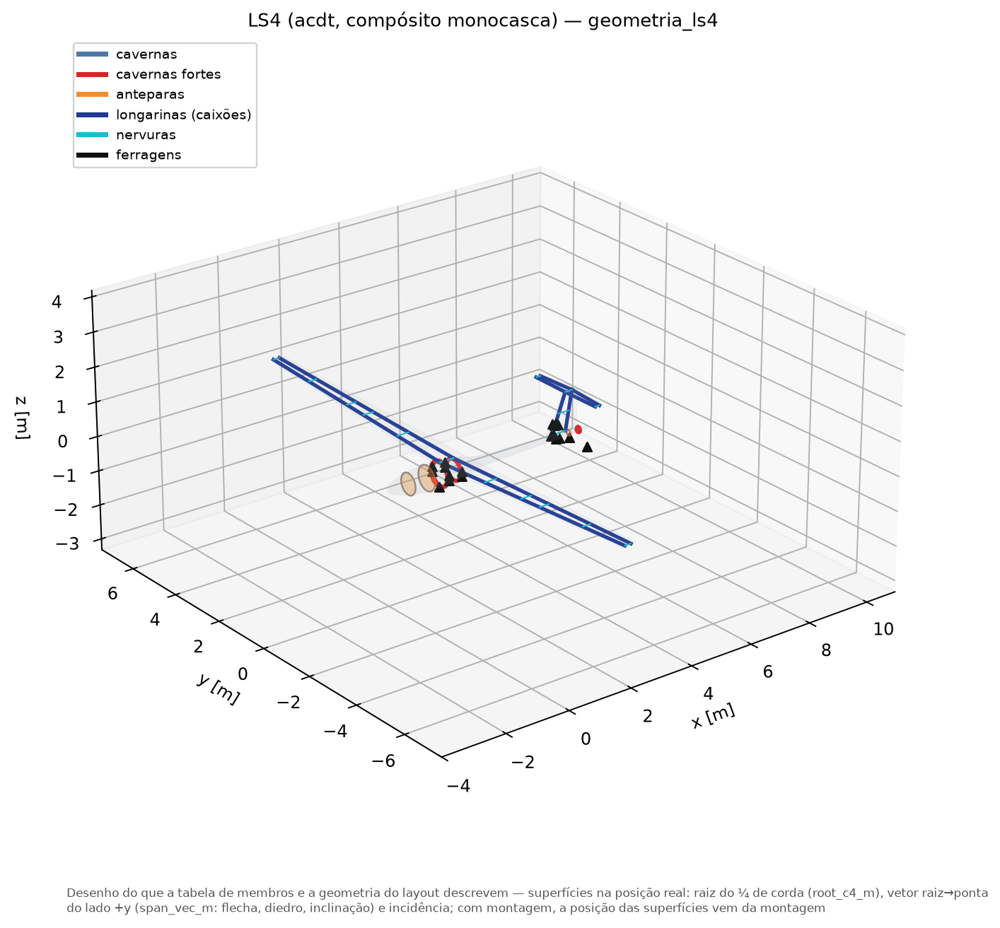
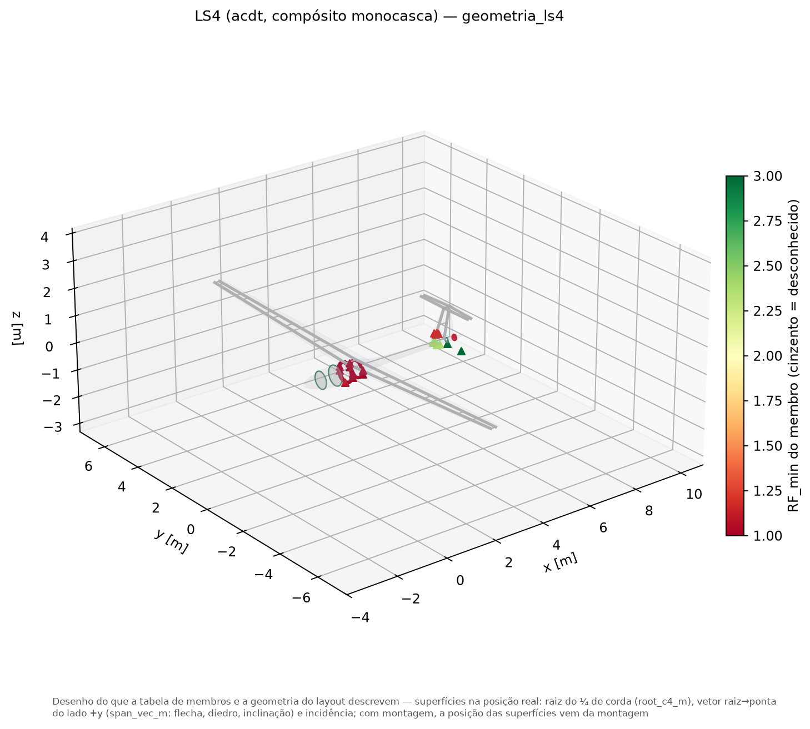

# Planador em compósito — Rolladen-Schneider LS4: acdt vs avião real

Estudo `applied: false` (examples/studies/planador_ls4). Fontes e qualidade em `examples/benchmarks/ls4/reference_data.json`. Δ = (acdt − real)/real.

## Caso `dimensionado` — W/S = 472 kg / 10,5 m² fixada; S e b saem de W0 do acdt

| grandeza | acdt | real | Δ | fonte |
|---|---|---|---|---|
| W0 / MTOM [kg] | 365 | 472 | -23 % | tcds |
| massa vazia [kg] | 131 | 238 | -45 % | janes |
| asa (estrutura paramétrica) [kg] | 50.0 | 128 | -61 % | fai_refmass |
| fuselagem (casca + cavernas + anteparas) [kg] | 32.3 | desconhecido | desconhecido | — |
| empenagens H + V [kg] | 3.0 | desconhecido | desconhecido | — |
| fuselagem + deriva + trem + comandos + aviónica (análogo Std Cirrus) [kg] | 79.4 | 123.0 | -35 % | hoff_gratton (análogo) |
| estabilizador (análogo Std Cirrus) [kg] | 1.7 | 7.0 | -76 % | hoff_gratton (análogo) |
| asa / massa vazia | 0.38 | 0,46–0,55 | — | hoff_gratton |
| trem (Raymer 15.50/15.51, extrapolado) [kg] | 22.8 | desconhecido | desconhecido | — |
| S [m²] | 8.11 | 10.50 | -23 % | tcds |
| envergadura [m] | 13.18 | 15.00 | -12 % | tcds |
| carga alar W0/S [kg/m²] | 45.0 | 44.95 | +0 % | tcds |
| CG [mm atrás do BA na raiz] | 284–305 | 225–375 | dentro | tcds |
| (L/D)max à massa da polar | 37.0 | 40 | -8 % | cumulus |
| V de (L/D)max [km/h] | 97 | 95 | +2 % | cumulus |
| afundamento a 95 km/h [m/s] | 0.714 | 0.660 | +8 % | cumulus |
| afundamento a 148 km/h [m/s] | 1.531 | 1.426 | +7 % | cumulus |
| afundamento a 200 km/h [m/s] | 3.365 | 2.995 | +12 % | cumulus |
| (L/D)max (Jane's, massa desconhecida) | 37.0 | 40.5 | -9 % | janes |
| afundamento mínimo [m/s] (Jane's, massa desc.) | 0.65 a 81 km/h | 0.61 a 75 km/h | +6 % | janes |
| V perda [km/h] (Jane's, massa desc.; acdt a 320 kg | MTOM) | 81 | 98 | 68 | +19 % | janes |
| VA [km/h] (VS1 √n1 a W0) | 199 | 180 | +11 % | tcds |
| VD [km/h] (entrada: VNE/0,9) | 300 | 300 | -0 % | cs22 |
| flutter (vigas + faixas) V_F [km/h EAS] | 217 (falha vs 1,2 VD = 360) | > VD = 300 (sem flutter) | -28 % | tcds |

Sensibilidade (AVL só com a asa, e = 0.977 vs configuração 0.810 com a empenagem não equilibrada): (L/D)max 41.4, afundamento mín. 0.561 m/s; a 95/148/200 km/h 0.639/1.483/3.329 m/s.

Veredictos da estrutura paramétrica: {'passa': 46, 'desconhecido': 14}; fuselagem com 8 cavernas/anteparas e 0 reforçadores.

## Caso `geometria_ls4` — S = 10,5 m² imposta por ponto fixo em constraints.ws_fixed

| grandeza | acdt | real | Δ | fonte |
|---|---|---|---|---|
| W0 / MTOM [kg] | 383 | 472 | -19 % | tcds |
| massa vazia [kg] | 149 | 238 | -37 % | janes |
| asa (estrutura paramétrica) [kg] | 62.6 | 128 | -51 % | fai_refmass |
| fuselagem (casca + cavernas + anteparas) [kg] | 33.0 | desconhecido | desconhecido | — |
| empenagens H + V [kg] | 4.5 | desconhecido | desconhecido | — |
| fuselagem + deriva + trem + comandos + aviónica (análogo Std Cirrus) [kg] | 82.6 | 123.0 | -33 % | hoff_gratton (análogo) |
| estabilizador (análogo Std Cirrus) [kg] | 2.5 | 7.0 | -64 % | hoff_gratton (análogo) |
| asa / massa vazia | 0.42 | 0,46–0,55 | — | hoff_gratton |
| trem (Raymer 15.50/15.51, extrapolado) [kg] | 23.6 | desconhecido | desconhecido | — |
| S [m²] | 10.50 | 10.50 | +0 % | tcds |
| envergadura [m] | 15.00 | 15.00 | +0 % | tcds |
| carga alar W0/S [kg/m²] | 36.5 | 44.95 | -19 % | tcds |
| CG [mm atrás do BA na raiz] | 331–357 | 225–375 | dentro | tcds |
| (L/D)max à massa da polar | 39.3 | 40 | -2 % | cumulus |
| V de (L/D)max [km/h] | 85 | 95 | -11 % | cumulus |
| afundamento a 95 km/h [m/s] | 0.690 | 0.660 | +5 % | cumulus |
| afundamento a 148 km/h [m/s] | 1.771 | 1.426 | +24 % | cumulus |
| afundamento a 200 km/h [m/s] | 4.076 | 2.995 | +36 % | cumulus |
| (L/D)max (Jane's, massa desconhecida) | 39.3 | 40.5 | -3 % | janes |
| afundamento mínimo [m/s] (Jane's, massa desc.) | 0.53 a 71 km/h | 0.61 a 75 km/h | -12 % | janes |
| V perda [km/h] (Jane's, massa desc.; acdt a 320 kg | MTOM) | 71 | 86 | 68 | +5 % | janes |
| VA [km/h] (VS1 √n1 a W0) | 179 | 180 | -0 % | tcds |
| VD [km/h] (entrada: VNE/0,9) | 300 | 300 | -0 % | cs22 |
| flutter (vigas + faixas) V_F [km/h EAS] | 200 (falha vs 1,2 VD = 360) | > VD = 300 (sem flutter) | -33 % | tcds |

Sensibilidade (AVL só com a asa, e = 0.977 vs configuração 0.862 com a empenagem não equilibrada): (L/D)max 42.4, afundamento mín. 0.484 m/s; a 95/148/200 km/h 0.652/1.748/4.058 m/s.

Veredictos da estrutura paramétrica: {'passa': 46, 'desconhecido': 14}; fuselagem com 8 cavernas/anteparas e 0 reforçadores.

