# Relatório de dimensionamento — Treinador acrobático biplace

_acdt 0.1.0 · Fase 1 (conceptual) + 1E (sistemas) + Fase 2 (baixa fidelidade)_

Treinador de pistão para formação básica/acrobacia; custo unitário minimizado.

**Resultado:** ✅ VIÁVEL

**Verificação por segmentos (Fase 2):** ✅ todos os requisitos de desempenho cumpridos

## 1. Requisitos desta corrida

| requisito | sentido | valor | qualificadores | estágios | avaliado |
|---|---|---|---|---|---|
| propulsion_type | target | piston_prop | - | context | sim |
| regulatory_category | target | cs_23 | - | check, systems | sim |
| crew_mass | target | 180 kg | - | sizing | sim |
| payload_mass | target | 10 kg | - | sizing | sim |
| endurance | min | 1.5 h | - | sizing | sim |
| cruise_speed | target | 120 kt | altitude=1524 | constraint, sizing | sim |
| load_factor | min | 3.0 - | altitude=1524, speed=56.5889 | constraint | sim |
| turn_rate | min | 18 deg/s | altitude=914.4, speed=46.3 | constraint | sim |
| climb_rate | min | 1200 ft/min | - | constraint | sim |
| stall_speed | max | 55 kt | - | constraint | sim |
| takeoff_ground_roll | max | 400 m | - | constraint | sim |
| unit_cost | objective | minimize USD | - | trade, check | sim |
| mtow_objective | objective | minimize kg | - | trade | sim |

Requisitos não definidos (livres / por omissão): range, max_speed, cruise_altitude, service_ceiling, landing_distance, mtow, wing_span, power_available, thrust_available, noise

### Validação

- **info**: Nz das equações de massa = 1.5 × n_lim do diagrama V-n (6.00, manobra; cs_23)
- **info**: Massa do caixão da asa (Megson/Bruhn) = 161.62 kg vs Raymer Eq. 15.46 214.74 kg (razão 0.75); usado: Raymer
- **warning**: We/W0 por componentes = 0.786 fora da banda estatística [0.55, 0.59] (±15 %) — requisitos exigentes (potência instalada/estrutura) ou pressupostos conservadores — rever massa do motor, categoria estrutural e o requisito ativo.

## 2. Peso à descolagem (Raymer Cap. 3; Hepperle 2012 para elétrico)

| grandeza | valor |
|---|---|
| W0 [kg] | 1416 |
| We [kg] | 1113 |
| Combustível/bateria [kg] | 112.5 |
| Payload + tripulação [kg] | 190 |
| We/W0 | 0.7863 |
| Wf/W0 | 0.07945 |
| Energia bateria nominal [Wh] | - |

Pernas da missão: loiter 5400 (SI) @ V=61.7 m/s, L/D=10.1, h=0 m

## 2a. Estimativa de pesos por componentes (Raymer 6th ed. Cap. 15 + sistemas)

Valor inicial do peso vazio: Raymer 6th ed. Table 3.1 (We/W0 = A W0^C, W0 in lb) 'ga_single_engine'.

Fator de carga último Nz = 9.00 (1.5 × limite). Iteração: estatística → geometria → componentes → novo We → re-dimensionar, até convergir (histórico na secção 8).

| grupo | item | kg | % W0 | método |
|---|---|---|---|---|
| structure | asa | 214.7 | 15.17 | Raymer Eq. 15.46 |
| structure | empenagem horizontal | 26.01 | 1.838 | Raymer Eq. 15.47 |
| structure | empenagem vertical | 12.31 | 0.8697 | Raymer Eq. 15.48 |
| structure | fuselagem | 127.7 | 9.022 | Raymer Eq. 15.49 (unpressurized) |
| structure | trem principal | 83.73 | 5.914 | Raymer Eq. 15.50 |
| structure | trem de nariz | 18.63 | 1.316 | Raymer Eq. 15.51 |
| propulsion | motor instalado (+hélice, berço, capota) | 436.4 | 30.83 | Raymer Eq. 15.52, Wen = P/1.1 kW/kg (ASSUMPTION — give engine_dry_mass_kg) |
| propulsion | sistema de combustível | 19.89 | 1.405 | Raymer Eq. 15.53 |
| equipment | comandos de voo (cabos/hastes) | 35.15 | 2.483 | Raymer Eq. 15.54 |
| equipment | hidráulica | 1.164 | 0.08224 | Raymer Eq. 15.55 (Kh=0.013, M=0.1) |
| equipment | aviónica instalada | 25.12 | 1.774 | Raymer Eq. 15.57, Wuav 15 kg (user) |
| equipment | sistema elétrico | 59.47 | 4.201 | Raymer Eq. 15.56 |
| equipment | interiores (bancos, cintos...) | 52.91 | 3.737 | Raymer Eq. 15.59 |


Resumo por grupo e composição de W0:

| grupo | kg | % W0 |
|---|---|---|
| structure | 483.1 | 34.13 |
| propulsion | 456.3 | 32.23 |
| equipment | 173.8 | 12.28 |
| **peso vazio We** | 1113 | 78.64 |
| combustível / bateria | 112.5 | 7.945 |
| payload | 10 | 0.7064 |
| tripulação | 180 | 12.71 |
| **W0** | 1416 | 100 |


Cross-check estatístico (We/W0 das classes publicadas no W0 obtido; 'fora' = W0 fora do intervalo da base de dados):

| classe | We/W0 | We [kg] | na gama | fonte |
|---|---|---|---|---|
| ga_single_engine | 0.5545 | 785.1 | - | Raymer 6th ed. Table 3.1 (We/W0 = A W0^C, W0 in lb) 'ga_single_engine' |
| homebuilt_composite | 0.5575 | 789.2 | - | Raymer 6th ed. Table 3.1 (We/W0 = A W0^C, W0 in lb) 'homebuilt_composite' |
| nicolai_light_ga | 0.5947 | 842 | - | Nicolai & Carichner (AIAA 2010) Table 5.1 (We = A W0^B, lb) 'nicolai_light_ga' |


## 3. Design point (diagrama de restrições)

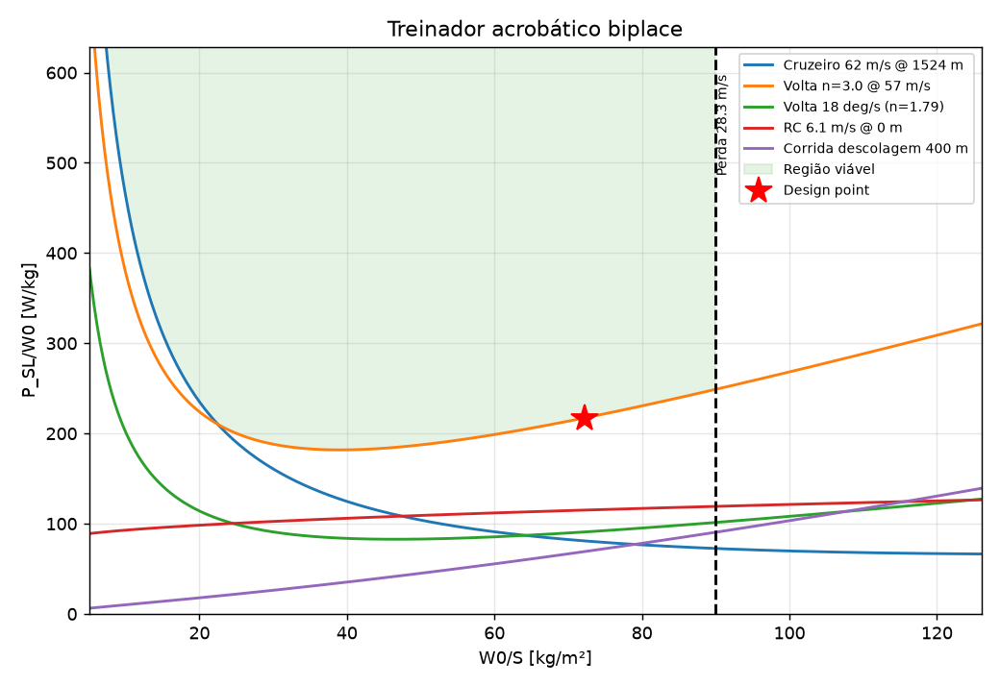

- **W0/S = 708.8 N/m² (72.28 kg/m²)**
- **P/W_SL = 217.3 W/kg** → P_SL = 308 kW
- Restrições ativas: Volta n=3.0 @ 57 m/s
- Área alar S = 19.588 m²

## 4. Geometria de primeira iteração

| parâmetro | valor |
|---|---|
| S_m2 | 19.59 |
| AR | 7 |
| span_m | 11.71 |
| taper | 0.6 |
| c_root_m | 2.091 |
| c_tip_m | 1.255 |
| MAC_m | 1.708 |
| y_MAC_m | 2.683 |
| sweep_c4_deg | 0 |
| sweep_LE_deg | 2.045 |
| t/c | 0.135 |

Fuselagem: L = 8.48 m, D = 1.211 m. Empenagem horizontal S = 4.604 m², vertical S = 1.804 m², braço = 5.09 m (coef. de volume, Raymer Eq. 6.28–6.29).

Caixão da asa (parametrizado na geometria, análise na Fase 2): longarinas a 20%/65% c, largura na raiz 0.941 m.

## 5. Aerodinâmica (Raymer Cap. 12 / DATCOM)

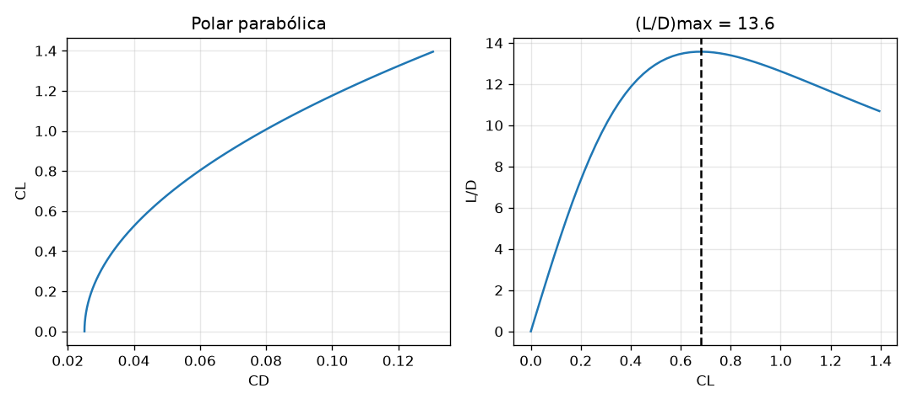

- CLα = 4.529 /rad (0.0790 /deg)
- CLmax limpo / descolagem / aterragem = 1.40 / 1.44 / 1.80
- CD0 = 0.02504, K = 0.0542 (e = 0.839), (L/D)max = 13.57 a CL = 0.68

Decomposição do CD0 (component build-up):

| component | Swet_m2 | Cf | FF | Q | CD0 |
|---|---|---|---|---|---|
| wing | 35.02 | 0.00289 | 1.284 | 1 | 0.006638 |
| htail | 9.342 | 0.00312 | 1.192 | 1.04 | 0.001845 |
| vtail | 3.66 | 0.003099 | 1.176 | 1.04 | 0.0007086 |
| fuselage | 26.29 | 0.00246 | 1.192 | 1 | 0.003937 |

D/q adicional (trem, antenas, ...): 0.2100 m²; L&P: 5%

## 6. Verificações

- ✅ `regulatory_category` — cs_23: W0 1415.7 kg <= 8618 kg
- ➖ `unit_cost` — objective minimize: unit cost 424,770 (report)
- ✅ `static_margin` — SM no CG traseiro 10.0 % (alvo 10 %; dianteiro 10.9 %) — posicionamento da asa por bisseção
- ✅ `trim` — CLmax limpo (CG dianteiro): δe -7.0°; cruzeiro (CG dianteiro): δe -2.6°
- ✅ `hq:scissor` — S_h/S atual 0.235 vs mínimo 0.235 (estabilidade 0.235 no CG traseiro, controlo 0.020 a CLmax no CG dianteiro; dimensionante: estabilidade)
- ✅ `hq:short_period` — período curto ζ = 0.936 → Nível 1 (N1: 0.30–2.00; MIL-F-8785C Table IV, Classe I, Cat. B)
- ✅ `hq:CAP` — CAP = ω²/(n/α) [1/(g s²)] = 1.69 → Nível 1 (N1: 0.085–3.6; MIL-F-8785C Figs. 1–3, Classe I, Cat. B)
- ✅ `hq:phugoid` — fugóide ζ = 0.0939 → Nível 1 (N1: ≥ 0.04; MIL-F-8785C 3.2.1.2, Classe I, Cat. B)
- ✅ `hq:dutch_roll` — rolamento holandês ζ / ζω / ω = 0.203 / 0.363 / 1.79 → Nível 1 (N1: 0.08 / 0.15 / 0.4; MIL-F-8785C Table VI, Classe I, Cat. B)
- ✅ `hq:roll` — rolamento τ_R [s] = 0.126 → Nível 1 (N1: ≤ 1.4; MIL-F-8785C Table VII, Classe I, Cat. B)
- ✅ `hq:spiral` — espiral T2 [s] (∞ = estável) = inf → Nível 1 (N1: ≥ 20; MIL-F-8785C Table VIII, Classe I, Cat. B)
- ✅ `aeroel:divergence` — divergência torsional V = 224.8 m/s EAS vs 132.5 (= 1.2 V_D); margem +70 %
- ✅ `aeroel:reversal` — inversão de aileron V = 221.4 m/s EAS vs 132.5 (= 1.2 V_D); margem +67 %
- ✅ `aeroel:flutter` — flutter binário V = 134.0 m/s EAS vs 132.5 (= 1.2 V_D); margem +1 %
- ✅ `aeroel:aeer45` — AEER-45 / 23.629(d): F = 0.00131 vs F_max = 0.00328 (balanceamento do aileron não avaliado)
- ✅ `perf:endurance` — tempo em espera (segmentos): 2.236 h vs requerido ≥ 1.5 (missão por segmentos — verificação, não altera a viabilidade do dimensionamento)
- ✅ `perf:climb_rate` — ROC máx. ao nível do mar: 13.91 m/s vs requerido ≥ 6.096 (missão por segmentos — verificação, não altera a viabilidade do dimensionamento)
- ✅ `perf:takeoff_ground_roll` — corrida de descolagem (Raymer 17.8): 97.91 m vs requerido ≤ 400 (missão por segmentos — verificação, não altera a viabilidade do dimensionamento)

## 7. Custo unitário (Eastlake modificado, Gudmundsson 2014 Cap. 2)

| item | USD |
|---|---|
| engineering | 6.74094e+06 |
| tooling | 4.9211e+06 |
| manufacturing | 3.58113e+07 |
| dev_support | 602362 |
| flight_test | 119495 |
| quality | 4.65547e+06 |
| materials | 7.28759e+06 |
| per_unit_variable | 124079 |
| unit_cost | 424770 |

## 8. Histórico do ciclo MDA (peso ↔ design point ↔ geometria ↔ arrasto)

| iter | W0 | We/W0 usado | We | Wf | n_lim (V-n) | asa Raymer [kg] | asa caixão [kg] | We_comp | We_comp/W0 | CD0 | W/S | P/W | L/D_max | aero |
|---|---|---|---|---|---|---|---|---|---|---|---|---|---|---|
| 1 | 658.2 | 0.6365 | 419 | 49.27 | 6 | 91.02 | 65.8 | 548.4 | 0.8332 | 0.03653 | 620.9 | 20.05 | 11.24 | manual |
| 2 | 814.7 | 0.6732 | 548.4 | 76.3 | 6 | 107.6 | 77 | 699.8 | 0.8589 | 0.03484 | 708.8 | 24.46 | 11.51 | manual |
| 3 | 975.8 | 0.7171 | 699.8 | 86.01 | 6 | 133.7 | 96.92 | 817.1 | 0.8374 | 0.0313 | 716.7 | 24.24 | 12.14 | manual |
| 4 | 1100 | 0.7426 | 817.1 | 93.25 | 6 | 156.2 | 114.6 | 900.6 | 0.8185 | 0.02897 | 711.9 | 23.46 | 12.62 | manual |
| 5 | 1189 | 0.7574 | 900.6 | 98.52 | 6 | 172.6 | 127.7 | 959.5 | 0.8069 | 0.02761 | 708.8 | 22.95 | 12.93 | manual |
| 6 | 1252 | 0.7665 | 959.5 | 102.3 | 6 | 184.3 | 137 | 1002 | 0.8 | 0.02678 | 707.7 | 22.66 | 13.13 | manual |
| 7 | 1297 | 0.7724 | 1002 | 105.1 | 6 | 192.6 | 143.7 | 1032 | 0.7958 | 0.02626 | 707.7 | 22.49 | 13.26 | manual |
| 8 | 1329 | 0.7765 | 1032 | 107 | 6 | 198.6 | 148.5 | 1054 | 0.793 | 0.0259 | 707.7 | 22.39 | 13.35 | manual |
| 9 | 1352 | 0.7792 | 1054 | 108.5 | 6 | 203 | 152.1 | 1070 | 0.7911 | 0.02565 | 707.7 | 22.32 | 13.41 | manual |
| 10 | 1369 | 0.7812 | 1070 | 109.6 | 6 | 206.2 | 154.7 | 1081 | 0.7897 | 0.02548 | 707.7 | 22.27 | 13.46 | manual |
| 11 | 1382 | 0.7826 | 1081 | 110.3 | 6 | 208.4 | 156.5 | 1090 | 0.7888 | 0.02536 | 708.3 | 22.24 | 13.49 | manual |
| 12 | 1391 | 0.7836 | 1090 | 110.9 | 6 | 210.1 | 157.9 | 1096 | 0.7881 | 0.02527 | 708.3 | 22.22 | 13.51 | manual |
| 13 | 1397 | 0.7844 | 1096 | 111.3 | 6 | 211.4 | 158.9 | 1101 | 0.7876 | 0.02521 | 708.3 | 22.2 | 13.53 | manual |
| 14 | 1402 | 0.7849 | 1101 | 111.6 | 6 | 212.3 | 159.7 | 1104 | 0.7873 | 0.02516 | 708.3 | 22.19 | 13.54 | manual |
| 15 | 1406 | 0.7853 | 1104 | 111.9 | 6 | 213 | 160.2 | 1106 | 0.787 | 0.02513 | 708.3 | 22.18 | 13.55 | manual |
| 16 | 1408 | 0.7856 | 1106 | 112 | 6 | 213.5 | 160.6 | 1108 | 0.7868 | 0.0251 | 708.3 | 22.17 | 13.56 | manual |
| 17 | 1410 | 0.7858 | 1108 | 112.1 | 6 | 213.8 | 160.9 | 1110 | 0.7867 | 0.02508 | 708.3 | 22.17 | 13.56 | manual |
| 18 | 1412 | 0.7859 | 1110 | 112.2 | 6 | 214 | 161 | 1110 | 0.7866 | 0.02508 | 708.8 | 22.17 | 13.56 | manual |
| 19 | 1413 | 0.786 | 1110 | 112.3 | 6 | 214.2 | 161.2 | 1111 | 0.7866 | 0.02507 | 708.8 | 22.17 | 13.57 | manual |
| 20 | 1414 | 0.7861 | 1111 | 112.3 | 6 | 214.3 | 161.3 | 1112 | 0.7865 | 0.02506 | 708.8 | 22.17 | 13.57 | manual |
| 21 | 1414 | 0.7862 | 1112 | 112.4 | 6 | 214.4 | 161.4 | 1112 | 0.7865 | 0.02506 | 708.8 | 22.17 | 13.57 | manual |
| 22 | 1415 | 0.7862 | 1112 | 112.4 | 6 | 214.5 | 161.4 | 1112 | 0.7864 | 0.02505 | 708.8 | 22.17 | 13.57 | manual |
| 23 | 1415 | 0.7863 | 1112 | 112.4 | 6 | 214.6 | 161.5 | 1113 | 0.7864 | 0.02505 | 708.8 | 22.16 | 13.57 | manual |
| 24 | 1415 | 0.7863 | 1113 | 112.4 | 6 | 214.6 | 161.5 | 1113 | 0.7864 | 0.02505 | 708.8 | 22.16 | 13.57 | manual |
| 25 | 1415 | 0.7863 | 1113 | 112.4 | 6 | 214.7 | 161.6 | 1113 | 0.7864 | 0.02505 | 708.8 | 22.16 | 13.57 | manual |
| 26 | 1415 | 0.7863 | 1113 | 112.5 | 6 | 214.7 | 161.6 | 1113 | 0.7864 | 0.02505 | 708.8 | 22.16 | 13.57 | manual |
| 27 | 1415 | 0.7863 | 1113 | 112.5 | 6 | 214.7 | 161.6 | 1113 | 0.7864 | 0.02504 | 708.8 | 22.16 | 13.57 | manual |
| 28 | 1416 | 0.7863 | 1113 | 112.5 | 6 | 214.7 | 161.6 | 1113 | 0.7864 | 0.02504 | 708.8 | 22.16 | 13.57 | manual |
| 29 | 1416 | 0.7863 | 1113 | 112.5 | 6 | 214.7 | 161.6 | 1113 | 0.7864 | 0.02504 | 708.8 | 22.16 | 13.57 | manual |
| 30 | 1416 | 0.7863 | 1113 | 112.5 | 6 | 214.7 | 161.6 | 1113 | 0.7864 | 0.02504 | 708.8 | 22.16 | 13.57 | manual |
| 31 | 1416 | 0.7863 | 1113 | 112.5 | 6 | 214.7 | 161.6 | 1113 | 0.7864 | 0.02504 | 708.8 | 22.16 | 13.57 | manual |
| 32 | 1416 | 0.7863 | 1113 | 112.5 | 6 | 214.7 | 161.6 | 1113 | 0.7864 | 0.02504 | 708.8 | 22.16 | 13.57 | manual |
| 33 | 1416 | 0.7863 | 1113 | 112.5 | 6 | 214.7 | 161.6 | 1113 | 0.7864 | 0.02504 | 708.8 | 22.16 | 13.57 | manual |

### Comparação AVL / baixa fidelidade vs métodos de manual

| grandeza | manual | AVL / baixa fid. | método manual | nota |
|---|---|---|---|---|
| CLα asa [/rad] | 4.529 | 5.476 | DATCOM / Raymer Eq. 12.6 | AVL: avião completo (asa + cauda), sem fuselagem |
| CDi a CL = 0.304 | 0.004996 | 0.005225 | Oswald Raymer e = 0.839 | AVL e (Trefftz) = 0.793; Oswald inclui arrasto viscoso dependente de CL |
| x̄_NP [MAC] | 0.5168 | 0.5266 | Raymer Eq. 16.9 + Torenbeek (fuselagem) | sem fuselagem: 0.530 (AVL não modela a fuselagem) |
| CLδe [/rad] | 0.5273 | 0.5693 | Nelson Ch. 2/5 (τ: Raymer Fig. 16.7 / DATCOM) |  |
| Cmδe [/rad] | -1.57 | -1.558 | Nelson Ch. 2/5 (τ: Raymer Fig. 16.7 / DATCOM) | AVL: Cmδe no CG traseiro; Cnδr com convenção de sinal AVL |
| |Clδa| [/rad] | 0.331 | 0.2335 | Nelson Ch. 2/5 (τ: Raymer Fig. 16.7 / DATCOM) |  |
| Cnδr [/rad] | -0.08167 | 0.07191 | Nelson Ch. 2/5 (τ: Raymer Fig. 16.7 / DATCOM) | AVL: Cmδe no CG traseiro; Cnδr com convenção de sinal AVL |

## 11. Estruturas: V-n, cargas na asa e caixão (Fase 2)

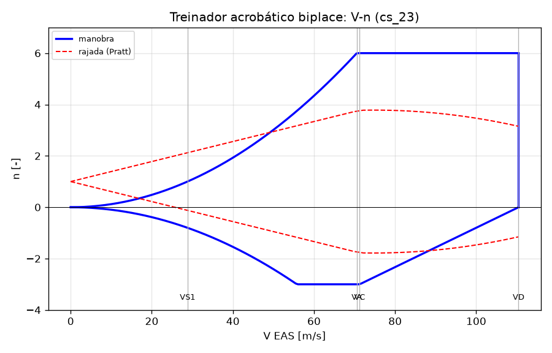

| grandeza | valor |
|---|---|
| regulation | cs_23 |
| category | aerobatic |
| VS1_EAS_m_s | 28.8 |
| VA_EAS_m_s | 70.55 |
| VC_EAS_m_s | 71.26 |
| VD_EAS_m_s | 110.4 |
| n_manoeuvre_pos | 6 |
| n_manoeuvre_neg | -3 |
| n_gust_VC | 3.776 / -1.776 |
| n_gust_VD | 3.151 / -1.151 |
| mu_g | 15.26 |
| Kg | 0.6531 |
| n_limit_pos | 6 |
| n_limit_neg | -3 |
| governing | manobra |
| n_ultimate | 9 |

Cláusulas aplicadas: 23.333 (envelope); 23.335(a) VC ≥ 36.0√(W/S) kt = 139 kt EAS; 23.335(b) VD ≥ max(1.25 VC, 1.55 VC,min); 23.335(c) VA ≥ VS√n; 23.337 limit manoeuvring load factors; 23.341 gust load factors (Pratt–Walker)


Condição crítica de dimensionamento: n = 6.00 (manobra), q a VD = 110.4 m/s EAS.

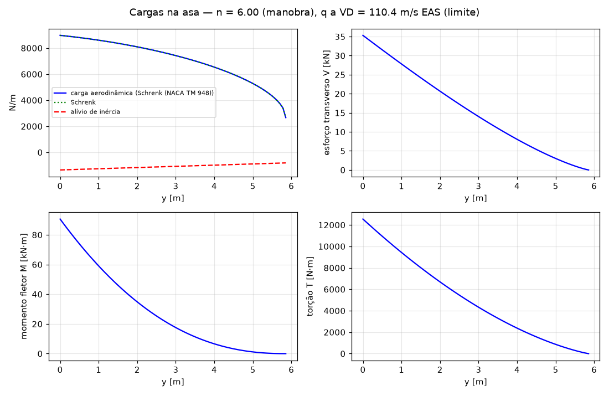

Raiz (limite): V = 35321.3 N, M = 90616.8 N·m, T = 12547.6 N·m.

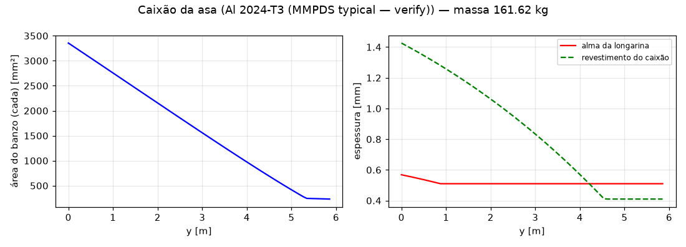

| parcela | massa [kg] |
|---|---|
| caps | 0 |
| covers_skin_stringers | 90.99 |
| core | 0 |
| webs | 5.983 |
| web_uprights | 4.2 |
| LE_TE_skins | 25.45 |
| ribs | 2.672 |
| ideal | 129.3 |
| nonoptimum | 32.32 |
| total | 161.6 |

Cross-check da massa da asa:

| método | massa da asa [kg] |
|---|---|
| Raymer Eq. 15.46 (estatístico) | 214.7 |
| caixão Megson/Bruhn, carga Schrenk (Al 2024-T3 (MMPDS typical — verify)) | 161.6 |
| caixão Megson/Bruhn, carga AVL | 158.5 |

- Revestimentos reforçados (Z): σ ótimo de Farrar F = 0.81 com corte por crippling de Needham 234 MPa (b'/t = 12 — PRESSUPOSTO); passo de reforçadores na raiz 57 mm (≈ 17 reforçadores/painel); σ raiz 165 MPa
- Almas: tensão diagonal de Kuhn, k raiz = 0.74, montantes a d = h (PRESSUPOSTO), C1 = C2 ≈ 0 (α ≈ 45°, banzos rígidos — PRESSUPOSTO); admissível de τ_max = Fsu (curva Bruhn Fig. C11.19 não digitalizada — LIMITAÇÃO)
- Banzo inferior: tração Ftu e compressão no caso negativo n_neg/n_pos = 0.50
- MMPDS typical 2024-T3 sheet: Fcy 269 MPa, Ftu 434 MPa, Fsu 262 MPa, G 27.6 GPa — verify
- 14 nervuras (passo 1.02 m)
- fator não-ótimo 1.25 (PRESSUPOSTO)
- superfícies de comando, flaps e carenagens NÃO incluídos (secundários)

## 12. Estabilidade e controlo (Fase 2: Raymer Cap. 16, Etkin & Reid, Nelson)

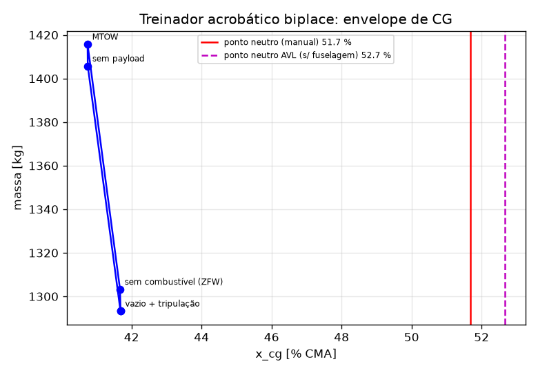

- asa posicionada para SM = 10% no CG mais recuado (ápice a 9.6% L); ápice da asa a x = 0.813 m
- Ponto neutro x̄_NP = 0.517 MAC (manual), 0.527 (AVL); dε/dα = 0.412
- **Margem estática: 10.9 % (CG dianteiro) … 10.0 % (CG traseiro)**
- AVL, cruzeiro compensado no CG traseiro: α = -15.03°, δe = 21.33°, Cnβ = 0.0797, Clβ = -0.0519, Cmq = -14.13
- Coef. de volume: V_h = 0.700, V_v = 0.0400 (Raymer Table 6.4: 0.7 / 0.04)

| caso | massa [kg] | x_cg [m] | x̄_cg [MAC] | SM |
|---|---|---|---|---|
| vazio + tripulação | 1293 | 1.62 | 0.4168 | 0.1 |
| sem payload | 1406 | 1.604 | 0.4075 | 0.1093 |
| MTOW | 1416 | 1.604 | 0.4074 | 0.1094 |
| sem combustível (ZFW) | 1303 | 1.62 | 0.4167 | 0.1001 |

Compensação (trim) no CG dianteiro:

| condição | CL | δe [°] | ok (|δe| ≤ máx.) |
|---|---|---|---|
| CLmax limpo (CG dianteiro) | 1.395 | -6.987 | True |
| cruzeiro (CG dianteiro) | 0.3036 | -2.631 | True |

- Clδa comparado em módulo (convenções de sinal do aileron diferem entre AVL e Nelson).
- Estações de CG dos componentes: PRESSUPOSTOS (Roskam Part V Table 8.1, valores típicos) — substituir pelas posições do layout real em assumptions.stability.stations.

## 13. Desempenho por segmentos (Fase 2: Raymer Cap. 17, Anderson)

Orçamento utilizável: Wf / 1.06 (reserva + não utilizável 6 %, Raymer Eq. 3.11).

Missão requerida (segmentos):

| segmento | t [min] | dist [km] | consumo [kg] | h [m] | V [m/s] | nota |
|---|---|---|---|---|---|---|
| aquecimento + descolagem | 0 | 0 | 42.47 | 0→0 | 0 | Raymer Table 3.2 (0.970) |
| subida (V_y) | 0 | 0 | 0 | 0→0 | 0 | potência de subida, integrado (V médio) |
| espera (loiter) | 90 | 333.4 | 38.13 | 0→0 | 61.73 |  |
| descida (L/D máx, ralenti) + aterragem | 0 | 0 | 6.866 | 0→0 | 40.07 | Raymer 0.995 (combustível) |

Missão até esgotar o orçamento: **alcance 497.0 km, endurance 2.24 h**.

| segmento | t [min] | dist [km] | consumo [kg] | h [m] | V [m/s] | nota |
|---|---|---|---|---|---|---|
| aquecimento + descolagem | 0 | 0 | 42.47 | 0→0 | 0 | Raymer Table 3.2 (0.970) |
| subida (V_y) | 0 | 0 | 0 | 0→0 | 0 | potência de subida, integrado (V médio) |
| espera (loiter) | 134.2 | 497 | 56.73 | 0→0 | 61.73 | estendido até esgotar o orçamento |
| descida (L/D máx, ralenti) + aterragem | 0 | 0 | 6.866 | 0→0 | 39.79 | Raymer 0.995 (combustível) |

Requisitos vs desempenho por segmentos:

| requisito | grandeza | obtido | requerido | unidade | ok |
|---|---|---|---|---|---|
| endurance | tempo em espera (segmentos) | 2.236 | 1.5 | h | ✅ |
| climb_rate | ROC máx. ao nível do mar | 13.91 | 6.096 | m/s | ✅ |
| takeoff_ground_roll | corrida de descolagem (Raymer 17.8) | 97.91 | 400 | m | ✅ |

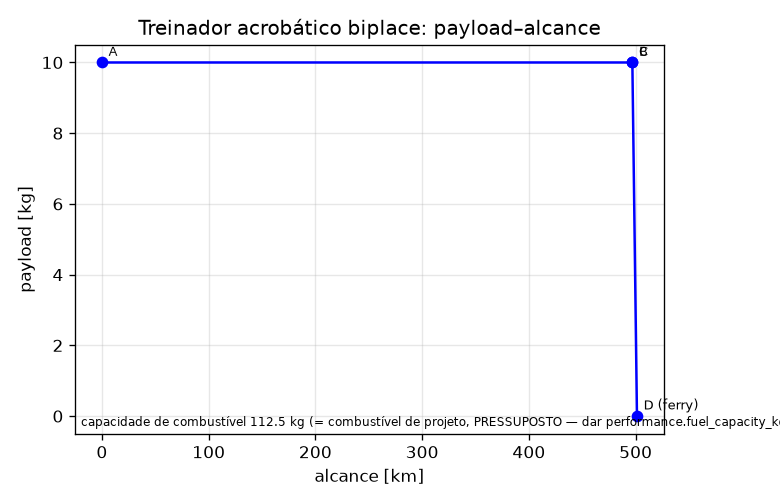

| ponto | payload_kg | combustível_kg | massa_kg | range_km |
|---|---|---|---|---|
| A | 10 | 0 | 1303 | 0 |
| B | 10 | 112.5 | 1416 | 497 |
| C | 10 | 112.5 | 1416 | 497 |
| D (ferry) | 0 | 112.5 | 1406 | 501.3 |

Nota: capacidade de combustível 112.5 kg (= combustível de projeto, PRESSUPOSTO — dar performance.fuel_capacity_kg).

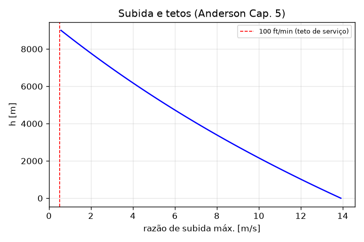

- ROC máx. ao nível do mar 13.91 m/s; teto de serviço > 9000 m; teto absoluto > 9000 m
- Descolagem (Raymer 17.8): corrida 98 m, total sobre 15 m 226 m (V_TO 31.2 m/s)
- Aterragem (Raymer 17.9): corrida 214 m, total sobre 15 m 518 m (μ_travagem 0.4; aproximação γ = 3° — `performance.approach_angle_deg`, por omissão o máximo de 5.2 % / 3° de CS/14 CFR 23.75(a)(1))

- Os resultados de segmentos usam a mesma polar e reservas do dimensionamento; diferenças face aos requisitos vêm da subida/descida integradas vs. frações históricas (Raymer Table 3.2).

## 14. Caixão da asa dimensionado à estabilidade (Fase 3: Bruhn C5/C7/C11, Farrar, Kuhn)

| caixão | massa [kg] | / Raymer 15.46 |
|---|---|---|
| resistência (Fase 2, limite inferior) | 127.7 | 0.5948 |
| encurvadura (Fase 3, Al 2024-T3 (MMPDS typical — verify)) | 161.6 | 0.7527 |
| Raymer Eq. 15.46 (asa completa, estatístico) | 214.7 | 1 |

Parcelas (caixão de encurvadura):

| parcela | massa [kg] |
|---|---|
| caps | 0 |
| covers_skin_stringers | 90.99 |
| core | 0 |
| webs | 5.983 |
| web_uprights | 4.2 |
| LE_TE_skins | 25.45 |
| ribs | 2.672 |
| ideal | 129.3 |
| nonoptimum | 32.32 |
| total | 161.6 |

- Almas Kuhn: fator de tração diagonal k máx. 0.741 (k = 0: alma resistente ao corte, sem tração diagonal)
- Passo dos reforçadores: 31–133 mm (encurvadura local do revestimento, k = 4)
- Revestimentos reforçados (Z): σ ótimo de Farrar F = 0.81 com corte por crippling de Needham 234 MPa (b'/t = 12 — PRESSUPOSTO); passo de reforçadores na raiz 57 mm (≈ 17 reforçadores/painel); σ raiz 165 MPa
- Almas: tensão diagonal de Kuhn, k raiz = 0.74, montantes a d = h (PRESSUPOSTO), C1 = C2 ≈ 0 (α ≈ 45°, banzos rígidos — PRESSUPOSTO); admissível de τ_max = Fsu (curva Bruhn Fig. C11.19 não digitalizada — LIMITAÇÃO)
- Banzo inferior: tração Ftu e compressão no caso negativo n_neg/n_pos = 0.50
- MMPDS typical 2024-T3 sheet: Fcy 269 MPa, Ftu 434 MPa, Fsu 262 MPa, G 27.6 GPa — verify
- 14 nervuras (passo 1.02 m)
- fator não-ótimo 1.25 (PRESSUPOSTO)
- superfícies de comando, flaps e carenagens NÃO incluídos (secundários)

## 15. Aeroelasticidade clássica (Fase 3)

V_D = 110.4 m/s EAS.

| fenómeno | V [m/s EAS] | requerido 1.2 V_D | margem | ok | método |
|---|---|---|---|---|---|
| divergência torsional | 224.8 | 132.5 | +70 % | ✅ | W&C 8.3 / Bisplinghoff 8-2 (faixas + FE) |
| inversão do aileron | 221.4 | 132.5 | +67 % | ✅ | W&C 8.4, Glauert (flap 2D) |
| flutter binário (flexão–torção) | 134 | 132.5 | +1 % | ✅ | W&C 11 (modos assumidos, quase-estacionário) |

- Frequências desacopladas: flexão 7.98 Hz, torção 24.1 Hz; flutter a 18.9 Hz
- AEER-45 (fator de flexibilidade torsional da asa): F = 1.307e-03 vs F_max = 200/V_D² = 3.277e-03 → OK

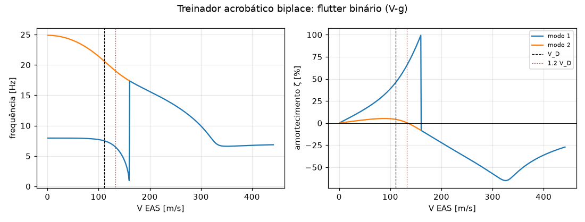

### Acoplamento aero-estrutural estático (OpenAeroStruct, VLM + caixão)

| ponto | modelo | α [°] | CL | CDi | CLα [/rad] | flecha ponta [m] | torção ponta [°] |
|---|---|---|---|---|---|---|---|
| cruise | rígido | 3.772 | 0.3036 | 0.004061 | 4.605 | 3.326e-06 | 1.991e-05 |
| cruise | flexível | 3.672 | 0.3036 | 0.004068 | 4.732 | 0.03361 | 0.201 |
| manobra (n_lim, V_D EAS, nível do mar) | rígido | 7.085 | 0.5692 | 0.01427 | 4.578 | 1.989e-05 | 0.0001189 |
| manobra (n_lim, V_D EAS, nível do mar) | flexível | 6.465 | 0.5692 | 0.01439 | 5.033 | 0.2057 | 1.225 |

- Efeito da forma deformada no arrasto induzido de cruzeiro: K_flex/K = 1.0018
- Missão por segmentos: rígido 497.0 km / 2.236 h → flexível 497.0 km / 2.236 h (comparação com o resultado desacoplado da Fase 2)
- OpenAeroStruct VLM (sem viscoso/onda: só arrasto induzido) + FEM de caixão 'wingbox' acoplados por NLBGS; rígido = E, G × 10⁴
- secção do caixão: NACA-4 entre longarinas; espessuras de alma/revestimento do caixão acdt (5 pontos de controlo); revestimento único equivalente que reproduz EI(y) do caixão acdt e G ajustado para GJ (PRESSUPOSTO)
- sem alívio de peso estrutural nem de combustível na asa (conservativo para a deformação)
- índice de falha OAS (von Mises/KS, σ_adm = σ_cap/1.5) na manobra: +0.584 (< 0 = OK) — critério de resistência do OAS sobre o revestimento equivalente — INDICATIVO (o dimensionamento é o do caixão acdt)
- massa da asa 214.74 kg distribuída ∝ corda; CG da secção a 0.50 c; eixo elástico a 0.425 c (meio do caixão), e = 0.175 c atrás do c.a.; a_w = 6.283/rad (2D, teoria das faixas — sem correção 3D/compressibilidade)
- encastramento na parede da fuselagem y0 = 0.605 m; EI/GJ do caixão buckling
- requisito: livre de flutter/divergência/inversão até 1.2 V_D = 132.5 m/s EAS (14 CFR 23.629(c) legado; CS/14 CFR 23.2245 'suficientemente além'; STANAG 4671 USAR.629 — verificar)
- flutter: modelo binário de modos assumidos (W&C Cap. 11), aerodinâmica quase-estacionária — ESTIMATIVA; a análise racional exige modos FEM + DLM (Fase 4)

## 16. Diagrama de tesoura, modos dinâmicos e qualidades de voo (Fase 3)

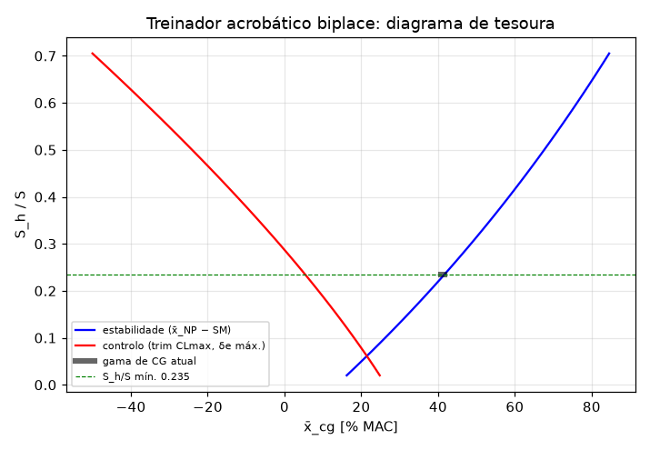

- S_h/S atual 0.235; requerido 0.235 (estabilidade 0.235, controlo 0.02; dimensionante: estabilidade) → ✅ (Torenbeek Cap. 9)
- linha de controlo: trim a CLmax limpo 1.40 com δe = −25°, τ_e = 0.661, Cm0 = -0.0389 (Raymer 16.13); momento dos flaps e efeito de solo NÃO incluídos
- massa da cauda não realimentada (posição da asa e braço fixos)

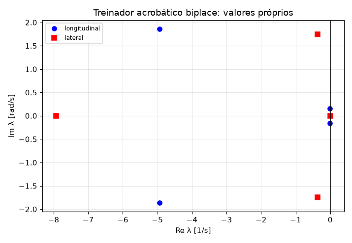

| modo | ωn [rad/s] | ζ | período [s] | τ / T [s] |
|---|---|---|---|---|
| período curto | 5.275 | 0.9357 | 3.375 | - |
| fugóide | 0.1613 | 0.09392 | 39.14 | - |
| rolamento holandês | 1.786 | 0.2033 | 3.594 | - |
| rolamento (constante de tempo) | - | - | - | 0.1262 |
| espiral estável | - | - | - | 418.2 |

- n/α = 16.5 g/rad, CAP = 1.69 1/(g s²)
- Inércias (Roskam V, soma por componentes): Ixx 3.32e+03, Iyy 2.98e+03, Izz 6.27e+03 kg·m²
- derivadas de taxa e laterais: AVL (sem fuselagem) + Cnβ da fuselagem (Raymer 16.47) -0.0451
- Cmα = −CLα·SM no CG de MTOW (ponto neutro de manual com fuselagem)
- inércias por soma de componentes (Roskam Parte V) — PRESSUPOSTOS de estações

Qualidades de voo — MIL-F-8785C, Classe I, categoria B (nível exigido 1):

| modo | valor | nível | limite N1 | ref |
|---|---|---|---|---|
| período curto ζ | 0.9357 | 1 | 0.30–2.00 | MIL-F-8785C Table IV |
| CAP = ω²/(n/α) [1/(g s²)] | 1.691 | 1 | 0.085–3.6 | MIL-F-8785C Figs. 1–3 |
| fugóide ζ | 0.09392 | 1 | ≥ 0.04 | MIL-F-8785C 3.2.1.2 |
| rolamento holandês ζ / ζω / ω | 0.203 / 0.363 / 1.79 | 1 | 0.08 / 0.15 / 0.4 | MIL-F-8785C Table VI |
| rolamento τ_R [s] | 0.1262 | 1 | ≤ 1.4 | MIL-F-8785C Table VII |
| espiral T2 [s] (∞ = estável) | n/a | 1 | ≥ 20 | MIL-F-8785C Table VIII |


## Pressupostos usados

```yaml
weights:
  method: components
  initial_class: null
  fixed_fraction: null
  A: null
  C: null
  tech_factor: 1.0
  Kvs: 1.0
  fixed_mass_kg: 0.0
  components:
    material: metal
    engine_kW_per_kg: 1.1
    avionics_uninstalled_kg: 15
    structural_category: aerobatic
aero:
  AR: 7
  taper: 0.6
  sweep_c4_deg: 0.0
  tc_root: 0.15
  tc_tip: 0.12
  xc_max_t: 0.3
  airfoil: NACA 23015
  clmax_airfoil: 1.55
  flap:
    kind: plain
    flapped_area_ratio: 0.5
  oswald: null
  cfe: 0.0055
  swet_sref: 4.0
  laminar:
    wing: 0.1
    htail: 0.1
    vtail: 0.1
    fuselage: 0.0
  roughness: smooth_paint
  Q: {}
  lp_fraction: 0.05
  extra_drag_areas_m2:
    fixed_gear: 0.16
    canopy_misc: 0.05
  CL_ground: 0.5
  dCD0_takeoff: 0.01
  mu_roll: 0.04
  fidelity: handbook
  airfoil_solver: xfoil
propulsion:
  eta_cruise: 0.8
  eta_climb: 0.75
  eta_takeoff: 0.55
  bsfc_lb_hp_h: null
  tsfc_1_h: 0.5
  battery_Wh_kg: 200.0
  eta_total: 0.7
  dod: 0.8
  energy_reserve: 0.2
  systems_power_W: 0.0
  n_engines: 1
geometry:
  fuselage_length_m: null
  fuselage_diameter_m: null
  fuselage_fineness: 7.0
  fuselage_class: null
  tail_class: null
  c_ht: null
  c_vt: null
  tail_arm_fraction: 0.6
  ar_h: 4.0
  ar_v: 1.5
constraints:
  cruise_weight_fraction: 1.0
  landing_weight_fraction: 1.0
  approach_distance_ft: 600.0
  margin: 0.0
  ws_initial_psf: 17.0
  ws_min: 50.0
  ws_max: 3000.0
  default_cruise_altitude_m: 0.0
  ws_fixed: null
  value_fixed: null
mda:
  max_iter: 30
  tol: 1.0e-05
  tol_lowfi: 0.0002
structures:
  regulation: auto
  load_factor_from_vn: true
  material: auto
  nonoptimum_factor: 1.25
  VH_eas_m_s: null
stability:
  target_static_margin: 0.1
  wing_apex_x_fraction: null
  stations: {}
  elevator_max_deg: 25.0
  use_avl: true
  dynamics: true
  hq_category: B
  hq_required_level: 1
performance:
  fuel_capacity_kg: null
  max_payload_kg: null
  mu_brake: 0.4
  approach_angle_deg: 3.0
aeroelasticity:
  enabled: true
  a_w: 6.283185307179586
  x_cg_chord: null
  margin_factor: 1.2
  static_aerostructural: true
mdo:
  objective: null
  solver: nlbgs
  trust_region_iterations: 8
  trust_region_radius: 0.3
  design_vars:
  - ws
  - AR
  AR_bounds:
  - 5.0
  - 16.0
  ws_bounds_factor:
  - 0.6
  - 1.4
  pw_bounds_factor:
  - 0.6
  - 1.6
  maxiter: 60
  tol: 1.0e-06
cost:
  N: 200
  Q_m: 4
  cpi: 1.38
  F_CERT: 1.0
  F_CF: 1.0
  avionics_cost: 25000
```

## Referências

- Raymer, D. P., *Aircraft Design: A Conceptual Approach*, 6th ed., AIAA, 2018 (equation numbers as in the 6th ed.).
- Roskam, J., *Airplane Design*, Parts I–VIII, DARcorporation.
- Gudmundsson, S., *General Aviation Aircraft Design: Applied Methods and Procedures*, Elsevier, 2014.
- Anderson, J. D., *Aircraft Performance and Design*, McGraw-Hill, 1999.
- Torenbeek, E., *Synthesis of Subsonic Airplane Design*, Delft Univ. Press, 1982.
- USAF Stability and Control DATCOM, 1978.
- Hepperle, M., "Electric Flight – Potential and Limitations", NATO STO-MP-AVT-209, 2012.
- Niu, M. C. Y., *Airframe Structural Design*, Conmilit, 1988.
- Drela, M., "First-Order DC Electric Motor Model", MIT, 2007.
- ISO 2533:1975 Standard Atmosphere.
- Nicolai, L. M., Carichner, G. E., *Fundamentals of Aircraft and Airship Design*, Vol. I, AIAA, 2010 (Table 5.1, We = A·W0^B incl. UAV classes).
- EASA CS-23 (Amdt. 4 and earlier) / 14 CFR 23.337 (pre-Amdt. 23-64): limit manoeuvring load factors.
- IEC 60028:1925, International standard of resistance for copper (ρCu = 8890 kg/m³).
- FAA Type Certificate Data Sheet 1E10 (Lycoming O-360/IO-360 series) — engine dry mass in the C172 check.
- Drela, M., "XFOIL: An Analysis and Design System for Low Reynolds Number Airfoils", 1989; XFOIL 6.99 (GPL).
- Drela, M., Youngren, H., AVL 3.40 (Athena Vortex Lattice), MIT, 2022 (GPL).
- Sharpe, P., NeuralFoil, MIT, 2024 (fallback section polars).
- Schrenk, O., "A Simple Approximation Method for Obtaining the Spanwise Lift Distribution", NACA TM 948, 1940.
- Megson, T. H. G., *Aircraft Structures for Engineering Students*, 5th ed., 2013 (Ch. 16, 19–23).
- Bruhn, E. F., *Analysis and Design of Flight Vehicle Structures*, 1973 (Ch. A3, C5, C11).
- Etkin, B., Reid, L. D., *Dynamics of Flight: Stability and Control*, 3rd ed., Wiley, 1996.
- Nelson, R. C., *Flight Stability and Automatic Control*, 2nd ed., McGraw-Hill, 1998.
- Kroo, I., *Aircraft Design: Synthesis and Analysis*, Stanford (lift-dependent drag, fuselage span-efficiency factor).
- EASA CS-23 Amdt. 4 / 14 CFR 23.333–23.341 (flight envelope, design speeds, gust loads); 14 CFR/CS 23.65 (climb speed).
- NATO STANAG 4671 Ed. 1 (USAR), 2009: USAR.303, .333, .335, .337, .341.
- Abbott, I. H., von Doenhoff, A. E., *Theory of Wing Sections*, Dover, 1959.
