# Relatório de dimensionamento — UAV ISR elétrico 25 kg

_acdt 0.1.0 · Fase 1 (conceptual) + 1E (sistemas) + Fase 2 (baixa fidelidade)_

UAV de asa fixa lançado por catapulta e recuperado por paraquedas/rede, com gimbal EO/IR. Sem requisito de pista (não há restrição de descolagem/aterragem).


**Resultado:** ✅ VIÁVEL

**Verificação por segmentos (Fase 2):** ⚠️ pelo menos um requisito não cumprido na missão por segmentos (ver §13)

## 1. Requisitos desta corrida

| requisito | sentido | valor | qualificadores | estágios | avaliado |
|---|---|---|---|---|---|
| propulsion_type | target | electric | - | context | sim |
| regulatory_category | target | easa_specific | - | check, systems | sim |
| payload_mass | target | 4.0 kg | - | sizing | sim |
| endurance | min | 2.5 h | - | sizing | sim |
| cruise_speed | target | 22 m/s | - | constraint, sizing | sim |
| cruise_altitude | target | 600 m | - | context | sim |
| stall_speed | max | 13 m/s | - | constraint | sim |
| climb_rate | min | 3.0 m/s | - | constraint | sim |
| service_ceiling | min | 3000 m | - | constraint | sim |
| wing_span | max | 4.2 m | - | check | sim |
| mtow | max | 25 kg | - | check | sim |

Requisitos não definidos (livres / por omissão): crew_mass, range, max_speed, load_factor, turn_rate, takeoff_ground_roll, landing_distance, power_available, thrust_available, unit_cost, noise, mtow_objective

### Validação

- **info**: Valor inicial estatístico We/W0 = 0.65 não fecha (We/W0 + Wf/W0 > 0.98); iteração por componentes reiniciada com We/W0 = 0.30.
- **info**: Nz das equações de massa = 1.5 × n_lim do diagrama V-n (5.28, rajada; stanag_4671)
- **warning**: n_lim = 5.28 está acima da linha de perda mesmo a VD (n = 3.26 com CLmax quase-estático): valor CONSERVATIVO mantido (a perda dinâmica numa rajada pode excedê-lo); VC baixo face a VS1 — rever VC/CLmax antes de dimensionar
- **info**: Massa do caixão da asa (Megson/Bruhn) = 3.73 kg vs Raymer Eq. 15.46 4.61 kg (razão 0.81); usado: Raymer
- **warning**: Massa da fuselagem L1 / Raymer Eq. 15.49 = 1.46 (1.7 kg vs 1.2 kg).
- **info**: Energia de descolagem + subida no dimensionamento = 102.8 Wh (modelo de segmentos: 1 min à potência de descolagem + subida integrada a V_y — o mesmo da verificação; Hepperle só energia potencial daria 63.9 Wh)
- **info**: Sem trem de aterragem (landing_gear: none) — lançamento/recuperação como itens do utilizador.
- **info**: W0 = 24 kg está abaixo da base de dados das equações GA de Raymer (~1000–8000 lb): extrapolação — calibrar com dados próprios (calibration).
- **warning**: We/W0 por componentes = 0.482 fora da banda estatística [0.76, 0.88] (±15 %) — rever itens em falta (recuperação, suportes, pintura, cablagem de sinal) ou calibrar com dados próprios.

## 2. Peso à descolagem (Raymer Cap. 3; Hepperle 2012 para elétrico)

| grandeza | valor |
|---|---|
| W0 [kg] | 24.25 |
| We [kg] | 11.69 |
| Combustível/bateria [kg] | 8.561 |
| Payload + tripulação [kg] | 4 |
| We/W0 | 0.482 |
| Wf/W0 | 0.3531 |
| Energia bateria nominal [Wh] | 1955 |

Pernas da missão: loiter 9675 (SI) @ V=22.0 m/s, L/D=18.9, h=600 m

## 2a. Estimativa de pesos por componentes (Raymer 6th ed. Cap. 15 + sistemas)

Valor inicial do peso vazio: Raymer 6th ed. Table 3.1 (We/W0 = A W0^C, W0 in lb) 'uav_small'.

Fator de carga último Nz = 7.92 (1.5 × limite). Iteração: estatística → geometria → componentes → novo We → re-dimensionar, até convergir (histórico na secção 8).

| grupo | item | kg | % W0 | método |
|---|---|---|---|---|
| structure | asa | 4.612 | 19.02 | Raymer Eq. 15.46; composite x0.875 (Raymer Table 15.4) |
| structure | empenagem horizontal | 0.4117 | 1.698 | minimum gauge: Swet 0.457 m² x 0.9 kg/m² (user layup) > Raymer Eq. 15.47 |
| structure | empenagem vertical | 0.3141 | 1.295 | minimum gauge: Swet 0.349 m² x 0.9 kg/m² (user layup) > Raymer Eq. 15.48 |
| structure | fuselagem | 1.095 | 4.514 | Raymer Eq. 15.49 (unpressurized); composite x0.925 (Raymer Table 15.4) |
| propulsion | motor(es) + ESC(s) | 1.05 | 4.33 | selected components (Phase 1E database) |
| propulsion | hélice(s) | 0.08 | 0.3299 | user (datasheet) |
| equipment | comandos (hastes/charneiras) | 0.0775 | 0.3196 | Raymer Eq. 15.54 |
| equipment | servos | 0.17 | 0.7011 | selected components (Phase 1E) |
| equipment | autopiloto + aviónica + extras | 0.075 | 0.3093 | selected components / user list |
| equipment | cablagem de potência | 0.29 | 1.196 | sized wire gauges x length x ρCu (IEC 60028) x1.3 insulation + 5 connectors x 0.01 kg (ASSUMPTIONS) |
| user_items | paraquedas de recuperação + ejetor | 1 | 4.124 | user-listed item |
| user_items | suporte/amortecimento do gimbal | 0.3 | 1.237 | user-listed item |
| equipment | datalink C2 + antenas | 0.25 | 1.031 | user-listed item |
| equipment | GNSS + bússola (x2) | 0.1 | 0.4124 | user-listed item |
| equipment | pitot/ADS-B | 0.1 | 0.4124 | user-listed item |
| equipment | cablagem de sinal + conectores | 0.3 | 1.237 | user-listed item |
| user_items | ferragens/fixações/pintura | 0.4 | 1.65 | user-listed item |
| allowance | margem de crescimento/integração | 1.063 | 4.382 | 10% of the build-up (ASSUMPTION, labelled) |


Resumo por grupo e composição de W0:

| grupo | kg | % W0 |
|---|---|---|
| structure | 6.433 | 26.53 |
| propulsion | 1.13 | 4.66 |
| equipment | 1.362 | 5.619 |
| user_items | 1.7 | 7.011 |
| allowance | 1.063 | 4.382 |
| **peso vazio We** | 11.69 | 48.2 |
| combustível / bateria | 8.561 | 35.31 |
| payload | 4 | 16.5 |
| tripulação | 0 | 0 |
| **W0** | 24.25 | 100 |


Notas do build-up:

- Sem trem de aterragem (landing_gear: none) — lançamento/recuperação como itens do utilizador.
- W0 = 24 kg está abaixo da base de dados das equações GA de Raymer (~1000–8000 lb): extrapolação — calibrar com dados próprios (calibration).

Cross-check estatístico (We/W0 das classes publicadas no W0 obtido; 'fora' = W0 fora do intervalo da base de dados):

| classe | We/W0 | We [kg] | na gama | fonte |
|---|---|---|---|---|
| uav_small | 0.764 | 18.53 | - | Raymer 6th ed. Table 3.1 (We/W0 = A W0^C, W0 in lb) 'uav_small' |
| uav_tactical_recce_ucav | 0.8836 | 21.42 | - | Raymer 6th ed. Table 3.1 (We/W0 = A W0^C, W0 in lb) 'uav_tactical_recce_ucav' |
| nicolai_uav_prop_endurance_lt12h | 1.044 | 25.32 | - | Nicolai & Carichner (AIAA 2010) Table 5.1 (We = A W0^B, lb) 'nicolai_uav_prop_endurance_lt12h' |
| nicolai_uav_prop_endurance_gt12h | 0.7951 | 19.28 | - | Nicolai & Carichner (AIAA 2010) Table 5.1 (We = A W0^B, lb) 'nicolai_uav_prop_endurance_gt12h' |


## 3. Design point (diagrama de restrições)

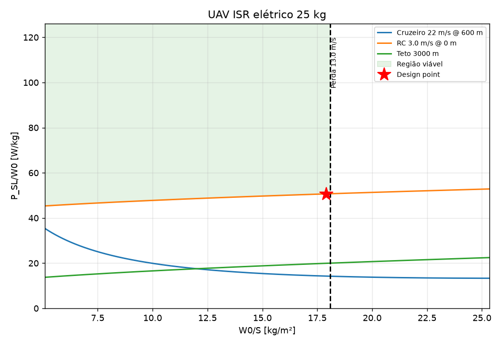

- **W0/S = 175.6 N/m² (17.91 kg/m²)**
- **P/W_SL = 50.68 W/kg** → P_SL = 1.23 kW
- Restrições ativas: RC 3.0 m/s @ 0 m
- Área alar S = 1.354 m²

## 4. Geometria de primeira iteração

| parâmetro | valor |
|---|---|
| S_m2 | 1.354 |
| AR | 12.98 |
| span_m | 4.192 |
| taper | 0.6 |
| c_root_m | 0.4038 |
| c_tip_m | 0.2423 |
| MAC_m | 0.3297 |
| y_MAC_m | 0.9606 |
| sweep_c4_deg | 0 |
| sweep_LE_deg | 1.104 |
| t/c | 0.12 |

Fuselagem: L = 1.80 m, D = 0.220 m. Empenagem horizontal S = 0.225 m², vertical S = 0.172 m², braço = 0.99 m (coef. de volume, Raymer Eq. 6.28–6.29).

Caixão da asa (parametrizado na geometria, análise na Fase 2): longarinas a 20%/65% c, largura na raiz 0.182 m.

## 5. Aerodinâmica (Raymer Cap. 12 / DATCOM)

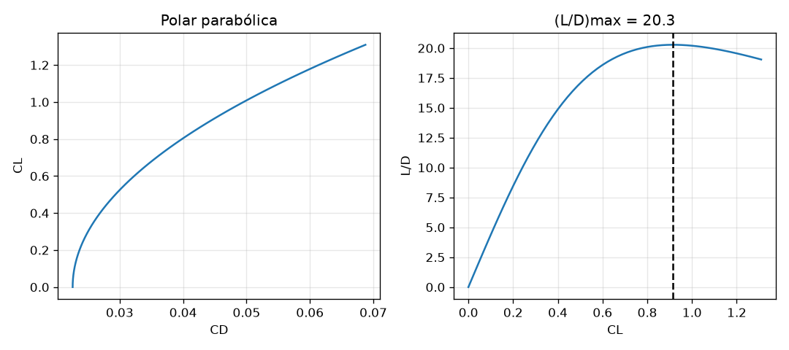

- CLα = 5.065 /rad (0.0884 /deg)
- CLmax limpo / descolagem / aterragem = 1.31 / 1.37 / 1.71
- CD0 = 0.02258, K = 0.0269 (e = 0.911), (L/D)max = 20.28 a CL = 0.92

Decomposição do CD0 (component build-up):

| component | Swet_m2 | Cf | FF | Q | CD0 |
|---|---|---|---|---|---|
| wing | 2.582 | 0.00419 | 1.033 | 1 | 0.008255 |
| htail | 0.4575 | 0.004515 | 0.9916 | 1.04 | 0.001573 |
| vtail | 0.3489 | 0.004127 | 0.9782 | 1.04 | 0.001082 |
| fuselage | 1.047 | 0.003471 | 1.13 | 1 | 0.003034 |

D/q adicional (trem, antenas, ...): 0.0080 m²; L&P: 5%

## 6. Verificações

- ➖ `regulatory_category` — easa_specific: no numeric limit
- ✅ `wing_span` — b = 4.19 m vs max 4.20 m
- ✅ `mtow` — W0 = 24.2 kg vs max 25.0 kg
- ✅ `static_margin` — SM no CG traseiro 10.0 % (alvo 10 %; dianteiro 10.0 %) — posicionamento da asa por bisseção
- ✅ `trim` — CLmax limpo (CG dianteiro): δe -11.0°; cruzeiro (CG dianteiro): δe -7.5°
- ✅ `hq:scissor` — S_h/S atual 0.167 vs mínimo 0.167 (estabilidade 0.167 no CG traseiro, controlo 0.094 a CLmax no CG dianteiro; dimensionante: estabilidade)
- ✅ `hq:short_period` — período curto ζ = 0.726 → Nível 1 (N1: 0.30–2.00; MIL-F-8785C Table IV, Classe I, Cat. B) — UAV: indicativo
- ❌ `hq:CAP` — CAP = ω²/(n/α) [1/(g s²)] = 8.06 → Nível 2 (N1: 0.085–3.6; MIL-F-8785C Figs. 1–3, Classe I, Cat. B) — UAV: indicativo
- ✅ `hq:phugoid` — fugóide ζ = 0.0634 → Nível 1 (N1: ≥ 0.04; MIL-F-8785C 3.2.1.2, Classe I, Cat. B) — UAV: indicativo
- ✅ `hq:dutch_roll` — rolamento holandês ζ / ζω / ω = 0.190 / 0.712 / 3.76 → Nível 1 (N1: 0.08 / 0.15 / 0.4; MIL-F-8785C Table VI, Classe I, Cat. B) — UAV: indicativo
- ✅ `hq:roll` — rolamento τ_R [s] = 0.066 → Nível 1 (N1: ≤ 1.4; MIL-F-8785C Table VII, Classe I, Cat. B) — UAV: indicativo
- ➖ `hq:spiral` — espiral unassessed: declare assumptions.geometry.dihedral_deg (current TrapezoidalWing default Γ=3° is PRESSUPOSTO only; Clβ/spiral need an explicit dihedral — Etkin & Reid 1996 Ch. 6 / MIL-F-8785C Table VIII)
- ✅ `wb:envelope` — Todos os 3 carregamentos dentro dos limites conceptuais; extremos 0.737 m (payload, 24 kg) e 0.737 m (vazio, 20 kg).
- ✅ `aeroel:divergence` — divergência torsional V = 291.5 m/s EAS vs 32.1 (= 1.2 V_D); margem +809 %
- ✅ `aeroel:reversal` — inversão de aileron: não ocorre (V → ∞) vs 32.1 m/s EAS
- ✅ `aeroel:flutter` — flutter binário V = 132.6 m/s EAS vs 32.1 (= 1.2 V_D); margem +314 %
- ✅ `aeroel:aeer45` — AEER-45 / 23.629(d): F = 0.00129 vs F_max = 0.056 (balanceamento do aileron não avaliado)
- ✅ `perf:endurance` — tempo em espera (segmentos): 2.686 h vs requerido ≥ 2.688 (missão por segmentos — verificação, não altera a viabilidade do dimensionamento)
- ✅ `perf:service_ceiling` — teto de serviço (Anderson) > 9000 m (não atingido): 9000 m vs requerido ≥ 3000 (missão por segmentos — verificação, não altera a viabilidade do dimensionamento)
- ✅ `perf:climb_rate` — ROC máx. ao nível do mar: 3 m/s vs requerido ≥ 3 (missão por segmentos — verificação, não altera a viabilidade do dimensionamento)

## 8. Histórico do ciclo MDA (peso ↔ design point ↔ geometria ↔ arrasto)

| iter | W0 | We/W0 usado | We | Wf | E descolagem+subida [Wh] | n_lim (V-n) | asa Raymer [kg] | asa caixão [kg] | We_comp | We_comp/W0 | CD0 | W/S | P/W | L/D_max | aero |
|---|---|---|---|---|---|---|---|---|---|---|---|---|---|---|---|
| 1 | 12.47 | 0.3 | 3.742 | 4.732 | 58.21 | 5.202 | 1.84 | 1.889 | 7.921 | 0.6349 | 0.02966 | 175.6 | 5.276 | 15.31 | manual |
| 2 | 21.91 | 0.3615 | 7.921 | 9.989 | 95.82 | 4.981 | 4.035 | 3.356 | 10.91 | 0.4978 | 0.02183 | 175.6 | 5.549 | 17.85 | manual |
| 3 | 24.04 | 0.4536 | 10.91 | 9.135 | 104.9 | 4.941 | 4.435 | 3.689 | 11.46 | 0.4768 | 0.02093 | 175.6 | 5.344 | 18.23 | manual |
| 4 | 24.59 | 0.4663 | 11.46 | 9.123 | 107.2 | 4.932 | 4.543 | 3.775 | 11.61 | 0.4724 | 0.02072 | 175.6 | 5.32 | 18.32 | manual |
| 5 | 24.74 | 0.4694 | 11.61 | 9.13 | 107.8 | 4.929 | 4.575 | 3.799 | 11.66 | 0.4711 | 0.02066 | 175.6 | 5.315 | 18.35 | manual |
| 6 | 24.79 | 0.4702 | 11.66 | 9.133 | 108 | 4.928 | 4.585 | 3.807 | 11.67 | 0.4708 | 0.02064 | 175.6 | 5.313 | 18.35 | manual |
| 7 | 24.81 | 0.4705 | 11.67 | 9.134 | 108.1 | 4.928 | 4.588 | 3.809 | 11.68 | 0.4707 | 0.02064 | 175.6 | 5.313 | 18.36 | manual |
| 8 | 24.81 | 0.4706 | 11.68 | 9.135 | 108.1 | 4.928 | 4.588 | 3.81 | 11.68 | 0.4706 | 0.02064 | 175.6 | 5.313 | 18.36 | manual |
| 9 | 24.81 | 0.4706 | 11.68 | 9.135 | 108.1 | 4.928 | 4.589 | 3.81 | 11.68 | 0.4706 | 0.02064 | 175.6 | 5.313 | 18.36 | manual |
| 10 | 24.81 | 0.4706 | 11.68 | 9.135 | 108.1 | 4.928 | 4.589 | 3.81 | 11.68 | 0.4706 | 0.02064 | 175.6 | 5.313 | 18.36 | manual |
| 11 | 24.81 | 0.4706 | 11.68 | 9.135 | 108.1 | 4.928 | 4.589 | 3.81 | 11.68 | 0.4706 | 0.02064 | 175.6 | 5.313 | 18.36 | manual |
| 12 | 24.81 | 0.4706 | 11.68 | 9.135 | 104.8 | 5.271 | 4.589 | 3.825 | 11.68 | 0.4706 | 0.02236 | 175.6 | 5.313 | 20.4 | lowfi |
| 13 | 24.15 | 0.4836 | 11.68 | 8.47 | 102.4 | 5.281 | 4.585 | 3.717 | 11.65 | 0.4825 | 0.02262 | 175.6 | 5.159 | 20.25 | lowfi |
| 14 | 24.21 | 0.4812 | 11.65 | 8.56 | 102.7 | 5.28 | 4.604 | 3.729 | 11.68 | 0.4823 | 0.0226 | 175.6 | 5.17 | 20.27 | lowfi |
| 15 | 24.24 | 0.4817 | 11.68 | 8.563 | 102.8 | 5.279 | 4.611 | 3.733 | 11.69 | 0.4821 | 0.02258 | 175.6 | 5.168 | 20.28 | lowfi |
| 16 | 24.25 | 0.4819 | 11.69 | 8.562 | 102.8 | 5.279 | 4.612 | 3.734 | 11.69 | 0.482 | 0.02258 | 175.6 | 5.168 | 20.28 | lowfi |
| 17 | 24.25 | 0.482 | 11.69 | 8.561 | 102.8 | 5.279 | 4.612 | 3.735 | 11.69 | 0.482 | 0.02258 | 175.6 | 5.168 | 20.28 | lowfi |

## 9. Sistemas e eletrónica (Fase 1E)

- **Hélice**: D = 0.560 m (22.0 in), rpm máx ≈ 4285, rpm cruzeiro ≈ 3367 (J = 0.7), Mach de ponta 0.37 — limited by geometric D_max (0.560 m). Passo a escolher com dados de hélice (UIUC Propeller Data Site / APC) para o J de cruzeiro.
- **Motor**: Kv alvo 175 rpm/V, P_eixo máx 1229 W, I máx 59.1 A @ 28.8 V → outrunner_63xx_170kv_class; **ESC** → esc_80a_12s_class
- **Bateria**: 8S4P de `liion_pouch_high_energy_class` (li_ion), 80.0 Ah, 29.6 V nom., 2368 Wh, massa 10.37 kg (228 Wh/kg pack), C pico 0.79 (OK), dimensionada por energy. Massa atribuída no sizing: 8.56 kg.

Servos (momentos de charneira a V_D):

| superfície | S_c m² | c_c m | H N·m | binário req. N·m | servo | n |
|---|---|---|---|---|---|---|
| aileron (each) | 0.05183 | 0.07066 | 0.5033 | 0.755 | servo_mini_8kgcm_class | 2 |
| elevator | 0.07892 | 0.08483 | 0.9201 | 1.38 | servo_standard_20kgcm_class | 1 |
| rudder | 0.06019 | 0.1229 | 1.017 | 1.525 | servo_standard_20kgcm_class | 1 |

- **Autopiloto**: `cubepilot_cube_orange_plus` (IMU×3, baro×2, CAN×2, massa≈0.075 kg) — https://docs.cubepilot.org/user-guides/autopilot/the-cube-module-overview
  - rejeitados: holybro_pixhawk_6c: IMU 2<3, baro 1<2; generic_f7_fc_class: IMU 1<3, baro 1<2, CAN 0<1

Power budget:

| load | bus | P_W | duty | P_avg_W | P_peak_W |
|---|---|---|---|---|---|
| autopilot cubepilot_cube_orange_plus | avionics | 2.5 | 1 | 2.5 | 2.5 |
| GNSS + compass (x2) | avionics | 1.5 | 1 | 1.5 | 1.5 |
| C2 datalink radio | avionics | 6 | 1 | 6 | 10 |
| payload EO/IR gimbal | payload | 15 | 1 | 15 | 30 |
| airspeed + ADS-B out | avionics | 2 | 1 | 2 | 2 |
| servo aileron (each) x2 | servo | 2 | 1 | 2 | 25.2 |
| servo elevator x1 | servo | 1 | 1 | 1 | 25.2 |
| servo rudder x1 | servo | 1 | 1 | 1 | 25.2 |

Média 31.0 W, pico 121.6 W; regulador aviónica ≥ 24.0 W, servos ≥ 113.4 W.

Cablagem de potência (secção por corrente e queda de tensão):

| fio | AWG | mm² | ΔV V | ΔV % | governado por |
|---|---|---|---|---|---|
| W1 | 6 | 13.3 | 0.07086 | 0.246 | ampacity |
| W2 | 6 | 13.3 | 0.07086 | 0.246 | ampacity |
| W3 | 22 | 0.3255 | 0.1177 | 2.353 | voltage drop |
| W4 | 22 | 0.3255 | 0.1177 | 2.353 | voltage drop |
| W5 | 12 | 3.309 | 0.1628 | 1.938 | voltage drop |
| W6 | 12 | 3.309 | 0.1628 | 1.938 | voltage drop |

Exportado: `harness.wireviz.yml` (WireViz), `harness.dot` (Graphviz), `netlist.csv`, `harness.net` (netlist KiCad, formato "E" — importar no Pcbnew).

Massas de sistemas selecionados:

| item | kg |
|---|---|
| motor(s) | 0.9 |
| ESC(s) | 0.15 |
| servo aileron (each) | 0.05 |
| servo elevator | 0.06 |
| servo rudder | 0.06 |
| autopilot cubepilot_cube_orange_plus | 0.075 |
| battery | 10.37 |

Fecho massa/energia sistemas → sizing:

| iter | W0 | We | systems_kg | battery_Wh_kg | pack_Wh_kg | systems_power_W | budget_W | battery_mass_alloc | battery_mass_sel |
|---|---|---|---|---|---|---|---|---|---|
| 1 | 24.01 | 10.32 | 1.295 | 200 | 228.4 | 30 | 31 | 9.696 | 10.37 |
| 2 | 24.25 | 11.69 | 1.295 | 228.4 | 228.4 | 31 | 31 | 8.561 | 10.37 |

### Checklist de normas (categoria: `easa_specific`, MTOW 24.2 kg, UAS, features: li_battery)

> Orientação de primeira análise. A base de certificação é acordada com a autoridade; confirmar sempre a edição em vigor de cada documento.

- [ ] **EU-2019/947-945** — Commission Implementing Reg. (EU) 2019/947 & Delegated Reg. (EU) 2019/945 — UAS operations & products (European Commission / EASA). <https://www.easa.europa.eu/en/domains/civil-drones>
  - [ ] operational category (open/specific/certified)
  - [ ] operator registration
  - [ ] remote ID
  - [ ] class marking
- [ ] **EASA-SORA-2.5** — SORA 2.5 — AMC1 to Art. 11 of Reg. (EU) 2019/947 (ED Decision 2025/018/R, Sept 2025) (EASA (based on JARUS SORA v2.5, 2024)). <https://www.easa.europa.eu/en/document-library/agency-decisions/ed-decision-2025018r>
  - [ ] ConOps
  - [ ] intrinsic ground risk class
  - [ ] air risk class
  - [ ] SAIL
  - [ ] operational safety objectives (OSO)
  - [ ] containment
- [ ] **EASA-SC-Light-UAS** — Special Condition Light-UAS Medium Risk (Issue 01, 2020) + FTB MoC SC Light-UAS (SAIL III and below) (EASA). <https://www.easa.europa.eu/en/special-condition-sc-light-uas-medium-risk>
  - [ ] design verification
  - [ ] flight test
  - [ ] system safety
  - [ ] C2 link
  - [ ] software/AEH assurance proportional to SAIL
- [ ] **ASTM-F3298-24** — ASTM F3298-24 Design and Construction of Lightweight UAS (fixed-wing) (ASTM F38.01). <https://www.astm.org/f3298-24.html>
  - [ ] structure
  - [ ] propulsion
  - [ ] systems
  - [ ] C2
  - [ ] launch & recovery
  - [ ] verification
- [ ] **ASTM-F2910-22** — ASTM F2910-22 Design and Construction of a Small UAS (sUAS) (ASTM F38.01). <https://www.astm.org/f2910-22.html>
  - [ ] sUAS design & construction baseline
- [ ] **ASTM-F3002-22** — ASTM F3002-22 Design of the Command and Control System for sUAS (generally <= 25 kg) (ASTM F38.01). <https://www.astm.org/f3002-22.html>
  - [ ] C2 link
  - [ ] spectrum
  - [ ] lost-link and fly-away functionality
- [ ] **ASTM-F3005-22** — ASTM F3005-22 Batteries for Use in sUAS (ASTM F38.01). <https://www.astm.org/f3005-22.html>
  - [ ] battery design
  - [ ] BMS
  - [ ] marking
  - [ ] testing
- [ ] **ASTM-F3201** — ASTM F3201 Ensuring Dependability of Software Used in UAS (ASTM F38.01). <https://www.astm.org/f3201-26.html>
  - [ ] software development assurance proportional to risk
- [ ] **UN-38.3** — UN Manual of Tests and Criteria, Part III, Sub-section 38.3 — Lithium batteries (transport) (UNECE). <https://unece.org/transport/dangerous-goods>
  - [ ] altitude
  - [ ] thermal
  - [ ] vibration
  - [ ] shock
  - [ ] external short circuit
  - [ ] impact
  - [ ] overcharge tests; transport certification
- [ ] **SAE-AS50881** — SAE AS50881 Wiring, Aerospace Vehicle (SAE). <https://www.sae.org/standards/content/as50881/>
  - [ ] wire selection & derating
  - [ ] voltage drop
  - [ ] bundle routing
  - [ ] separation
  - [ ] protection
  - [ ] identification
- [ ] **IPC-WHMA-A-620** — IPC/WHMA-A-620 Requirements and Acceptance for Cable and Wire Harness Assemblies (IPC / WHMA). <https://www.ipc.org>
  - [ ] crimping
  - [ ] soldering
  - [ ] splices
  - [ ] connectors
  - [ ] workmanship classes 1–3 (use class 3 for flight-critical)
- [ ] **RTCA-DO-160G** — RTCA DO-160G Environmental Conditions and Test Procedures for Airborne Equipment (EUROCAE ED-14G) (RTCA / EUROCAE). <https://www.rtca.org>
  - [ ] temperature/altitude
  - [ ] vibration
  - [ ] EMC (Sect. 20/21)
  - [ ] lightning
  - [ ] power input (Sect. 16)
- [ ] **RTCA-DO-178C** — RTCA DO-178C / ED-12C Software Considerations in Airborne Systems (awareness; DAL per safety assessment) (RTCA / EUROCAE). <https://www.rtca.org>
  - [ ] software development assurance; SC Light-UAS / SORA high-SAIL may require equivalent evidence
- [ ] **RTCA-DO-254** — RTCA DO-254 / ED-80 Design Assurance for Airborne Electronic Hardware (awareness) (RTCA / EUROCAE). <https://www.rtca.org>
  - [ ] complex electronic hardware (FPGA/ASIC) assurance


## 10. Aerodinâmica de baixa fidelidade (Fase 2: XFOIL + AVL)

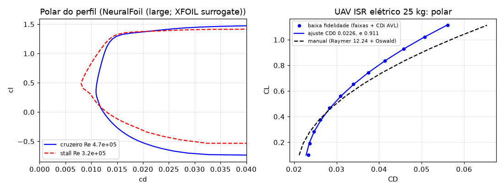

- Perfil: NeuralFoil (large; XFOIL surrogate); Re de cruzeiro 4.74e+05, cm0 = -0.0966
- clmax do perfil (Re de perda 3.19e+05) = 1.455 → CLmax limpo 1.310 (Raymer Eq. 12.15)
- Carga em envergadura: AVL 3.40 (VLM), 2 ângulos; e_inv = 0.963, fator de fuselagem (Kroo) 0.9945
- CDp da asa (integração em faixas, CL = 0.5) = 0.01004 vs termo do manual 0.00825
- **Polar usada no ciclo: CD0 = 0.02258, K = 0.02693 (e = 0.911)**

- perfil NACA 4412: Re cruzeiro 4.74e+05 (xtr = 0.30), clmax a Re_stall 3.19e+05 (transição livre, Ncrit 9)

### Comparação AVL / baixa fidelidade vs métodos de manual

| grandeza | manual | AVL / baixa fid. | método manual | nota |
|---|---|---|---|---|
| CLα asa [/rad] | 5.065 | 5.671 | DATCOM / Raymer Eq. 12.6 | AVL: avião completo (asa + cauda), sem fuselagem |
| CDi a CL = 0.628 | 0.01417 | 0.01006 | Oswald Raymer e = 0.682 | AVL e (Trefftz) = 0.961; Oswald inclui arrasto viscoso dependente de CL |
| x̄_NP [MAC] | 0.4611 | 0.4904 | Raymer Eq. 16.9 + Torenbeek (fuselagem) | sem fuselagem: 0.482 (AVL não modela a fuselagem) |
| CLδe [/rad] | 0.3736 | 0.4407 | Nelson Ch. 2/5 (τ: Raymer Fig. 16.7 / DATCOM) |  |
| Cmδe [/rad] | -1.122 | -1.211 | Nelson Ch. 2/5 (τ: Raymer Fig. 16.7 / DATCOM) | AVL: Cmδe no CG traseiro; Cnδr com convenção de sinal AVL |
| |Clδa| [/rad] | 0.3702 | 0.2791 | Nelson Ch. 2/5 (τ: Raymer Fig. 16.7 / DATCOM) |  |
| Cnδr [/rad] | -0.06125 | 0.05993 | Nelson Ch. 2/5 (τ: Raymer Fig. 16.7 / DATCOM) | AVL: Cmδe no CG traseiro; Cnδr com convenção de sinal AVL |
| CD0 (polar ajustada) | 0.02085 | 0.02258 | Raymer Eq. 12.24 | perfil NeuralFoil (large; XFOIL surrogate); ajuste rms 2.0e-04 |
| e efetivo | 0.6823 | 0.9108 | Raymer Eq. 12.49 | baixa fid.: AVL e_inv × Kroo (fuselagem) + cd(cl) do perfil |
| cl_max do perfil | 1.45 | 1.455 | pressuposto do utilizador | XFOIL/NeuralFoil a Re = 3.19e+05 |

## 11. Estruturas: V-n, cargas na asa e caixão (Fase 2)

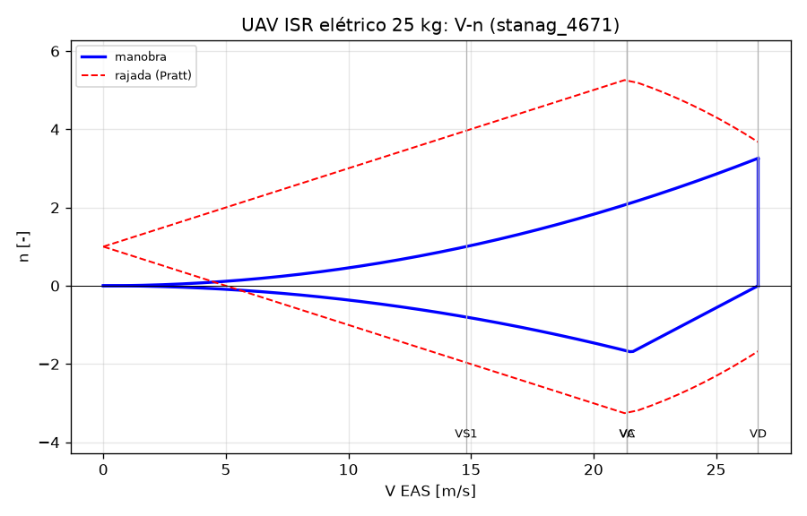

| grandeza | valor |
|---|---|
| regulation | stanag_4671 |
| category | utility |
| VS1_EAS_m_s | 14.8 |
| VA_EAS_m_s | 21.37 |
| VC_EAS_m_s | 21.37 |
| VD_EAS_m_s | 26.71 |
| n_manoeuvre_pos | 4.4 |
| n_manoeuvre_neg | -1.76 |
| n_gust_VC | 5.279 / -3.279 |
| n_gust_VD | 3.674 / -1.674 |
| mu_g | 16.65 |
| Kg | 0.6675 |
| n_limit_pos | 5.279 |
| n_limit_neg | -3.279 |
| governing | rajada |
| n_ultimate | 7.918 |

Cláusulas aplicadas: USAR.333 (envelope); USAR.335(a)(1) VC from operating requirements; USAR.335(b)(1) VD ≥ 1.25 VC; USAR.335(c) VA ≥ VS√n; USAR.337; USAR.341 / USAR.333(c); USAR.303 FS = 1.5

- ⚠️ n_lim = 5.28 está acima da linha de perda mesmo a VD (n = 3.26 com CLmax quase-estático): valor CONSERVATIVO mantido (a perda dinâmica numa rajada pode excedê-lo); VC baixo face a VS1 — rever VC/CLmax antes de dimensionar

Condição crítica de dimensionamento: n = 5.28 (rajada), q a VD = 26.7 m/s EAS.

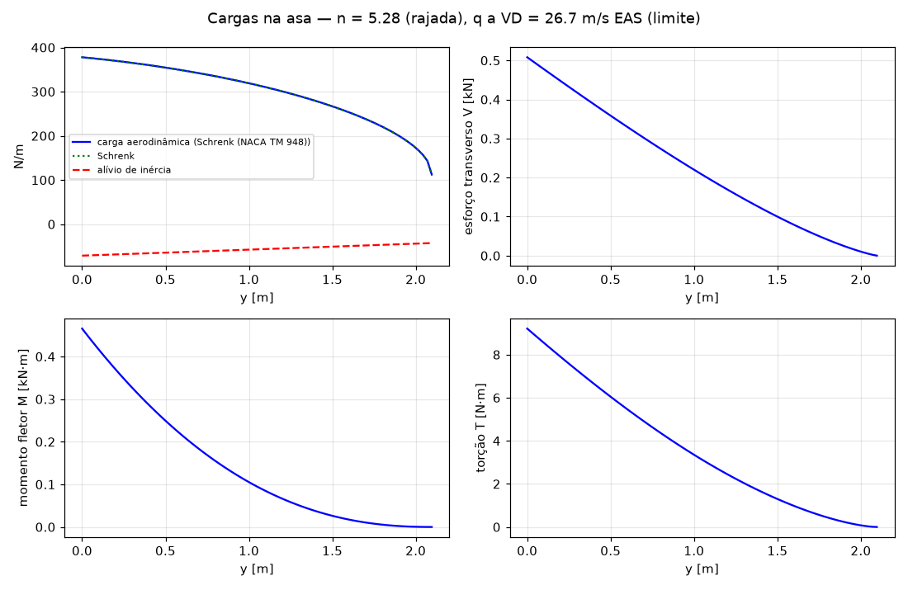

Raiz (limite): V = 508.1 N, M = 465.6 N·m, T = 9.2 N·m.

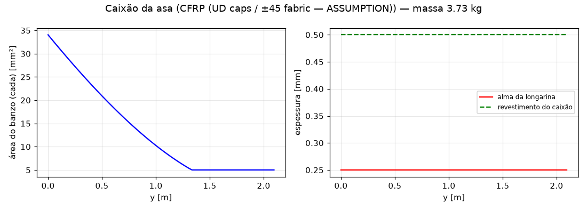

| parcela | massa [kg] |
|---|---|
| caps | 0.1714 |
| box_skins | 1.522 |
| core | 0.1901 |
| webs | 0.09907 |
| web_uprights | 0 |
| LE_TE_skins | 0.9639 |
| ribs | 0.0413 |
| ideal | 2.988 |
| nonoptimum | 0.7469 |
| total | 3.735 |

Cross-check da massa da asa:

| método | massa da asa [kg] |
|---|---|
| Raymer Eq. 15.46 (estatístico) | 4.612 |
| caixão Megson/Bruhn, carga Schrenk (CFRP (UD caps / ±45 fabric — ASSUMPTION)) | 3.735 |
| caixão Megson/Bruhn, carga AVL | 3.726 |

- Revestimentos em sanduíche: núcleo PVC/PMI foam (ASSUMPTION) ρ = 75 kg/m³, E_c = 70 MPa, G_c = 30 MPa (PRESSUPOSTO); núcleo na raiz 2.1 mm, máx. 2.1 mm; interação R_c + R_s² ≤ 1 (Bruhn C5)
- Enrugamento das faces σ_wr = 0.5 (E_f E_c G_c)^(1/3) = 251 MPa (Hoff & Mautner) → OK
- Almas: núcleo sanduíche onde τ > τ_cr (máx. 2.0 mm)
- allowables are ASSUMPTIONS (knock-down for environment/damage)
- 24 nervuras (passo 0.20 m)
- fator não-ótimo 1.25 (PRESSUPOSTO)
- superfícies de comando, flaps e carenagens NÃO incluídos (secundários)
- Eixo elástico = centro de corte da secção real (Megson, multicélula, com bordo de ataque D): x_sc/c raiz 0.339 (meio do caixão 0.425); EI/GJ da secção idealizada no contorno do perfil

### Viga L1: fuselagem, empenagens e torção elástica

Fuselagem 1.7 kg, Raymer Eq. 15.49 1.2 kg (razão 1.46). Estabilizador 0.3 kg, deriva 0.2 kg. CG estrutural 0.7756275247955293 m (não move as estações Roskam do peso e centragem).
Deflexão da cauda no caso limite 0.1 mm; torção da deriva 0.013°.
Correção elástica de cruzeiro: aplicada = não; K_flex/K_rígido = 0.9995; torção de ponta -0.032°; CLα flexível 5.144 /rad. O CLα de manual do resultado mantém-se.
- Fuselagem: casca circular não reforçada, γ de NASA SP-8007 (1968) na encurvadura clássica 0,605 E t/R (Timoshenko & Gere, ν = 0,3). Longarinas só com área mínima (o momento já está no revestimento).
- Piso 0.45 L × 0.75 D, duas anteparas π R² à espessura mínima (Torenbeek 1982 App. D lista estes itens; a espessura é a mínima do material — PRESSUPOSTO). Fator não-ótimo 1.25 só em revestimento + longarinas + cavernas.
- Envelope de manobra: sustentação atingível do estabilizador a VA (Raymer 12.15), equilíbrio + 23.423(b), inércia do motor e aterragem (23.473). 23.427 (rajada) e 23.441 (leme) não estão modelados. Torção assimétrica do estabilizador omitida.
- Estação da asa neste fecho: x = 0.70 m (centro aerodinâmico: ápice colocado pela estabilidade + quarto da corda média).
- γ de SP-8007 é uma correlação de cilindros de alumínio. Em CFRP entra como PRESSUPOSTO conservativo, não como ensaio do laminado.
- Empenagens: caixão de duas longarinas (Megson), carga em envergadura uniforme — PRESSUPOSTO, M_raiz = L b/8 por semienvergadura, mais pesado em flexão do que uma elipse. c_lmax de secção 1 (estabilizador) e 0.8 (deriva), não o da asa; CLmax pela Eq. 12.15 de Raymer.
- k_EI e k_GJ multiplicam EI e GJ da asa (razão viga/BoxFEM). A fuselagem não os usa.
- Massa da fuselagem L1 / Raymer Eq. 15.49 = 1.46. A regressão de Raymer inclui portas, janelas e suportes que esta casca não tem.

## 12. Estabilidade e controlo (Fase 2: Raymer Cap. 16, Etkin & Reid, Nelson)

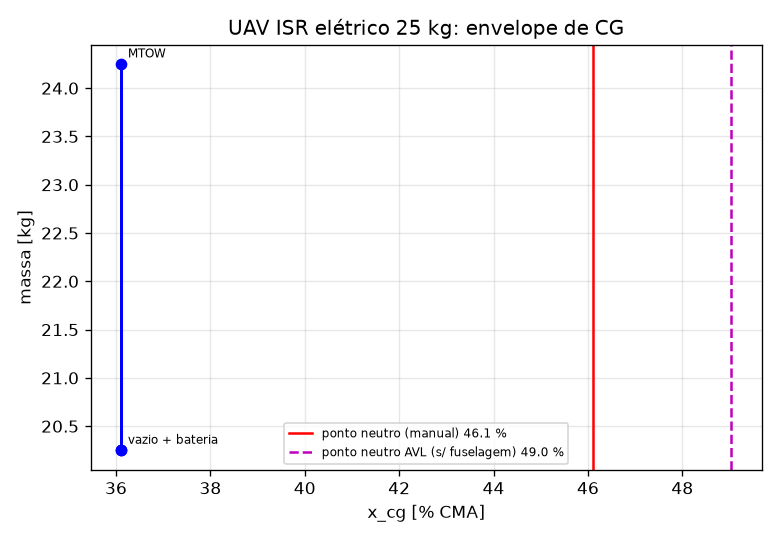

- asa posicionada para SM = 10% no CG mais recuado (ápice a 33.3% L); ápice da asa a x = 0.599 m
- Ponto neutro x̄_NP = 0.461 MAC (manual), 0.49 (AVL); dε/dα = 0.248
- **Margem estática: 10.0 % (CG dianteiro) … 10.0 % (CG traseiro)**
- AVL, cruzeiro compensado no CG traseiro: α = 2.82°, δe = -2.63°, Cnβ = 0.0674, Clβ = -0.0782, Cmq = -11.24
- Coef. de volume: V_h = 0.500, V_v = 0.0300 (Raymer Table 6.4: - / -)

| caso | massa [kg] | x_cg [m] | x̄_cg [MAC] | SM |
|---|---|---|---|---|
| vazio + bateria | 20.25 | 0.7367 | 0.3611 | 0.1 |
| MTOW | 24.25 | 0.7367 | 0.3611 | 0.1 |

Compensação (trim) no CG dianteiro:

| condição | CL | δe [°] | ok (|δe| ≤ máx.) |
|---|---|---|---|
| CLmax limpo (CG dianteiro) | 1.31 | -10.96 | True |
| cruzeiro (CG dianteiro) | 0.6278 | -7.481 | True |

- Clδa comparado em módulo (convenções de sinal do aileron diferem entre AVL e Nelson).
- Estações de estrutura: PRESSUPOSTOS (Roskam Part V Table 8.1, valores típicos). Tripulação, carga e bateria, se a missão não as der, ficam no CG da massa fixa (Raymer 2018 Sec. 15.1: a estação que não desloca o balanço). Um UAV sem massa de tripulação não leva tripulação. O combustível de asa fica a 30 % da CMA. Substituir em assumptions.stability.stations.

## 12a. Peso e centragem operacional e trem de aterragem

Peso e centragem (Raymer 2018 Sec. 15.1; Roskam Parte II Cap. 10). Os limites, quando não são dados no ficheiro, são os conceptuais: margem estática alvo atrás e, à frente, o mais à ré entre o trim no CLmax limpo e o flare com flaps.

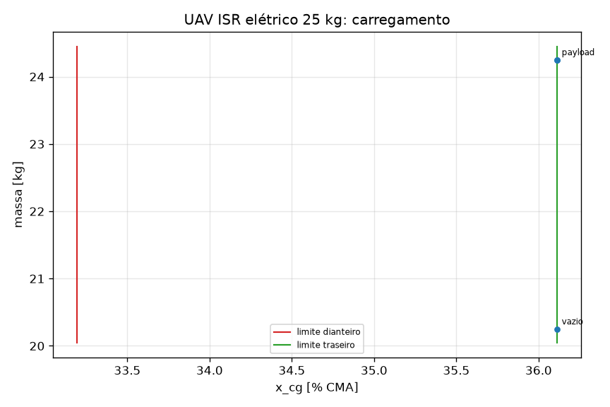

Todos os 3 carregamentos dentro dos limites conceptuais; extremos 0.737 m (payload, 24 kg) e 0.737 m (vazio, 20 kg).

| carregamento | massa [kg] | x_cg [m] | x̄ [% CMA] |
|---|---|---|---|
| vazio | 20.25 | 0.7367 | 36.11 |
| payload | 24.25 | 0.7367 | 36.11 |
| payload | 24.25 | 0.7367 | 36.11 |

Limites a W0: dianteiro 0.7270847384553127 m, traseiro 0.7367052103162438 m.

- Limite dianteiro conceptual: dimensiona «flare com flaps» a 0.727 m. Casos: limpo a 0.668 m (CL 1.31, Cm0 -0.0837), flare com flaps a 0.727 m (CL 1.71, Cm0 -0.2734). Nelson 1998 Cap. 2, |δe| = 25°. Cm0 da asa = -0.0837 (Raymer Eq. 16.13, cm0 do perfil) Cm0,f = -0.0197 entra no flare (Multhopp, Nelson 1998 Cap. 2; k2−k1 da tabela de Lamb em Tuckerman, NACA Report 139; α0 = -4.01°. Largura constante igual a D e i_f = 0, PRESSUPOSTO — fuselagem de revolução, Torenbeek App. F, sem segmentar nariz e cauda) ΔCm do flap = -0.1700 entra no flare (Glauert 1926, b_C·δ·S_f/S; δ = 30° (PRESSUPOSTO, omissão de flightsim/controls.py — substituir em assumptions.aero.flap.landing_deg); c_f/c = 0.25 (PRESSUPOSTO, omissão de flightsim/controls.py — substituir em assumptions.aero.flap.cf_c); S_f/S = 0.500; corda da parte com flap igual à CMA, PRESSUPOSTO). Efeito de solo no flare: CLα da cauda × 1.011 (φ = 0.966 = 1 − exp[−2.48 (2h/b)^0.768], Torenbeek 1982, citado por Phillips e Hunsaker, Journal of Aircraft, Vol. 50, No. 4, 2013, Eq. (4); h/b = 0.748, h = 0.710 m, trem + 0.5 D, omissão 0.60 m (PRESSUPOSTO, weights_detailed.DEFAULT_MAIN_GEAR_LENGTH_M); PRESSUPOSTO: o centro aerodinâmico da cauda está à altura do eixo da fuselagem). 1/CLα = 1/a0 + φ/(π AR), a0 = 0.95·2π, e = 1 (PRESSUPOSTO). O quociente multiplica o CLα livre e não substitui o declive de Helmbold. O CLmax não aumenta e o dε/dα do ponto neutro não é reduzido: essa redução é a penalização de rotação, não um alívio do flare. Na tesoura, φ repete-se em cada S_h/S porque a envergadura muda com a área. O flare fica em efeito de solo só neste declive. O fator de Hoerner e Borst não é usado como CLα.
- Limite traseiro conceptual: ponto neutro menos a margem estática alvo (Raymer Cap. 16).
- Estações de CG: as da estabilidade. Estrutura: Roskam Parte V, Tabela 8.1 (PRESSUPOSTO). Tripulação, carga e bateria, se a missão não as der, ficam no CG da massa fixa (Raymer 2018 Sec. 15.1); combustível de asa a 30 % da CMA. Substituir em assumptions.stability.stations, weight_balance.loading ou extra_items. O combustível arde na estação do tanque; não há combustível inutilizável separado.
- A tripulação, quando existe, vai em todos os carregamentos.

**Trem (none).** sem trem

sem trem; 14 CFR 23.473 não aplicado

- Sem trem de aterragem (landing_gear: none) — lançamento e recuperação ficam por analisar.

## 13. Desempenho por segmentos (Fase 2: Raymer Cap. 17, Anderson)

Orçamento utilizável: E_nom 1955 Wh × DoD 0.85 / (1 + reserva 0.2).

Missão requerida (segmentos):

| segmento | t [min] | dist [km] | consumo [Wh] | h [m] | V [m/s] | nota |
|---|---|---|---|---|---|---|
| descolagem | 1 | 0 | 18.17 | 0→0 | 0 | 1 min potência de descolagem (PRESSUPOSTO) |
| subida (V_y) | 3.346 | 3.563 | 84.64 | 0→600 | 18 | potência de subida, integrado (V médio) |
| espera (loiter) | 161.2 | 212.7 | 1282 | 600→600 | 22 |  |
| descida (L/D máx, ralenti) + aterragem | 11.29 | 12.17 | 0 | 600→0 | 17.95 | planado, energia ≈ 0 |

Missão até esgotar o orçamento: **alcance 228.5 km, endurance 2.95 h**.

| segmento | t [min] | dist [km] | consumo [Wh] | h [m] | V [m/s] | nota |
|---|---|---|---|---|---|---|
| descolagem | 1 | 0 | 18.17 | 0→0 | 0 | 1 min potência de descolagem (PRESSUPOSTO) |
| subida (V_y) | 3.346 | 3.563 | 84.64 | 0→600 | 18 | potência de subida, integrado (V médio) |
| espera (loiter) | 161.2 | 212.7 | 1282 | 600→600 | 22 | estendido até esgotar o orçamento |
| descida (L/D máx, ralenti) + aterragem | 11.29 | 12.17 | 0 | 600→0 | 17.95 | planado, energia ≈ 0 |

Requisitos vs desempenho por segmentos:

| requisito | grandeza | obtido | requerido | unidade | ok |
|---|---|---|---|---|---|
| endurance | tempo em espera (segmentos) | 2.686 | 2.688 | h | ✅ |
| service_ceiling | teto de serviço (Anderson) > 9000 m (não atingido) | 9000 | 3000 | m | ✅ |
| climb_rate | ROC máx. ao nível do mar | 3 | 3 | m/s | ✅ |

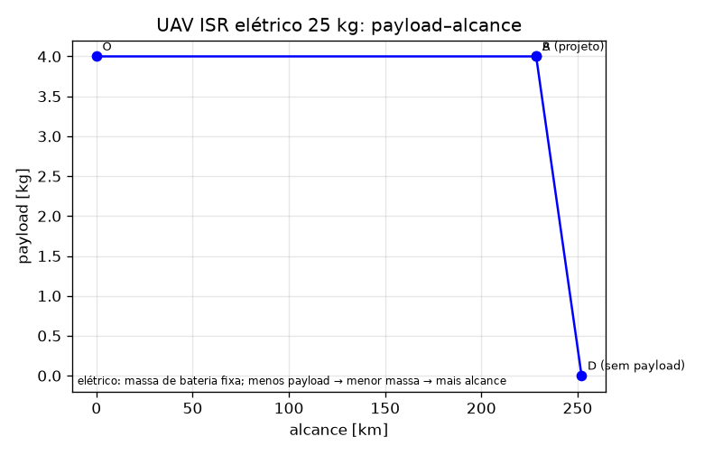

| ponto | payload_kg | massa_kg | range_km | endurance_h |
|---|---|---|---|---|
| O | 4 | 24.25 | 0 | 0 |
| A | 4 | 24.25 | 228.5 | 2.947 |
| B (projeto) | 4 | 24.25 | 228.5 | 2.947 |
| D (sem payload) | 0 | 20.25 | 252.1 | 3.263 |

Nota: elétrico: massa de bateria fixa; menos payload → menor massa → mais alcance.

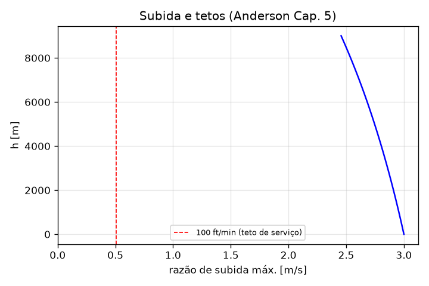

- ROC máx. ao nível do mar 3.00 m/s; teto de serviço > 9000 m; teto absoluto > 9000 m
- Descolagem (Raymer 17.8): corrida 62 m, total sobre 15 m 206 m (V_TO 15.9 m/s)
- Aterragem (Raymer 17.9): corrida 78 m, total sobre 15 m 373 m (μ_travagem 0.4; aproximação γ = 3° — `performance.approach_angle_deg`, por omissão o máximo de 5.2 % / 3° de CS/14 CFR 23.75(a)(1))

- Os resultados de segmentos usam a mesma polar e reservas do dimensionamento; diferenças face aos requisitos vêm da subida/descida integradas vs. frações históricas (Raymer Table 3.2).
- A missão requerida esgota o orçamento antes do fim (ver segmentos).

## 14. Caixão da asa dimensionado à estabilidade (Fase 3: Bruhn C5/C7/C11, Farrar, Kuhn)

| caixão | massa [kg] | / Raymer 15.46 |
|---|---|---|
| resistência (Fase 2, limite inferior) | 3.497 | 0.7582 |
| encurvadura (Fase 3, CFRP (UD caps / ±45 fabric — ASSUMPTION)) | 3.735 | 0.8097 |
| Raymer Eq. 15.46 (asa completa, estatístico) | 4.612 | 1 |

Parcelas (caixão de encurvadura):

| parcela | massa [kg] |
|---|---|
| caps | 0.1714 |
| box_skins | 1.522 |
| core | 0.1901 |
| webs | 0.09907 |
| web_uprights | 0 |
| LE_TE_skins | 0.9639 |
| ribs | 0.0413 |
| ideal | 2.988 |
| nonoptimum | 0.7469 |
| total | 3.735 |

- Almas Kuhn: fator de tração diagonal k máx. 0.000 (k = 0: alma resistente ao corte, sem tração diagonal)
- Revestimentos em sanduíche: núcleo PVC/PMI foam (ASSUMPTION) ρ = 75 kg/m³, E_c = 70 MPa, G_c = 30 MPa (PRESSUPOSTO); núcleo na raiz 2.1 mm, máx. 2.1 mm; interação R_c + R_s² ≤ 1 (Bruhn C5)
- Enrugamento das faces σ_wr = 0.5 (E_f E_c G_c)^(1/3) = 251 MPa (Hoff & Mautner) → OK
- Almas: núcleo sanduíche onde τ > τ_cr (máx. 2.0 mm)
- allowables are ASSUMPTIONS (knock-down for environment/damage)
- 24 nervuras (passo 0.20 m)
- fator não-ótimo 1.25 (PRESSUPOSTO)
- superfícies de comando, flaps e carenagens NÃO incluídos (secundários)
- Eixo elástico = centro de corte da secção real (Megson, multicélula, com bordo de ataque D): x_sc/c raiz 0.339 (meio do caixão 0.425); EI/GJ da secção idealizada no contorno do perfil

## 15. Aeroelasticidade clássica (Fase 3)

V_D = 26.7 m/s EAS.

| fenómeno | V [m/s EAS] | requerido 1.2 V_D | margem | ok | método |
|---|---|---|---|---|---|
| divergência torsional | 291.5 | 32.06 | +809 % | ✅ | W&C 8.3 / Bisplinghoff 8-2 (faixas + FE) |
| inversão do aileron | n/a | 32.06 | sem ocorrência | ✅ | W&C 8.4, Glauert (flap 2D) |
| flutter binário (flexão–torção) | 132.6 | 32.06 | +314 % | ✅ | W&C 11 (modos assumidos, quase-estacionário) |

- Frequências desacopladas: flexão 11.6 Hz, torção 82.3 Hz; flutter a 65.7 Hz
- AEER-45 (fator de flexibilidade torsional da asa): F = 1.289e-03 vs F_max = 200/V_D² = 5.601e-02 → OK

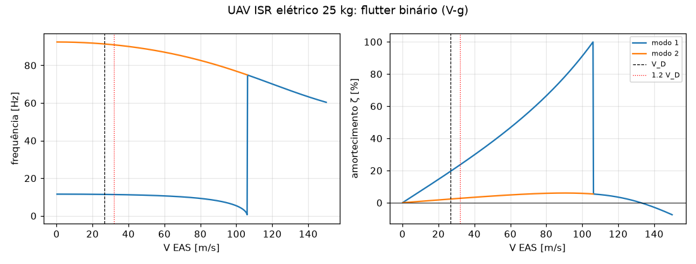

### Acoplamento aero-estrutural estático (OpenAeroStruct, VLM + caixão)

| ponto | modelo | α [°] | CL | CDi | CLα [/rad] | flecha ponta [m] | torção ponta [°] |
|---|---|---|---|---|---|---|---|
| cruise | rígido | 6.808 | 0.6278 | 0.009482 | 5.26 | 1.339e-06 | 5.782e-06 |
| cruise | flexível | 6.774 | 0.6278 | 0.009488 | 5.289 | 0.01342 | 0.05791 |
| manobra (n_lim, V_D EAS, nível do mar) | rígido | 23.57 | 2.121 | 0.1076 | 4.883 | 6.648e-06 | 2.853e-05 |
| manobra (n_lim, V_D EAS, nível do mar) | flexível | 23.3 | 2.121 | 0.1079 | 4.977 | 0.06676 | 0.2863 |

- Efeito da forma deformada no arrasto induzido de cruzeiro: K_flex/K = 1.0006
- Missão por segmentos: rígido 228.5 km / 2.947 h → flexível 228.5 km / 2.947 h (comparação com o resultado desacoplado da Fase 2)
- ponto de manobra: CL = 2.12 > CLmax limpo 1.31 (n_lim de rajada acima da linha de perda) — caso de carga válido para a deformação (VLM linear), α não físico
- OpenAeroStruct VLM (sem viscoso/onda: só arrasto induzido) + FEM de caixão 'wingbox' acoplados por NLBGS; rígido = E, G × 10⁴
- secção do caixão: NACA-4 entre longarinas; espessuras de alma/revestimento do caixão acdt (5 pontos de controlo); revestimento único equivalente que reproduz EI(y) do caixão acdt e G ajustado para GJ (PRESSUPOSTO)
- sem alívio de peso estrutural nem de combustível na asa (conservativo para a deformação)
- índice de falha OAS (von Mises/KS, σ_adm = σ_cap/1.5) na manobra: -0.357 (< 0 = OK) — critério de resistência do OAS sobre o revestimento equivalente — INDICATIVO (o dimensionamento é o do caixão acdt)
- massa da asa 4.61 kg distribuída ∝ corda; CG da secção a 0.50 c; eixo elástico a 0.339 c (centro de corte da secção, média), e = 0.089 c atrás do c.a.; a_w = 6.283/rad (2D, teoria das faixas — sem correção 3D/compressibilidade)
- encastramento na parede da fuselagem y0 = 0.110 m; EI/GJ do caixão buckling
- requisito: livre de flutter/divergência/inversão até 1.2 V_D = 32.1 m/s EAS (14 CFR 23.629(c) legado; CS/14 CFR 23.2245 'suficientemente além'; STANAG 4671 USAR.629 — verificar)
- flutter: modelo binário de modos assumidos (W&C Cap. 11), aerodinâmica quase-estacionária — ESTIMATIVA; a análise racional exige modos FEM + DLM (Fase 4)
- UAV (STANAG 4671): AEER-45 é um critério FAA para aviação geral — informativo

## 16. Diagrama de tesoura, modos dinâmicos e qualidades de voo (Fase 3)

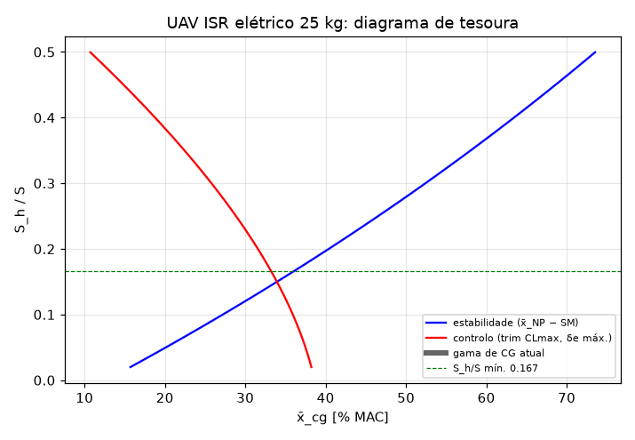

- S_h/S atual 0.167; requerido 0.167 (estabilidade 0.167, controlo 0.0944; dimensionante: estabilidade) → ✅ (Torenbeek Cap. 9)
- linha de controlo: o x̄ mais à ré entre o CLmax limpo 1.31 (Cm0 asa -0.0837) e o flare com flaps (CLmax aterragem 1.71, Cm0 -0.2734), δe = −25°, τ_e = 0.661. Cm0 da asa = -0.0837 (Raymer Eq. 16.13, cm0 do perfil) Cm0,f = -0.0197 entra no flare (Multhopp, Nelson 1998 Cap. 2; k2−k1 da tabela de Lamb em Tuckerman, NACA Report 139; α0 = -4.01°. Largura constante igual a D e i_f = 0, PRESSUPOSTO — fuselagem de revolução, Torenbeek App. F, sem segmentar nariz e cauda) ΔCm do flap = -0.1700 entra no flare (Glauert 1926, b_C·δ·S_f/S; δ = 30° (PRESSUPOSTO, omissão de flightsim/controls.py — substituir em assumptions.aero.flap.landing_deg); c_f/c = 0.25 (PRESSUPOSTO, omissão de flightsim/controls.py — substituir em assumptions.aero.flap.cf_c); S_f/S = 0.500; corda da parte com flap igual à CMA, PRESSUPOSTO). Efeito de solo no flare: CLα da cauda × 1.011 (φ = 0.966 = 1 − exp[−2.48 (2h/b)^0.768], Torenbeek 1982, citado por Phillips e Hunsaker, Journal of Aircraft, Vol. 50, No. 4, 2013, Eq. (4); h/b = 0.748, h = 0.710 m, trem + 0.5 D, omissão 0.60 m (PRESSUPOSTO, weights_detailed.DEFAULT_MAIN_GEAR_LENGTH_M); PRESSUPOSTO: o centro aerodinâmico da cauda está à altura do eixo da fuselagem). 1/CLα = 1/a0 + φ/(π AR), a0 = 0.95·2π, e = 1 (PRESSUPOSTO). O quociente multiplica o CLα livre e não substitui o declive de Helmbold. O CLmax não aumenta e o dε/dα do ponto neutro não é reduzido: essa redução é a penalização de rotação, não um alívio do flare. Na tesoura, φ repete-se em cada S_h/S porque a envergadura muda com a área. O flare fica em efeito de solo só neste declive. O fator de Hoerner e Borst não é usado como CLα.
- massa da cauda não realimentada (posição da asa e braço fixos)
- gama de CG: a mesma do trim (extremos dos casos de carregamento)

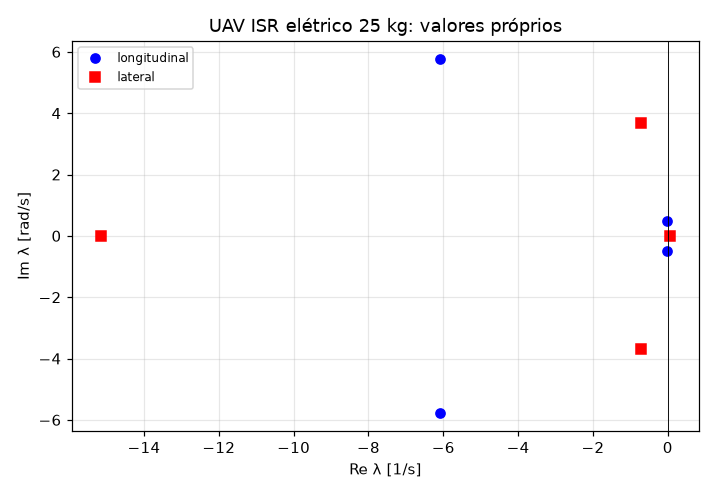

| modo | ωn [rad/s] | ζ | período [s] | τ / T [s] |
|---|---|---|---|---|
| período curto | 8.393 | 0.7257 | 1.088 | - |
| fugóide | 0.4977 | 0.06335 | 12.65 | - |
| rolamento holandês | 3.757 | 0.1896 | 1.703 | - |
| rolamento (constante de tempo) | - | - | - | 0.06597 |
| espiral instável | - | - | - | 11.49 |

- n/α = 8.74 g/rad, CAP = 8.06 1/(g s²)
- Inércias (Roskam V, soma por componentes): Ixx 5.96, Iyy 1.56, Izz 7.48 kg·m²
- derivadas de taxa e laterais: AVL (sem fuselagem) + Cnβ da fuselagem (Raymer 16.47) -0.0132
- Cmα = −CLα·SM no CG de MTOW (ponto neutro de manual com fuselagem)
- inércias por soma de componentes (Roskam Parte V) — PRESSUPOSTOS de estações

Qualidades de voo — MIL-F-8785C, Classe I, categoria B (nível exigido 1):

| modo | valor | nível | limite N1 | ref |
|---|---|---|---|---|
| período curto ζ | 0.7257 | 1 | 0.30–2.00 | MIL-F-8785C Table IV |
| CAP = ω²/(n/α) [1/(g s²)] | 8.057 | 2 | 0.085–3.6 | MIL-F-8785C Figs. 1–3 |
| fugóide ζ | 0.06335 | 1 | ≥ 0.04 | MIL-F-8785C 3.2.1.2 |
| rolamento holandês ζ / ζω / ω | 0.190 / 0.712 / 3.76 | 1 | 0.08 / 0.15 / 0.4 | MIL-F-8785C Table VI |
| rolamento τ_R [s] | 0.06597 | 1 | ≤ 1.4 | MIL-F-8785C Table VII |
| espiral T2 [s] (∞ = estável) | 11.49 | 2 | ≥ 20 | MIL-F-8785C Table VIII |


## Pressupostos usados

```yaml
weights:
  method: components
  initial_class: uav_small
  fixed_fraction: null
  A: null
  C: null
  tech_factor: 1.0
  Kvs: 1.0
  fixed_mass_kg: 0.0
  components:
    material: composite
    structural_category: utility
    landing_gear: none
    min_areal_density_kg_m2: 0.9
    propeller_mass_kg: 0.08
    items:
    - name: paraquedas de recuperação + ejetor
      mass_kg: 1.0
    - name: suporte/amortecimento do gimbal
      mass_kg: 0.3
    - name: datalink C2 + antenas
      mass_kg: 0.25
      group: equipment
    - name: GNSS + bússola (x2)
      mass_kg: 0.1
      group: equipment
    - name: pitot/ADS-B
      mass_kg: 0.1
      group: equipment
    - name: cablagem de sinal + conectores
      mass_kg: 0.3
      group: equipment
    - name: ferragens/fixações/pintura
      mass_kg: 0.4
    growth_allowance: 0.1
aero:
  AR: 12.9771
  taper: 0.6
  sweep_c4_deg: 0.0
  tc_root: 0.13
  tc_tip: 0.11
  xc_max_t: 0.3
  airfoil: NACA 4412
  clmax_airfoil: 1.45
  flap:
    kind: plain
    flapped_area_ratio: 0.5
  oswald: null
  cfe: 0.0055
  swet_sref: 3.5
  laminar:
    wing: 0.3
    htail: 0.3
    vtail: 0.3
    fuselage: 0.1
  roughness: smooth_molded_composite
  Q: {}
  lp_fraction: 0.05
  extra_drag_areas_m2:
    gimbal_eo_ir: 0.006
    antennas_pitot: 0.002
  CL_ground: 0.5
  dCD0_takeoff: 0.01
  mu_roll: 0.04
  fidelity: lowfi
  airfoil_solver: xfoil
propulsion:
  eta_cruise: 0.8
  eta_climb: 0.75
  eta_takeoff: 0.55
  bsfc_lb_hp_h: null
  tsfc_1_h: 0.5
  battery_Wh_kg: 228.39506172839506
  eta_total: 0.62
  dod: 0.85
  energy_reserve: 0.2
  systems_power_W: 31.0
  n_engines: 1
  propeller: null
geometry:
  fuselage_length_m: 1.8
  fuselage_diameter_m: 0.22
  fuselage_fineness: 7.0
  fuselage_class: null
  tail_class: null
  c_ht: 0.5
  c_vt: 0.03
  tail_arm_fraction: 0.55
  ar_h: 4.0
  ar_v: 1.5
  dihedral_deg: null
  configuration: conventional
  tail_dihedral_deg: null
  boom_span_fraction: 0.35
  pod_length_fraction: 0.55
  boom_width_m: null
  taper_v: 0.5
constraints:
  cruise_weight_fraction: 1.0
  landing_weight_fraction: 1.0
  approach_distance_ft: 600.0
  margin: 0.0
  ws_initial_psf: 6
  ws_min: 50.0
  ws_max: 3000.0
  default_cruise_altitude_m: 0.0
  ws_fixed: 175.63065436163683
  value_fixed: null
  criterion: fixed_ws
mda:
  max_iter: 30
  tol: 1.0e-05
  tol_lowfi: 0.0002
structures:
  regulation: auto
  load_factor_from_vn: true
  material: auto
  nonoptimum_factor: 1.25
  VH_eas_m_s: null
  elastic_axis: section
  le_cell: true
  flex: false
  mass_in_loop: false
  wingbox:
    hold_section: false
stability:
  target_static_margin: 0.1
  wing_apex_x_fraction: null
  stations: {}
  inertia_method: components
  roskam_reference: null
  radii_of_gyration: null
  elevator_max_deg: 25.0
  use_avl: true
  dynamics: true
  hq_category: B
  hq_required_level: 1
performance:
  fuel_capacity_kg: null
  max_payload_kg: null
  mu_brake: 0.4
  approach_angle_deg: 3.0
aeroelasticity:
  enabled: true
  a_w: 6.283185307179586
  x_cg_chord: null
  margin_factor: 1.2
  static_aerostructural: true
mdo:
  objective: null
  solver: nlbgs
  trust_region_iterations: 8
  trust_region_radius: 0.3
  design_vars:
  - ws
  - AR
  AR_bounds:
  - 5.0
  - 16.0
  ws_bounds_factor:
  - 0.6
  - 1.4
  pw_bounds_factor:
  - 0.6
  - 1.6
  maxiter: 60
  tol: 1.0e-06
  hq_aeroel_constraints: false
  hq_aeroel_keys: null
cost: {}
calibration:
  file: null
  apply: []
  factors: {}
weight_balance:
  crew_optional: false
  extra_items: []
  x_forward_m: null
  x_aft_m: null
  forward_limit: null
  aft_limit: null
  lemac_arm_in: null
  mac_in: null
landing_gear:
  h_cg_m: null
  tipback_deg: 15.0
  overturn_max_deg: 63.0
  nose_fraction_min: 0.08
  nose_fraction_max: 0.15
  wing_lift_fraction: 0.6666666666666666
  absorber: oleo
  eta: null
  stroke_m: null
  tire_stroke_m: 0.0
  max_stroke_m: null
  rotation_min_deg: 10.0
  x_nose_m: null
  x_main_m: null
  x_tail_m: null
  track_m: null
  x_nose_min_m: 0.0
  x_main_max_m: null
launch_recovery: null
```

## Referências

- Raymer, D. P., *Aircraft Design: A Conceptual Approach*, 6th ed., AIAA, 2018 (equation numbers as in the 6th ed.).
- Roskam, J., *Airplane Design*, Parts I–VIII, DARcorporation.
- Gudmundsson, S., *General Aviation Aircraft Design: Applied Methods and Procedures*, Elsevier, 2014.
- Anderson, J. D., *Aircraft Performance and Design*, McGraw-Hill, 1999.
- Torenbeek, E., *Synthesis of Subsonic Airplane Design*, Delft Univ. Press, 1982.
- USAF Stability and Control DATCOM, 1978.
- Hepperle, M., "Electric Flight – Potential and Limitations", NATO STO-MP-AVT-209, 2012.
- Niu, M. C. Y., *Airframe Structural Design*, Conmilit, 1988.
- Drela, M., "First-Order DC Electric Motor Model", MIT, 2007.
- ISO 2533:1975 Standard Atmosphere.
- Nicolai, L. M., Carichner, G. E., *Fundamentals of Aircraft and Airship Design*, Vol. I, AIAA, 2010 (Table 5.1, We = A·W0^B incl. UAV classes).
- EASA CS-23 (Amdt. 4 and earlier) / 14 CFR 23.337 (pre-Amdt. 23-64): limit manoeuvring load factors.
- IEC 60028:1925, International standard of resistance for copper (ρCu = 8890 kg/m³).
- FAA Type Certificate Data Sheet 1E10 (Lycoming O-360/IO-360 series) — engine dry mass in the C172 check.
- Drela, M., "XFOIL: An Analysis and Design System for Low Reynolds Number Airfoils", 1989; XFOIL 6.99 (GPL).
- Drela, M., Youngren, H., AVL 3.40 (Athena Vortex Lattice), MIT, 2022 (GPL).
- Sharpe, P., NeuralFoil, MIT, 2024 (fallback section polars).
- Schrenk, O., "A Simple Approximation Method for Obtaining the Spanwise Lift Distribution", NACA TM 948, 1940.
- Megson, T. H. G., *Aircraft Structures for Engineering Students*, 5th ed., 2013 (Ch. 16, 19–23).
- Bruhn, E. F., *Analysis and Design of Flight Vehicle Structures*, 1973 (Ch. A3, C5, C11).
- Etkin, B., Reid, L. D., *Dynamics of Flight: Stability and Control*, 3rd ed., Wiley, 1996.
- Nelson, R. C., *Flight Stability and Automatic Control*, 2nd ed., McGraw-Hill, 1998.
- Kroo, I., *Aircraft Design: Synthesis and Analysis*, Stanford (lift-dependent drag, fuselage span-efficiency factor).
- EASA CS-23 Amdt. 4 / 14 CFR 23.333–23.341 (flight envelope, design speeds, gust loads); 14 CFR/CS 23.65 (climb speed).
- NATO STANAG 4671 Ed. 1 (USAR), 2009: USAR.303, .333, .335, .337, .341.
- Abbott, I. H., von Doenhoff, A. E., *Theory of Wing Sections*, Dover, 1959.
