# Relatório de dimensionamento — UAV ISR — caso sobre-restringido (demonstração de inviabilidade)

_acdt 0.1.0 · Fase 1 (conceptual) + 1E (sistemas) + Fase 2 (baixa fidelidade)_

UAV de asa fixa lançado por catapulta e recuperado por paraquedas/rede, com gimbal EO/IR. Sem requisito de pista (não há restrição de descolagem/aterragem).


**Resultado:** ❌ INVIÁVEL / requisitos não cumpridos

**Verificação por segmentos (Fase 2):** ⚠️ pelo menos um requisito não cumprido na missão por segmentos (ver §13)

## 1. Requisitos desta corrida

| requisito | sentido | valor | qualificadores | estágios | avaliado |
|---|---|---|---|---|---|
| propulsion_type | target | electric | - | context | sim |
| regulatory_category | target | easa_specific | - | check, systems | sim |
| payload_mass | target | 4.0 kg | - | sizing | sim |
| endurance | min | 3.5 h | - | sizing | sim |
| cruise_speed | target | 22 m/s | - | constraint, sizing | sim |
| cruise_altitude | target | 600 m | - | context | sim |
| stall_speed | max | 13 m/s | - | constraint | sim |
| climb_rate | min | 3.0 m/s | - | constraint | sim |
| service_ceiling | min | 3000 m | - | constraint | sim |
| wing_span | max | 4.2 m | - | check | sim |
| mtow | max | 25 kg | - | check | sim |

Requisitos não definidos (livres / por omissão): crew_mass, range, max_speed, load_factor, turn_rate, takeoff_ground_roll, landing_distance, power_available, thrust_available, unit_cost, noise, mtow_objective

### Validação

- **info**: Valor inicial estatístico We/W0 = 0.57 não fecha (We/W0 + Wf/W0 > 0.98); iteração por componentes reiniciada com We/W0 = 0.30.
- **info**: Nz das equações de massa = 1.5 × n_lim do diagrama V-n (4.85, rajada; stanag_4671)
- **warning**: n_lim = 4.85 está acima da linha de perda mesmo a VD (n = 3.22 com CLmax quase-estático): valor CONSERVATIVO mantido (a perda dinâmica numa rajada pode excedê-lo); VC baixo face a VS1 — rever VC/CLmax antes de dimensionar
- **info**: Massa do caixão da asa (Megson/Bruhn) = 5.09 kg vs Raymer Eq. 15.46 6.73 kg (razão 0.76); usado: Raymer
- **warning**: Massa da fuselagem L1 / Raymer Eq. 15.49 = 1.41 (1.7 kg vs 1.2 kg).
- **info**: Energia de descolagem + subida no dimensionamento = 140.6 Wh (modelo de segmentos: 1 min à potência de descolagem + subida integrada a V_y — o mesmo da verificação; Hepperle só energia potencial daria 86.7 Wh)
- **info**: Sem trem de aterragem (landing_gear: none) — lançamento/recuperação como itens do utilizador.
- **info**: W0 = 33 kg está abaixo da base de dados das equações GA de Raymer (~1000–8000 lb): extrapolação — calibrar com dados próprios (calibration).
- **warning**: We/W0 por componentes = 0.446 fora da banda estatística [0.75, 0.99] (±15 %) — rever itens em falta (recuperação, suportes, pintura, cablagem de sinal) ou calibrar com dados próprios.

## 2. Peso à descolagem (Raymer Cap. 3; Hepperle 2012 para elétrico)

| grandeza | valor |
|---|---|
| W0 [kg] | 32.89 |
| We [kg] | 14.67 |
| Combustível/bateria [kg] | 14.22 |
| Payload + tripulação [kg] | 4 |
| We/W0 | 0.446 |
| Wf/W0 | 0.4323 |
| Energia bateria nominal [Wh] | 3247 |

Pernas da missão: loiter 12600 (SI) @ V=22.0 m/s, L/D=19.5, h=600 m

## 2a. Estimativa de pesos por componentes (Raymer 6th ed. Cap. 15 + sistemas)

Valor inicial do peso vazio: Raymer 6th ed. Table 3.1 (We/W0 = A W0^C, W0 in lb) 'uav_small'.

Fator de carga último Nz = 7.27 (1.5 × limite). Iteração: estatística → geometria → componentes → novo We → re-dimensionar, até convergir (histórico na secção 8).

| grupo | item | kg | % W0 | método |
|---|---|---|---|---|
| structure | asa | 6.73 | 20.47 | Raymer Eq. 15.46; composite x0.875 (Raymer Table 15.4) |
| structure | empenagem horizontal | 0.6188 | 1.882 | minimum gauge: Swet 0.688 m² x 0.9 kg/m² (user layup) > Raymer Eq. 15.47 |
| structure | empenagem vertical | 0.5092 | 1.548 | minimum gauge: Swet 0.566 m² x 0.9 kg/m² (user layup) > Raymer Eq. 15.48 |
| structure | fuselagem | 1.138 | 3.46 | Raymer Eq. 15.49 (unpressurized); composite x0.925 (Raymer Table 15.4) |
| propulsion | motor(es) + ESC(s) | 1.13 | 3.436 | selected components (Phase 1E database) |
| propulsion | hélice(s) | 0.08 | 0.2433 | user (datasheet) |
| equipment | comandos (hastes/charneiras) | 0.09895 | 0.3009 | Raymer Eq. 15.54 |
| equipment | servos | 0.27 | 0.821 | selected components (Phase 1E) |
| equipment | autopiloto + aviónica + extras | 0.075 | 0.2281 | selected components / user list |
| equipment | cablagem de potência | 0.2347 | 0.7136 | sized wire gauges x length x ρCu (IEC 60028) x1.3 insulation + 5 connectors x 0.01 kg (ASSUMPTIONS) |
| user_items | paraquedas de recuperação + ejetor | 1 | 3.041 | user-listed item |
| user_items | suporte/amortecimento do gimbal | 0.3 | 0.9123 | user-listed item |
| equipment | datalink C2 + antenas | 0.25 | 0.7602 | user-listed item |
| equipment | GNSS + bússola (x2) | 0.1 | 0.3041 | user-listed item |
| equipment | pitot/ADS-B | 0.1 | 0.3041 | user-listed item |
| equipment | cablagem de sinal + conectores | 0.3 | 0.9123 | user-listed item |
| user_items | ferragens/fixações/pintura | 0.4 | 1.216 | user-listed item |
| allowance | margem de crescimento/integração | 1.333 | 4.055 | 10% of the build-up (ASSUMPTION, labelled) |


Resumo por grupo e composição de W0:

| grupo | kg | % W0 |
|---|---|---|
| structure | 8.996 | 27.36 |
| propulsion | 1.21 | 3.679 |
| equipment | 1.429 | 4.344 |
| user_items | 1.7 | 5.169 |
| allowance | 1.333 | 4.055 |
| **peso vazio We** | 14.67 | 44.6 |
| combustível / bateria | 14.22 | 43.23 |
| payload | 4 | 12.16 |
| tripulação | 0 | 0 |
| **W0** | 32.89 | 100 |


Notas do build-up:

- Sem trem de aterragem (landing_gear: none) — lançamento/recuperação como itens do utilizador.
- W0 = 33 kg está abaixo da base de dados das equações GA de Raymer (~1000–8000 lb): extrapolação — calibrar com dados próprios (calibration).

Cross-check estatístico (We/W0 das classes publicadas no W0 obtido; 'fora' = W0 fora do intervalo da base de dados):

| classe | We/W0 | We [kg] | na gama | fonte |
|---|---|---|---|---|
| uav_small | 0.7502 | 24.67 | - | Raymer 6th ed. Table 3.1 (We/W0 = A W0^C, W0 in lb) 'uav_small' |
| uav_tactical_recce_ucav | 0.8415 | 27.67 | - | Raymer 6th ed. Table 3.1 (We/W0 = A W0^C, W0 in lb) 'uav_tactical_recce_ucav' |
| nicolai_uav_prop_endurance_lt12h | 0.9869 | 32.46 | - | Nicolai & Carichner (AIAA 2010) Table 5.1 (We = A W0^B, lb) 'nicolai_uav_prop_endurance_lt12h' |
| nicolai_uav_prop_endurance_gt12h | 0.7515 | 24.71 | - | Nicolai & Carichner (AIAA 2010) Table 5.1 (We = A W0^B, lb) 'nicolai_uav_prop_endurance_gt12h' |


## 3. Design point (diagrama de restrições)

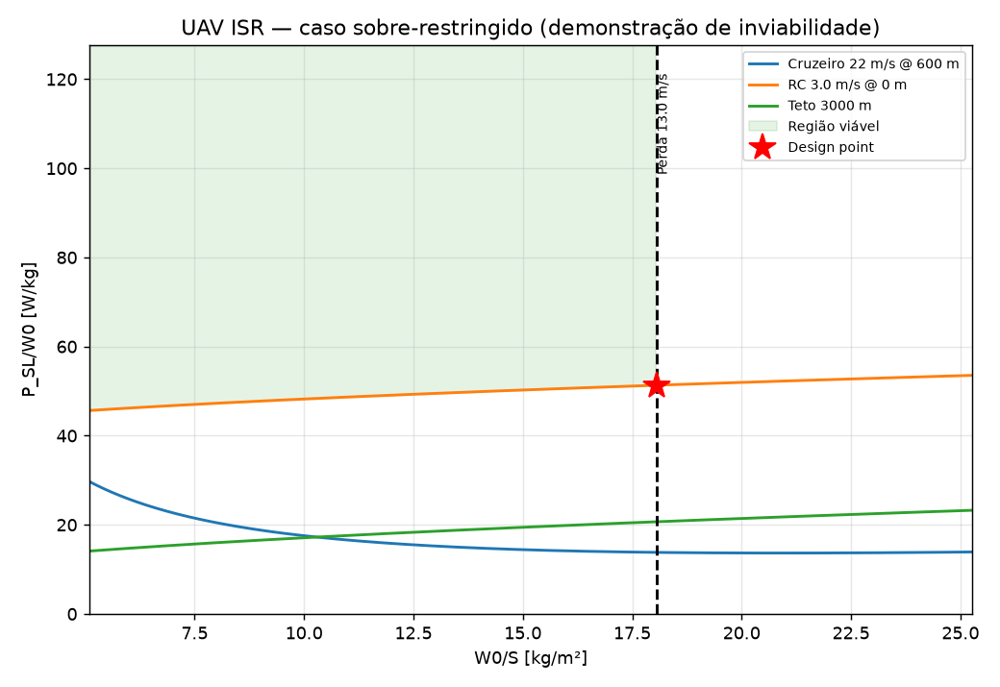

- **W0/S = 177.0 N/m² (18.05 kg/m²)**
- **P/W_SL = 51.32 W/kg** → P_SL = 1.69 kW
- Restrições ativas: RC 3.0 m/s @ 0 m, Perda 13.0 m/s
- Área alar S = 1.822 m²

## 4. Geometria de primeira iteração

| parâmetro | valor |
|---|---|
| S_m2 | 1.822 |
| AR | 14 |
| span_m | 5.05 |
| taper | 0.6 |
| c_root_m | 0.4509 |
| c_tip_m | 0.2706 |
| MAC_m | 0.3683 |
| y_MAC_m | 1.157 |
| sweep_c4_deg | 0 |
| sweep_LE_deg | 1.023 |
| t/c | 0.12 |

Fuselagem: L = 1.80 m, D = 0.220 m. Empenagem horizontal S = 0.339 m², vertical S = 0.279 m², braço = 0.99 m (coef. de volume, Raymer Eq. 6.28–6.29).

Caixão da asa (parametrizado na geometria, análise na Fase 2): longarinas a 20%/65% c, largura na raiz 0.203 m.

## 5. Aerodinâmica (Raymer Cap. 12 / DATCOM)

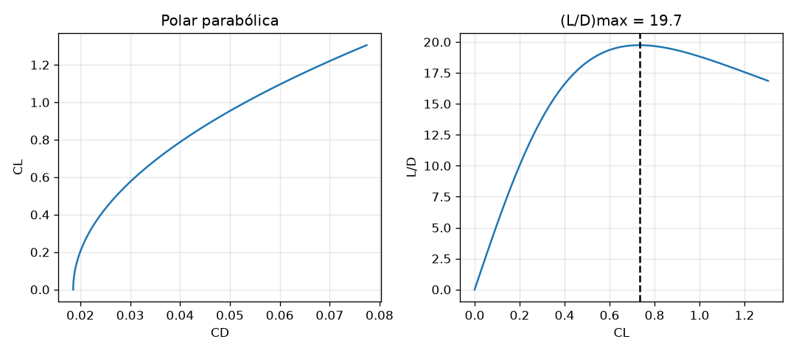

- CLα = 5.119 /rad (0.0893 /deg)
- CLmax limpo / descolagem / aterragem = 1.30 / 1.37 / 1.71
- CD0 = 0.01857, K = 0.0346 (e = 0.658), (L/D)max = 19.74 a CL = 0.73

Decomposição do CD0 (component build-up):

| component | Swet_m2 | Cf | FF | Q | CD0 |
|---|---|---|---|---|---|
| wing | 3.515 | 0.004081 | 1.033 | 1 | 0.008135 |
| htail | 0.6876 | 0.004296 | 0.9916 | 1.04 | 0.001672 |
| vtail | 0.5658 | 0.0039 | 0.9782 | 1.04 | 0.001232 |
| fuselage | 1.047 | 0.003471 | 1.13 | 1 | 0.002255 |

D/q adicional (trem, antenas, ...): 0.0080 m²; L&P: 5%

## 6. Verificações

- ➖ `regulatory_category` — easa_specific: no numeric limit
- ❌ `wing_span` — b = 5.05 m vs max 4.20 m
- ❌ `mtow` — W0 = 32.9 kg vs max 25.0 kg
- ✅ `static_margin` — SM no CG traseiro 10.0 % (alvo 10 %; dianteiro 10.0 %) — posicionamento da asa por bisseção
- ✅ `trim` — CLmax limpo (CG dianteiro): δe -8.9°; cruzeiro (CG dianteiro): δe -5.5°
- ✅ `hq:scissor` — S_h/S atual 0.186 vs mínimo 0.186 (estabilidade 0.186 no CG traseiro, controlo 0.020 a CLmax no CG dianteiro; dimensionante: estabilidade)
- ✅ `hq:short_period` — período curto ζ = 0.728 → Nível 1 (N1: 0.30–2.00; MIL-F-8785C Table IV, Classe I, Cat. B) — UAV: indicativo
- ❌ `hq:CAP` — CAP = ω²/(n/α) [1/(g s²)] = 8.72 → Nível 2 (N1: 0.085–3.6; MIL-F-8785C Figs. 1–3, Classe I, Cat. B) — UAV: indicativo
- ✅ `hq:phugoid` — fugóide ζ = 0.0583 → Nível 1 (N1: ≥ 0.04; MIL-F-8785C 3.2.1.2, Classe I, Cat. B) — UAV: indicativo
- ✅ `hq:dutch_roll` — rolamento holandês ζ / ζω / ω = 0.194 / 0.700 / 3.61 → Nível 1 (N1: 0.08 / 0.15 / 0.4; MIL-F-8785C Table VI, Classe I, Cat. B) — UAV: indicativo
- ✅ `hq:roll` — rolamento τ_R [s] = 0.0699 → Nível 1 (N1: ≤ 1.4; MIL-F-8785C Table VII, Classe I, Cat. B) — UAV: indicativo
- ➖ `hq:spiral` — espiral unassessed: declare assumptions.geometry.dihedral_deg (current TrapezoidalWing default Γ=3° is PRESSUPOSTO only; Clβ/spiral need an explicit dihedral — Etkin & Reid 1996 Ch. 6 / MIL-F-8785C Table VIII)
- ✅ `wb:envelope` — Todos os 3 carregamentos dentro dos limites conceptuais; extremos 0.798 m (vazio, 29 kg) e 0.798 m (payload, 33 kg).
- ✅ `aeroel:divergence` — divergência torsional V = 254.2 m/s EAS vs 32.1 (= 1.2 V_D); margem +693 %
- ✅ `aeroel:reversal` — inversão de aileron: não ocorre (V → ∞) vs 32.1 m/s EAS
- ✅ `aeroel:flutter` — flutter binário V = 115.9 m/s EAS vs 32.1 (= 1.2 V_D); margem +262 %
- ✅ `aeroel:aeer45` — AEER-45 / 23.629(d): F = 0.0017 vs F_max = 0.056 (balanceamento do aileron não avaliado)
- ✅ `perf:endurance` — tempo em espera (segmentos): 3.5 h vs requerido ≥ 3.5 (missão por segmentos — verificação, não altera a viabilidade do dimensionamento)
- ✅ `perf:service_ceiling` — teto de serviço (Anderson) > 9000 m (não atingido): 9000 m vs requerido ≥ 3000 (missão por segmentos — verificação, não altera a viabilidade do dimensionamento)
- ✅ `perf:climb_rate` — ROC máx. ao nível do mar: 3 m/s vs requerido ≥ 3 (missão por segmentos — verificação, não altera a viabilidade do dimensionamento)

## 8. Histórico do ciclo MDA (peso ↔ design point ↔ geometria ↔ arrasto)

| iter | W0 | We/W0 usado | We | Wf | E descolagem+subida [Wh] | n_lim (V-n) | asa Raymer [kg] | asa caixão [kg] | We_comp | We_comp/W0 | CD0 | W/S | P/W | L/D_max | aero |
|---|---|---|---|---|---|---|---|---|---|---|---|---|---|---|---|
| 1 | 16.96 | 0.3 | 5.087 | 7.869 | 76.01 | 5.128 | 2.808 | 2.579 | 9.359 | 0.552 | 0.02505 | 177 | 5.251 | 17 | manual |
| 2 | 27.53 | 0.34 | 9.359 | 14.17 | 118.5 | 4.927 | 5.542 | 4.231 | 13.03 | 0.4734 | 0.01989 | 177 | 5.404 | 19.07 | manual |
| 3 | 30.94 | 0.4212 | 13.03 | 13.91 | 132.6 | 4.874 | 6.288 | 4.776 | 14.06 | 0.4544 | 0.01899 | 177 | 5.268 | 19.52 | manual |
| 4 | 32.13 | 0.4376 | 14.06 | 14.07 | 137.5 | 4.857 | 6.556 | 4.965 | 14.43 | 0.4491 | 0.01873 | 177 | 5.245 | 19.66 | manual |
| 5 | 32.58 | 0.4428 | 14.43 | 14.16 | 139.3 | 4.85 | 6.661 | 5.038 | 14.57 | 0.4472 | 0.01863 | 177 | 5.238 | 19.71 | manual |
| 6 | 32.76 | 0.4448 | 14.57 | 14.19 | 140.1 | 4.848 | 6.702 | 5.066 | 14.63 | 0.4465 | 0.01859 | 177 | 5.235 | 19.73 | manual |
| 7 | 32.84 | 0.4455 | 14.63 | 14.21 | 140.4 | 4.847 | 6.719 | 5.078 | 14.65 | 0.4462 | 0.01858 | 177 | 5.234 | 19.73 | manual |
| 8 | 32.87 | 0.4458 | 14.65 | 14.21 | 140.5 | 4.846 | 6.726 | 5.082 | 14.66 | 0.4461 | 0.01857 | 177 | 5.234 | 19.74 | manual |
| 9 | 32.88 | 0.446 | 14.66 | 14.22 | 140.5 | 4.846 | 6.729 | 5.084 | 14.67 | 0.4461 | 0.01857 | 177 | 5.233 | 19.74 | manual |
| 10 | 32.88 | 0.446 | 14.67 | 14.22 | 140.6 | 4.846 | 6.73 | 5.085 | 14.67 | 0.4461 | 0.01857 | 177 | 5.233 | 19.74 | manual |
| 11 | 32.88 | 0.446 | 14.67 | 14.22 | 140.6 | 4.846 | 6.73 | 5.085 | 14.67 | 0.446 | 0.01857 | 177 | 5.233 | 19.74 | manual |
| 12 | 32.88 | 0.446 | 14.67 | 14.22 | 140.6 | 4.846 | 6.73 | 5.086 | 14.67 | 0.446 | 0.01857 | 177 | 5.233 | 19.74 | manual |
| 13 | 32.89 | 0.446 | 14.67 | 14.22 | 140.6 | 4.846 | 6.73 | 5.086 | 14.67 | 0.446 | 0.01857 | 177 | 5.233 | 19.74 | manual |

## 9. Sistemas e eletrónica (Fase 1E)

- **Hélice**: D = 0.560 m (22.0 in), rpm máx ≈ 4763, rpm cruzeiro ≈ 3367 (J = 0.7), Mach de ponta 0.41 — limited by geometric D_max (0.560 m). Passo a escolher com dados de hélice (UIUC Propeller Data Site / APC) para o J de cruzeiro.
- **Motor**: Kv alvo 195 rpm/V, P_eixo máx 1688 W, I máx 81.1 A @ 28.8 V → outrunner_63xx_170kv_class; **ESC** → esc_120a_12s_class
- **Bateria**: 8S6P de `liion_pouch_high_energy_class` (li_ion), 120.0 Ah, 29.6 V nom., 3552 Wh, massa 15.55 kg (228 Wh/kg pack), C pico 0.73 (OK), dimensionada por energy. Massa atribuída no sizing: 14.22 kg.

Servos (momentos de charneira a V_D):

| superfície | S_c m² | c_c m | H N·m | binário req. N·m | servo | n |
|---|---|---|---|---|---|---|
| aileron (each) | 0.06975 | 0.07891 | 0.7564 | 1.135 | servo_standard_20kgcm_class | 2 |
| elevator | 0.1186 | 0.104 | 1.695 | 2.543 | servo_hv_35kgcm_class | 1 |
| rudder | 0.09759 | 0.1565 | 2.099 | 3.148 | servo_hv_35kgcm_class | 1 |

- **Autopiloto**: `cubepilot_cube_orange_plus` (IMU×3, baro×2, CAN×2, massa≈0.075 kg) — https://docs.cubepilot.org/user-guides/autopilot/the-cube-module-overview
  - rejeitados: holybro_pixhawk_6c: IMU 2<3, baro 1<2; generic_f7_fc_class: IMU 1<3, baro 1<2, CAN 0<1

Power budget:

| load | bus | P_W | duty | P_avg_W | P_peak_W |
|---|---|---|---|---|---|
| autopilot cubepilot_cube_orange_plus | avionics | 2.5 | 1 | 2.5 | 2.5 |
| GNSS + compass (x2) | avionics | 1.5 | 1 | 1.5 | 1.5 |
| C2 datalink radio | avionics | 6 | 1 | 6 | 10 |
| payload EO/IR gimbal | payload | 15 | 1 | 15 | 30 |
| airspeed + ADS-B out | avionics | 2 | 1 | 2 | 2 |
| servo aileron (each) x2 | servo | 2 | 1 | 2 | 50.4 |
| servo elevator x1 | servo | 1 | 1 | 1 | 37.8 |
| servo rudder x1 | servo | 1 | 1 | 1 | 37.8 |

Média 31.0 W, pico 172.0 W; regulador aviónica ≥ 24.0 W, servos ≥ 189.0 W.

Cablagem de potência (secção por corrente e queda de tensão):

| fio | AWG | mm² | ΔV V | ΔV % | governado por |
|---|---|---|---|---|---|
| W1 | - | n/a | n/a | n/a | no gauge in table satisfies limits |
| W2 | - | n/a | n/a | n/a | no gauge in table satisfies limits |
| W3 | 22 | 0.3255 | 0.1177 | 2.353 | voltage drop |
| W4 | 22 | 0.3255 | 0.1177 | 2.353 | voltage drop |
| W5 | 10 | 5.261 | 0.1706 | 2.032 | voltage drop |
| W6 | 10 | 5.261 | 0.1706 | 2.032 | voltage drop |

Exportado: `harness.wireviz.yml` (WireViz), `harness.dot` (Graphviz), `netlist.csv`, `harness.net` (netlist KiCad, formato "E" — importar no Pcbnew).

Massas de sistemas selecionados:

| item | kg |
|---|---|
| motor(s) | 0.9 |
| ESC(s) | 0.23 |
| servo aileron (each) | 0.12 |
| servo elevator | 0.075 |
| servo rudder | 0.075 |
| autopilot cubepilot_cube_orange_plus | 0.075 |
| battery | 15.55 |

Fecho massa/energia sistemas → sizing:

| iter | W0 | We | systems_kg | battery_Wh_kg | pack_Wh_kg | systems_power_W | budget_W | battery_mass_alloc | battery_mass_sel |
|---|---|---|---|---|---|---|---|---|---|
| 1 | 35.64 | 14.39 | 1.58 | 200 | 228.4 | 30 | 31 | 17.25 | 15.55 |
| 2 | 33.01 | 14.75 | 1.475 | 228.4 | 228.4 | 31 | 31 | 14.26 | 15.55 |
| 3 | 32.89 | 14.67 | 1.475 | 228.4 | 228.4 | 31 | 31 | 14.22 | 15.55 |

### Checklist de normas (categoria: `easa_specific`, MTOW 32.9 kg, UAS, features: li_battery)

> Orientação de primeira análise. A base de certificação é acordada com a autoridade; confirmar sempre a edição em vigor de cada documento.

- [ ] **EU-2019/947-945** — Commission Implementing Reg. (EU) 2019/947 & Delegated Reg. (EU) 2019/945 — UAS operations & products (European Commission / EASA). <https://www.easa.europa.eu/en/domains/civil-drones>
  - [ ] operational category (open/specific/certified)
  - [ ] operator registration
  - [ ] remote ID
  - [ ] class marking
- [ ] **EASA-SORA-2.5** — SORA 2.5 — AMC1 to Art. 11 of Reg. (EU) 2019/947 (ED Decision 2025/018/R, Sept 2025) (EASA (based on JARUS SORA v2.5, 2024)). <https://www.easa.europa.eu/en/document-library/agency-decisions/ed-decision-2025018r>
  - [ ] ConOps
  - [ ] intrinsic ground risk class
  - [ ] air risk class
  - [ ] SAIL
  - [ ] operational safety objectives (OSO)
  - [ ] containment
- [ ] **EASA-SC-Light-UAS** — Special Condition Light-UAS Medium Risk (Issue 01, 2020) + FTB MoC SC Light-UAS (SAIL III and below) (EASA). <https://www.easa.europa.eu/en/special-condition-sc-light-uas-medium-risk>
  - [ ] design verification
  - [ ] flight test
  - [ ] system safety
  - [ ] C2 link
  - [ ] software/AEH assurance proportional to SAIL
- [ ] **ASTM-F3298-24** — ASTM F3298-24 Design and Construction of Lightweight UAS (fixed-wing) (ASTM F38.01). <https://www.astm.org/f3298-24.html>
  - [ ] structure
  - [ ] propulsion
  - [ ] systems
  - [ ] C2
  - [ ] launch & recovery
  - [ ] verification
- [ ] **ASTM-F3201** — ASTM F3201 Ensuring Dependability of Software Used in UAS (ASTM F38.01). <https://www.astm.org/f3201-26.html>
  - [ ] software development assurance proportional to risk
- [ ] **UN-38.3** — UN Manual of Tests and Criteria, Part III, Sub-section 38.3 — Lithium batteries (transport) (UNECE). <https://unece.org/transport/dangerous-goods>
  - [ ] altitude
  - [ ] thermal
  - [ ] vibration
  - [ ] shock
  - [ ] external short circuit
  - [ ] impact
  - [ ] overcharge tests; transport certification
- [ ] **SAE-AS50881** — SAE AS50881 Wiring, Aerospace Vehicle (SAE). <https://www.sae.org/standards/content/as50881/>
  - [ ] wire selection & derating
  - [ ] voltage drop
  - [ ] bundle routing
  - [ ] separation
  - [ ] protection
  - [ ] identification
- [ ] **IPC-WHMA-A-620** — IPC/WHMA-A-620 Requirements and Acceptance for Cable and Wire Harness Assemblies (IPC / WHMA). <https://www.ipc.org>
  - [ ] crimping
  - [ ] soldering
  - [ ] splices
  - [ ] connectors
  - [ ] workmanship classes 1–3 (use class 3 for flight-critical)
- [ ] **RTCA-DO-160G** — RTCA DO-160G Environmental Conditions and Test Procedures for Airborne Equipment (EUROCAE ED-14G) (RTCA / EUROCAE). <https://www.rtca.org>
  - [ ] temperature/altitude
  - [ ] vibration
  - [ ] EMC (Sect. 20/21)
  - [ ] lightning
  - [ ] power input (Sect. 16)
- [ ] **RTCA-DO-178C** — RTCA DO-178C / ED-12C Software Considerations in Airborne Systems (awareness; DAL per safety assessment) (RTCA / EUROCAE). <https://www.rtca.org>
  - [ ] software development assurance; SC Light-UAS / SORA high-SAIL may require equivalent evidence
- [ ] **RTCA-DO-254** — RTCA DO-254 / ED-80 Design Assurance for Airborne Electronic Hardware (awareness) (RTCA / EUROCAE). <https://www.rtca.org>
  - [ ] complex electronic hardware (FPGA/ASIC) assurance


### Comparação AVL / baixa fidelidade vs métodos de manual

| grandeza | manual | AVL / baixa fid. | método manual | nota |
|---|---|---|---|---|
| CLα asa [/rad] | 5.119 | 5.806 | DATCOM / Raymer Eq. 12.6 | AVL: avião completo (asa + cauda), sem fuselagem |
| CDi a CL = 0.633 | 0.01383 | 0.009617 | Oswald Raymer e = 0.658 | AVL e (Trefftz) = 0.946; Oswald inclui arrasto viscoso dependente de CL |
| x̄_NP [MAC] | 0.4676 | 0.4847 | Raymer Eq. 16.9 + Torenbeek (fuselagem) | sem fuselagem: 0.482 (AVL não modela a fuselagem) |
| CLδe [/rad] | 0.4173 | 0.5024 | Nelson Ch. 2/5 (τ: Raymer Fig. 16.7 / DATCOM) |  |
| Cmδe [/rad] | -1.122 | -1.212 | Nelson Ch. 2/5 (τ: Raymer Fig. 16.7 / DATCOM) | AVL: Cmδe no CG traseiro; Cnδr com convenção de sinal AVL |
| |Clδa| [/rad] | 0.3741 | 0.2859 | Nelson Ch. 2/5 (τ: Raymer Fig. 16.7 / DATCOM) |  |
| Cnδr [/rad] | -0.06125 | 0.06291 | Nelson Ch. 2/5 (τ: Raymer Fig. 16.7 / DATCOM) | AVL: Cmδe no CG traseiro; Cnδr com convenção de sinal AVL |

## 11. Estruturas: V-n, cargas na asa e caixão (Fase 2)

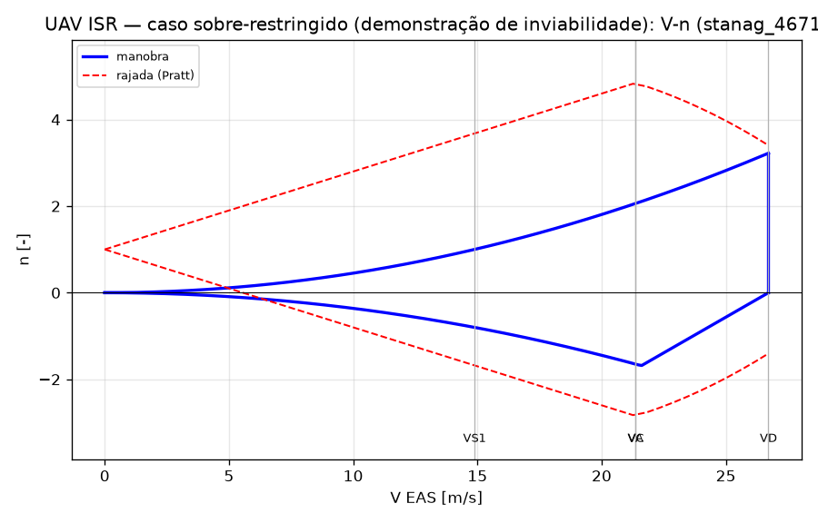

| grandeza | valor |
|---|---|
| regulation | stanag_4671 |
| category | utility |
| VS1_EAS_m_s | 14.88 |
| VA_EAS_m_s | 21.37 |
| VC_EAS_m_s | 21.37 |
| VD_EAS_m_s | 26.71 |
| n_manoeuvre_pos | 4.4 |
| n_manoeuvre_neg | -1.76 |
| n_gust_VC | 4.846 / -2.846 |
| n_gust_VD | 3.404 / -1.404 |
| mu_g | 16.57 |
| Kg | 0.6667 |
| n_limit_pos | 4.846 |
| n_limit_neg | -2.846 |
| governing | rajada |
| n_ultimate | 7.269 |

Cláusulas aplicadas: USAR.333 (envelope); USAR.335(a)(1) VC from operating requirements; USAR.335(b)(1) VD ≥ 1.25 VC; USAR.335(c) VA ≥ VS√n; USAR.337; USAR.341 / USAR.333(c); USAR.303 FS = 1.5

- ⚠️ n_lim = 4.85 está acima da linha de perda mesmo a VD (n = 3.22 com CLmax quase-estático): valor CONSERVATIVO mantido (a perda dinâmica numa rajada pode excedê-lo); VC baixo face a VS1 — rever VC/CLmax antes de dimensionar

Condição crítica de dimensionamento: n = 4.85 (rajada), q a VD = 26.7 m/s EAS.

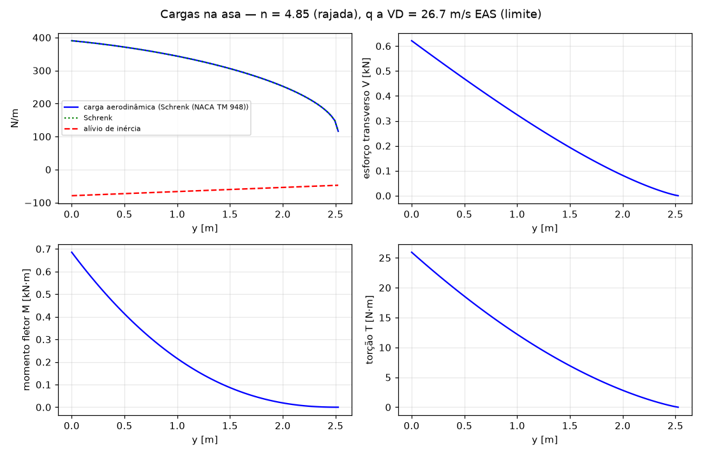

Raiz (limite): V = 621.3 N, M = 685.4 N·m, T = 25.9 N·m.

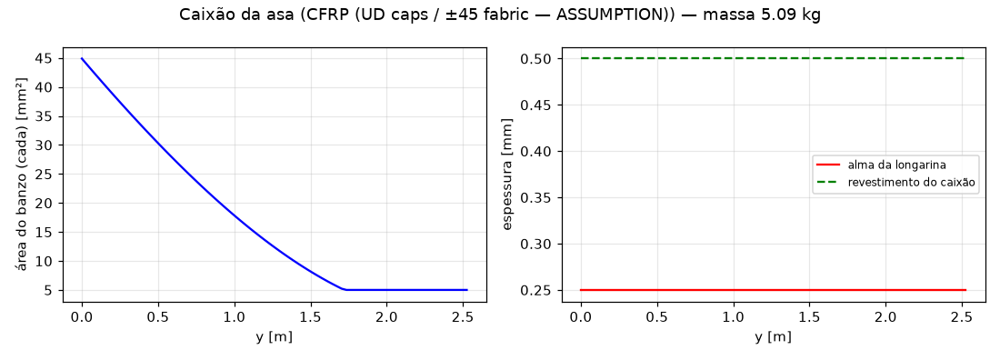

| parcela | massa [kg] |
|---|---|
| caps | 0.2636 |
| box_skins | 2.048 |
| core | 0.2707 |
| webs | 0.1333 |
| web_uprights | 0 |
| LE_TE_skins | 1.297 |
| ribs | 0.05581 |
| ideal | 4.068 |
| nonoptimum | 1.017 |
| total | 5.086 |

Cross-check da massa da asa:

| método | massa da asa [kg] |
|---|---|
| Raymer Eq. 15.46 (estatístico) | 6.73 |
| caixão Megson/Bruhn, carga Schrenk (CFRP (UD caps / ±45 fabric — ASSUMPTION)) | 5.086 |
| caixão Megson/Bruhn, carga AVL | 5.077 |

- Revestimentos em sanduíche: núcleo PVC/PMI foam (ASSUMPTION) ρ = 75 kg/m³, E_c = 70 MPa, G_c = 30 MPa (PRESSUPOSTO); núcleo na raiz 2.5 mm, máx. 2.5 mm; interação R_c + R_s² ≤ 1 (Bruhn C5)
- Enrugamento das faces σ_wr = 0.5 (E_f E_c G_c)^(1/3) = 251 MPa (Hoff & Mautner) → OK
- Almas: núcleo sanduíche onde τ > τ_cr (máx. 2.0 mm)
- allowables are ASSUMPTIONS (knock-down for environment/damage)
- 26 nervuras (passo 0.22 m)
- fator não-ótimo 1.25 (PRESSUPOSTO)
- superfícies de comando, flaps e carenagens NÃO incluídos (secundários)
- Eixo elástico = centro de corte da secção real (Megson, multicélula, com bordo de ataque D): x_sc/c raiz 0.339 (meio do caixão 0.425); EI/GJ da secção idealizada no contorno do perfil

### Viga L1: fuselagem, empenagens e torção elástica

Fuselagem 1.7 kg, Raymer Eq. 15.49 1.2 kg (razão 1.41). Estabilizador 0.4 kg, deriva 0.3 kg. CG estrutural 0.834714430631566 m (não move as estações Roskam do peso e centragem).
Deflexão da cauda no caso limite 0.2 mm; torção da deriva 0.026°.
Correção elástica de cruzeiro: aplicada = não; K_flex/K_rígido = 1.0008; torção de ponta 0.053°; CLα flexível 5.200 /rad. O CLα de manual do resultado mantém-se.
- Fuselagem: casca circular não reforçada, γ de NASA SP-8007 (1968) na encurvadura clássica 0,605 E t/R (Timoshenko & Gere, ν = 0,3). Longarinas só com área mínima (o momento já está no revestimento).
- Piso 0.45 L × 0.75 D, duas anteparas π R² à espessura mínima (Torenbeek 1982 App. D lista estes itens; a espessura é a mínima do material — PRESSUPOSTO). Fator não-ótimo 1.25 só em revestimento + longarinas + cavernas.
- Envelope de manobra: sustentação atingível do estabilizador a VA (Raymer 12.15), equilíbrio + 23.423(b), inércia do motor e aterragem (23.473). 23.427 (rajada) e 23.441 (leme) não estão modelados. Torção assimétrica do estabilizador omitida.
- Estação da asa neste fecho: x = 0.75 m (centro aerodinâmico: ápice colocado pela estabilidade + quarto da corda média).
- γ de SP-8007 é uma correlação de cilindros de alumínio. Em CFRP entra como PRESSUPOSTO conservativo, não como ensaio do laminado.
- Empenagens: caixão de duas longarinas (Megson), carga em envergadura uniforme — PRESSUPOSTO, M_raiz = L b/8 por semienvergadura, mais pesado em flexão do que uma elipse. c_lmax de secção 1 (estabilizador) e 0.8 (deriva), não o da asa; CLmax pela Eq. 12.15 de Raymer.
- k_EI e k_GJ multiplicam EI e GJ da asa (razão viga/BoxFEM). A fuselagem não os usa.
- Massa da fuselagem L1 / Raymer Eq. 15.49 = 1.41. A regressão de Raymer inclui portas, janelas e suportes que esta casca não tem.

## 12. Estabilidade e controlo (Fase 2: Raymer Cap. 16, Etkin & Reid, Nelson)

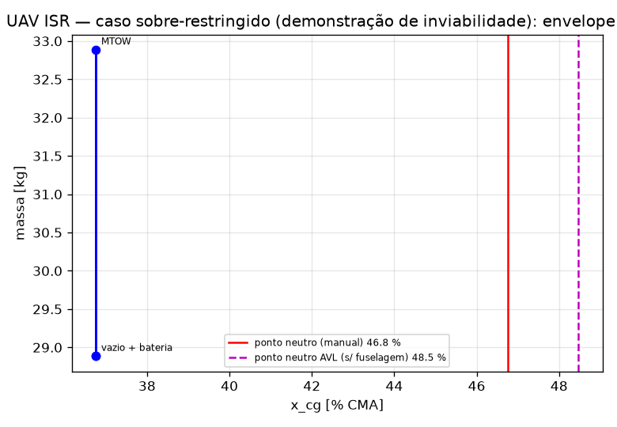

- asa posicionada para SM = 10% no CG mais recuado (ápice a 35.7% L); ápice da asa a x = 0.642 m
- Ponto neutro x̄_NP = 0.468 MAC (manual), 0.485 (AVL); dε/dα = 0.233
- **Margem estática: 10.0 % (CG dianteiro) … 10.0 % (CG traseiro)**
- AVL, cruzeiro compensado no CG traseiro: α = 2.79°, δe = -2.34°, Cnβ = 0.0693, Clβ = -0.0812, Cmq = -10.11
- Coef. de volume: V_h = 0.500, V_v = 0.0300 (Raymer Table 6.4: - / -)

| caso | massa [kg] | x_cg [m] | x̄_cg [MAC] | SM |
|---|---|---|---|---|
| vazio + bateria | 28.89 | 0.7978 | 0.3676 | 0.1 |
| MTOW | 32.89 | 0.7978 | 0.3676 | 0.1 |

Compensação (trim) no CG dianteiro:

| condição | CL | δe [°] | ok (|δe| ≤ máx.) |
|---|---|---|---|
| CLmax limpo (CG dianteiro) | 1.305 | -8.9 | True |
| cruzeiro (CG dianteiro) | 0.6327 | -5.466 | True |

- Bordo de fuga da empenagem a 1.97 m > comprimento da fuselagem 1.80 m (braço de cauda fixo) — reduzir tail_arm_fraction ou usar boom de cauda.
- Clδa comparado em módulo (convenções de sinal do aileron diferem entre AVL e Nelson).
- Estações de estrutura: PRESSUPOSTOS (Roskam Part V Table 8.1, valores típicos). Tripulação, carga e bateria, se a missão não as der, ficam no CG da massa fixa (Raymer 2018 Sec. 15.1: a estação que não desloca o balanço). Um UAV sem massa de tripulação não leva tripulação. O combustível de asa fica a 30 % da CMA. Substituir em assumptions.stability.stations.

## 12a. Peso e centragem operacional e trem de aterragem

Peso e centragem (Raymer 2018 Sec. 15.1; Roskam Parte II Cap. 10). Os limites, quando não são dados no ficheiro, são os conceptuais: margem estática alvo atrás e, à frente, o mais à ré entre o trim no CLmax limpo e o flare com flaps.

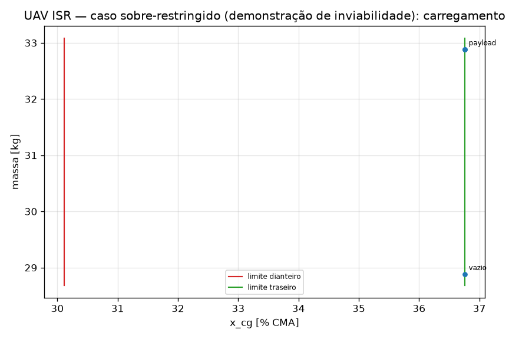

Todos os 3 carregamentos dentro dos limites conceptuais; extremos 0.798 m (vazio, 29 kg) e 0.798 m (payload, 33 kg).

| carregamento | massa [kg] | x_cg [m] | x̄ [% CMA] |
|---|---|---|---|
| vazio | 28.89 | 0.7978 | 36.76 |
| payload | 32.89 | 0.7978 | 36.76 |
| payload | 32.89 | 0.7978 | 36.76 |

Limites a W0: dianteiro 0.7733003981243662 m, traseiro 0.7977655166100739 m.

- Limite dianteiro conceptual: dimensiona «flare com flaps» a 0.773 m. Casos: limpo a 0.709 m (CL 1.30, Cm0 -0.0438), flare com flaps a 0.773 m (CL 1.71, Cm0 -0.2138). Nelson 1998 Cap. 2, |δe| = 25°. Cm0 da asa = -0.0438 (Raymer Eq. 16.13, cm0 = −0.05 (PRESSUPOSTO, o mesmo da estabilidade)) Cm0 da fuselagem não entra (sem α0 do perfil) ΔCm do flap = -0.1700 entra no flare (Glauert 1926, b_C·δ·S_f/S; δ = 30° (PRESSUPOSTO, omissão de flightsim/controls.py — substituir em assumptions.aero.flap.landing_deg); c_f/c = 0.25 (PRESSUPOSTO, omissão de flightsim/controls.py — substituir em assumptions.aero.flap.cf_c); S_f/S = 0.500; corda da parte com flap igual à CMA, PRESSUPOSTO). Efeito de solo no flare: CLα da cauda × 1.018 (φ = 0.944 = 1 − exp[−2.48 (2h/b)^0.768], Torenbeek 1982, citado por Phillips e Hunsaker, Journal of Aircraft, Vol. 50, No. 4, 2013, Eq. (4); h/b = 0.610, h = 0.710 m, trem + 0.5 D, omissão 0.60 m (PRESSUPOSTO, weights_detailed.DEFAULT_MAIN_GEAR_LENGTH_M); PRESSUPOSTO: o centro aerodinâmico da cauda está à altura do eixo da fuselagem). 1/CLα = 1/a0 + φ/(π AR), a0 = 0.95·2π, e = 1 (PRESSUPOSTO). O quociente multiplica o CLα livre e não substitui o declive de Helmbold. O CLmax não aumenta e o dε/dα do ponto neutro não é reduzido: essa redução é a penalização de rotação, não um alívio do flare. Na tesoura, φ repete-se em cada S_h/S porque a envergadura muda com a área. O flare fica em efeito de solo só neste declive. O fator de Hoerner e Borst não é usado como CLα.
- Limite traseiro conceptual: ponto neutro menos a margem estática alvo (Raymer Cap. 16).
- Estações de CG: as da estabilidade. Estrutura: Roskam Parte V, Tabela 8.1 (PRESSUPOSTO). Tripulação, carga e bateria, se a missão não as der, ficam no CG da massa fixa (Raymer 2018 Sec. 15.1); combustível de asa a 30 % da CMA. Substituir em assumptions.stability.stations, weight_balance.loading ou extra_items. O combustível arde na estação do tanque; não há combustível inutilizável separado.
- A tripulação, quando existe, vai em todos os carregamentos.

**Trem (none).** sem trem

sem trem; 14 CFR 23.473 não aplicado

- Sem trem de aterragem (landing_gear: none) — lançamento e recuperação ficam por analisar.

## 13. Desempenho por segmentos (Fase 2: Raymer Cap. 17, Anderson)

Orçamento utilizável: E_nom 3247 Wh × DoD 0.85 / (1 + reserva 0.2).

Missão requerida (segmentos):

| segmento | t [min] | dist [km] | consumo [Wh] | h [m] | V [m/s] | nota |
|---|---|---|---|---|---|---|
| descolagem | 1 | 0 | 24.95 | 0→0 | 0 | 1 min potência de descolagem (PRESSUPOSTO) |
| subida (V_y) | 3.347 | 3.584 | 115.6 | 0→600 | 18.1 | potência de subida, integrado (V médio) |
| espera (loiter) | 210 | 277.2 | 2159 | 600→600 | 22 |  |
| descida (L/D máx, ralenti) + aterragem | 9.8 | 11.84 | 0 | 600→0 | 20.14 | planado, energia ≈ 0 |

Missão até esgotar o orçamento: **alcance 292.6 km, endurance 3.74 h**.

| segmento | t [min] | dist [km] | consumo [Wh] | h [m] | V [m/s] | nota |
|---|---|---|---|---|---|---|
| descolagem | 1 | 0 | 24.95 | 0→0 | 0 | 1 min potência de descolagem (PRESSUPOSTO) |
| subida (V_y) | 3.347 | 3.584 | 115.6 | 0→600 | 18.1 | potência de subida, integrado (V médio) |
| espera (loiter) | 210 | 277.2 | 2159 | 600→600 | 22 | estendido até esgotar o orçamento |
| descida (L/D máx, ralenti) + aterragem | 9.8 | 11.84 | 0 | 600→0 | 20.14 | planado, energia ≈ 0 |

Requisitos vs desempenho por segmentos:

| requisito | grandeza | obtido | requerido | unidade | ok |
|---|---|---|---|---|---|
| endurance | tempo em espera (segmentos) | 3.5 | 3.5 | h | ✅ |
| service_ceiling | teto de serviço (Anderson) > 9000 m (não atingido) | 9000 | 3000 | m | ✅ |
| climb_rate | ROC máx. ao nível do mar | 3 | 3 | m/s | ✅ |

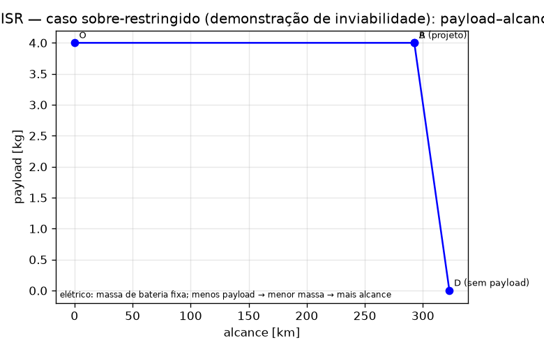

| ponto | payload_kg | massa_kg | range_km | endurance_h |
|---|---|---|---|---|
| O | 4 | 32.89 | 0 | 0 |
| A | 4 | 32.89 | 292.6 | 3.736 |
| B (projeto) | 4 | 32.89 | 292.6 | 3.736 |
| D (sem payload) | 0 | 28.89 | 322.8 | 4.129 |

Nota: elétrico: massa de bateria fixa; menos payload → menor massa → mais alcance.

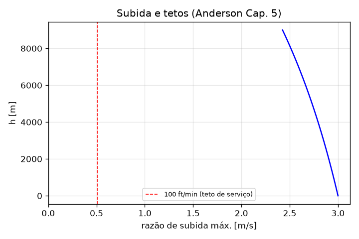

- ROC máx. ao nível do mar 3.00 m/s; teto de serviço > 9000 m; teto absoluto > 9000 m
- Descolagem (Raymer 17.8): corrida 62 m, total sobre 15 m 209 m (V_TO 16.0 m/s)
- Aterragem (Raymer 17.9): corrida 79 m, total sobre 15 m 373 m (μ_travagem 0.4; aproximação γ = 3° — `performance.approach_angle_deg`, por omissão o máximo de 5.2 % / 3° de CS/14 CFR 23.75(a)(1))

- Os resultados de segmentos usam a mesma polar e reservas do dimensionamento; diferenças face aos requisitos vêm da subida/descida integradas vs. frações históricas (Raymer Table 3.2).

## 14. Caixão da asa dimensionado à estabilidade (Fase 3: Bruhn C5/C7/C11, Farrar, Kuhn)

| caixão | massa [kg] | / Raymer 15.46 |
|---|---|---|
| resistência (Fase 2, limite inferior) | 4.747 | 0.7053 |
| encurvadura (Fase 3, CFRP (UD caps / ±45 fabric — ASSUMPTION)) | 5.086 | 0.7556 |
| Raymer Eq. 15.46 (asa completa, estatístico) | 6.73 | 1 |

Parcelas (caixão de encurvadura):

| parcela | massa [kg] |
|---|---|
| caps | 0.2636 |
| box_skins | 2.048 |
| core | 0.2707 |
| webs | 0.1333 |
| web_uprights | 0 |
| LE_TE_skins | 1.297 |
| ribs | 0.05581 |
| ideal | 4.068 |
| nonoptimum | 1.017 |
| total | 5.086 |

- Almas Kuhn: fator de tração diagonal k máx. 0.000 (k = 0: alma resistente ao corte, sem tração diagonal)
- Revestimentos em sanduíche: núcleo PVC/PMI foam (ASSUMPTION) ρ = 75 kg/m³, E_c = 70 MPa, G_c = 30 MPa (PRESSUPOSTO); núcleo na raiz 2.5 mm, máx. 2.5 mm; interação R_c + R_s² ≤ 1 (Bruhn C5)
- Enrugamento das faces σ_wr = 0.5 (E_f E_c G_c)^(1/3) = 251 MPa (Hoff & Mautner) → OK
- Almas: núcleo sanduíche onde τ > τ_cr (máx. 2.0 mm)
- allowables are ASSUMPTIONS (knock-down for environment/damage)
- 26 nervuras (passo 0.22 m)
- fator não-ótimo 1.25 (PRESSUPOSTO)
- superfícies de comando, flaps e carenagens NÃO incluídos (secundários)
- Eixo elástico = centro de corte da secção real (Megson, multicélula, com bordo de ataque D): x_sc/c raiz 0.339 (meio do caixão 0.425); EI/GJ da secção idealizada no contorno do perfil

## 15. Aeroelasticidade clássica (Fase 3)

V_D = 26.7 m/s EAS.

| fenómeno | V [m/s EAS] | requerido 1.2 V_D | margem | ok | método |
|---|---|---|---|---|---|
| divergência torsional | 254.2 | 32.06 | +693 % | ✅ | W&C 8.3 / Bisplinghoff 8-2 (faixas + FE) |
| inversão do aileron | n/a | 32.06 | sem ocorrência | ✅ | W&C 8.4, Glauert (flap 2D) |
| flutter binário (flexão–torção) | 115.9 | 32.06 | +262 % | ✅ | W&C 11 (modos assumidos, quase-estacionário) |

- Frequências desacopladas: flexão 8.64 Hz, torção 65.5 Hz; flutter a 52.3 Hz
- AEER-45 (fator de flexibilidade torsional da asa): F = 1.697e-03 vs F_max = 200/V_D² = 5.601e-02 → OK

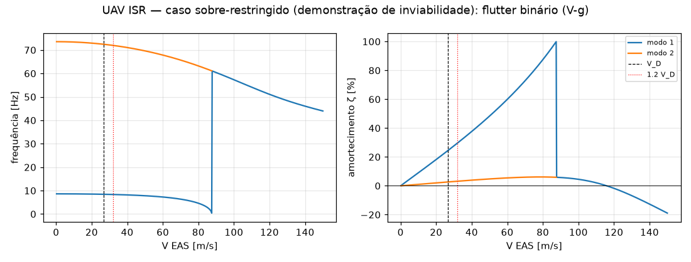

### Acoplamento aero-estrutural estático (OpenAeroStruct, VLM + caixão)

| ponto | modelo | α [°] | CL | CDi | CLα [/rad] | flecha ponta [m] | torção ponta [°] |
|---|---|---|---|---|---|---|---|
| cruise | rígido | 6.778 | 0.6327 | 0.008947 | 5.325 | 2.19e-06 | 7.522e-06 |
| cruise | flexível | 6.734 | 0.6327 | 0.008956 | 5.363 | 0.02195 | 0.07538 |
| manobra (n_lim, V_D EAS, nível do mar) | rígido | 21.44 | 1.962 | 0.08562 | 5.016 | 1.009e-05 | 3.451e-05 |
| manobra (n_lim, V_D EAS, nível do mar) | flexível | 21.14 | 1.962 | 0.08596 | 5.128 | 0.1014 | 0.3466 |

- Efeito da forma deformada no arrasto induzido de cruzeiro: K_flex/K = 1.0009
- Missão por segmentos: rígido 292.6 km / 3.736 h → flexível 292.4 km / 3.733 h (comparação com o resultado desacoplado da Fase 2)
- ponto de manobra: CL = 1.96 > CLmax limpo 1.30 (n_lim de rajada acima da linha de perda) — caso de carga válido para a deformação (VLM linear), α não físico
- OpenAeroStruct VLM (sem viscoso/onda: só arrasto induzido) + FEM de caixão 'wingbox' acoplados por NLBGS; rígido = E, G × 10⁴
- secção do caixão: NACA-4 entre longarinas; espessuras de alma/revestimento do caixão acdt (5 pontos de controlo); revestimento único equivalente que reproduz EI(y) do caixão acdt e G ajustado para GJ (PRESSUPOSTO)
- sem alívio de peso estrutural nem de combustível na asa (conservativo para a deformação)
- índice de falha OAS (von Mises/KS, σ_adm = σ_cap/1.5) na manobra: -0.284 (< 0 = OK) — critério de resistência do OAS sobre o revestimento equivalente — INDICATIVO (o dimensionamento é o do caixão acdt)
- massa da asa 6.73 kg distribuída ∝ corda; CG da secção a 0.50 c; eixo elástico a 0.340 c (centro de corte da secção, média), e = 0.090 c atrás do c.a.; a_w = 6.283/rad (2D, teoria das faixas — sem correção 3D/compressibilidade)
- encastramento na parede da fuselagem y0 = 0.110 m; EI/GJ do caixão buckling
- requisito: livre de flutter/divergência/inversão até 1.2 V_D = 32.1 m/s EAS (14 CFR 23.629(c) legado; CS/14 CFR 23.2245 'suficientemente além'; STANAG 4671 USAR.629 — verificar)
- flutter: modelo binário de modos assumidos (W&C Cap. 11), aerodinâmica quase-estacionária — ESTIMATIVA; a análise racional exige modos FEM + DLM (Fase 4)
- UAV (STANAG 4671): AEER-45 é um critério FAA para aviação geral — informativo

## 16. Diagrama de tesoura, modos dinâmicos e qualidades de voo (Fase 3)

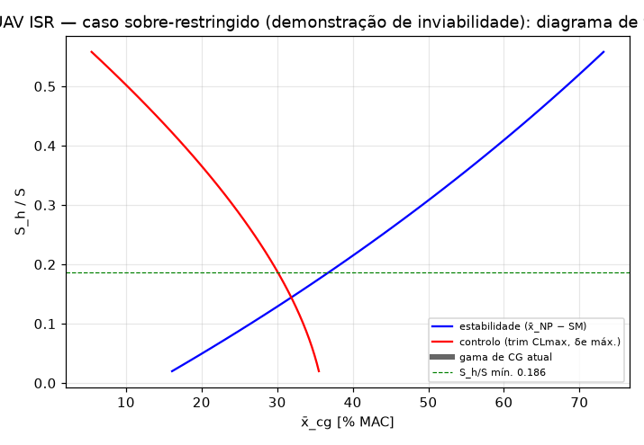

- S_h/S atual 0.186; requerido 0.186 (estabilidade 0.186, controlo 0.02; dimensionante: estabilidade) → ✅ (Torenbeek Cap. 9)
- linha de controlo: o x̄ mais à ré entre o CLmax limpo 1.30 (Cm0 asa -0.0438) e o flare com flaps (CLmax aterragem 1.71, Cm0 -0.2138), δe = −25°, τ_e = 0.661. Cm0 da asa = -0.0438 (Raymer Eq. 16.13, cm0 = −0.05 (PRESSUPOSTO, o mesmo da estabilidade)) Cm0 da fuselagem não entra (sem α0 do perfil) ΔCm do flap = -0.1700 entra no flare (Glauert 1926, b_C·δ·S_f/S; δ = 30° (PRESSUPOSTO, omissão de flightsim/controls.py — substituir em assumptions.aero.flap.landing_deg); c_f/c = 0.25 (PRESSUPOSTO, omissão de flightsim/controls.py — substituir em assumptions.aero.flap.cf_c); S_f/S = 0.500; corda da parte com flap igual à CMA, PRESSUPOSTO). Efeito de solo no flare: CLα da cauda × 1.018 (φ = 0.944 = 1 − exp[−2.48 (2h/b)^0.768], Torenbeek 1982, citado por Phillips e Hunsaker, Journal of Aircraft, Vol. 50, No. 4, 2013, Eq. (4); h/b = 0.610, h = 0.710 m, trem + 0.5 D, omissão 0.60 m (PRESSUPOSTO, weights_detailed.DEFAULT_MAIN_GEAR_LENGTH_M); PRESSUPOSTO: o centro aerodinâmico da cauda está à altura do eixo da fuselagem). 1/CLα = 1/a0 + φ/(π AR), a0 = 0.95·2π, e = 1 (PRESSUPOSTO). O quociente multiplica o CLα livre e não substitui o declive de Helmbold. O CLmax não aumenta e o dε/dα do ponto neutro não é reduzido: essa redução é a penalização de rotação, não um alívio do flare. Na tesoura, φ repete-se em cada S_h/S porque a envergadura muda com a área. O flare fica em efeito de solo só neste declive. O fator de Hoerner e Borst não é usado como CLα.
- massa da cauda não realimentada (posição da asa e braço fixos)
- gama de CG: a mesma do trim (extremos dos casos de carregamento)

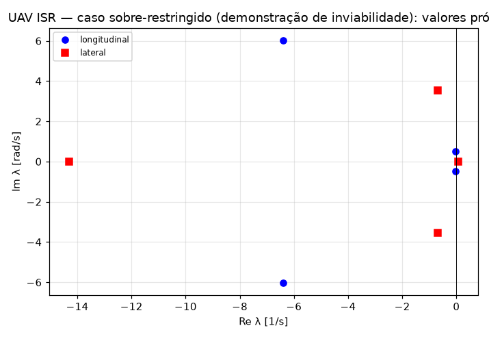

| modo | ωn [rad/s] | ζ | período [s] | τ / T [s] |
|---|---|---|---|---|
| período curto | 8.787 | 0.7276 | 1.042 | - |
| fugóide | 0.498 | 0.05834 | 12.64 | - |
| rolamento holandês | 3.605 | 0.1941 | 1.776 | - |
| rolamento (constante de tempo) | - | - | - | 0.06986 |
| espiral instável | - | - | - | 10.21 |

- n/α = 8.86 g/rad, CAP = 8.72 1/(g s²)
- Inércias (Roskam V, soma por componentes): Ixx 12.6, Iyy 2.18, Izz 14.7 kg·m²
- derivadas de taxa e laterais: AVL (sem fuselagem) + Cnβ da fuselagem (Raymer 16.47) -0.0081
- Cmα = −CLα·SM no CG de MTOW (ponto neutro de manual com fuselagem)
- inércias por soma de componentes (Roskam Parte V) — PRESSUPOSTOS de estações

Qualidades de voo — MIL-F-8785C, Classe I, categoria B (nível exigido 1):

| modo | valor | nível | limite N1 | ref |
|---|---|---|---|---|
| período curto ζ | 0.7276 | 1 | 0.30–2.00 | MIL-F-8785C Table IV |
| CAP = ω²/(n/α) [1/(g s²)] | 8.718 | 2 | 0.085–3.6 | MIL-F-8785C Figs. 1–3 |
| fugóide ζ | 0.05834 | 1 | ≥ 0.04 | MIL-F-8785C 3.2.1.2 |
| rolamento holandês ζ / ζω / ω | 0.194 / 0.700 / 3.61 | 1 | 0.08 / 0.15 / 0.4 | MIL-F-8785C Table VI |
| rolamento τ_R [s] | 0.06986 | 1 | ≤ 1.4 | MIL-F-8785C Table VII |
| espiral T2 [s] (∞ = estável) | 10.21 | 2 | ≥ 20 | MIL-F-8785C Table VIII |


## Pressupostos usados

```yaml
weights:
  method: components
  initial_class: uav_small
  fixed_fraction: null
  A: null
  C: null
  tech_factor: 1.0
  Kvs: 1.0
  fixed_mass_kg: 0.0
  components:
    material: composite
    structural_category: utility
    landing_gear: none
    min_areal_density_kg_m2: 0.9
    propeller_mass_kg: 0.08
    items:
    - name: paraquedas de recuperação + ejetor
      mass_kg: 1.0
    - name: suporte/amortecimento do gimbal
      mass_kg: 0.3
    - name: datalink C2 + antenas
      mass_kg: 0.25
      group: equipment
    - name: GNSS + bússola (x2)
      mass_kg: 0.1
      group: equipment
    - name: pitot/ADS-B
      mass_kg: 0.1
      group: equipment
    - name: cablagem de sinal + conectores
      mass_kg: 0.3
      group: equipment
    - name: ferragens/fixações/pintura
      mass_kg: 0.4
    growth_allowance: 0.1
aero:
  AR: 14
  taper: 0.6
  sweep_c4_deg: 0.0
  tc_root: 0.13
  tc_tip: 0.11
  xc_max_t: 0.3
  airfoil: NACA 4412
  clmax_airfoil: 1.45
  flap:
    kind: plain
    flapped_area_ratio: 0.5
  oswald: null
  cfe: 0.0055
  swet_sref: 3.5
  laminar:
    wing: 0.3
    htail: 0.3
    vtail: 0.3
    fuselage: 0.1
  roughness: smooth_molded_composite
  Q: {}
  lp_fraction: 0.05
  extra_drag_areas_m2:
    gimbal_eo_ir: 0.006
    antennas_pitot: 0.002
  CL_ground: 0.5
  dCD0_takeoff: 0.01
  mu_roll: 0.04
  fidelity: handbook
  airfoil_solver: xfoil
propulsion:
  eta_cruise: 0.8
  eta_climb: 0.75
  eta_takeoff: 0.55
  bsfc_lb_hp_h: null
  tsfc_1_h: 0.5
  battery_Wh_kg: 228.39506172839506
  eta_total: 0.62
  dod: 0.85
  energy_reserve: 0.2
  systems_power_W: 31.0
  n_engines: 1
  propeller: null
geometry:
  fuselage_length_m: 1.8
  fuselage_diameter_m: 0.22
  fuselage_fineness: 7.0
  fuselage_class: null
  tail_class: null
  c_ht: 0.5
  c_vt: 0.03
  tail_arm_fraction: 0.55
  ar_h: 4.0
  ar_v: 1.5
  dihedral_deg: null
  configuration: conventional
  tail_dihedral_deg: null
  boom_span_fraction: 0.35
  pod_length_fraction: 0.55
  boom_width_m: null
  taper_v: 0.5
constraints:
  cruise_weight_fraction: 1.0
  landing_weight_fraction: 1.0
  approach_distance_ft: 600.0
  margin: 0.0
  ws_initial_psf: 6
  ws_min: 50.0
  ws_max: 3000.0
  default_cruise_altitude_m: 0.0
  ws_fixed: null
  value_fixed: null
mda:
  max_iter: 30
  tol: 1.0e-05
  tol_lowfi: 0.0002
structures:
  regulation: auto
  load_factor_from_vn: true
  material: auto
  nonoptimum_factor: 1.25
  VH_eas_m_s: null
  elastic_axis: section
  le_cell: true
  flex: false
  mass_in_loop: false
  wingbox:
    hold_section: false
stability:
  target_static_margin: 0.1
  wing_apex_x_fraction: null
  stations: {}
  inertia_method: components
  roskam_reference: null
  radii_of_gyration: null
  elevator_max_deg: 25.0
  use_avl: true
  dynamics: true
  hq_category: B
  hq_required_level: 1
performance:
  fuel_capacity_kg: null
  max_payload_kg: null
  mu_brake: 0.4
  approach_angle_deg: 3.0
aeroelasticity:
  enabled: true
  a_w: 6.283185307179586
  x_cg_chord: null
  margin_factor: 1.2
  static_aerostructural: true
mdo:
  objective: null
  solver: nlbgs
  trust_region_iterations: 8
  trust_region_radius: 0.3
  design_vars:
  - ws
  - AR
  AR_bounds:
  - 5.0
  - 16.0
  ws_bounds_factor:
  - 0.6
  - 1.4
  pw_bounds_factor:
  - 0.6
  - 1.6
  maxiter: 60
  tol: 1.0e-06
  hq_aeroel_constraints: false
  hq_aeroel_keys: null
cost: {}
calibration:
  file: null
  apply: []
  factors: {}
weight_balance:
  crew_optional: false
  extra_items: []
  x_forward_m: null
  x_aft_m: null
  forward_limit: null
  aft_limit: null
  lemac_arm_in: null
  mac_in: null
landing_gear:
  h_cg_m: null
  tipback_deg: 15.0
  overturn_max_deg: 63.0
  nose_fraction_min: 0.08
  nose_fraction_max: 0.15
  wing_lift_fraction: 0.6666666666666666
  absorber: oleo
  eta: null
  stroke_m: null
  tire_stroke_m: 0.0
  max_stroke_m: null
  rotation_min_deg: 10.0
  x_nose_m: null
  x_main_m: null
  x_tail_m: null
  track_m: null
  x_nose_min_m: 0.0
  x_main_max_m: null
launch_recovery: null
```

## Referências

- Raymer, D. P., *Aircraft Design: A Conceptual Approach*, 6th ed., AIAA, 2018 (equation numbers as in the 6th ed.).
- Roskam, J., *Airplane Design*, Parts I–VIII, DARcorporation.
- Gudmundsson, S., *General Aviation Aircraft Design: Applied Methods and Procedures*, Elsevier, 2014.
- Anderson, J. D., *Aircraft Performance and Design*, McGraw-Hill, 1999.
- Torenbeek, E., *Synthesis of Subsonic Airplane Design*, Delft Univ. Press, 1982.
- USAF Stability and Control DATCOM, 1978.
- Hepperle, M., "Electric Flight – Potential and Limitations", NATO STO-MP-AVT-209, 2012.
- Niu, M. C. Y., *Airframe Structural Design*, Conmilit, 1988.
- Drela, M., "First-Order DC Electric Motor Model", MIT, 2007.
- ISO 2533:1975 Standard Atmosphere.
- Nicolai, L. M., Carichner, G. E., *Fundamentals of Aircraft and Airship Design*, Vol. I, AIAA, 2010 (Table 5.1, We = A·W0^B incl. UAV classes).
- EASA CS-23 (Amdt. 4 and earlier) / 14 CFR 23.337 (pre-Amdt. 23-64): limit manoeuvring load factors.
- IEC 60028:1925, International standard of resistance for copper (ρCu = 8890 kg/m³).
- FAA Type Certificate Data Sheet 1E10 (Lycoming O-360/IO-360 series) — engine dry mass in the C172 check.
- Drela, M., "XFOIL: An Analysis and Design System for Low Reynolds Number Airfoils", 1989; XFOIL 6.99 (GPL).
- Drela, M., Youngren, H., AVL 3.40 (Athena Vortex Lattice), MIT, 2022 (GPL).
- Sharpe, P., NeuralFoil, MIT, 2024 (fallback section polars).
- Schrenk, O., "A Simple Approximation Method for Obtaining the Spanwise Lift Distribution", NACA TM 948, 1940.
- Megson, T. H. G., *Aircraft Structures for Engineering Students*, 5th ed., 2013 (Ch. 16, 19–23).
- Bruhn, E. F., *Analysis and Design of Flight Vehicle Structures*, 1973 (Ch. A3, C5, C11).
- Etkin, B., Reid, L. D., *Dynamics of Flight: Stability and Control*, 3rd ed., Wiley, 1996.
- Nelson, R. C., *Flight Stability and Automatic Control*, 2nd ed., McGraw-Hill, 1998.
- Kroo, I., *Aircraft Design: Synthesis and Analysis*, Stanford (lift-dependent drag, fuselage span-efficiency factor).
- EASA CS-23 Amdt. 4 / 14 CFR 23.333–23.341 (flight envelope, design speeds, gust loads); 14 CFR/CS 23.65 (climb speed).
- NATO STANAG 4671 Ed. 1 (USAR), 2009: USAR.303, .333, .335, .337, .341.
- Abbott, I. H., von Doenhoff, A. E., *Theory of Wing Sections*, Dover, 1959.
